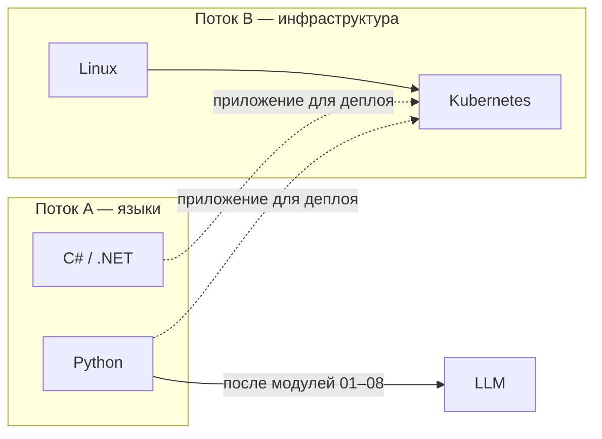

# План проекта

## Цель

Личная база знаний для системного изучения технологий — сейчас это C#, Python, Kubernetes, Linux и LLM, дальше любые новые темы. Claude генерирует материалы по единым правилам ([CLAUDE.md](CLAUDE.md)), я изучаю их через практику. Каждый материал перед пометкой `verified` проходит независимую проверку.

## Принципы

1. **Уровни детализации для любой темы.** Обзор → базовая теория → продвинутая → экспертная (почти полный справочник, подвохи, вопросы с собеседований) → квиз и упражнения → запускаемые примеры → тесты. Глубина выбирается под задачу: C# — до тестов, остальные технологии — до нужного уровня, который можно поднять позже.
2. **Два языка.** Вся документация ведётся на русском и английском, версии эквивалентны.
3. **Точность.** Факты сверяются с официальной документацией, весь код запускается тестами, вывод в тексте реальный. Сгенерированное — `draft`, пока не пройдёт `/verify`.
4. **Связность.** Материалы ссылаются друг на друга, в том числе между треками, и ссылки двусторонние.
5. **Маленькие шаги.** Один модуль — одна тема на 1–3 часа вместе с практикой.

## Порядок изучения

Рекомендация — вести параллельно два потока:

- **Поток A (языки):** основы C# и Python, затем продвинутый уровень обоих, затем LLM. LLM можно начинать после модулей Python 01–08.
- **Поток B (инфраструктура):** Linux, затем Kubernetes. Для Kubernetes нужны модули Linux 01–06.
- **Финал:** межтрековый проект (этап 4).

## Этапы

### Этап 0 — Структура ✅ (2026-11-20)

- [x] Структура папок, правила генерации, шаблоны, команды Claude Code
- [x] Двуязычие, краткая и подробная версии, три уровня, код с тестами, перекрёстные ссылки
- [x] Дорожные карты пяти треков, `PROGRESS.md`, автопроверка `tools/check-docs.ps1`

### Этап 1 — Калибровка

- [ ] Пройтись по дорожным картам: убрать то, что уже знаю, добавить нужное, поменять порядок
- [ ] Поставить окружение: .NET SDK 11+, uv, WSL2 (Ubuntu) + bats + shellcheck, Docker + kind + kubeconform
- [ ] Сгенерировать 1–2 пилотных модуля разных треков, прогнать `/verify` и по итогам доработать шаблоны и `CLAUDE.md`
- [ ] `git init` и первый коммит

### Этап 2 — Уровень 1. Основы

- [ ] Модули первого уровня во всех треках
- [ ] Шпаргалка трека (`cheatsheet.ru.md`, `cheatsheet.en.md`) по итогам уровня

### Этап 3 — Уровень 2. Продвинутый

- [ ] Модули второго уровня, включая тестирование (C#: 16–17, Python: 12–13, LLM: 10)
- [ ] Ключевые библиотеки и инструменты
- [ ] Первые рецепты

### Этап 4 — Уровень 3. Для опытных и проекты

- [ ] Модули третьего уровня
- [ ] Итоговые проекты треков
- [ ] Межтрековый проект: сервис на C# или Python → Docker → Helm → kind, плюс LLM-фича (RAG по этой базе знаний)

### Этап 5 — Инструменты вокруг базы (по желанию)

- [ ] Скрипт подсчёта прогресса по `PROGRESS.md`
- [ ] Статический сайт с переключателем ru/en и поиском
- [ ] Экспорт квизов и `review.md` в Anki для интервального повторения
- [ ] `check-docs` и markdownlint в pre-commit

## Бэклог идей

> Темы и улучшения, которые пришли в голову, но ещё не попали в дорожные карты.

- Упражнения в формате TDD: заготовка решения + тесты, которые проверяют именно мой код, а не эталонное решение
- Общие треки для концепций вне конкретной технологии: `algorithms`, `system-design`, `security`
