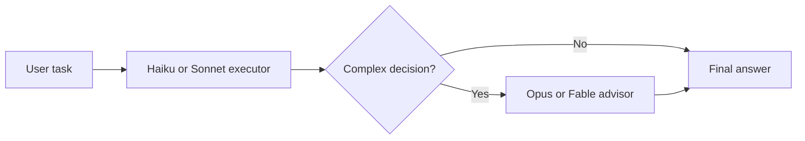

# The Claude family and model selection: advanced theory

🌐 [Русский](advanced.ru.md) · **English**

**Levels:** [Overview](overview.en.md) · [1. Basics](basics.en.md) · **2. Advanced** · [3. Expert](expert.en.md) · [4. Quiz](quiz.en.md) · [5. Runnable examples](code/examples/) · [6. Tests](code/tests/)

**Level 5:** [runnable examples](code/examples/) demonstrate deterministic routing and an eval matrix.

## Evals-based model selection

A model change cannot be considered successful based on one attractive answer. Build a workflow-specific set:

1. Typical requests: recurring production work or a representative sample.
2. Edge cases: formats, long context, tool calls, missing data and ambiguous intent.
3. Expectations: automatic checks or an expert rubric.
4. Metrics: correctness, latency, cost, tool-call accuracy, refusals and regressions.

Run each model or effort variant with the same prompt and dataset, using comparable generation settings supported by each model. Because effort can change tool calls and output, evals should use production parameters.

## Effort as an economic lever

Effort levels tune response thoroughness and expected token use within one model. Effort is a behavioral signal, not a strict token budget:

| Level | Role |
|---|---|
| `low` | Fast, economical answers with less thoroughness |
| `medium` | Balance for Opus 5.5 and Haiku 5.5 |
| `high` | More deeply considered answers by default for most main models |
| `xhigh` | A level between `high` and `max`, supported by the Claude 5.5 family |
| `max` | Maximum capability at higher latency and cost |

For adaptive-thinking models, effort is the preferred way to control depth: it affects thinking, text and tool arguments. When migrating applications that use forced tool use or manual thinking controls, check the official Opus 5.5 and Fable 5.2 model pages for breaking changes.

`max_tokens` remains the hard limit on all generated output, including thinking; leave room for it.

## Multimodel patterns

Executor/advisor:



Orchestrator/worker:

- The orchestrator plans steps and delegates routine work.
- Workers use cheaper models.
- Complex decisions and final merging remain with the frontier model.

This approach is useful when the proportion of difficult decisions is small. If the routing model makes mistakes more often than the strategy saves, upgrade the executor instead of adding routing complexity.

## Platform-specific IDs

| Platform | What to send |
|---|---|
| Claude API | Claude API model ID or dateless snapshot |
| Amazon Bedrock runtime | Bedrock inference profile or model ID, which differs for regional routes |
| Microsoft Foundry | The deployment name created by the user |
| Claude Platform on AWS | Claude API model ID, not a Bedrock-style ID |
| Google managed | Google-managed model endpoint ID |

Store configuration separately:

```python
config = {
    "provider": "claude-api",
    "model": "claude-opus-5-5",
    "effort": "medium",
}

print(config)
```

When migrating, verify:

- feature support;
- system/tools/earlier-message behavior;
- thinking and preserved thinking;
- computer use;
- output limits;
- partner pricing;
- retirement schedule.

## Best practices

- Stabilize the prompt and output contract before changing models.
- Run A/B tests with the same sample and effort.
- Compare cost per completed task, not only price per token.
- Include not only output cost but also latency, retries, tool calls and cache reads.
- Measure per-request cost and expert-escalation share for high-volume workloads.
- Pin model versions or deployments in every environment.
- Use the Batches API for background offline processing when latency is not critical.

## Common mistakes

- ❌ Compare models at only one effort level → ✅ run at least `low`, default and `high/max` for the everyday task.
- ❌ Assume Sonnet is a universal Opus replacement → ✅ test accuracy on agentic and edge-case samples.
- ❌ Carry an entire prompt unchanged from model to model → ✅ reevaluate system instructions and tool schemas.
- ❌ Choose Fable for high volume by capability alone → ✅ test Haiku/Sonnet and escalation policy.

## Comparison with other tracks

- The [LLM track](../../../llm/overview.en.md) discusses models and evals as provider-agnostic API concepts.
- In the Claude module, selection is tightly linked to Anthropic-specific `output_config.effort`, lifecycle and partner deployments.

## Related materials

- Foundation: [basics](basics.en.md)
- Expert reference: [expert.en.md](expert.en.md)
- Related track: [LLM](../../../llm/overview.en.md)

## Sources

- [Choosing the right model](https://platform.claude.com/docs/en/about-claude/models/choosing-a-model)
- [Optimizing for cost and intelligence](https://platform.claude.com/docs/en/about-claude/models/optimizing-for-cost-and-intelligence)
- [Effort](https://platform.claude.com/docs/en/build-with-claude/effort)
- [Models overview](https://platform.claude.com/docs/en/models/overview)
- [Features overview](https://platform.claude.com/docs/en/build-with-claude/overview)
