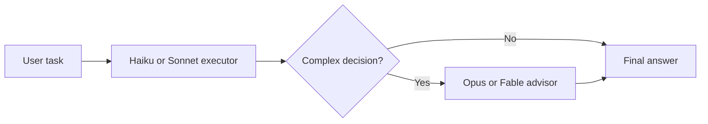

# Семейство Claude и выбор модели: продвинутая теория

🌐 **Русский** · [English](advanced.en.md)

**Уровни:** [обзор](overview.ru.md) · [1. Базовая теория](basics.ru.md) · **2. Продвинутая теория** · [3. Экспертная теория](expert.ru.md) · [4. Квиз](quiz.ru.md) · [5. Запускаемые примеры](code/examples/) · [6. Тесты](code/tests/)

**Уровень 5:** [запускаемые примеры](code/examples/) дополнительно демонстрируют детерминированный routing и eval matrix.

## Подход к выбору через evals

Смену модели нельзя считать успешной по одному красивому ответу. Для конкретного workflow формируют набор:

1. Типовые запросы — повторяющиеся задачи из production или репрезентативной выборки.
2. Edge cases — форматы, длинный контекст, tool calls, отсутствующие данные и ambiguous intent.
3. Ожидания — автоматические проверки или экспертная rubric.
4. Метрики — correctness, latency, cost, tool-call accuracy, refusal и регрессии.

Затем запускают каждый вариант модели или effort на том же prompt и dataset, используя сопоставимые параметры генерации, поддерживаемые каждой моделью. Поскольку effort может изменить tool calls и output, eval должен запускаться с production-параметрами.

## Effort как экономический рычаг

Уровни effort позволяют менять тщательность и ожидаемое количество токенов внутри одной модели. Это поведенческий сигнал, а не строгий token budget:

| Level | Роль |
|---|---|
| `low` | Быстрые и экономичные ответы с меньшей thoroughness |
| `medium` | Баланс для Opus 5.5 и Haiku 5.5 |
| `high` | Более глубоко продуманный ответ по умолчанию для большинства основных моделей |
| `xhigh` | Уровень между `high` и `max`, поддерживаемый семейством Claude 5.5 |
| `max` | Максимальная capability при высоких latency и cost |

Для adaptive-thinking моделей effort — предпочтительный способ управлять depth: он влияет и на thinking, и на текст, и на tool arguments. При миграции приложений с forced tool use или ручным управлением thinking проверяйте breaking changes Opus 5.5 и Fable 5.2 по официальным страницам моделей.

`max_tokens` остаётся жёстким верхним пределом всего сгенерированного output, включая thinking; оставляйте для него запас.

## Multimodel-схемы

Executor/advisor:



Orchestrator/worker:

- Orchestrator планирует steps и делегирует типовую работу.
- Workers выполняют с более дешёвыми моделями.
- Сложные решения и merge-контент остаются в frontier-модели.

Такой подход полезен, если доля сложных решений мала. Если модель-переключатель ошибается чаще, чем стоит экономия, лучше поднять executor, а не усложнять routing.

## IDs по платформам

| Платформа | Что отправлять |
|---|---|
| Claude API | Claude API model ID или dateless snapshot |
| Amazon Bedrock runtime | Bedrock inference profile или model ID, различный для региональных маршрутов |
| Microsoft Foundry | Deployment name, которое создаёт пользователь |
| Claude Platform on AWS | Claude API model ID, а не Bedrock-style ID |
| Google managed | Google-managed model endpoint ID |

Конфигурацию стоит хранить отдельно:

```python
config = {
    "provider": "claude-api",
    "model": "claude-opus-5-5",
    "effort": "medium",
}

print(config)
```

При миграции нужно сверить:

- feature support;
- system/tools/earlier-messages behavior;
- thinking и preserved thinking;
- computer use;
- output limits;
- partner pricing;
- retirement schedule.

## Лучшие практики

- Сначала стабилизируйте промпт и output contract, затем меняйте модель.
- Тестируйте A/B с одинаковой выборкой и одинаковым effort.
- Сравнивайте стоимость за завершённую задачу, а не только цену за токен.
- Учитывайте не только output cost, но и latency, retries, tool calls и cache reads.
- Для high-volume задач измеряйте per-request cost и долю expert escalations.
- Закрепляйте model version или deployment в конфигурации каждого environment.
- Используйте Batches API для фоновой offline-обработки, если latency не критична.

## Частые ошибки

- ❌ Сравнивать модели только на один уровень effort → ✅ прогнать хотя бы `low`, default и `high/max` для повседневной задачи.
- ❌ Считать Sonnet универсальной заменой Opus → ✅ проверить accuracy на agentic и edge-case выборке.
- ❌ Перекладывать промпт целиком из одной модели в другую → ✅ повторно оценить системные инструкции и tool schemas.
- ❌ Выбирать Fable по максимальной capability для высокого объёма → ✅ тестировать Haiku/Sonnet и escalation policy.

## Сравнение с другими треками

- В треке [LLM](../../../llm/overview.ru.md) модели и evals рассматриваются как общий слой provider-agnostic API.
- В Claude-модуле выбор tightly связан с Anthropic-specific `output_config.effort`, lifecycle и partner deployments.

## Связанные материалы

- Основа: [базовая теория](basics.ru.md)
- Экспертный справочник: [expert.ru.md](expert.ru.md)
- Связанный трек: [LLM](../../../llm/overview.ru.md)

## Источники

- [Choosing the right model](https://platform.claude.com/docs/en/about-claude/models/choosing-a-model)
- [Optimizing for cost and intelligence](https://platform.claude.com/docs/en/about-claude/models/optimizing-for-cost-and-intelligence)
- [Effort](https://platform.claude.com/docs/en/build-with-claude/effort)
- [Models overview](https://platform.claude.com/docs/en/models/overview)
- [Features overview](https://platform.claude.com/docs/en/build-with-claude/overview)
