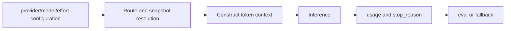

# The Claude family and model selection: expert theory

🌐 [Русский](expert.ru.md) · **English**

**Levels:** [Overview](overview.en.md) · [1. Basics](basics.en.md) · [2. Advanced](advanced.en.md) · **3. Expert** · [4. Quiz](quiz.en.md) · [5. Runnable examples](code/examples/) · [6. Tests](code/tests/)

**Level 5:** [runnable examples](code/examples/) run without credentials.

## Under the hood

Model selection in production is routing by expected utility and cost, not a static label. The request passes through a provider, where a model ID or deployment selects a model and inference endpoint. A model ID pins the model weights and configuration, but serving infrastructure (such as routers and safety classifiers) can change and affect observable behavior. The request budget is then distributed across the system prompt, history, tools, documents and output.



Effort affects all response tokens: text, explanations, tool arguments and thinking. In 1M-context models and with thinking preservation, earlier thinking blocks can also enter the next input and participate in accounting twice: first as output when generated, then as input when retained.

## Reference

| Property | Claude Fable 5.2 | Claude Opus 5.5 | Claude Sonnet 5.5 | Claude Haiku 5.5 |
|---|---|---|---|---|
| Claude API ID | `claude-fable-5-2` | `claude-opus-5-5` | `claude-sonnet-5-5` | `claude-haiku-5-5` |
| Profile | Maximum capability, demanding reasoning | Long-running agentic coding and knowledge work | Speed and capability for everyday workloads | Lowest latency, high-volume tasks |
| Comparative latency | Moderate | Moderate | Fast | Fastest |
| Input / output | Text and image / text | Text and image / text | Text and image / text | Text and image / text |
| Vision, tools, multilingual | Yes | Yes | Yes | Yes |
| Context window | 1M | 1M | 1M | 1M |
| Max synchronous output | 128K | 128K | 128K | 128K |
| Max output in Message Batches | 128K | 300K* | 300K* | 300K* |
| Default effort | `high` | `medium` | `high` | `medium` |
| Thinking | Adaptive, always on | Adaptive, always on | Adaptive; `between_tools` at `low`/`medium`/`high` | Adaptive; `disabled` at `high` or below |
| Reliable knowledge / training cutoff | Jun 2026 / Jun 2026 | Jun 2026 / Jun 2026 | Jun 2026 / Jun 2026 | Jun 2026 / Jun 2026 |
| Retirement commitment on Claude-operated platforms | Not before Nov 9, 2027 | Not before Sep 22, 2027 | Not before Sep 28, 2027 | Not before Oct 7, 2027 |

| Base price per MTok (input/output) | $8 / $40 | $4 / $20 | $2 / $10 | From $0.10 / $0.50 |
| Model availability | Claude API: all customers | Check platform availability | Check platform availability | Check platform availability |

Prices are Claude API base prices as of verification; Haiku's $0.10 / $0.50 rate applies to prompts up to 100K tokens, while input over 100K is $0.50 / $2.50. Prompt cache, batches and third-party platforms can have different rates. `300K*` is available in Message Batches with the `output-300k-2026-03-24` beta header; Fable 5.2 is not included. Retirement commitments apply to Anthropic-operated platforms; partner platforms set their own dates. Comparative latency is relative, not an SLA. Model availability depends on region, platform and organization access.

All four models support `low`, `medium`, `high`, `xhigh` and `max` effort; `xhigh` sits between `high` and `max`. Thinking behavior differs: Opus 5.5 and Fable 5.2 always use adaptive thinking; Sonnet 5.5 supports `between_tools` only through `high`, while Haiku 5.5 supports `disabled` at `high` or below. Sonnet and Haiku require adaptive thinking at `xhigh` and `max`. A model switch does not guarantee the target can read preserved thinking blocks or supports the same tools.

| Platform / endpoint | What to send as `model` | Important distinction |
|---|---|---|
| Claude API | Claude API ID, for example `claude-opus-5-5` | 4.6+ IDs are canonical pinned IDs; aliases for older models can point to dated snapshots |
| Amazon Bedrock `bedrock-mantle` | Bedrock ID with `anthropic.` prefix, for example `anthropic.claude-opus-5-5` | Messages API; some models are only available on `bedrock-runtime` |
| Amazon Bedrock `bedrock-runtime` | Bedrock model ID or inference profile, for example `global.anthropic.claude-fable-5-2` | Has its own endpoint and availability rules |
| Microsoft Foundry | Deployment name | Defaults to the model ID but can be customized when created |
| Claude Platform on AWS | Claude API model ID | Do not confuse it with AWS-operated Amazon Bedrock |
| Google Cloud | ID matching Claude API naming | Managed platforms have their own availability and lifecycle terms |

## Gotchas

### A dateless ID is not always an alias

All model IDs identify pinned model versions. From generation 4.6 onward, a dateless model ID is the canonical pinned ID, while an API alias for older models can point to the latest dated snapshot. Pinned weights do not guarantee identical responses over time: serving infrastructure can change. Partner-platform IDs and lifecycle terms also differ.

**What to do:** store provider and model ID/deployment separately, along with the verification date and relevant API parameters. Do not apply one migration matrix to every provider.

### 1M context does not remove context rot

A larger context increases working memory, but recall accuracy and precision can decline as the number of unstructured facts grows.

```python
items = ["system prompt", "10k history", "tool schemas", "documents", "images"]

request_tokens = sum(len(item) for item in items)
print(request_tokens)
```

The result is the sum of the string lengths, but real input tokenization depends on the tokenizer and block types. Do not use string size as a usage proxy.

### Opus 5.5 has specific breaking changes

On the Claude API, Opus 5.5 does not support forced tool use (`tool_choice: {"type": "any"}` or `{"type": "tool", "name": ...}`), disabled thinking or manual `budget_tokens`; those requests return 400. Its thinking blocks are tied to the model and conversation. The response shape also changed: at the default `display: "omitted"` setting, text between tool calls is returned in thinking blocks with empty text, so an application's progress stream may go quiet; check the `display` settings. `computer_20251124` is also unsupported by this model on the Claude API, though Bedrock has its own rules.

Fable 5.2 likewise does not support forced tool use, disabled thinking or a legacy manual budget. Its thinking blocks are tied to the model; editing an earlier turn can fail the prefix check and return 400. Only Fable 5.2 and Mythos 5.2 can read Fable 5.2 thinking blocks. The legacy `computer_20251124` is supported only on Amazon Bedrock. The advisor tool also restricts pairings: a Fable 5.2 executor requires a Fable 5.2 or Mythos 5.2 advisor.

**What to do:** run a test matrix before rollout and roll back to a pinned snapshot or deployment.

### Effort does not replace a stronger model

Effort changes allocation inside a model. It does not guarantee that a lower-tier model will acquire unavailable capability or a better tool strategy.

## Trade-offs and alternatives

| Strategy | Advantages | Risks |
|---|---|---|
| Efficiency-first | Low cost and fast iteration | Hidden capability gap and more retries |
| Capability-first | High accuracy on the difficult core | High cost for routine steps |
| One model | Simple configuration | Cannot optimize different task profiles |
| Executor/advisor | Cost savings and strong fallback | Routing latency and a complex multi-call contract |
| Orchestrator/worker | Scaling of multistep workflows | Context duplication and merge errors |

## Interview questions

**1. How does a context window differ from training data?**

<details><summary>Answer</summary>

Training data is the corpus on which the model was trained. A context window is the current working context of a request. It includes the system prompt, history, tools, documents and generated output.

</details>

**2. What does `max_tokens` mean?**

<details><summary>Answer</summary>

It is the absolute maximum number of generated tokens for a turn, not a context reserve. Models may stop earlier.

</details>

**3. How does a dateless ID differ from an alias?**

<details><summary>Answer</summary>

For 4.6+ a dateless ID can be the pinned snapshot itself. In earlier generations, an alias can point to a dated snapshot. Exact behavior depends on model generation and platform.

</details>

**4. Which request components can enter the context window?**

<details><summary>Answer</summary>

The system prompt, messages, tool definitions, tool results, images, documents, generated output and thinking blocks. Cache reads and writes are included in usage.

</details>

**5. Why does a partner-platform deployment matrix matter?**

<details><summary>Answer</summary>

Anthropic, Bedrock, Foundry and Google can use different IDs, pricing, routing and lifecycle schedules.

</details>

**6. Why does 1M context not guarantee perfect retrieval?**

<details><summary>Answer</summary>

Context rot can reduce recall and accuracy as volume and noise grow. Curation, retrieval and compaction are still needed.

</details>

**7. What should change when many requests are simple?**

<details><summary>Answer</summary>

Evaluate a cheaper model and effort, retain escalation and a statically bounded fallback for difficult tasks.

</details>

**8. How does effort affect tool calls?**

<details><summary>Answer</summary>

It affects call count, brevity, reasoning and tool arguments. Therefore an eval must include tool-call accuracy.

</details>

**9. What should an eval verify during a model change?**

<details><summary>Answer</summary>

Accuracy, edge cases, refusals, stop reasons, tool strategy, latency, cost, cache behavior and output schema.

</details>

**10. When is it better to keep one model?**

<details><summary>Answer</summary>

When routing does not pay off, workloads are homogeneous, evals show no meaningful trade-off or orchestration complexity exceeds expected savings.

</details>

## Cheat sheet

- Start: Haiku efficiency-first, Opus capability-first, Fable for the hardest reasoning.
- Tune: effort before model if both options support the same features.
- Measure: correctness + latency + cost + edge cases.
- Deploy: provider + model/deployment + effort + pinned snapshot.
- Migrate: test tool use, thinking, system/tools changes and partner IDs.
- Context: curate, evaluate and compact; 1M is a limit, not a quality guarantee.

## Related materials

- Basics: [basics.en.md](basics.en.md)
- Advanced theory: [advanced.en.md](advanced.en.md)
- General model theory: [LLM](../../../llm/overview.en.md)

## Sources

- [Model IDs and versioning](https://platform.claude.com/docs/en/about-claude/models/model-ids-and-versions)
- [Models overview and pricing](https://platform.claude.com/docs/en/models/overview)
- [Pricing details](https://platform.claude.com/docs/en/about-claude/pricing)
- [Choosing the right model](https://platform.claude.com/docs/en/about-claude/models/choosing-a-model)
- [Optimizing for cost and intelligence](https://platform.claude.com/docs/en/about-claude/models/optimizing-for-cost-and-intelligence)
- [Context windows](https://platform.claude.com/docs/en/build-with-claude/context-windows)
- [Model deprecations and retirement commitments](https://platform.claude.com/docs/en/about-claude/model-deprecations)
- [Effort](https://platform.claude.com/docs/en/build-with-claude/effort)
- [Thinking](https://platform.claude.com/docs/en/build-with-claude/thinking)
- [Claude Opus 5.5 behavior and breaking changes](https://platform.claude.com/docs/en/models/opus-5-5/whats-new-opus-5-5)
- [Claude Fable 5.2 behavior and breaking changes](https://platform.claude.com/docs/en/models/fable-5-2/whats-new-fable-5-2)
- [Claude Sonnet 5.5 effort guidance](https://platform.claude.com/docs/en/build-with-claude/effort#recommended-effort-levels)
- [Claude Haiku 5.5 effort guidance](https://platform.claude.com/docs/en/build-with-claude/effort#recommended-effort-levels)
- [Claude in Microsoft Foundry](https://platform.claude.com/docs/en/build-with-claude/claude-in-microsoft-foundry)
- [Claude in Amazon Bedrock](https://platform.claude.com/docs/en/build-with-claude/claude-in-amazon-bedrock)
- [Claude Platform on AWS](https://platform.claude.com/docs/en/build-with-claude/claude-platform-on-aws)
- [Claude Models on Google Cloud, Google managed](https://platform.claude.com/docs/en/build-with-claude/claude-models-on-google-cloud/google-managed)
- [Claude Models on Google Cloud, Anthropic managed](https://platform.claude.com/docs/en/build-with-claude/claude-models-on-google-cloud/anthropic-managed)
