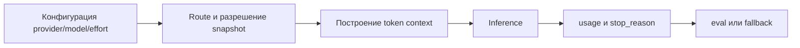

# Семейство Claude и выбор модели: экспертная теория

🌐 **Русский** · [English](expert.en.md)

**Уровни:** [обзор](overview.ru.md) · [1. Базовая теория](basics.ru.md) · [2. Продвинутая теория](advanced.ru.md) · **3. Экспертная теория** · [4. Квиз](quiz.ru.md) · [5. Запускаемые примеры](code/examples/) · [6. Тесты](code/tests/)

**Уровень 5:** [запускаемые примеры](code/examples/) можно запускать без credentials.

## Под капотом

Model selection в production — это routing по ожидаемой utility и cost, а не статический label. Запрос проходит через provider, где model ID или deployment выбирает модель и inference endpoint. Model ID закрепляет версию весов и конфигурации, но serving-инфраструктура (например, router и safety classifiers) может меняться и влиять на наблюдаемое поведение. Затем request budget распределяется между system prompt, history, tools, documents и output.



Effort влияет на все ответные токены: text, explanations, tool arguments и thinking. В 1M-моделях и при preservation thinking прошлые thinking blocks тоже могут попадать в следующий input и дважды участвовать в accounting: сначала как output при генерации, потом как input при сохранении.

## Справочник

| Свойство | Claude Fable 5.2 | Claude Opus 5.5 | Claude Sonnet 5.5 | Claude Haiku 5.5 |
|---|---|---|---|---|
| Claude API ID | `claude-fable-5-2` | `claude-opus-5-5` | `claude-sonnet-5-5` | `claude-haiku-5-5` |
| Профиль | Максимальная capability, сложное reasoning | Долгие agentic coding и knowledge work | Скорость и capability для повседневных задач | Наименьшая latency, high-volume задачи |
| Сравнительная latency | Moderate | Moderate | Fast | Fastest |
| Ввод / вывод | Text и image / text | Text и image / text | Text и image / text | Text и image / text |
| Vision, tools, multilingual | Да | Да | Да | Да |
| Context window | 1M | 1M | 1M | 1M |
| Max синхронный output | 128K | 128K | 128K | 128K |
| Max output в Message Batches | 128K | 300K* | 300K* | 300K* |
| Default effort | `high` | `medium` | `high` | `medium` |
| Thinking | Adaptive, always on | Adaptive, always on | Adaptive; `between_tools` на `low`/`medium`/`high` | Adaptive; `disabled` при `high` и ниже |
| Reliable knowledge / training cutoff | Jun 2026 / Jun 2026 | Jun 2026 / Jun 2026 | Jun 2026 / Jun 2026 | Jun 2026 / Jun 2026 |
| Retirement commitment на Claude-operated platforms | Не раньше 9 ноября 2027 | Не раньше 22 сентября 2027 | Не раньше 28 сентября 2027 | Не раньше 7 октября 2027 |

| Базовая цена за MTok (input/output) | $8 / $40 | $4 / $20 | $2 / $10 | от $0.10 / $0.50 |
| Доступность модели | Claude API: все клиенты | Сверять platform availability | Сверять platform availability | Сверять platform availability |

Цены — базовые цены Claude API на дату проверки; для Haiku $0.10 / $0.50 действует при prompts до 100K tokens, а выше 100K input — $0.50 / $2.50. Prompt cache, batch и сторонние платформы могут иметь другие тарифы. `300K*` доступен в Message Batches с beta header `output-300k-2026-03-24`; Fable 5.2 в список не входит. Retirement commitments применяются к платформам, которыми управляет Anthropic; partner platforms устанавливают свои даты. Сравнительная latency — относительная, не SLA. Доступность модели зависит от региона, платформы и доступа организации.

Все четыре модели поддерживают effort `low`, `medium`, `high`, `xhigh`, `max`; `xhigh` находится между `high` и `max`. Thinking behavior различается: Opus 5.5 и Fable 5.2 всегда используют adaptive thinking; Sonnet 5.5 поддерживает `between_tools` только до `high`, а Haiku 5.5 — `disabled` при `high` и ниже. Для `xhigh` и `max` у Sonnet/Haiku нужен adaptive thinking. Смена модели не гарантирует, что целевая модель сможет прочесть сохранённые thinking blocks или поддержит те же инструменты.

| Платформа / endpoint | Что передавать в поле `model` | Важное различие |
|---|---|---|
| Claude API | Claude API ID, например `claude-opus-5-5` | ID 4.6+ — канонический pinned ID; для старых моделей alias может указывать на dated snapshot |
| Amazon Bedrock `bedrock-mantle` | Bedrock ID с префиксом `anthropic.`, например `anthropic.claude-opus-5-5` | Messages API; некоторые модели доступны только на `bedrock-runtime` |
| Amazon Bedrock `bedrock-runtime` | Bedrock model ID или inference profile, например `global.anthropic.claude-fable-5-2` | Собственные endpoint и availability правила |
| Microsoft Foundry | Имя deployment-а | По умолчанию совпадает с model ID, но при создании может быть задано другое имя |
| Claude Platform on AWS | Claude API model ID | Не путать с AWS-operated Amazon Bedrock |
| Google Cloud | ID, соответствующий Claude API naming | У managed-платформ собственные availability и lifecycle условия |

## Подвохи

### Dateless ID не всегда означает alias

Все model IDs указывают на закреплённую версию модели. Начиная с поколения 4.6 dateless model ID — канонический pinned ID, а у более ранних моделей API alias может указывать на последний dated snapshot. Закрепление весов не обещает полностью идентичный ответ во времени: serving infrastructure может обновляться. Partner-platform ID и lifecycle также различаются.

**Что делать:** хранить provider и model ID/deployment отдельно, а также дату проверки и нужные API параметры. Не применять одну migration matrix ко всем providers.

### 1M context не удаляет context rot

Большой контекст увеличивает working memory, но recall accuracy и precision могут падать по мере роста числа неструктурированных фактов.

```python
items = ["system prompt", "10k history", "tool schemas", "documents", "images"]

request_tokens = sum(len(item) for item in items)
print(request_tokens)
```

Результат равен сумме длин строк, но реальный input-токенинг зависит от tokenizer и block types. Не считайте строковый размер proxy для usage.

### Opus 5.5 имеет особые breaking changes

В Claude API Opus 5.5 не поддерживает forced tool use (`tool_choice: {"type": "any"}` или `{"type": "tool", "name": ...}`), выключенное thinking и ручной `budget_tokens`; такие запросы завершаются 400. Его thinking blocks привязаны к модели и разговору. Изменился и response shape: при стандартном `display: "omitted"` текст между tool calls возвращается в thinking blocks с пустым текстом, поэтому progress stream приложения может замолчать; проверьте настройки `display`. Также `computer_20251124` не поддерживается Claude API для этой модели, хотя Bedrock имеет собственные правила.

Fable 5.2 также не поддерживает forced tool use, выключенное thinking и legacy manual budget. Её thinking blocks привязаны к модели; изменение прежнего хода может провалить prefix check и вернуть 400. Только Fable 5.2 и Mythos 5.2 могут читать thinking blocks Fable 5.2. Legacy `computer_20251124` поддержан только на Amazon Bedrock. Advisor tool также ограничивает пары: Fable 5.2 executor требует Fable 5.2 или Mythos 5.2 advisor.

**Что делать:** прогонять test matrix до rollout и откатываться по pinned snapshot или deployment.

### Effort не заменяет более сильную модель

Effort меняет allocation бюджета внутри модели. Он не даёт гарантии, что lower-tier model приобретёт unavailable capability или better tool strategy.

## Компромиссы и альтернативы

| Стратегия | Преимущества | Риски |
|---|---|---|
| Efficiency-first | Низкая цена и быстрая итерация | Скрытый capability gap и много retries |
| Capability-first | Высокая точность на сложном ядре | Высокая стоимость типовых шагов |
| One model | Простая конфигурация | Нельзя оптимизировать разные профили задач |
| Executor/advisor | Экономия и сохранение сильного fallback | Routing latency и сложный multi-call contract |
| Orchestrator/worker | Масштабирование многозадачных workflows | Дублирование контекста и merge-ошибки |

## Вопросы с собеседований

**1. Чем context window отличается от training data?**

<details><summary>Ответ</summary>

Training data — корпус, на котором модель обучалась. Context window — текущий рабочий контекст запроса. Он включает system prompt, историю, tools, документы и сгенерированный вывод.

</details>

**2. Что означает `max_tokens`?**

<details><summary>Ответ</summary>

Это абсолютный максимум генерируемых токенов для turn, а не резервный размер контекста. Модели могут остановиться раньше.

</details>

**3. Чем dateless ID отличается от alias?**

<details><summary>Ответ</summary>

Для модели 4.6+ dateless ID может быть самим pinned snapshot. На прежних поколениях alias может указывать на dated snapshot. Конкретное behavior определяется model generation и platform.

</details>

**4. Какие компоненты request могут попасть в context window?**

<details><summary>Ответ</summary>

System prompt, messages, tool definitions, tool results, images, documents, generated output и thinking blocks; cache reads и writes учитываются в usage.

</details>

**5. Зачем нужна partner-platform deployment matrix?**

<details><summary>Ответ</summary>

Anthropic, Bedrock, Foundry и Google могут использовать разные ID, pricing, routing и lifecycle schedule.

</details>

**6. Почему 1M context не гарантирует perfect retrieval?**

<details><summary>Ответ</summary>

Появляется context rot: с ростом объёма и шума recall и accuracy могут снижаться. Нужны curation, retrieval и compaction.

</details>

**7. Что нужно изменить при высокой доле простых запросов?**

<details><summary>Ответ</summary>

Оценить дешёвую модель и effort, оставить escalation и statically bounded fallback для сложных tasks.

</details>

**8. Как effort влияет на tool calls?**

<details><summary>Ответ</summary>

Он влияет на количество и краткость вызовов, reasoning и аргументы tools. Поэтому eval должен включать tool-call accuracy.

</details>

**9. Что проверять в eval при смене модели?**

<details><summary>Ответ</summary>

Accuracy, edge cases, refusals, stop reasons, tool strategy, latency, cost, cache behavior и output schema.

</details>

**10. Когда лучше оставить одну модель?**

<details><summary>Ответ</summary>

Когда routing не окупается, задачи homogeneous, eval не обнаруживает значимой trade-off или сложность orchestration превышает ожидаемую экономию.

</details>

## Шпаргалка

- Start: Haiku efficiency-first, Opus capability-first, Fable для hardest reasoning.
- Tune: effort before model if both options support the same feature.
- Measure: correctness + latency + cost + edge cases.
- Deploy: provider + model/deployment + effort + pinned snapshot.
- Migrate: test tool use, thinking, system/tools changes и partner IDs.
- Context: curate, evaluate and compact; 1M — limit, не quality guarantee.

## Связанные материалы

- Базовая теория: [basics.ru.md](basics.ru.md)
- Продвинутая теория: [advanced.ru.md](advanced.ru.md)
- Общая теория моделей: [LLM](../../../llm/overview.ru.md)

## Источники

- [Model IDs and versioning](https://platform.claude.com/docs/en/about-claude/models/model-ids-and-versions)
- [Models overview and pricing](https://platform.claude.com/docs/en/models/overview)
- [Pricing details](https://platform.claude.com/docs/en/about-claude/pricing)
- [Choosing the right model](https://platform.claude.com/docs/en/about-claude/models/choosing-a-model)
- [Optimizing for cost and intelligence](https://platform.claude.com/docs/en/about-claude/models/optimizing-for-cost-and-intelligence)
- [Context windows](https://platform.claude.com/docs/en/build-with-claude/context-windows)
- [Model deprecations and retirement commitments](https://platform.claude.com/docs/en/about-claude/model-deprecations)
- [Effort](https://platform.claude.com/docs/en/build-with-claude/effort)
- [Thinking](https://platform.claude.com/docs/en/build-with-claude/thinking)
- [Claude Opus 5.5 behavior and breaking changes](https://platform.claude.com/docs/en/models/opus-5-5/whats-new-opus-5-5)
- [Claude Fable 5.2 behavior and breaking changes](https://platform.claude.com/docs/en/models/fable-5-2/whats-new-fable-5-2)
- [Claude Sonnet 5.5 effort guidance](https://platform.claude.com/docs/en/build-with-claude/effort#recommended-effort-levels)
- [Claude Haiku 5.5 effort guidance](https://platform.claude.com/docs/en/build-with-claude/effort#recommended-effort-levels)
- [Claude in Microsoft Foundry](https://platform.claude.com/docs/en/build-with-claude/claude-in-microsoft-foundry)
- [Claude in Amazon Bedrock](https://platform.claude.com/docs/en/build-with-claude/claude-in-amazon-bedrock)
- [Claude Platform on AWS](https://platform.claude.com/docs/en/build-with-claude/claude-platform-on-aws)
- [Claude Models on Google Cloud, Google managed](https://platform.claude.com/docs/en/build-with-claude/claude-models-on-google-cloud/google-managed)
- [Claude Models on Google Cloud, Anthropic managed](https://platform.claude.com/docs/en/build-with-claude/claude-models-on-google-cloud/anthropic-managed)
