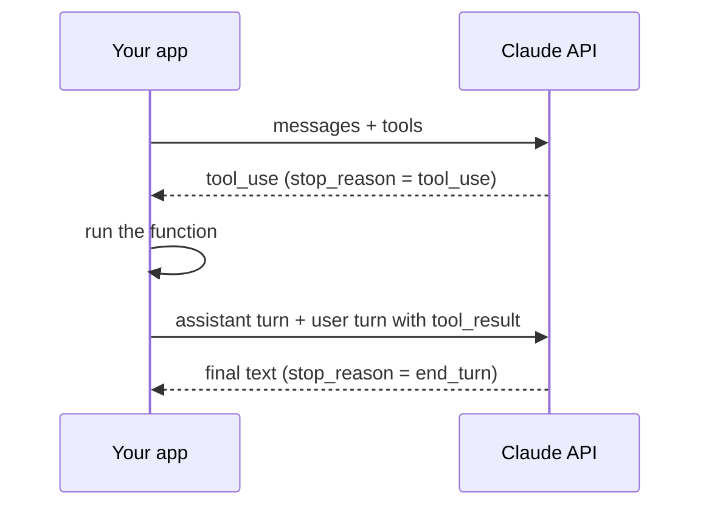

# Tool use: basics

🌐 [Русский](basics.ru.md) · **English**

**Levels:** [overview](overview.en.md) · **1. Basics** · [2. Advanced](advanced.en.md) · [3. Expert](expert.en.md) · [4. Quiz](quiz.en.md)

**Prerequisites:** [02 · Messages API](../02-messages-api/overview.en.md) · **Time:** ~1.5 h

## How the code was checked

There is no API key, so the examples ran in Python 3 with the `anthropic` 2.13.0 SDK against a **local mock server**. The mock returns scripted replies (a `tool_use` for the first request, a final text after a `tool_result`) and applies two rules from the documentation: results must immediately follow the tool call, and forced tool use is refused on `claude-opus-5-5`/`claude-sonnet-5-5`. So the *request shapes* and the loop logic are checked; real model decisions are not. Outputs below are the mock's.

## Why it matters

A model on its own knows only its training data and the conversation. A tool gives it hands: look up the weather, query a database, read a file. The model never executes anything: it **asks**, and your code decides whether and how to run it. This split is the whole safety model of tool use.

## The loop in four steps



1. Send the request with `tools`.
2. If `stop_reason == "tool_use"`, append the reply `content` **unchanged** as an `assistant` message.
3. Run each `tool_use` block and build one `tool_result` per block.
4. Send them in a single `user` message; repeat until the reply is not `tool_use`.

## Defining a tool

```python
tools = [{
    "name": "get_weather",
    "description": "Get the current weather in a city. Use it when the user asks about weather.",
    "input_schema": {"type": "object",
                     "properties": {"location": {"type": "string"}},
                     "required": ["location"]},
}]
```

- `name` — 1–128 characters from `a-z A-Z 0-9 _ -`.
- `description` — the most important field: what the tool does, when to use it, what it returns. The documentation advises at least 3–4 sentences.
- `input_schema` — a JSON Schema object with the parameters.

## Call and result

```python
import anthropic
client = anthropic.Anthropic()

def run_tool(name, args):
    if name == "get_weather":
        return f"15 degrees in {args['location']}"
    raise ValueError(f"unknown tool {name}")

def ask(question, **kw):
    messages = [{"role": "user", "content": question}]
    for step in range(10):                      # always cap the loop
        r = client.messages.create(model="claude-opus-5-5", max_tokens=1024,
                                   tools=tools, messages=messages, **kw)
        print(step, r.stop_reason, [b.type for b in r.content])
        if r.stop_reason != "tool_use":
            return "".join(b.text for b in r.content if b.type == "text")
        messages.append({"role": "assistant", "content": r.content})
        results = []
        for b in r.content:
            if b.type == "tool_use":
                try:
                    results.append({"type": "tool_result", "tool_use_id": b.id, "content": run_tool(b.name, b.input)})
                except Exception as e:
                    results.append({"type": "tool_result", "tool_use_id": b.id, "content": str(e), "is_error": True})
        messages.append({"role": "user", "content": results})
    raise RuntimeError("too many steps")

print(ask("Weather in Paris?"))
```

```text
0 tool_use ['text', 'tool_use']
1 end_turn ['text']
It is 15 degrees in Paris.
```

Notes:

- A `tool_use` block has `id`, `name` and `input` (an object matching the schema). The reply may also contain text before it ("Let me check.").
- A `tool_result` block has `tool_use_id` (the `id` of the call), `content` (a string or a list of blocks) and optionally `is_error`.
- The `assistant` message is the reply `content` as it came: the next request must repeat it exactly.

## Parallel calls

The model may request several independent tools in one reply. Return **all** results in **one** user message:

```python
print(ask("PARALLEL Weather in Paris and Rome?"))
```

```text
0 tool_use ['text', 'tool_use', 'tool_use']
1 end_turn ['text']
It is 15 degrees in Paris.
```

The last request held three messages (the question, the assistant turn, one user message) and the results `['toolu_01', 'toolu_02']`. Do not send each result in its own message: it breaks the pairing and teaches the model to call tools less in parallel. With `tool_choice={"type": "auto", "disable_parallel_tool_use": True}` the same question gave a single call in the mock.

## Errors in tools

If a tool fails, still answer the call: `is_error: true` and a message the model can act on (what happened, what to try). Claude may retry with other arguments or explain the failure to the user. "failed" helps nobody; "Rate limit exceeded. Retry after 60 seconds." does.

An **order violation** is a client error. With text before the result the mock (following the documented rule) answered:

```text
BadRequestError 400 tool_use ids were found without tool_result blocks immediately after.
```

The wording is the documentation's; the status line is the mock's.

## Choosing a tool

`tool_choice` controls whether and which tool is used:

| Value | Meaning |
|---|---|
| `{"type": "auto"}` | the model decides (default when `tools` are given) |
| `{"type": "any"}` | it must call some tool |
| `{"type": "tool", "name": "get_weather"}` | it must call exactly this tool |
| `{"type": "none"}` | tools are not used |

```python
r = client.messages.create(..., tool_choice={"type": "none"})
```

```text
I cannot check the weather.
```

> ⚠️ Verify: according to the documentation, `any` and `tool` return a 400 on Claude Fable 5.2, Opus 5.5, Sonnet 5.5 (and some others); the mock reproduces this for the first two model ids, and the real error text was not seen. Use `auto` there. Details are in the [advanced theory](advanced.en.md#forced-tool-use-and-models).

## Beginner mistakes

- ❌ Appending only the text of the reply to the history instead of the whole `content` → ✅ the whole `content`.
- ❌ Text before `tool_result` blocks → ✅ results first.
- ❌ One message per result → ✅ all results in one message.
- ❌ Skipping a failed call → ✅ `tool_result` with `is_error`.
- ❌ A `while True` loop → ✅ a step limit.
- ❌ A vague description ("weather") → ✅ when to use it and what it returns.

## Related materials

- Next: [advanced theory](advanced.en.md) — server tools, token cost, caching, the SDK runner
- Earlier: [02 · Messages API](../02-messages-api/basics.en.md), [04 · Structured outputs](../04-structured-output/basics.en.md)
- Parallels: [LLM](../../../llm/overview.en.md)

## Sources

- [Tool use overview](https://platform.claude.com/docs/en/agents-and-tools/tool-use/overview)
- [Define tools](https://platform.claude.com/docs/en/agents-and-tools/tool-use/define-tools)
- [Handle tool calls](https://platform.claude.com/docs/en/agents-and-tools/tool-use/handle-tool-calls)
- [Parallel tool use](https://platform.claude.com/docs/en/agents-and-tools/tool-use/parallel-tool-use)
