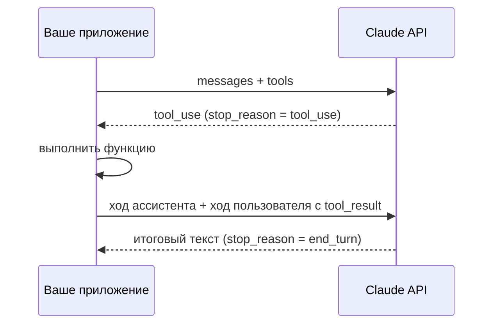

# Tool use: основы

🌐 **Русский** · [English](basics.en.md)

**Уровни:** [overview](overview.ru.md) · **1. Основы** · [2. Продвинутый](advanced.ru.md) · [3. Эксперт](expert.ru.md) · [4. Квиз](quiz.ru.md)

**Пререквизиты:** [02 · Messages API](../02-messages-api/overview.ru.md) · **Время:** ~1,5 ч

## Как проверялся код

Ключа API нет, поэтому примеры запускались на Python 3 с SDK `anthropic` 2.13.0 против **локального mock-сервера**. Мок отдаёт заготовленные ответы (`tool_use` на первый запрос, финальный текст после `tool_result`) и применяет два правила из документации: результаты должны идти сразу за вызовом инструмента, а принудительный вызов инструмента отклоняется для `claude-opus-5-5`/`claude-sonnet-5-5`. Значит, проверены *формы запросов* и логика цикла; решения реальной модели — нет. Выводы ниже — ответы мока.

## Зачем это нужно

Модель сама знает только обучающие данные и разговор. Инструмент даёт ей руки: узнать погоду, спросить базу, прочитать файл. Модель ничего не выполняет: она **просит**, а ваш код решает, выполнять ли и как. Это разделение — вся модель безопасности tool use.

## Цикл из четырёх шагов



1. Отправьте запрос с `tools`.
2. Если `stop_reason == "tool_use"`, добавьте `content` ответа **без изменений** как сообщение `assistant`.
3. Выполните каждый блок `tool_use` и соберите по одному `tool_result` на блок.
4. Отправьте их одним сообщением `user`; повторяйте, пока ответ не перестанет быть `tool_use`.

## Описание инструмента

```python
tools = [{
    "name": "get_weather",
    "description": "Get the current weather in a city. Use it when the user asks about weather.",
    "input_schema": {"type": "object",
                     "properties": {"location": {"type": "string"}},
                     "required": ["location"]},
}]
```

- `name` — 1–128 символов из `a-z A-Z 0-9 _ -`.
- `description` — важнейшее поле: что делает инструмент, когда его применять, что он возвращает. Документация советует не меньше 3–4 предложений.
- `input_schema` — объект JSON Schema с параметрами.

## Вызов и результат

```python
import anthropic
client = anthropic.Anthropic()

def run_tool(name, args):
    if name == "get_weather":
        return f"15 degrees in {args['location']}"
    raise ValueError(f"unknown tool {name}")

def ask(question, **kw):
    messages = [{"role": "user", "content": question}]
    for step in range(10):                      # always cap the loop
        r = client.messages.create(model="claude-opus-5-5", max_tokens=1024,
                                   tools=tools, messages=messages, **kw)
        print(step, r.stop_reason, [b.type for b in r.content])
        if r.stop_reason != "tool_use":
            return "".join(b.text for b in r.content if b.type == "text")
        messages.append({"role": "assistant", "content": r.content})
        results = []
        for b in r.content:
            if b.type == "tool_use":
                try:
                    results.append({"type": "tool_result", "tool_use_id": b.id, "content": run_tool(b.name, b.input)})
                except Exception as e:
                    results.append({"type": "tool_result", "tool_use_id": b.id, "content": str(e), "is_error": True})
        messages.append({"role": "user", "content": results})
    raise RuntimeError("too many steps")

print(ask("Weather in Paris?"))
```

```text
0 tool_use ['text', 'tool_use']
1 end_turn ['text']
It is 15 degrees in Paris.
```

Замечания:

- Блок `tool_use` содержит `id`, `name` и `input` (объект по схеме). Перед ним в ответе может быть текст («Let me check.»).
- Блок `tool_result` содержит `tool_use_id` (`id` вызова), `content` (строка или список блоков) и необязательный `is_error`.
- Сообщение `assistant` — это `content` ответа как есть: следующий запрос должен повторить его в точности.

## Параллельные вызовы

Модель может запросить несколько независимых инструментов в одном ответе. Возвращайте **все** результаты в **одном** сообщении пользователя:

```python
print(ask("PARALLEL Weather in Paris and Rome?"))
```

```text
0 tool_use ['text', 'tool_use', 'tool_use']
1 end_turn ['text']
It is 15 degrees in Paris.
```

Последний запрос содержал три сообщения (вопрос, ход ассистента, одно сообщение пользователя) и результаты `['toolu_01', 'toolu_02']`. Не отправляйте каждый результат отдельным сообщением: это ломает соответствие и приучает модель реже вызывать инструменты параллельно. С `tool_choice={"type": "auto", "disable_parallel_tool_use": True}` тот же вопрос дал в моке один вызов.

## Ошибки инструментов

Если инструмент упал, на вызов всё равно нужно ответить: `is_error: true` и сообщение, с которым модель может что-то сделать (что случилось, что попробовать). Claude может повторить с другими аргументами или объяснить сбой пользователю. «failed» не помогает никому; «Rate limit exceeded. Retry after 60 seconds.» помогает.

**Нарушение порядка** — ошибка клиента. С текстом перед результатом мок (по документированному правилу) ответил:

```text
BadRequestError 400 tool_use ids were found without tool_result blocks immediately after.
```

Формулировка — из документации; строка статуса — мока.

## Выбор инструмента

`tool_choice` управляет тем, использовать ли инструмент и какой:

| Значение | Смысл |
|---|---|
| `{"type": "auto"}` | решает модель (по умолчанию при заданных `tools`) |
| `{"type": "any"}` | обязана вызвать какой-нибудь инструмент |
| `{"type": "tool", "name": "get_weather"}` | обязана вызвать именно этот |
| `{"type": "none"}` | инструменты не используются |

```python
r = client.messages.create(..., tool_choice={"type": "none"})
```

```text
I cannot check the weather.
```

> ⚠️ Проверить: по документации `any` и `tool` дают 400 на Claude Fable 5.2, Opus 5.5, Sonnet 5.5 (и некоторых других); мок воспроизводит это для первых двух идентификаторов моделей, реальный текст ошибки не видели. Там используйте `auto`. Подробности — в [продвинутой теории](advanced.ru.md#принудительный-вызов-и-модели).

## Типичные ошибки новичков

- ❌ Добавлять в историю только текст ответа вместо всего `content` → ✅ весь `content`.
- ❌ Текст перед блоками `tool_result` → ✅ сначала результаты.
- ❌ Одно сообщение на результат → ✅ все результаты в одном сообщении.
- ❌ Пропускать упавший вызов → ✅ `tool_result` с `is_error`.
- ❌ Цикл `while True` → ✅ лимит шагов.
- ❌ Расплывчатое описание («weather») → ✅ когда применять и что возвращает.

## Связанные материалы

- Дальше: [продвинутая теория](advanced.ru.md) — серверные инструменты, стоимость в токенах, кэширование, runner в SDK
- Раньше: [02 · Messages API](../02-messages-api/basics.ru.md), [04 · Structured outputs](../04-structured-output/basics.ru.md)
- Параллели: [LLM](../../../llm/overview.ru.md)

## Источники

- [Tool use overview](https://platform.claude.com/docs/en/agents-and-tools/tool-use/overview)
- [Define tools](https://platform.claude.com/docs/en/agents-and-tools/tool-use/define-tools)
- [Handle tool calls](https://platform.claude.com/docs/en/agents-and-tools/tool-use/handle-tool-calls)
- [Parallel tool use](https://platform.claude.com/docs/en/agents-and-tools/tool-use/parallel-tool-use)
