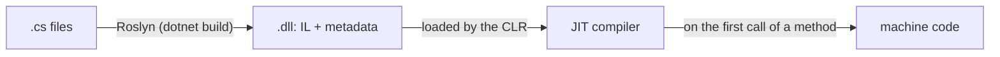

# The .NET platform and dotnet CLI: advanced

🌐 [Русский](advanced.ru.md) · **English**

**Levels:** [overview](overview.en.md) · [1. Basics](basics.en.md) · **2. Advanced** · [3. Expert](expert.en.md) · [4. Quiz](quiz.en.md) · [exercises](exercises.en.md) · [5–6. Code and tests](code/)

## From source code to machine code



The C# compiler does not produce machine code. It emits **IL** (Intermediate Language) — bytecode for an abstract stack machine — and **metadata**: a description of every type, method and reference to other assemblies. This gives three things:

- the same assembly runs on x64, Arm64, Windows and Linux;
- reflection works on top of metadata: a program can inspect itself;
- C#, F# and VB.NET compile to the same IL and call each other freely.

## JIT: compilation on the first call

The JIT compiler translates a method into machine code **on its first call** and remembers the result. You can see it with `JitInfo`:

```csharp
public static class JitObserver
{
    // Counts methods JIT-compiled on the current thread while the action runs.
    // currentThread: true ignores background compilation (e.g. tier-1 recompilation).
    public static long CountJitCompilations(Action action)
    {
        long before = JitInfo.GetCompiledMethodCount(currentThread: true);
        action();
        return JitInfo.GetCompiledMethodCount(currentThread: true) - before;
    }

    // NoInlining keeps the method a separate unit of JIT compilation.
    [MethodImpl(MethodImplOptions.NoInlining)]
    public static int Double(int x) => x * 2;
}
```

The test calls the same delegate twice:

```csharp
// The same delegate is used twice, so the second call needs no new code.
Action call = () => JitObserver.Double(21);

long firstCall = JitObserver.CountJitCompilations(call);
long secondCall = JitObserver.CountJitCompilations(call);
```

The real result: `firstCall = 2`, `secondCall = 0`. The first call compiles two methods — the lambda and `Double`; the second call reuses the ready code. Code: [Ex03_JitObserver.cs](code/Examples/Ex03_JitObserver.cs).

## Tiered compilation

The JIT faces a choice: compile quickly (fast startup, slower code) or optimize (fast code, slow startup). Tiered compilation does both. It has been enabled by default since .NET Core 3.0:

1. **The first tier** — quick JIT without heavy optimizations, or loading ready-made ReadyToRun code.
2. **The second tier** — frequently called ("hot") methods are recompiled by the optimizing JIT on a background thread.

The behavior is controlled by the runtime settings `TieredCompilation`, `TC_QuickJit` and `TieredPGO`. The last one enables dynamic profile-guided optimization (dynamic PGO): the JIT takes into account how the code actually ran at the first tier. The practical consequence: the first calls of a method are slower than later ones, so performance cannot be measured with a single call. BenchmarkDotNet exists for measurements — it does the warm-up (module 19).

## Ahead-of-time: ReadyToRun and Native AOT

Code can be compiled to machine code in advance (ahead-of-time, AOT):

- **ReadyToRun** (`<PublishReadyToRun>true</PublishReadyToRun>`) stores ready machine code next to the IL. Startup is faster; the JIT stays and recompiles hot methods.
- **Native AOT** (`<PublishAot>true</PublishAot>`) builds a single native executable without a JIT. Startup is very fast and memory use is lower. Limitations: no dynamic assembly loading (`Assembly.LoadFile`), no runtime code generation (`System.Reflection.Emit`), trimming (removing unused code) is required. On Windows, building requires Visual Studio 2022 or later with the **Desktop development with C++** workload.

Asking the runtime whether code can be generated at run time:

```csharp
public static class ExecutionModel
{
    // false under Native AOT, and also when the project sets PublishAot=true (see expert).
    public static bool CanGenerateCodeAtRuntime => RuntimeFeature.IsDynamicCodeSupported;

    public static string Describe() => CanGenerateCodeAtRuntime
        ? "Dynamic code is supported"
        : "Dynamic code is not supported";
}
```

In a regular project (this module's tests) the result is `Dynamic code is supported`. Code: [Ex04_ExecutionModel.cs](code/Examples/Ex04_ExecutionModel.cs).

## Publishing

| Mode | Command | What you get |
|---|---|---|
| Framework-dependent (default) | `dotnet publish -c Release` | only your assemblies; the machine needs an installed runtime |
| Self-contained | `dotnet publish -c Release -r linux-x64 --self-contained` | the app together with the runtime; nothing to install |
| Single-file | add `-p:PublishSingleFile=true` | a single executable file |
| Trimmed | add `-p:PublishTrimmed=true` (self-contained only) | unused code removed, smaller size |
| Native AOT | `<PublishAot>true</PublishAot>` + `dotnet publish -c Release -r win-x64` | a native exe without a JIT |

`-r` sets the RID (runtime identifier) — the target platform: `win-x64`, `linux-x64`, `linux-arm64`, `osx-arm64`.

## .NET versions and their support

- A new major version ships every year in November.
- Even-numbered versions are **LTS** (long-term support): 3 years of support. Odd-numbered ones are **STS** (standard-term support): 2 years.
- .NET 10 was released on November 11, 2025; it is LTS and supported until November 14, 2028.
- .NET 11 was released on November 10, 2026; it is STS and is also supported until November 14, 2028. This track targets .NET 11.
- The default C# version is tied to the TFM. For `net11.0` it is C# 15, for `net10.0` it is C# 14. You can check it with the `#error version` directive: the compiler reports its own version and the language version.

## global.json

A `global.json` in the project folder or above configures the SDK for everything under that folder:

```json
{
  "sdk": {
    "version": "11.0.100",
    "rollForward": "latestFeature"
  }
}
```

- `sdk.version` and `rollForward` pin which SDK to use when several are installed.
- The `test` section selects the `dotnet test` mode. This module's `code/` has such a file:

```json
{
  "test": {
    "runner": "Microsoft.Testing.Platform"
  }
}
```

It is needed because xUnit v3 runs on Microsoft.Testing.Platform (MTP), and the .NET 10 SDK and later no longer support the old VSTest mode for MTP projects (checked on SDK 10.0.302 and 11.0.100). Starting with .NET 11, you can set the `DOTNET_TEST_RUNNER=Microsoft.Testing.Platform` environment variable instead of using `global.json`.

## Common mistakes

- ❌ Taking `dotnet --version` for the platform version → ✅ it is the SDK version; check the runtime with `dotnet --list-runtimes` or `RuntimeInformation.FrameworkDescription`.
- ❌ `dotnet run` in a folder with no project or with several projects → ✅ `dotnet run --project path/to/App.csproj`.
- ❌ Committing `bin/` and `obj/` → ✅ add them to `.gitignore`.
- ❌ Expecting a Native AOT build to work out of the box on Windows → ✅ install the Desktop development with C++ workload.
- ❌ xUnit v3 tests fail with `Testing with VSTest target is no longer supported by Microsoft.Testing.Platform on .NET 10 SDK and later` → ✅ enable MTP in `global.json` (see above).
- ❌ Ignoring the `NU1903` warning (a known vulnerability in a package) → ✅ update the SDK or the package. For example, a file-based app on SDK 10.0.302 with the outdated runtime 10.0.10 produced this warning.

## Related materials

- Next: [02 · Types and variables](../02-types-and-variables/overview.en.md), [03 · Control flow and methods](../03-control-flow-and-methods/overview.en.md)
- The same idea in other tracks: [Python](../../../python/overview.en.md) — the CPython interpreter, uv and `pyproject.toml` instead of the dotnet CLI and `.csproj`; [Kubernetes](../../../kubernetes/overview.en.md) — containers for .NET apps

## Sources

- [.NET overview](https://learn.microsoft.com/dotnet/core/introduction)
- [dotnet CLI](https://learn.microsoft.com/dotnet/core/tools/)
- [File-based apps](https://learn.microsoft.com/dotnet/core/sdk/file-based-apps)
- [Runtime compilation settings: tiered compilation, PGO](https://learn.microsoft.com/dotnet/core/runtime-config/compilation)
- [Tiered compilation: design (.NET Core 2.1)](https://github.com/dotnet/runtime/blob/main/docs/design/features/tiered-compilation.md)
- [Native AOT](https://learn.microsoft.com/dotnet/core/deploying/native-aot/)
- [.NET version selection and roll-forward](https://learn.microsoft.com/dotnet/core/versions/selection)
- [.NET releases and support](https://learn.microsoft.com/dotnet/core/releases-and-support)
- [dotnet test and Microsoft.Testing.Platform](https://learn.microsoft.com/dotnet/core/testing/unit-testing-with-dotnet-test)
- [C# language version](https://learn.microsoft.com/dotnet/csharp/language-reference/configure-language-version)
