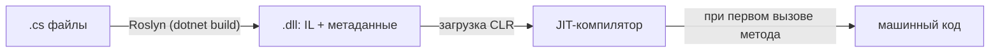

# Платформа .NET и dotnet CLI: продвинутая теория

🌐 **Русский** · [English](advanced.en.md)

**Уровни:** [обзор](overview.ru.md) · [1. Базовая](basics.ru.md) · **2. Продвинутая** · [3. Экспертная](expert.ru.md) · [4. Квиз](quiz.ru.md) · [упражнения](exercises.ru.md) · [5–6. Код и тесты](code/)

## От исходника до машинного кода



Компилятор C# не создаёт машинный код. Он выдаёт **IL** (Intermediate Language) — байт-код для абстрактной стековой машины — и **метаданные**: описание всех типов, методов и ссылок на другие сборки. Это даёт три вещи:

- одна и та же сборка работает на x64, Arm64, Windows и Linux;
- по метаданным работает рефлексия: программа может исследовать сама себя;
- C#, F# и VB.NET компилируются в один и тот же IL и свободно вызывают друг друга.

## JIT: компиляция при первом вызове

JIT-компилятор переводит метод в машинный код **при первом вызове** и запоминает результат. Это можно увидеть через `JitInfo`:

```csharp
public static class JitObserver
{
    // Counts methods JIT-compiled on the current thread while the action runs.
    // currentThread: true ignores background compilation (e.g. tier-1 recompilation).
    public static long CountJitCompilations(Action action)
    {
        long before = JitInfo.GetCompiledMethodCount(currentThread: true);
        action();
        return JitInfo.GetCompiledMethodCount(currentThread: true) - before;
    }

    // NoInlining keeps the method a separate unit of JIT compilation.
    [MethodImpl(MethodImplOptions.NoInlining)]
    public static int Double(int x) => x * 2;
}
```

Тест вызывает один и тот же делегат дважды:

```csharp
// The same delegate is used twice, so the second call needs no new code.
Action call = () => JitObserver.Double(21);

long firstCall = JitObserver.CountJitCompilations(call);
long secondCall = JitObserver.CountJitCompilations(call);
```

Реальный результат: `firstCall = 2`, `secondCall = 0`. При первом вызове скомпилированы два метода — лямбда и `Double`, второй вызов использует готовый код. Код: [Ex03_JitObserver.cs](code/Examples/Ex03_JitObserver.cs).

## Tiered compilation

JIT стоит перед выбором: компилировать быстро (быстрый старт, но код медленнее) или оптимизировать (быстрый код, но долгий старт). Многоуровневая компиляция (tiered compilation) делает и то и другое. Она включена по умолчанию начиная с .NET Core 3.0:

1. **Первый уровень** — быстрый JIT (quick JIT) без тяжёлых оптимизаций или загрузка готового кода ReadyToRun.
2. **Второй уровень** — часто вызываемые («горячие») методы перекомпилируются оптимизирующим JIT в фоновом потоке.

Поведением управляют настройки runtime `TieredCompilation`, `TC_QuickJit` и `TieredPGO`. Последняя включает динамическую оптимизацию по профилю (dynamic PGO): JIT учитывает, как код реально выполнялся на первом уровне. Практическое следствие: первые вызовы метода медленнее последующих, поэтому производительность нельзя мерить одним вызовом. Для замеров есть BenchmarkDotNet — он делает прогрев (модуль 19).

## Ahead-of-time: ReadyToRun и Native AOT

Код можно скомпилировать в машинный заранее (ahead-of-time, AOT):

- **ReadyToRun** (`<PublishReadyToRun>true</PublishReadyToRun>`) кладёт готовый машинный код рядом с IL. Старт быстрее, JIT остаётся и перекомпилирует горячие методы.
- **Native AOT** (`<PublishAot>true</PublishAot>`) собирает один нативный исполняемый файл без JIT. Старт очень быстрый, потребление памяти меньше. Ограничения: нет динамической загрузки сборок (`Assembly.LoadFile`), нет генерации кода во время выполнения (`System.Reflection.Emit`), обязателен trimming (удаление неиспользуемого кода). В Windows для сборки нужен Visual Studio 2022 или новее с workload **Desktop development with C++**.

Спросить runtime, можно ли генерировать код во время выполнения:

```csharp
public static class ExecutionModel
{
    // false under Native AOT, and also when the project sets PublishAot=true (see expert).
    public static bool CanGenerateCodeAtRuntime => RuntimeFeature.IsDynamicCodeSupported;

    public static string Describe() => CanGenerateCodeAtRuntime
        ? "Dynamic code is supported"
        : "Dynamic code is not supported";
}
```

В обычном проекте (тесты этого модуля) результат — `Dynamic code is supported`. Код: [Ex04_ExecutionModel.cs](code/Examples/Ex04_ExecutionModel.cs).

## Публикация

| Режим | Команда | Что получается |
|---|---|---|
| Framework-dependent (по умолчанию) | `dotnet publish -c Release` | только ваши сборки; на машине нужен установленный runtime |
| Self-contained | `dotnet publish -c Release -r linux-x64 --self-contained` | приложение вместе с runtime; ничего ставить не нужно |
| Single-file | добавить `-p:PublishSingleFile=true` | один исполняемый файл |
| Trimmed | добавить `-p:PublishTrimmed=true` (только self-contained) | неиспользуемый код удалён, размер меньше |
| Native AOT | `<PublishAot>true</PublishAot>` + `dotnet publish -c Release -r win-x64` | нативный exe без JIT |

`-r` задаёт RID (runtime identifier) — целевую платформу: `win-x64`, `linux-x64`, `linux-arm64`, `osx-arm64`.

## Версии .NET и их поддержка

- Новая мажорная версия выходит каждый год в ноябре.
- Чётные версии — **LTS** (long-term support): поддержка 3 года. Нечётные — **STS** (standard-term support): 2 года.
- .NET 10 вышел 11 ноября 2025 года, это LTS, поддержка до 14 ноября 2028 года.
- .NET 11 вышел 10 ноября 2026 года, это STS, поддержка тоже до 14 ноября 2028 года. На .NET 11 нацелен этот трек.
- Версия C# по умолчанию привязана к TFM. Для `net11.0` это C# 15, для `net10.0` — C# 14. Проверить можно директивой `#error version`: компилятор сообщит свою версию и версию языка.

## global.json

`global.json` в папке проекта или выше настраивает SDK для всего, что лежит под этой папкой:

```json
{
  "sdk": {
    "version": "11.0.100",
    "rollForward": "latestFeature"
  }
}
```

- `sdk.version` и `rollForward` фиксируют, какой SDK использовать, если их установлено несколько.
- Секция `test` выбирает режим `dotnet test`. В `code/` этого модуля лежит такой файл:

```json
{
  "test": {
    "runner": "Microsoft.Testing.Platform"
  }
}
```

Он нужен потому, что xUnit v3 работает на Microsoft.Testing.Platform (MTP), а старый режим VSTest для MTP-проектов в .NET 10 SDK и новее не поддерживается (проверено на SDK 10.0.302 и 11.0.100). Начиная с .NET 11 вместо `global.json` можно задать переменную окружения `DOTNET_TEST_RUNNER=Microsoft.Testing.Platform`.

## Частые ошибки

- ❌ Считать `dotnet --version` версией платформы → ✅ это версия SDK; runtime смотри в `dotnet --list-runtimes` или `RuntimeInformation.FrameworkDescription`.
- ❌ `dotnet run` в папке, где нет проекта или их несколько → ✅ `dotnet run --project path/to/App.csproj`.
- ❌ Коммитить `bin/` и `obj/` → ✅ добавить их в `.gitignore`.
- ❌ Ждать, что Native AOT-сборка заработает «из коробки» в Windows → ✅ поставить workload Desktop development with C++.
- ❌ Тесты на xUnit v3 падают с ошибкой `Testing with VSTest target is no longer supported by Microsoft.Testing.Platform on .NET 10 SDK and later` → ✅ включить MTP в `global.json` (см. выше).
- ❌ Игнорировать предупреждение `NU1903` (известная уязвимость в пакете) → ✅ обновить SDK или пакет. Такое предупреждение выдавал, например, file-based app на SDK 10.0.302 с устаревшим runtime 10.0.10.

## Связанные материалы

- Дальше: [02 · Типы и переменные](../02-types-and-variables/overview.ru.md), [03 · Управляющие конструкции и методы](../03-control-flow-and-methods/overview.ru.md)
- То же в других треках: [Python](../../../python/overview.ru.md) — интерпретатор CPython, uv и `pyproject.toml` вместо dotnet CLI и `.csproj`; [Kubernetes](../../../kubernetes/overview.ru.md) — контейнеры для .NET-приложений

## Источники

- [Обзор .NET](https://learn.microsoft.com/dotnet/core/introduction)
- [dotnet CLI](https://learn.microsoft.com/dotnet/core/tools/)
- [File-based apps](https://learn.microsoft.com/dotnet/core/sdk/file-based-apps)
- [Настройки компиляции runtime: tiered compilation, PGO](https://learn.microsoft.com/dotnet/core/runtime-config/compilation)
- [Tiered compilation: дизайн (.NET Core 2.1)](https://github.com/dotnet/runtime/blob/main/docs/design/features/tiered-compilation.md)
- [Native AOT](https://learn.microsoft.com/dotnet/core/deploying/native-aot/)
- [Выбор версии .NET и roll-forward](https://learn.microsoft.com/dotnet/core/versions/selection)
- [Релизы и поддержка .NET](https://learn.microsoft.com/dotnet/core/releases-and-support)
- [dotnet test и Microsoft.Testing.Platform](https://learn.microsoft.com/dotnet/core/testing/unit-testing-with-dotnet-test)
- [Версия языка C#](https://learn.microsoft.com/dotnet/csharp/language-reference/configure-language-version)
