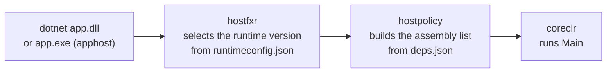

# The .NET platform and dotnet CLI: expert

🌐 [Русский](expert.ru.md) · **English**

**Levels:** [overview](overview.en.md) · [1. Basics](basics.en.md) · [2. Advanced](advanced.en.md) · **3. Expert** · [4. Quiz](quiz.en.md) · [exercises](exercises.en.md) · [5–6. Code and tests](code/)

## How an app starts



- `dotnet` (the muxer) or the apphost (`app.exe`, created when the app is built) starts **hostfxr**.
- hostfxr reads `app.runtimeconfig.json` and selects the shared framework version.
- **hostpolicy** uses `app.deps.json` to build the list of the app's assemblies and dependencies.
- **coreclr** is the runtime itself: it initializes the GC and JIT, loads assemblies and calls `Main`.

Every step can be observed: the `COREHOST_TRACE=1` and `COREHOST_TRACEFILE=<path>` environment variables turn on host tracing. It shows hostfxr reading `runtimeconfig.json` and choosing the framework version (`version_compatibility_range=minor` is exactly the `Minor` policy), and hostpolicy loading the `deps.json` files of the framework and the app.

The real `runtimeconfig.json` of this module's test project:

```json
{
  "runtimeOptions": {
    "tfm": "net11.0",
    "framework": {
      "name": "Microsoft.NETCore.App",
      "version": "11.0.0"
    },
    "configProperties": {
      "System.Runtime.Serialization.EnableUnsafeBinaryFormatterSerialization": false
    }
  }
}
```

Version `11.0.0` is requested — the minimum acceptable one. When the module targeted .NET 10, this file asked for `10.0.0`, and the tests ran on the installed `10.0.10`. This is **roll-forward**:

- Moving to the latest installed patch always happens automatically.
- If the requested minor version is missing, the default `Minor` policy allows moving to a newer minor version of the same major. It does not move to a new major version (`11.0`).
- The policy is changed with the `<RollForward>` project property: `LatestPatch`, `Minor`, `LatestMinor`, `Major`, `LatestMajor`, `Disable`.

Parsing `runtimeconfig.json` is [exercise 3](exercises.en.md).

## IL from the inside

IL consists of instructions for a stack machine: arguments are pushed onto the stack, an operation pops them and pushes the result.

```csharp
public static class IlInspector
{
    public static int Add(int a, int b) => a + b;

    // The raw IL body of a method, exactly as it is stored in the assembly.
    public static byte[] GetIl(MethodInfo method) =>
        method.GetMethodBody()?.GetILAsByteArray() ?? [];

    public static string AddIlAsHex() =>
        Convert.ToHexString(GetIl(typeof(IlInspector).GetMethod(nameof(Add))!));
}
```

```text
0203582A
```

| Byte | Instruction | Action |
|---|---|---|
| `02` | `ldarg.0` | push argument `a` onto the stack |
| `03` | `ldarg.1` | push argument `b` onto the stack |
| `58` | `add` | pop two values, push their sum |
| `2A` | `ret` | return the value on top of the stack |

For this method the IL is the same in Debug and Release — a test checks it in both configurations. ILSpy or IDE plugins are convenient for viewing IL. Code: [Ex05_IlInspector.cs](code/Examples/Ex05_IlInspector.cs).

## Tiered compilation from the inside

In the original design of tiered compilation (.NET Core 2.1), a method moved to the second tier after **30 calls**. Call counting started after a startup delay of **100 ms** so as not to slow down app startup. The mechanism has evolved since then (ReadyToRun code, dynamic PGO), so the exact thresholds are an implementation detail, not a contract. The idea is what matters: the runtime spends optimization effort only on code that is actually hot.

## The trap: PublishAot in file-based apps

A file-based app is not just "a project without a file". Converting it with `dotnet project convert` shows which properties are set implicitly:

```xml
<PropertyGroup>
  <OutputType>Exe</OutputType>
  <TargetFramework>net11.0</TargetFramework>
  <ImplicitUsings>enable</ImplicitUsings>
  <Nullable>enable</Nullable>
  <PublishAot>true</PublishAot>
  <PackAsTool>true</PackAsTool>
  <UserSecretsId>…</UserSecretsId>
</PropertyGroup>
```

`PublishAot=true` takes effect on a plain `dotnet run`, not only when publishing. The SDK writes the `"System.Runtime.CompilerServices.RuntimeFeature.IsDynamicCodeSupported": false` switch into `runtimeconfig.json`, and the runtime reports Native AOT limitations even though the code is executed by the JIT. Let's check:

```csharp
Console.WriteLine($"IsDynamicCodeSupported={RuntimeFeature.IsDynamicCodeSupported}");
Console.WriteLine($"IsDynamicCodeCompiled={RuntimeFeature.IsDynamicCodeCompiled}");

// Yet the JIT is clearly working: calling a new method compiles it.
long before = JitInfo.GetCompiledMethodCount(currentThread: true);
Helper.Touch();
long after = JitInfo.GetCompiledMethodCount(currentThread: true);
Console.WriteLine($"JIT compiled during first call: {after - before}");
```

```text
> dotnet run aot-check.cs
IsDynamicCodeSupported=False
IsDynamicCodeCompiled=False
JIT compiled during first call: 1
```

Both `RuntimeFeature` flags are `False`, while `JitInfo` shows that the JIT is working. This way the SDK shows in advance the behavior you will get after an AOT publish. Takeaways:

- `RuntimeFeature` reflects the allowed capabilities, not the actual way the code is executed;
- if a file-based app uses `Reflection.Emit` or other dynamic code generation, add `#:property PublishAot=false`.

Code: [aot-check.cs](code/FileBasedApp/aot-check.cs), test: [FileBasedAppTests.cs](code/Tests/FileBasedAppTests.cs).

## Reference

### dotnet CLI commands

| Command | Purpose | Useful options |
|---|---|---|
| `dotnet new <template>` | create a project or file | `-o <folder>`, `-n <name>`; `dotnet new list` — all templates |
| `dotnet build` | build | `-c Release`, `-f <tfm>`, `-r <rid>`, `-p:Name=Value`, `-bl` (MSBuild binary log) |
| `dotnet run` | build and run | `--project <path>`, `-f <tfm>`, `-c`, `-- <program arguments>`; `dotnet run app.cs` |
| `dotnet test` | build and run tests | `--filter`, `-c` |
| `dotnet watch` | run and restart on file changes, with hot reload | `dotnet watch run`, `dotnet watch test`, `--no-hot-reload` |
| `dotnet format` | bring code in line with `.editorconfig` rules | `--verify-no-changes` — a CI check |
| `dotnet publish` | prepare for deployment | `-c Release`, `-r <rid>`, `--self-contained`, `-p:PublishSingleFile=true` |
| `dotnet add package` | add a NuGet package | `--version`, `--prerelease` |
| `dotnet package list` | the project's packages | `--vulnerable`, `--outdated`, `--deprecated`, `--include-transitive` |
| `dotnet package search` | search NuGet | `--exact-match`, `--take`, `--format json` |
| `dotnet sln add / remove / list` | work with a solution | |
| `dotnet tool install` | install a tool | `-g` — globally, without `-g` — into the local manifest |
| `dotnet dnx <package>` (or `dnx`) | run a tool without installing it | |
| `dotnet project convert app.cs` | file-based app → project | |
| `dotnet workload list / install` | extra workloads (MAUI, WebAssembly) | |
| `dotnet clean` | delete build output | |
| `dotnet --info` | SDK, runtime, environment | |

### Common project properties (MSBuild)

| Property | What it does |
|---|---|
| `TargetFramework` / `TargetFrameworks` | one platform / several separated by `;` |
| `OutputType` | `Exe`, `WinExe`; `Library` by default |
| `Nullable`, `ImplicitUsings`, `LangVersion` | language settings |
| `TreatWarningsAsErrors`, `WarningsAsErrors`, `NoWarn` | warnings as errors, selectively, disabled |
| `AssemblyName`, `RootNamespace`, `Version` | assembly name, namespace, version |
| `CheckForOverflowUnderflow` | `checked` arithmetic by default |
| `InvariantGlobalization` | an app without culture data: smaller size, but cultures such as `de-DE` are unavailable |
| `RollForward` | runtime version selection policy |
| `ServerGarbageCollection`, `ConcurrentGarbageCollection`, `TieredCompilation`, `TieredPGO` | runtime settings, written into `runtimeconfig.json` |
| `PublishAot`, `PublishTrimmed`, `PublishSingleFile`, `PublishReadyToRun`, `SelfContained`, `RuntimeIdentifier` | publishing |
| `GenerateDocumentationFile` | XML documentation from `///` comments |
| `ManagePackageVersionsCentrally` | Central Package Management |
| `RestorePackagesWithLockFile` | the `packages.lock.json` lock file |

### Directory.Build.props and Central Package Management

`Directory.Build.props` sets common properties for every project below it in the folder tree:

```xml
<Project>
  <PropertyGroup>
    <Nullable>enable</Nullable>
    <ImplicitUsings>enable</ImplicitUsings>
    <Company>Learning</Company>
  </PropertyGroup>
</Project>
```

MSBuild searches for this file upwards from the project folder and imports **only the first one found**. If a nested `Directory.Build.props` should extend the outer one, the outer file is imported explicitly with `<Import>`.

Central Package Management moves package versions into a single `Directory.Packages.props` file, and projects reference packages without versions:

```xml
<!-- Directory.Packages.props -->
<Project>
  <PropertyGroup>
    <ManagePackageVersionsCentrally>true</ManagePackageVersionsCentrally>
  </PropertyGroup>
  <ItemGroup>
    <PackageVersion Include="xunit.v3.assert" Version="4.0.3" />
  </ItemGroup>
</Project>
```

```xml
<!-- Lib.csproj -->
<ItemGroup>
  <PackageReference Include="xunit.v3.assert" />
</ItemGroup>
```

### Multi-targeting

One library can be built for several platforms at once:

```xml
<PropertyGroup>
  <TargetFrameworks>net11.0;net10.0</TargetFrameworks>
</PropertyGroup>
```

For each platform the compiler defines conditional compilation symbols, so the code can differ:

```csharp
namespace Lib;
public static class Info
{
#if NET11_0_OR_GREATER
    public const string Built = "net11.0 or greater";
#elif NET10_0
    public const string Built = "net10.0";
#endif
}
```

`dotnet run --framework net11.0` prints `net11.0 or greater`, `dotnet run --framework net10.0` prints `net10.0`.

### .NET tools (dotnet tools)

- A global tool: `dotnet tool install -g dotnet-counters` — available in any folder.
- A local tool is pinned in the repository manifest: `dotnet new tool-manifest` (SDK 11 creates `dotnet-tools.json` in the current folder), then `dotnet tool install dotnet-ef`. On another machine — `dotnet tool restore`.
- A one-off run without installing: `dotnet dnx <package>` (or `dnx <package>`).
- Diagnosing a running app: `dotnet-counters` (metrics), `dotnet-trace` (tracing), `dotnet-dump` and `dotnet-gcdump` (dumps).

### NuGet: versions, dependency resolution, auditing

| Version notation | Meaning |
|---|---|
| `Version="1.2.3"` | **at least** 1.2.3 (a minimum version, not an exact one) |
| `Version="[1.2.3]"` | exactly 1.2.3 |
| `Version="[1.0,2.0)"` | from 1.0 inclusive to 2.0 exclusive |
| `Version="1.*"` | floating: the newest 1.x |

- NuGet picks the **lowest applicable** version. If `1.2.3` is not in the source, the nearest newer one is taken with warning `NU1603`.
- If a package is referenced with different versions, the project's direct reference wins over a transitive one.
- Vulnerability auditing on restore: `NU1901`–`NU1904` — low, moderate, high, critical severity. The full list: `dotnet package list --vulnerable`.
- For projects targeting `net10.0` or later, auditing checks transitive dependencies too by default (`NuGetAuditMode` = `all`); for older targets — only direct ones (`direct`).
- Reproducible restore: `<RestorePackagesWithLockFile>true</RestorePackagesWithLockFile>` creates `packages.lock.json`, and `dotnet restore --locked-mode` fails if the dependencies changed.
- Package sources are set in `nuget.config`. With Central Package Management and several sources, NuGet produces `NU1507` and asks you to configure package source mapping.

### runtimeconfig.json and environment variables

Runtime properties from the `.csproj` end up in the `configProperties` section of `runtimeconfig.json`. For example, `<InvariantGlobalization>true</InvariantGlobalization>` becomes `"System.Globalization.Invariant": true`. The same settings can be set at launch with environment variables prefixed with `DOTNET_`: `DOTNET_TieredPGO=0`, `DOTNET_gcServer=1`.

## Gotchas

### global.json in a parent folder

`global.json` applies to every folder below it. If it requires an SDK that is not installed, even commands unrelated to the project break:

```text
> dotnet --version
...
A compatible .NET SDK was not found.
Requested SDK version: 99.0.100
```

With puzzling SDK errors, first look for a `global.json` higher up the folder tree.

### A nested Directory.Build.props disables the outer one

The outer `Directory.Build.props` sets `<Company>Outer</Company>`, the nested one sets `<Product>Inner</Product>`. For a project in the nested folder the real result is `Company=[App] Product=[Inner]`. The outer file was not imported, and `Company` got its default value — the assembly name.

### Version="1.0.0" is a minimum

`<PackageReference Include="xunit.v3.assert" Version="3.99.0" />` does not fail when version 3.99.0 is missing. NuGet installs 4.0.0 and warns `NU1603`: "depends on xunit.v3.assert (>= 3.99.0)". To forbid an upgrade, use the exact version `[3.99.0]`.

### Several TFMs and dotnet run

A project with `<TargetFrameworks>net11.0;net10.0</TargetFrameworks>` does not start with plain `dotnet run`: the SDK reports that there are several frameworks and asks for `--framework`.

### InvariantGlobalization breaks cultures

With `<InvariantGlobalization>true</InvariantGlobalization>`, calling `CultureInfo.GetCultureInfo("de-DE")` throws `CultureNotFoundException`. The mode reduces the app size, but culture-aware formatting (see [02 · Types and variables](../02-types-and-variables/advanced.en.md)) stops working.

### An app does not move to a new major runtime version

An app built for `net11.0` will not start on a machine that has only the .NET 10 runtime: the `Minor` policy does not cross major versions. The reverse is also true: an app built for `net10.0` will not start on a machine with only .NET 11 without `<RollForward>Major</RollForward>`.

### Debug is not for measurements

`dotnet run` and `dotnet test` build the Debug configuration by default: compiler optimizations are off. Measure performance only in Release, and preferably with BenchmarkDotNet.

## Trade-offs and alternatives

| | JIT | ReadyToRun | Native AOT |
|---|---|---|---|
| Startup time | longer | faster | the fastest |
| Peak performance | high: tiered compilation, PGO | high: hot code is recompiled by the JIT | good, but without run-time optimizations |
| Deployment size | small (framework-dependent) | larger: IL + machine code | a single file with the runtime inside |
| Reflection.Emit, assembly loading | yes | yes | no |
| Typical use | servers, desktop | apps where startup matters | CLI tools, serverless, containers |

## Interview questions

**1. How does the SDK differ from the runtime, and why do they have different version numbers?**

<details><summary>Answer</summary>

The runtime (CLR + BCL) is needed to run apps, the SDK (runtime + the Roslyn compiler, MSBuild, CLI, templates) is needed to develop them. They are different products with different release cycles: the SDK has feature bands (`1xx`, `2xx`, `3xx`), so SDK `11.0.100` and `10.0.302` contain runtime `11.0.0` and `10.0.10` respectively.

</details>

**2. What are IL and metadata? Why an intermediate language?**

<details><summary>Answer</summary>

IL is stack-machine bytecode, metadata describes types, methods and references. An intermediate language gives portability (one assembly on x64 and Arm64, Windows and Linux), reflection, and interoperability between .NET languages. IL is turned into machine code by the JIT on the first call of a method, or ahead of time by an AOT compiler.

</details>

**3. How does tiered compilation work? Why is the first call of a method slower?**

<details><summary>Answer</summary>

First, a method is compiled quickly without heavy optimizations (or ready-made ReadyToRun code is used), then frequently called methods are recompiled by the optimizing JIT in the background. The first call pays for JIT compilation, so performance is measured after a warm-up.

</details>

**4. How does ReadyToRun differ from Native AOT?**

<details><summary>Answer</summary>

ReadyToRun stores machine code next to the IL; the JIT stays and can recompile hot methods. Native AOT builds a native executable without a JIT: no `Reflection.Emit`, no dynamic assembly loading, trimming is required, but startup is the fastest and no installed runtime is needed.

</details>

**5. How does .NET choose the runtime version at startup?**

<details><summary>Answer</summary>

hostfxr reads `runtimeconfig.json`. The latest installed patch is always chosen. If the requested minor version is missing, the default `Minor` policy takes a newer minor version of the same major. Without `<RollForward>Major</RollForward>`, an app does not move to a new major version.

</details>

**6. How does `dotnet` choose the SDK version for a command?**

<details><summary>Answer</summary>

It looks for `global.json` from the current folder upwards. If the file exists, it uses `sdk.version` taking `sdk.rollForward` into account. If not, it takes the newest installed SDK (that is why after installing SDK 11 `dotnet --version` shows `11.0.100`).

</details>

**7. How does framework-dependent differ from self-contained and single-file?**

<details><summary>Answer</summary>

Framework-dependent contains only your assemblies and requires an installed runtime. Self-contained includes the runtime and is tied to a RID. Single-file packs the app into one executable. These settings are independent: there are self-contained single-file and framework-dependent single-file apps.

</details>

**8. What is in `runtimeconfig.json` and `deps.json`?**

<details><summary>Answer</summary>

`runtimeconfig.json` says which shared framework and version are needed, plus runtime settings (`configProperties`): GC, globalization, feature switches. `deps.json` lists the app's assemblies and dependencies with paths. The first is read by hostfxr, the second by hostpolicy.

</details>

**9. What is multi-targeting, and how do you write code for different platforms in one library?**

<details><summary>Answer</summary>

`<TargetFrameworks>net11.0;net10.0</TargetFrameworks>` builds the library for each platform separately. Differences in code are expressed with conditional compilation: `#if NET11_0_OR_GREATER`, `#elif NET10_0`.

</details>

**10. Why do you need `Directory.Build.props` and Central Package Management?**

<details><summary>Answer</summary>

`Directory.Build.props` removes duplication of common properties across many projects. Central Package Management (`Directory.Packages.props`) keeps all package versions in one place so the projects of a solution do not drift apart. The gotcha: only the nearest `Directory.Build.props` is imported.

</details>

**11. 🪤 `<PackageReference Include="X" Version="1.0.0" />` — is that exactly version 1.0.0?**

<details><summary>Answer</summary>

No. It is a minimum version: "1.0.0 or newer". If 1.0.0 is not in the source, NuGet takes the next one and warns `NU1603`. An exact version is written as `[1.0.0]`.

</details>

**12. 🪤 xUnit v3 tests stopped running after moving to the .NET 10 SDK. Why?**

<details><summary>Answer</summary>

xUnit v3 runs on Microsoft.Testing.Platform, while `dotnet test` in .NET 10+ works in the VSTest mode by default, which is no longer supported for MTP projects. You need a `global.json` with `"test": {"runner": "Microsoft.Testing.Platform"}` or, starting with .NET 11, the `DOTNET_TEST_RUNNER=Microsoft.Testing.Platform` variable.

</details>

**13. 🪤 Why is `RuntimeFeature.IsDynamicCodeSupported` `false` in a file-based app on a plain `dotnet run`?**

<details><summary>Answer</summary>

A file-based app implicitly gets `PublishAot=true`, and the SDK writes a switch into `runtimeconfig.json` that makes the runtime report Native AOT limitations already during development. The JIT is still working — `JitInfo` shows it.

</details>

**14. How does NuGet choose the version of a transitive dependency?**

<details><summary>Answer</summary>

It takes the lowest version that satisfies all constraints. If the project references the package directly, that version wins over the transitive one. That is why a vulnerable transitive dependency is fixed with a direct reference to a newer version.

</details>

## Cheat sheet

| Task | Command |
|---|---|
| SDK / runtime versions | `dotnet --list-sdks` / `dotnet --list-runtimes` |
| New project / solution | `dotnet new console -o App` / `dotnet new sln` |
| Add a project to a solution | `dotnet sln add App/App.csproj` |
| Run a file without a project | `dotnet run app.cs` |
| Script → project | `dotnet project convert app.cs` |
| Add a package | `dotnet add package Name` |
| Tests | `dotnet test`, a single test — `--filter "FullyQualifiedName~Name"` |
| Publish | `dotnet publish -c Release [-r RID] [--self-contained]` |
| Language version | `#error version` in any `.cs` |

## Related materials

- Next: [02 · Types and variables](../02-types-and-variables/overview.en.md), [03 · Control flow and methods](../03-control-flow-and-methods/overview.en.md)
- The `dotnet ef` local tool and migrations: [15 · EF Core](../15-ef-core/basics.en.md#migrations)
- GC settings in `runtimeconfig.json` and environment variables: [12 · Memory and GC](../12-memory-and-gc/expert.en.md#gc-settings)
- The same idea in other tracks: [Python](../../../python/overview.en.md) — the CPython interpreter, uv and `pyproject.toml` instead of the dotnet CLI and `.csproj`; [Kubernetes](../../../kubernetes/overview.en.md) — containers for .NET apps

## Sources

- [.NET overview](https://learn.microsoft.com/dotnet/core/introduction)
- [dotnet CLI](https://learn.microsoft.com/dotnet/core/tools/)
- [File-based apps](https://learn.microsoft.com/dotnet/core/sdk/file-based-apps)
- [Runtime compilation settings: tiered compilation, PGO](https://learn.microsoft.com/dotnet/core/runtime-config/compilation)
- [Tiered compilation: design (.NET Core 2.1)](https://github.com/dotnet/runtime/blob/main/docs/design/features/tiered-compilation.md)
- [Native AOT](https://learn.microsoft.com/dotnet/core/deploying/native-aot/)
- [.NET version selection and roll-forward](https://learn.microsoft.com/dotnet/core/versions/selection)
- [.NET releases and support](https://learn.microsoft.com/dotnet/core/releases-and-support)
- [dotnet test and Microsoft.Testing.Platform](https://learn.microsoft.com/dotnet/core/testing/unit-testing-with-dotnet-test)
- [C# language version](https://learn.microsoft.com/dotnet/csharp/language-reference/configure-language-version)
- [MSBuild: Directory.Build.props](https://learn.microsoft.com/visualstudio/msbuild/customize-by-directory)
- [Central Package Management](https://learn.microsoft.com/nuget/consume-packages/central-package-management)
- [Target frameworks and preprocessor symbols](https://learn.microsoft.com/dotnet/standard/frameworks)
- [NuGet package versioning](https://learn.microsoft.com/nuget/concepts/package-versioning)
- [NuGet dependency resolution](https://learn.microsoft.com/nuget/concepts/dependency-resolution)
- [Auditing NuGet packages](https://learn.microsoft.com/nuget/concepts/auditing-packages)
- [.NET tools](https://learn.microsoft.com/dotnet/core/tools/global-tools)
- [global.json](https://learn.microsoft.com/dotnet/core/tools/global-json)
