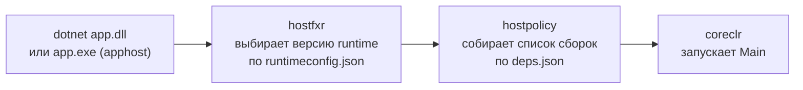

# Платформа .NET и dotnet CLI: экспертная теория

🌐 **Русский** · [English](expert.en.md)

**Уровни:** [обзор](overview.ru.md) · [1. Базовая](basics.ru.md) · [2. Продвинутая](advanced.ru.md) · **3. Экспертная** · [4. Квиз](quiz.ru.md) · [упражнения](exercises.ru.md) · [5–6. Код и тесты](code/)

## Как запускается приложение



- `dotnet` (muxer) или apphost (`app.exe`, создаётся при сборке приложения) запускает **hostfxr**.
- hostfxr читает `app.runtimeconfig.json` и выбирает версию shared framework.
- **hostpolicy** по `app.deps.json` собирает список сборок приложения и его зависимостей.
- **coreclr** — сам runtime: инициализирует GC и JIT, загружает сборки и вызывает `Main`.

Каждый шаг можно увидеть: переменные окружения `COREHOST_TRACE=1` и `COREHOST_TRACEFILE=<путь>` включают трассировку хоста. В ней видно, как hostfxr читает `runtimeconfig.json` и выбирает версию фреймворка (`version_compatibility_range=minor` — та самая политика `Minor`), а hostpolicy загружает `deps.json` фреймворка и приложения.

Реальный `runtimeconfig.json` тестового проекта этого модуля:

```json
{
  "runtimeOptions": {
    "tfm": "net11.0",
    "framework": {
      "name": "Microsoft.NETCore.App",
      "version": "11.0.0"
    },
    "configProperties": {
      "System.Runtime.Serialization.EnableUnsafeBinaryFormatterSerialization": false
    }
  }
}
```

Запрошена версия `11.0.0` — минимально допустимая. Когда модуль был нацелен на .NET 10, этот файл запрашивал `10.0.0`, а тесты выполнялись на установленном `10.0.10`. Это **roll-forward**:

- Переход на последний установленный патч происходит всегда, автоматически.
- Если нужной minor-версии нет, политика по умолчанию `Minor` разрешает перейти на более новую minor-версию той же мажорной. На новую мажорную (`11.0`) она не переходит.
- Политику меняют свойством `<RollForward>` в проекте: `LatestPatch`, `Minor`, `LatestMinor`, `Major`, `LatestMajor`, `Disable`.

Разбор `runtimeconfig.json` — [упражнение 3](exercises.ru.md).

## IL изнутри

IL — инструкции для стековой машины: аргументы кладутся на стек, операция снимает их и кладёт результат.

```csharp
public static class IlInspector
{
    public static int Add(int a, int b) => a + b;

    // The raw IL body of a method, exactly as it is stored in the assembly.
    public static byte[] GetIl(MethodInfo method) =>
        method.GetMethodBody()?.GetILAsByteArray() ?? [];

    public static string AddIlAsHex() =>
        Convert.ToHexString(GetIl(typeof(IlInspector).GetMethod(nameof(Add))!));
}
```

```text
0203582A
```

| Байт | Инструкция | Действие |
|---|---|---|
| `02` | `ldarg.0` | положить на стек аргумент `a` |
| `03` | `ldarg.1` | положить на стек аргумент `b` |
| `58` | `add` | снять два значения, положить сумму |
| `2A` | `ret` | вернуть значение с вершины стека |

Для этого метода IL одинаков в Debug и Release — это проверено тестом в обеих конфигурациях. Смотреть IL удобно в ILSpy или в плагинах IDE. Код: [Ex05_IlInspector.cs](code/Examples/Ex05_IlInspector.cs).

## Tiered compilation изнутри

В исходном дизайне многоуровневой компиляции (.NET Core 2.1) метод переходил на второй уровень после **30 вызовов**. Подсчёт вызовов начинался после стартовой задержки в **100 мс**, чтобы не мешать запуску приложения. С тех пор механизм развивался (ReadyToRun-код, динамический PGO), поэтому конкретные пороги — деталь реализации, а не контракт. Важно понимать идею: runtime тратит ресурсы на оптимизацию только того кода, который реально горячий.

## Ловушка: PublishAot в file-based apps

File-based app не просто «проект без файла». Если сконвертировать его командой `dotnet project convert`, видно, какие свойства задаются неявно:

```xml
<PropertyGroup>
  <OutputType>Exe</OutputType>
  <TargetFramework>net11.0</TargetFramework>
  <ImplicitUsings>enable</ImplicitUsings>
  <Nullable>enable</Nullable>
  <PublishAot>true</PublishAot>
  <PackAsTool>true</PackAsTool>
  <UserSecretsId>…</UserSecretsId>
</PropertyGroup>
```

`PublishAot=true` действует уже при обычном `dotnet run`, а не только при публикации. SDK записывает в `runtimeconfig.json` переключатель `"System.Runtime.CompilerServices.RuntimeFeature.IsDynamicCodeSupported": false`, и runtime сообщает об ограничениях Native AOT, хотя код выполняется JIT-ом. Проверим:

```csharp
Console.WriteLine($"IsDynamicCodeSupported={RuntimeFeature.IsDynamicCodeSupported}");
Console.WriteLine($"IsDynamicCodeCompiled={RuntimeFeature.IsDynamicCodeCompiled}");

// Yet the JIT is clearly working: calling a new method compiles it.
long before = JitInfo.GetCompiledMethodCount(currentThread: true);
Helper.Touch();
long after = JitInfo.GetCompiledMethodCount(currentThread: true);
Console.WriteLine($"JIT compiled during first call: {after - before}");
```

```text
> dotnet run aot-check.cs
IsDynamicCodeSupported=False
IsDynamicCodeCompiled=False
JIT compiled during first call: 1
```

Оба флага `RuntimeFeature` равны `False`, а `JitInfo` показывает, что JIT работает. Так SDK заранее показывает поведение, которое будет после AOT-публикации. Выводы:

- `RuntimeFeature` отражает разрешённые возможности, а не фактический способ выполнения кода;
- если file-based app использует `Reflection.Emit` или другую динамическую генерацию кода, добавь `#:property PublishAot=false`.

Код: [aot-check.cs](code/FileBasedApp/aot-check.cs), тест: [FileBasedAppTests.cs](code/Tests/FileBasedAppTests.cs).

## Справочник

### Команды dotnet CLI

| Команда | Назначение | Полезные параметры |
|---|---|---|
| `dotnet new <шаблон>` | создать проект или файл | `-o <папка>`, `-n <имя>`; `dotnet new list` — все шаблоны |
| `dotnet build` | собрать | `-c Release`, `-f <tfm>`, `-r <rid>`, `-p:Имя=Значение`, `-bl` (двоичный лог MSBuild) |
| `dotnet run` | собрать и запустить | `--project <путь>`, `-f <tfm>`, `-c`, `-- <аргументы программы>`; `dotnet run app.cs` |
| `dotnet test` | собрать и запустить тесты | `--filter`, `-c` |
| `dotnet watch` | запустить и перезапускать при изменении файлов, с горячей перезагрузкой | `dotnet watch run`, `dotnet watch test`, `--no-hot-reload` |
| `dotnet format` | привести код к правилам `.editorconfig` | `--verify-no-changes` — проверка в CI |
| `dotnet publish` | подготовить к развёртыванию | `-c Release`, `-r <rid>`, `--self-contained`, `-p:PublishSingleFile=true` |
| `dotnet add package` | добавить NuGet-пакет | `--version`, `--prerelease` |
| `dotnet package list` | пакеты проекта | `--vulnerable`, `--outdated`, `--deprecated`, `--include-transitive` |
| `dotnet package search` | поиск в NuGet | `--exact-match`, `--take`, `--format json` |
| `dotnet sln add / remove / list` | работа с решением | |
| `dotnet tool install` | установить инструмент | `-g` — глобально, без `-g` — в локальный манифест |
| `dotnet dnx <пакет>` (или `dnx`) | запустить инструмент без установки | |
| `dotnet project convert app.cs` | file-based app → проект | |
| `dotnet workload list / install` | дополнительные workloads (MAUI, WebAssembly) | |
| `dotnet clean` | удалить результаты сборки | |
| `dotnet --info` | SDK, runtime, окружение | |

### Частые свойства проекта (MSBuild)

| Свойство | Что делает |
|---|---|
| `TargetFramework` / `TargetFrameworks` | одна платформа / несколько через `;` |
| `OutputType` | `Exe`, `WinExe`; по умолчанию `Library` |
| `Nullable`, `ImplicitUsings`, `LangVersion` | настройки языка |
| `TreatWarningsAsErrors`, `WarningsAsErrors`, `NoWarn` | предупреждения как ошибки, выборочно, отключение |
| `AssemblyName`, `RootNamespace`, `Version` | имя сборки, пространство имён, версия |
| `CheckForOverflowUnderflow` | `checked`-арифметика по умолчанию |
| `InvariantGlobalization` | приложение без данных о культурах: меньше размер, но культуры вроде `de-DE` недоступны |
| `RollForward` | политика выбора версии runtime |
| `ServerGarbageCollection`, `ConcurrentGarbageCollection`, `TieredCompilation`, `TieredPGO` | настройки runtime, попадают в `runtimeconfig.json` |
| `PublishAot`, `PublishTrimmed`, `PublishSingleFile`, `PublishReadyToRun`, `SelfContained`, `RuntimeIdentifier` | публикация |
| `GenerateDocumentationFile` | XML-документация из комментариев `///` |
| `ManagePackageVersionsCentrally` | Central Package Management |
| `RestorePackagesWithLockFile` | lock-файл `packages.lock.json` |

### Directory.Build.props и Central Package Management

`Directory.Build.props` задаёт общие свойства всем проектам ниже по дереву папок:

```xml
<Project>
  <PropertyGroup>
    <Nullable>enable</Nullable>
    <ImplicitUsings>enable</ImplicitUsings>
    <Company>Learning</Company>
  </PropertyGroup>
</Project>
```

MSBuild ищет этот файл вверх от папки проекта и импортирует **только первый найденный**. Если вложенный `Directory.Build.props` должен дополнять внешний, внешний подключают явно через `<Import>`.

Central Package Management выносит версии пакетов в один файл `Directory.Packages.props`, а проекты ссылаются на пакеты без версий:

```xml
<!-- Directory.Packages.props -->
<Project>
  <PropertyGroup>
    <ManagePackageVersionsCentrally>true</ManagePackageVersionsCentrally>
  </PropertyGroup>
  <ItemGroup>
    <PackageVersion Include="xunit.v3.assert" Version="4.0.3" />
  </ItemGroup>
</Project>
```

```xml
<!-- Lib.csproj -->
<ItemGroup>
  <PackageReference Include="xunit.v3.assert" />
</ItemGroup>
```

### Multi-targeting

Одна библиотека может собираться под несколько платформ сразу:

```xml
<PropertyGroup>
  <TargetFrameworks>net11.0;net10.0</TargetFrameworks>
</PropertyGroup>
```

Для каждой платформы компилятор определяет символы условной компиляции, и код может различаться:

```csharp
namespace Lib;
public static class Info
{
#if NET11_0_OR_GREATER
    public const string Built = "net11.0 or greater";
#elif NET10_0
    public const string Built = "net10.0";
#endif
}
```

`dotnet run --framework net11.0` выводит `net11.0 or greater`, `dotnet run --framework net10.0` — `net10.0`.

### Инструменты .NET (dotnet tools)

- Глобальный инструмент: `dotnet tool install -g dotnet-counters` — доступен в любой папке.
- Локальный инструмент фиксируется в манифесте репозитория: `dotnet new tool-manifest` (SDK 11 создаёт `dotnet-tools.json` в текущей папке), затем `dotnet tool install dotnet-ef`. На другой машине — `dotnet tool restore`.
- Разовый запуск без установки: `dotnet dnx <пакет>` (или `dnx <пакет>`).
- Диагностика работающего приложения: `dotnet-counters` (метрики), `dotnet-trace` (трассировка), `dotnet-dump` и `dotnet-gcdump` (дампы).

### NuGet: версии, разрешение зависимостей, аудит

| Запись версии | Значение |
|---|---|
| `Version="1.2.3"` | **не меньше** 1.2.3 (минимальная версия, а не точная) |
| `Version="[1.2.3]"` | ровно 1.2.3 |
| `Version="[1.0,2.0)"` | от 1.0 включительно до 2.0 не включительно |
| `Version="1.*"` | плавающая: самая новая 1.x |

- NuGet выбирает **наименьшую подходящую** версию. Если `1.2.3` нет в источнике, берётся ближайшая более новая с предупреждением `NU1603`.
- Если на один пакет ссылаются с разными версиями, прямая ссылка проекта побеждает транзитивную.
- Аудит уязвимостей при restore: `NU1901`–`NU1904` — низкая, средняя, высокая, критическая серьёзность. Полный список: `dotnet package list --vulnerable`.
- Для проектов `net10.0` и новее аудит по умолчанию проверяет и транзитивные зависимости (`NuGetAuditMode` = `all`), для более старых — только прямые (`direct`).
- Воспроизводимый restore: `<RestorePackagesWithLockFile>true</RestorePackagesWithLockFile>` создаёт `packages.lock.json`, а `dotnet restore --locked-mode` падает, если зависимости изменились.
- Источники пакетов задаются в `nuget.config`. При Central Package Management и нескольких источниках NuGet выдаёт `NU1507` и просит настроить package source mapping.

### runtimeconfig.json и переменные окружения

Свойства runtime из `.csproj` попадают в секцию `configProperties` файла `runtimeconfig.json`. Например, `<InvariantGlobalization>true</InvariantGlobalization>` превращается в `"System.Globalization.Invariant": true`. Те же настройки можно задать при запуске переменными окружения с префиксом `DOTNET_`: `DOTNET_TieredPGO=0`, `DOTNET_gcServer=1`.

## Подвохи

### global.json в родительской папке

`global.json` действует на все папки ниже себя. Если он требует SDK, которого нет на машине, ломаются даже команды, не связанные с проектом:

```text
> dotnet --version
...
A compatible .NET SDK was not found.
Requested SDK version: 99.0.100
```

При непонятных ошибках SDK первым делом ищи `global.json` выше по дереву папок.

### Вложенный Directory.Build.props отключает внешний

Внешний `Directory.Build.props` задаёт `<Company>Outer</Company>`, вложенный — `<Product>Inner</Product>`. У проекта во вложенной папке реальный результат: `Company=[App] Product=[Inner]`. Внешний файл не импортирован, а `Company` получил значение по умолчанию — имя сборки.

### Version="1.0.0" — это минимум

`<PackageReference Include="xunit.v3.assert" Version="3.99.0" />` при отсутствии версии 3.99.0 не падает. NuGet ставит 4.0.0 и предупреждает `NU1603`: «зависит от xunit.v3.assert (>= 3.99.0)». Чтобы запретить обновление, нужна точная версия `[3.99.0]`.

### Несколько TFM и dotnet run

Проект с `<TargetFrameworks>net11.0;net10.0</TargetFrameworks>` не запускается командой `dotnet run`: SDK сообщает, что платформ несколько, и просит указать `--framework`.

### InvariantGlobalization ломает культуры

С `<InvariantGlobalization>true</InvariantGlobalization>` вызов `CultureInfo.GetCultureInfo("de-DE")` бросает `CultureNotFoundException`. Режим уменьшает размер приложения, но форматирование по культурам (см. [02 · Типы и переменные](../02-types-and-variables/advanced.ru.md)) перестаёт работать.

### Приложение не переходит на новую мажорную версию runtime

Приложение под `net11.0` не запустится на машине, где установлен только runtime .NET 10: политика `Minor` не переходит между мажорными версиями. Наоборот — тоже: приложение под `net10.0` на машине только с .NET 11 не запустится без `<RollForward>Major</RollForward>`.

### Debug — не для замеров

`dotnet run` и `dotnet test` по умолчанию собирают конфигурацию Debug: оптимизации компилятора выключены. Производительность меряют только в Release, а лучше — через BenchmarkDotNet.

## Компромиссы и альтернативы

| | JIT | ReadyToRun | Native AOT |
|---|---|---|---|
| Время старта | дольше | быстрее | самое быстрое |
| Пиковая производительность | высокая: tiered compilation, PGO | высокая: горячий код перекомпилируется JIT | хорошая, но без оптимизаций во время выполнения |
| Размер поставки | маленький (framework-dependent) | больше: IL + машинный код | один файл, runtime внутри |
| Reflection.Emit, загрузка сборок | да | да | нет |
| Типичное применение | серверы, десктоп | приложения, где важен старт | CLI-утилиты, serverless, контейнеры |

## Вопросы с собеседований

**1. Чем SDK отличается от runtime и почему у них разные номера версий?**

<details><summary>Ответ</summary>

Runtime (CLR + BCL) нужен для запуска, SDK (runtime + компилятор Roslyn, MSBuild, CLI, шаблоны) — для разработки. Это разные продукты с разным циклом выпусков: у SDK есть полосы возможностей (`1xx`, `2xx`, `3xx`), поэтому SDK `11.0.100` и `10.0.302` содержат runtime `11.0.0` и `10.0.10` соответственно.

</details>

**2. Что такое IL и метаданные? Зачем промежуточный язык?**

<details><summary>Ответ</summary>

IL — байт-код стековой машины, метаданные — описание типов, методов и ссылок. Промежуточный язык даёт переносимость (одна сборка на x64 и Arm64, Windows и Linux), рефлексию и совместимость языков .NET между собой. В машинный код IL превращает JIT при первом вызове метода или AOT-компилятор заранее.

</details>

**3. Как работает tiered compilation? Почему первый вызов метода медленнее?**

<details><summary>Ответ</summary>

Сначала метод компилируется быстро и без тяжёлых оптимизаций (или берётся готовый ReadyToRun-код), потом часто вызываемые методы перекомпилируются оптимизирующим JIT в фоне. Первый вызов платит за JIT-компиляцию, поэтому производительность измеряют после прогрева.

</details>

**4. Чем ReadyToRun отличается от Native AOT?**

<details><summary>Ответ</summary>

ReadyToRun кладёт машинный код рядом с IL, JIT остаётся и может перекомпилировать горячие методы. Native AOT собирает нативный исполняемый файл без JIT: нет `Reflection.Emit` и динамической загрузки сборок, обязателен trimming, зато старт самый быстрый и не нужен установленный runtime.

</details>

**5. Как .NET выбирает версию runtime при запуске?**

<details><summary>Ответ</summary>

hostfxr читает `runtimeconfig.json`. Последний установленный патч выбирается всегда. Если нужной minor-версии нет, политика по умолчанию `Minor` берёт более новую minor-версию той же мажорной. На новую мажорную версию приложение без `<RollForward>Major</RollForward>` не переходит.

</details>

**6. Как `dotnet` выбирает версию SDK для команды?**

<details><summary>Ответ</summary>

Ищет `global.json` от текущей папки вверх. Если файл есть — использует `sdk.version` с учётом `sdk.rollForward`. Если нет — берёт самый новый установленный SDK (поэтому после установки SDK 11 `dotnet --version` показывает `11.0.100`).

</details>

**7. Чем framework-dependent отличается от self-contained и single-file?**

<details><summary>Ответ</summary>

Framework-dependent содержит только ваши сборки и требует установленный runtime. Self-contained включает runtime и привязан к RID. Single-file упаковывает приложение в один исполняемый файл. Это независимые настройки: бывает self-contained single-file и framework-dependent single-file.

</details>

**8. Что лежит в `runtimeconfig.json` и `deps.json`?**

<details><summary>Ответ</summary>

`runtimeconfig.json` — какой shared framework и какой версии нужен, плюс настройки runtime (`configProperties`): GC, глобализация, переключатели функций. `deps.json` — список сборок приложения и его зависимостей с путями. Первый читает hostfxr, второй — hostpolicy.

</details>

**9. Что такое multi-targeting и как писать код под разные платформы в одной библиотеке?**

<details><summary>Ответ</summary>

`<TargetFrameworks>net11.0;net10.0</TargetFrameworks>` собирает библиотеку под каждую платформу отдельно. Различия в коде оформляют условной компиляцией: `#if NET11_0_OR_GREATER`, `#elif NET10_0`.

</details>

**10. Зачем нужны `Directory.Build.props` и Central Package Management?**

<details><summary>Ответ</summary>

`Directory.Build.props` убирает дублирование общих свойств во многих проектах. Central Package Management (`Directory.Packages.props`) держит версии всех пакетов в одном месте, чтобы проекты решения не разъезжались по версиям. Подвох: импортируется только ближайший `Directory.Build.props`.

</details>

**11. 🪤 `<PackageReference Include="X" Version="1.0.0" />` — это ровно версия 1.0.0?**

<details><summary>Ответ</summary>

Нет. Это минимальная версия: «1.0.0 или новее». Если 1.0.0 нет в источнике, NuGet возьмёт следующую и предупредит `NU1603`. Точная версия записывается как `[1.0.0]`.

</details>

**12. 🪤 Тесты на xUnit v3 перестали запускаться после перехода на .NET 10 SDK. Почему?**

<details><summary>Ответ</summary>

xUnit v3 работает на Microsoft.Testing.Platform, а `dotnet test` в .NET 10+ по умолчанию работает в режиме VSTest, который для MTP-проектов больше не поддерживается. Нужен `global.json` с `"test": {"runner": "Microsoft.Testing.Platform"}` или, начиная с .NET 11, переменная `DOTNET_TEST_RUNNER=Microsoft.Testing.Platform`.

</details>

**13. 🪤 Почему в file-based app `RuntimeFeature.IsDynamicCodeSupported` равен `false` при обычном `dotnet run`?**

<details><summary>Ответ</summary>

File-based app неявно получает `PublishAot=true`, и SDK записывает в `runtimeconfig.json` переключатель, который заставляет runtime сообщать об ограничениях Native AOT уже при разработке. JIT при этом работает — это видно через `JitInfo`.

</details>

**14. Как NuGet выбирает версию транзитивной зависимости?**

<details><summary>Ответ</summary>

Берётся наименьшая версия, удовлетворяющая всем ограничениям. Если проект ссылается на пакет напрямую, его версия побеждает транзитивную. Поэтому уязвимую транзитивную зависимость исправляют прямой ссылкой на более новую версию.

</details>

## Шпаргалка

| Задача | Команда |
|---|---|
| Версии SDK / runtime | `dotnet --list-sdks` / `dotnet --list-runtimes` |
| Новый проект / решение | `dotnet new console -o App` / `dotnet new sln` |
| Добавить проект в решение | `dotnet sln add App/App.csproj` |
| Запустить файл без проекта | `dotnet run app.cs` |
| Скрипт → проект | `dotnet project convert app.cs` |
| Добавить пакет | `dotnet add package Name` |
| Тесты | `dotnet test`, один тест — `--filter "FullyQualifiedName~Name"` |
| Публикация | `dotnet publish -c Release [-r RID] [--self-contained]` |
| Версия языка | `#error version` в любом `.cs` |

## Связанные материалы

- Дальше: [02 · Типы и переменные](../02-types-and-variables/overview.ru.md), [03 · Управляющие конструкции и методы](../03-control-flow-and-methods/overview.ru.md)
- Локальный инструмент `dotnet ef` и миграции: [15 · EF Core](../15-ef-core/basics.ru.md#миграции)
- Настройки GC в `runtimeconfig.json` и переменных окружения: [12 · Память и GC](../12-memory-and-gc/expert.ru.md#настройки-gc)
- То же в других треках: [Python](../../../python/overview.ru.md) — интерпретатор CPython, uv и `pyproject.toml` вместо dotnet CLI и `.csproj`; [Kubernetes](../../../kubernetes/overview.ru.md) — контейнеры для .NET-приложений

## Источники

- [Обзор .NET](https://learn.microsoft.com/dotnet/core/introduction)
- [dotnet CLI](https://learn.microsoft.com/dotnet/core/tools/)
- [File-based apps](https://learn.microsoft.com/dotnet/core/sdk/file-based-apps)
- [Настройки компиляции runtime: tiered compilation, PGO](https://learn.microsoft.com/dotnet/core/runtime-config/compilation)
- [Tiered compilation: дизайн (.NET Core 2.1)](https://github.com/dotnet/runtime/blob/main/docs/design/features/tiered-compilation.md)
- [Native AOT](https://learn.microsoft.com/dotnet/core/deploying/native-aot/)
- [Выбор версии .NET и roll-forward](https://learn.microsoft.com/dotnet/core/versions/selection)
- [Релизы и поддержка .NET](https://learn.microsoft.com/dotnet/core/releases-and-support)
- [dotnet test и Microsoft.Testing.Platform](https://learn.microsoft.com/dotnet/core/testing/unit-testing-with-dotnet-test)
- [Версия языка C#](https://learn.microsoft.com/dotnet/csharp/language-reference/configure-language-version)
- [MSBuild: Directory.Build.props](https://learn.microsoft.com/visualstudio/msbuild/customize-by-directory)
- [Central Package Management](https://learn.microsoft.com/nuget/consume-packages/central-package-management)
- [Multi-targeting и символы препроцессора](https://learn.microsoft.com/dotnet/standard/frameworks)
- [Версии пакетов NuGet](https://learn.microsoft.com/nuget/concepts/package-versioning)
- [Разрешение зависимостей NuGet](https://learn.microsoft.com/nuget/concepts/dependency-resolution)
- [Аудит уязвимостей NuGet](https://learn.microsoft.com/nuget/concepts/auditing-packages)
- [Инструменты .NET](https://learn.microsoft.com/dotnet/core/tools/global-tools)
- [global.json](https://learn.microsoft.com/dotnet/core/tools/global-json)
