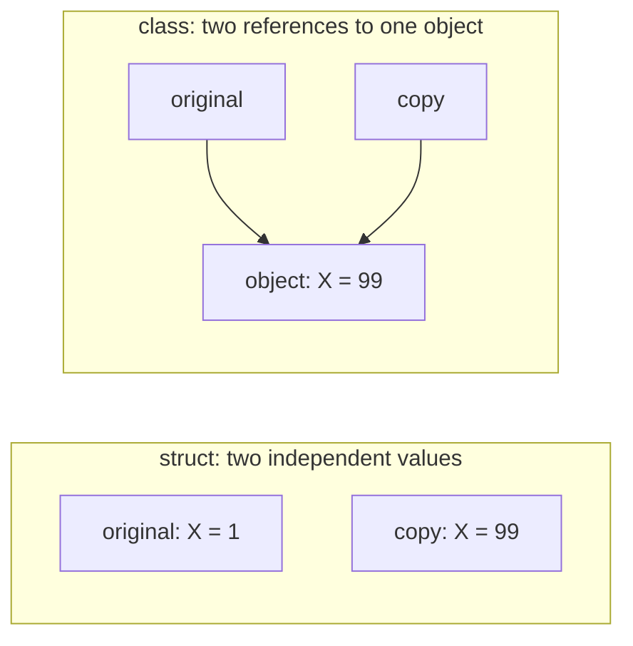

# Types and variables: basics

🌐 [Русский](basics.ru.md) · **English**

**Levels:** [overview](overview.en.md) · **1. Basics** · [2. Advanced](advanced.en.md) · [3. Expert](expert.en.md) · [4. Quiz](quiz.en.md) · [exercises](exercises.en.md) · [5–6. Code and tests](code/)

**Prerequisites:** [01 · The .NET platform and dotnet CLI](../01-dotnet-platform/overview.en.md)

## Static typing

Every variable in C# has a type known at compile time. The compiler checks that only operations valid for that type are performed. The `var` keyword does not make a variable dynamic: in `var count = 10;` the type `int` is inferred from the right-hand side once and never changes. Trying to assign `count = "ten"` later is compile error CS0029.

## Built-in types

C# keywords are aliases for .NET types: `int` and `System.Int32` are the same thing.

| C# | .NET | Size | What it holds |
|---|---|---|---|
| `bool` | `System.Boolean` | 1 byte | `true` / `false` |
| `byte` / `sbyte` | `System.Byte` / `System.SByte` | 1 byte | 0…255 / −128…127 |
| `short` / `ushort` | `System.Int16` / `System.UInt16` | 2 bytes | integers |
| `int` / `uint` | `System.Int32` / `System.UInt32` | 4 bytes | integers, `int` is about ±2.1 billion |
| `long` / `ulong` | `System.Int64` / `System.UInt64` | 8 bytes | integers |
| `float` | `System.Single` | 4 bytes | binary floating point, ~6–9 significant digits |
| `double` | `System.Double` | 8 bytes | binary floating point, ~15–17 significant digits |
| `decimal` | `System.Decimal` | 16 bytes | decimal number, 28–29 significant digits |
| `char` | `System.Char` | 2 bytes | one UTF-16 code unit |
| `string` | `System.String` | reference | an immutable UTF-16 string |
| `object` | `System.Object` | reference | the base type of all types |

Literals with suffixes: `5L` is `long`, `5f` is `float`, `5m` is `decimal`, `5.0` is `double`. Digit separator: `1_000_000`.

## Value types and reference types

This is the most important distinction in the .NET type system:

- **Value types**: all numeric types, `bool`, `char`, enums, structs (`struct`). A variable holds the value itself. Assignment **copies** the value.
- **Reference types**: classes (`class`), `string`, arrays, delegates, `object`. A variable holds a reference to an object. Assignment copies the **reference**, and both variables point to the same object.

```csharp
// A struct is a value type: assignment copies the whole value.
public struct PointStruct
{
    public int X;
    public int Y;
}

// A class is a reference type: assignment copies the reference, both variables see one object.
public class PointClass
{
    public int X;
    public int Y;
}

public static class CopySemantics
{
    public static (int Original, int Copy) MutateStructCopy()
    {
        var original = new PointStruct { X = 1 };
        var copy = original;
        copy.X = 99;
        return (original.X, copy.X);
    }

    public static (int Original, int Copy) MutateClassCopy()
    {
        var original = new PointClass { X = 1 };
        var copy = original;
        copy.X = 99;
        return (original.X, copy.X);
    }
```

Results: `MutateStructCopy()` → `(1, 99)`, `MutateClassCopy()` → `(99, 99)`.



The same rule applies to method arguments: `Reset(PointStruct point)` receives a copy and does not change the caller's variable, while `Reset(PointClass point)` changes the shared object. Code: [Ex01_CopySemantics.cs](code/Examples/Ex01_CopySemantics.cs).

## Type conversions

```csharp
public static class Conversions
{
    // Implicit: no data can be lost (int -> long).
    public static long Widen(int value) => value;

    // Explicit: the fractional part is truncated toward zero, not rounded.
    public static int Truncate(double value) => (int)value;

    // Unchecked by default: an overflow silently wraps around.
    public static int AddUnchecked(int a, int b) => a + b;

    // checked turns an overflow into an OverflowException.
    public static int AddChecked(int a, int b) => checked(a + b);

    // TryParse reports failure with false instead of throwing like int.Parse.
    public static int? ParseOrNull(string text) =>
        int.TryParse(text, NumberStyles.Integer, CultureInfo.InvariantCulture, out int value) ? value : null;

    // Math.Round uses banker's rounding by default: a tie goes to the nearest even number.
    public static double RoundDefault(double value) => Math.Round(value);

    public static double RoundAwayFromZero(double value) => Math.Round(value, MidpointRounding.AwayFromZero);
}
```

| Call | Result | Why |
|---|---|---|
| `Truncate(2.9)` / `Truncate(-2.9)` | `2` / `-2` | the cast drops the fractional part |
| `AddUnchecked(int.MaxValue, 1)` | `int.MinValue` | the overflow silently wraps around |
| `AddChecked(int.MaxValue, 1)` | `OverflowException` | `checked` enables the check |
| `ParseOrNull("4x2")` | `null` | `TryParse` does not throw |
| `RoundDefault(2.5)` / `RoundDefault(3.5)` | `2` / `4` | banker's rounding — to even |
| `RoundAwayFromZero(2.5)` | `3` | "school" rounding has to be requested explicitly |

- An **implicit** conversion is allowed when no data is lost: `int` → `long`, `int` → `double`.
- An **explicit** conversion (a cast, `(int)x`) is required when data may be lost.
- Strings are parsed with `Parse` (throws on error) or `TryParse` (returns `false`). User input is parsed with `TryParse`.

Code: [Ex02_Conversions.cs](code/Examples/Ex02_Conversions.cs).

## Strings

```csharp
public static class Strings
{
    // ToUpperInvariant returns a new string; the original one never changes.
    public static (string Original, string Upper) Immutability()
    {
        string original = "hello";
        string upper = original.ToUpperInvariant();
        return (original, upper);
    }

    // Interpolation with an explicit culture, so the decimal separator does not depend on the OS settings.
    public static string PriceTag(string name, decimal price) =>
        string.Create(CultureInfo.InvariantCulture, $"{name}: {price:F2}");

    // Verbatim (@) and raw (""") literals: backslashes and quotes need no escaping.
    public const string VerbatimPath = @"C:\temp\new";

    public const string RawJson = """
        {"name": "Alice", "path": "C:\temp"}
        """;
```

- Strings are **immutable**: every "modifying" method returns a new string. `Immutability()` → `("hello", "HELLO")`.
- **Interpolation** `$"…{expression:format}…"`: `PriceTag("Tea", 3.5m)` → `Tea: 3.50`.
- A **verbatim string** `@"…"` does not treat `\` as an escape character: handy for Windows paths.
- A **raw string literal** `"""…"""` (C# 11) needs no escaping for `\` or quotes. The indentation of the closing `"""` is removed from every line.
- String `==` compares **contents**, not references.
- To build a string in a loop, use `StringBuilder` so that a new string is not created on every iteration: `NumbersCsv(5)` → `0,1,2,3,4`.

Code: [Ex03_Strings.cs](code/Examples/Ex03_Strings.cs).

## Nullable value types: int?

A value type cannot be `null`. When "no value" is a normal result, use `int?` (that is `Nullable<int>`):

```csharp
// int? is Nullable<int>: a value type that can also hold "no value".
public static int? FindIndex(int[] values, int target)
{
    int index = Array.IndexOf(values, target);
    return index >= 0 ? index : null;
}
```

`FindIndex([10, 20, 30], 20)` → `1`, `FindIndex([10, 20, 30], 99)` → `null`. This is more honest than a "magic" `-1`. Code: [Ex04_NullHandling.cs](code/Examples/Ex04_NullHandling.cs).

## Related materials

- Prerequisites: [01 · The .NET platform and dotnet CLI](../01-dotnet-platform/overview.en.md) — the project, `<Nullable>enable</Nullable>`, building
- Next: [03 · Control flow and methods](../03-control-flow-and-methods/overview.en.md) — `ref`, `out`, `in` and passing value types to methods
- The same idea in other tracks: [Python](../../../python/overview.en.md) — dynamic typing and type annotations instead of static types

## Sources

- [C# built-in types](https://learn.microsoft.com/dotnet/csharp/language-reference/builtin-types/built-in-types)
- [Value types](https://learn.microsoft.com/dotnet/csharp/language-reference/builtin-types/value-types)
- [Reference types](https://learn.microsoft.com/dotnet/csharp/language-reference/keywords/reference-types)
- [Nullable reference types](https://learn.microsoft.com/dotnet/csharp/nullable-references)
- [Boxing and unboxing](https://learn.microsoft.com/dotnet/csharp/programming-guide/types/boxing-and-unboxing)
- [Floating-point numeric types](https://learn.microsoft.com/dotnet/csharp/language-reference/builtin-types/floating-point-numeric-types)
- [Best practices for comparing strings](https://learn.microsoft.com/dotnet/standard/base-types/best-practices-strings)
- [Raw string literals](https://learn.microsoft.com/dotnet/csharp/language-reference/tokens/raw-string)
- [`string.Intern`](https://learn.microsoft.com/dotnet/api/system.string.intern)
