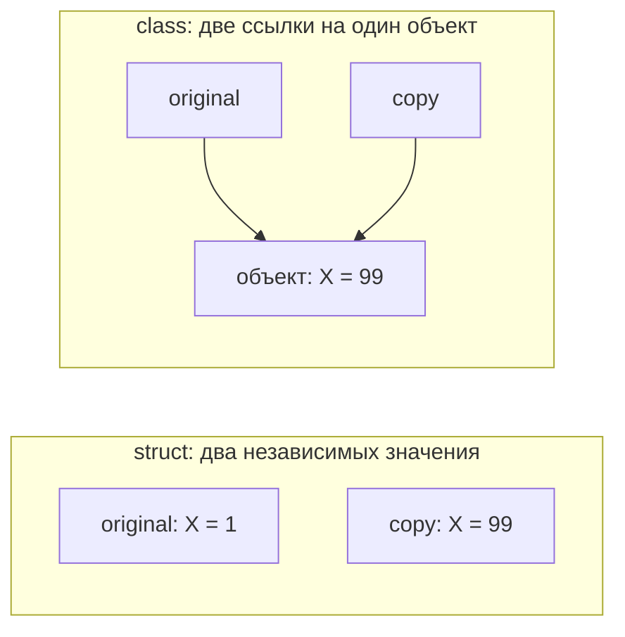

# Типы и переменные: базовая теория

🌐 **Русский** · [English](basics.en.md)

**Уровни:** [обзор](overview.ru.md) · **1. Базовая** · [2. Продвинутая](advanced.ru.md) · [3. Экспертная](expert.ru.md) · [4. Квиз](quiz.ru.md) · [упражнения](exercises.ru.md) · [5–6. Код и тесты](code/)

**Пререквизиты:** [01 · Платформа .NET и dotnet CLI](../01-dotnet-platform/overview.ru.md)

## Статическая типизация

У каждой переменной в C# есть тип, известный при компиляции. Компилятор проверяет, что с переменной делают только допустимые для типа вещи. Ключевое слово `var` не делает переменную динамической: в `var count = 10;` тип `int` выводится из правой части один раз и больше не меняется. Попытка потом присвоить `count = "ten"` — ошибка компиляции CS0029.

## Встроенные типы

Ключевые слова C# — это псевдонимы типов .NET: `int` и `System.Int32` — одно и то же.

| C# | .NET | Размер | Что хранит |
|---|---|---|---|
| `bool` | `System.Boolean` | 1 байт | `true` / `false` |
| `byte` / `sbyte` | `System.Byte` / `System.SByte` | 1 байт | 0…255 / −128…127 |
| `short` / `ushort` | `System.Int16` / `System.UInt16` | 2 байта | целые |
| `int` / `uint` | `System.Int32` / `System.UInt32` | 4 байта | целые, `int` — около ±2,1 млрд |
| `long` / `ulong` | `System.Int64` / `System.UInt64` | 8 байт | целые |
| `float` | `System.Single` | 4 байта | двоичное число с плавающей точкой, ~6–9 значащих цифр |
| `double` | `System.Double` | 8 байт | двоичное число с плавающей точкой, ~15–17 значащих цифр |
| `decimal` | `System.Decimal` | 16 байт | десятичное число, 28–29 значащих цифр |
| `char` | `System.Char` | 2 байта | одна кодовая единица UTF-16 |
| `string` | `System.String` | ссылка | неизменяемая строка UTF-16 |
| `object` | `System.Object` | ссылка | базовый тип для всех типов |

Литералы с суффиксами: `5L` — `long`, `5f` — `float`, `5m` — `decimal`, `5.0` — `double`. Разделитель разрядов: `1_000_000`.

## Значимые и ссылочные типы

Это самое важное различие в системе типов .NET:

- **Значимые типы** (value types): все числовые типы, `bool`, `char`, перечисления, структуры (`struct`). Переменная хранит само значение. При присваивании значение **копируется**.
- **Ссылочные типы** (reference types): классы (`class`), `string`, массивы, делегаты, `object`. Переменная хранит ссылку на объект. При присваивании копируется **ссылка**, и обе переменные указывают на один объект.

```csharp
// A struct is a value type: assignment copies the whole value.
public struct PointStruct
{
    public int X;
    public int Y;
}

// A class is a reference type: assignment copies the reference, both variables see one object.
public class PointClass
{
    public int X;
    public int Y;
}

public static class CopySemantics
{
    public static (int Original, int Copy) MutateStructCopy()
    {
        var original = new PointStruct { X = 1 };
        var copy = original;
        copy.X = 99;
        return (original.X, copy.X);
    }

    public static (int Original, int Copy) MutateClassCopy()
    {
        var original = new PointClass { X = 1 };
        var copy = original;
        copy.X = 99;
        return (original.X, copy.X);
    }
```

Результаты: `MutateStructCopy()` → `(1, 99)`, `MutateClassCopy()` → `(99, 99)`.



То же правило действует для аргументов методов: метод `Reset(PointStruct point)` получает копию и не меняет переменную вызывающего, а `Reset(PointClass point)` меняет общий объект. Код: [Ex01_CopySemantics.cs](code/Examples/Ex01_CopySemantics.cs).

## Преобразования типов

```csharp
public static class Conversions
{
    // Implicit: no data can be lost (int -> long).
    public static long Widen(int value) => value;

    // Explicit: the fractional part is truncated toward zero, not rounded.
    public static int Truncate(double value) => (int)value;

    // Unchecked by default: an overflow silently wraps around.
    public static int AddUnchecked(int a, int b) => a + b;

    // checked turns an overflow into an OverflowException.
    public static int AddChecked(int a, int b) => checked(a + b);

    // TryParse reports failure with false instead of throwing like int.Parse.
    public static int? ParseOrNull(string text) =>
        int.TryParse(text, NumberStyles.Integer, CultureInfo.InvariantCulture, out int value) ? value : null;

    // Math.Round uses banker's rounding by default: a tie goes to the nearest even number.
    public static double RoundDefault(double value) => Math.Round(value);

    public static double RoundAwayFromZero(double value) => Math.Round(value, MidpointRounding.AwayFromZero);
}
```

| Вызов | Результат | Почему |
|---|---|---|
| `Truncate(2.9)` / `Truncate(-2.9)` | `2` / `-2` | приведение отбрасывает дробную часть |
| `AddUnchecked(int.MaxValue, 1)` | `int.MinValue` | переполнение молча «заворачивается» |
| `AddChecked(int.MaxValue, 1)` | `OverflowException` | `checked` включает проверку |
| `ParseOrNull("4x2")` | `null` | `TryParse` не бросает исключение |
| `RoundDefault(2.5)` / `RoundDefault(3.5)` | `2` / `4` | банковское округление — к чётному |
| `RoundAwayFromZero(2.5)` | `3` | «школьное» округление нужно запросить явно |

- **Неявное** (implicit) преобразование разрешено, когда данные не теряются: `int` → `long`, `int` → `double`.
- **Явное** (explicit, приведение `(int)x`) нужно, когда данные могут потеряться.
- Для разбора строк есть `Parse` (бросает исключение при ошибке) и `TryParse` (возвращает `false`). Ввод пользователя разбирают через `TryParse`.

Код: [Ex02_Conversions.cs](code/Examples/Ex02_Conversions.cs).

## Строки

```csharp
public static class Strings
{
    // ToUpperInvariant returns a new string; the original one never changes.
    public static (string Original, string Upper) Immutability()
    {
        string original = "hello";
        string upper = original.ToUpperInvariant();
        return (original, upper);
    }

    // Interpolation with an explicit culture, so the decimal separator does not depend on the OS settings.
    public static string PriceTag(string name, decimal price) =>
        string.Create(CultureInfo.InvariantCulture, $"{name}: {price:F2}");

    // Verbatim (@) and raw (""") literals: backslashes and quotes need no escaping.
    public const string VerbatimPath = @"C:\temp\new";

    public const string RawJson = """
        {"name": "Alice", "path": "C:\temp"}
        """;
```

- Строки **неизменяемы**: любой «изменяющий» метод возвращает новую строку. `Immutability()` → `("hello", "HELLO")`.
- **Интерполяция** `$"…{выражение:формат}…"`: `PriceTag("Tea", 3.5m)` → `Tea: 3.50`.
- **Verbatim-строка** `@"…"` не обрабатывает `\` как escape-символ: удобно для путей Windows.
- **Raw string literal** `"""…"""` (C# 11) не требует экранирования ни `\`, ни кавычек. Отступ закрывающих `"""` вычитается из каждой строки.
- Сравнение строк `==` сравнивает **содержимое**, а не ссылки.
- Для сборки строки в цикле используют `StringBuilder`, чтобы не создавать новую строку на каждой итерации: `NumbersCsv(5)` → `0,1,2,3,4`.

Код: [Ex03_Strings.cs](code/Examples/Ex03_Strings.cs).

## Nullable value types: int?

Значимый тип не может быть `null`. Если «значения нет» — нормальный результат, используют `int?` (это `Nullable<int>`):

```csharp
// int? is Nullable<int>: a value type that can also hold "no value".
public static int? FindIndex(int[] values, int target)
{
    int index = Array.IndexOf(values, target);
    return index >= 0 ? index : null;
}
```

`FindIndex([10, 20, 30], 20)` → `1`, `FindIndex([10, 20, 30], 99)` → `null`. Это честнее, чем «магическое» `-1`. Код: [Ex04_NullHandling.cs](code/Examples/Ex04_NullHandling.cs).

## Связанные материалы

- Пререквизиты: [01 · Платформа .NET и dotnet CLI](../01-dotnet-platform/overview.ru.md) — проект, `<Nullable>enable</Nullable>`, сборка
- Дальше: [03 · Управляющие конструкции и методы](../03-control-flow-and-methods/overview.ru.md) — `ref`, `out`, `in` и передача значимых типов в методы
- То же в других треках: [Python](../../../python/overview.ru.md) — динамическая типизация и аннотации типов вместо статических типов

## Источники

- [Встроенные типы C#](https://learn.microsoft.com/dotnet/csharp/language-reference/builtin-types/built-in-types)
- [Значимые типы](https://learn.microsoft.com/dotnet/csharp/language-reference/builtin-types/value-types)
- [Ссылочные типы](https://learn.microsoft.com/dotnet/csharp/language-reference/keywords/reference-types)
- [Nullable reference types](https://learn.microsoft.com/dotnet/csharp/nullable-references)
- [Boxing и unboxing](https://learn.microsoft.com/dotnet/csharp/programming-guide/types/boxing-and-unboxing)
- [Числа с плавающей точкой](https://learn.microsoft.com/dotnet/csharp/language-reference/builtin-types/floating-point-numeric-types)
- [Сравнение строк](https://learn.microsoft.com/dotnet/standard/base-types/best-practices-strings)
- [Raw string literals](https://learn.microsoft.com/dotnet/csharp/language-reference/tokens/raw-string)
- [`string.Intern`](https://learn.microsoft.com/dotnet/api/system.string.intern)
