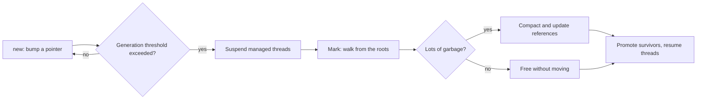

# Memory and GC: expert

🌐 [Русский](expert.ru.md) · **English**

**Levels:** [overview](overview.en.md) · [1. Basics](basics.en.md) · [2. Advanced](advanced.en.md) · **3. Expert** · [4. Quiz](quiz.en.md) · [exercises](exercises.en.md) · [5–6. Code and tests](code/)

## How a collection works



- **Allocation** is nearly free: the runtime allocates an object by bumping a pointer — almost as fast as on the stack.
- **Mark**: the GC walks the graph from the roots — stack variables reported by the JIT and the stack walker, static data, GC handles, the finalization queue — and marks reachable objects.
- **Compact**: surviving objects are moved next to each other, and references to them are updated. The GC compacts the heap only if it found a lot of garbage. Verified: after a plain `GC.Collect()`, `GC.GetGCMemoryInfo().Compacted` was `False`, and after `GC.Collect(2, GCCollectionMode.Forced, blocking: true, compacting: true)` it was `True`.
- **References from older generations to younger ones.** To collect generation 0 without walking all of generation 2, the GC must know which old objects reference young ones. So when a reference is written into a field, the JIT emits a write barrier call: it marks a "card" — the memory range where a reference changed. When collecting younger generations, the GC scans only the marked cards. That is why writing a reference into a field costs a bit more than writing a number.
- **Regions.** Since .NET 7, on 64-bit Windows and Linux the heap consists of regions — small blocks the GC hands between generations freely — instead of large segments.

A blocking collection suspends all managed threads. **Background GC** (on by default) collects generation 2 concurrently with the program, while generation 0 and 1 collections stay blocking but short.

## Object lifetime and the JIT

An object becomes collectible not at the end of a method and not after `obj = null`, but when the JIT stops reporting a reference to it to the GC. That depends on how the code was compiled:

| How the method was compiled | A local variable after its last use |
|---|---|
| Debug build | alive until the end of the method, even after `obj = null` |
| Release, first calls (tier 0, unoptimized) | may stay alive until the end of the method |
| Release, optimized code (tier 1, `AggressiveOptimization`) | may be collected right after its last use |

Verified with the same method: `var obj = new object(); var weak = new WeakReference(obj); obj = null; GC.Collect(); return weak.IsAlive;` returned `True` in Debug, `True` in Release on the first call, and `False` in Release with `[MethodImpl(MethodImplOptions.AggressiveOptimization)]`.

Two conclusions:

1. Tests of GC behavior create the object in a separate method marked `[MethodImpl(MethodImplOptions.NoInlining)]` — then the result is the same in Debug and Release. All examples in this module work this way.
2. If an object must live until a certain point — for example, while native code uses its resource — put `GC.KeepAlive(obj)` **at the end** of that section. See the gotchas below.

## Finalization internals

1. When an object with a finalizer is created, the GC registers it in the finalization queue.
2. When the object becomes unreachable, the GC does not free its memory but moves the object to the queue of objects ready for finalization. That queue is a root, so the object and everything it references survive the collection and are promoted to an older generation.
3. A separate finalizer thread calls the finalizers. The order is not guaranteed.
4. The memory is freed only at the next collection of the generation the object now lives in.

`GC.SuppressFinalize(this)` removes the object from the finalization queue — that is why an object released through `Dispose` is collected in a single collection.

**Resurrection**: a finalizer can store `this` in a static field, and the object becomes reachable again. Verified: the object was resurrected, but its finalizer was called once. When the reference was cleared and garbage collected again, the finalizer was not called — finalizing again requires `GC.ReRegisterForFinalize(this)`.

## LOH and POH

- **LOH** (large object heap): objects of 85,000 bytes and up. The size includes the header: on a 64-bit runtime an array has a 24-byte header, so `byte[84_975]` is created in generation 0 and `byte[84_976]` already in the LOH (verified). The LOH is collected only together with generation 2 and is **not compacted** by default: copying large objects is expensive. That is why the LOH fragments.
- One-time LOH compaction: `GCSettings.LargeObjectHeapCompactionMode = GCLargeObjectHeapCompactionMode.CompactOnce` — applies to the next full blocking collection. Verified: after `GC.Collect()` the collection was compacting, and the mode went back to `Default`.
- **POH** (pinned object heap): `GC.AllocateArray<T>(length, pinned: true)` creates an array that the GC never moves. `GC.GetGeneration` returns `2` for it. POH objects do not block compaction of the rest of the heap, unlike pinned ordinary objects.

Code: [Ex02_Generations.cs](code/Examples/Ex02_Generations.cs), [Ex11_GcControl.cs](code/Examples/Ex11_GcControl.cs).

## Pinning

Native code and pointers work with a memory address, while the GC moves objects during compaction. Pinning forbids the GC to move an object:

```csharp
// fixed pins the array only for the duration of the block.
public static unsafe int SumWithPointer(byte[] data)
{
    int sum = 0;
    fixed (byte* start = data)
    {
        for (byte* p = start; p < start + data.Length; p++)
        {
            sum += *p;
        }
    }
    return sum;
}
```

`fixed` pins the object only for the duration of the block. For long-term pinning use a `GCHandle`:

```csharp
// A pinned GCHandle keeps the object in place until Free — even across collections.
public static bool PinnedHandleAddressIsStable()
{
    var buffer = new byte[100];
    GCHandle handle = GCHandle.Alloc(buffer, GCHandleType.Pinned);
    try
    {
        nint before = handle.AddrOfPinnedObject();
        GC.Collect(2, GCCollectionMode.Forced, blocking: true, compacting: true);
        return before == handle.AddrOfPinnedObject();
    }
    finally
    {
        handle.Free(); // a forgotten Free pins the object forever and fragments the heap
    }
}
```

The address did not change even after a compacting collection. The price: a pinned object is a "rock" in the middle of the heap that the GC cannot compact around. Long-lived buffers for native code are better allocated in the POH from the start. `fixed` and pointers require the project to allow unsafe code: `<AllowUnsafeBlocks>true</AllowUnsafeBlocks>`. Code: [Ex12_Pinning.cs](code/Examples/Ex12_Pinning.cs).

## Controlling the GC from code

### GC.Collect and modes

`GC.Collect()` is an immediate blocking collection of all generations. The overload `GC.Collect(generation, mode, blocking, compacting)` refines the behavior.

| `GCCollectionMode` | What it does |
|---|---|
| `Default` | currently the same as `Forced` |
| `Forced` | collect immediately |
| `Optimized` | the GC decides whether now is a good time |
| `Aggressive` | a collection that returns as much memory as possible to the operating system |

### Latency modes

`GCSettings.LatencyMode` sets the trade-off between pauses and throughput:

| `GCLatencyMode` | When |
|---|---|
| `Batch` | background GC is off; maximum throughput |
| `Interactive` | the default for Workstation and Server GC with background GC on |
| `LowLatency` | short periods when pauses are unacceptable; Workstation GC only |
| `SustainedLowLatency` | long periods when blocking full collections should be avoided |
| `NoGCRegion` | read-only: set through `GC.TryStartNoGCRegion` |

### A no-GC region

`GC.TryStartNoGCRegion(totalSize)` reserves memory up front, and while allocations fit in it there are no collections. It ends with `GC.EndNoGCRegion()`; nested regions are not allowed. Verified: inside the region `GCSettings.LatencyMode` was `NoGCRegion`, and 1000 allocations of 100 bytes caused no collections.

```csharp
// Inside a no-GC region allocations up to the requested size do not trigger a collection.
public static (bool Started, GCLatencyMode Inside, int Gen0Collections) NoGcRegion()
{
    bool started = GC.TryStartNoGCRegion(1_000_000);
    GCLatencyMode inside = GCSettings.LatencyMode;
    int before = GC.CollectionCount(0);
    for (int i = 0; i < 1_000; i++)
    {
        _ = new byte[100];
    }
    int collections = GC.CollectionCount(0) - before;
    if (started)
    {
        GC.EndNoGCRegion();
    }
    return (started, inside, collections);
}
```

Code: [Ex11_GcControl.cs](code/Examples/Ex11_GcControl.cs).

## GC settings

Settings go in the `.csproj` (an MSBuild property), in `runtimeconfig.json`, or in an environment variable:

| Setting | `runtimeconfig.json` | MSBuild | Environment variable | Default |
|---|---|---|---|---|
| Server GC | `System.GC.Server` | `ServerGarbageCollection` | `DOTNET_gcServer` | Workstation |
| Background GC | `System.GC.Concurrent` | `ConcurrentGarbageCollection` | `DOTNET_gcConcurrent` | on |
| Hard heap limit, bytes | `System.GC.HeapHardLimit` | — | `DOTNET_GCHeapHardLimit` | not set |
| Heap limit, % of memory | `System.GC.HeapHardLimitPercent` | — | `DOTNET_GCHeapHardLimitPercent` | in a container with a limit — 75% |
| Conserve memory (0–9) | `System.GC.ConserveMemory` | — | `DOTNET_GCConserveMemory` | 0 |
| Retain freed memory | `System.GC.RetainVM` | `RetainVMGarbageCollection` | `DOTNET_GCRetainVM` | no, return it to the OS |
| DATAS | `System.GC.DynamicAdaptationMode` | `GarbageCollectionAdaptationMode` | `DOTNET_GCDynamicAdaptationMode` | on since .NET 9 |

- **Containers.** If the process has a memory limit (a container, a cgroup), the GC treats it as all physical memory and limits the heap to 75% of it by default. How limits are set is covered in the [Linux](../../../linux/overview.en.md) (cgroups) and [Kubernetes](../../../kubernetes/overview.en.md) (requests and limits) tracks.
- **DATAS** (dynamic adaptation to application sizes) applies to Server GC: the number of heaps adapts to the load, so a small app on Server GC does not reserve a heap per core.
- Numbers in environment variables are **hexadecimal**, in `runtimeconfig.json` decimal (see the gotchas).

## Reference

### The GC class

| Method or property | Purpose |
|---|---|
| `GC.Collect(...)` | forced collection |
| `GC.GetGeneration(obj)` | the object's generation |
| `GC.CollectionCount(gen)` | number of collections of a generation |
| `GC.MaxGeneration` | the oldest generation (2) |
| `GC.GetAllocatedBytesForCurrentThread()` / `GC.GetTotalAllocatedBytes()` | bytes allocated by the thread / the process |
| `GC.GetTotalMemory(forceFullCollection)` | approximate size of the occupied heap |
| `GC.GetGCMemoryInfo()` | data about the last collection: generation, compaction, pauses, available memory |
| `GC.KeepAlive(obj)` | extend the object's life to this point |
| `GC.SuppressFinalize(obj)` / `GC.ReRegisterForFinalize(obj)` | cancel / restore finalization |
| `GC.WaitForPendingFinalizers()` | wait for queued finalizers to run |
| `GC.AllocateArray<T>(n, pinned)` / `GC.AllocateUninitializedArray<T>(n, pinned)` | an array, including in the POH |
| `GC.TryStartNoGCRegion(size)` / `GC.EndNoGCRegion()` | a no-GC region |
| `GC.AddMemoryPressure(bytes)` / `GC.RemoveMemoryPressure(bytes)` | tell the GC about unmanaged memory an object holds |

### Releasing resources in C#

| Construct | What it does |
|---|---|
| `using (var x = …) { }` | `Dispose` at the end of the block, in `finally` |
| `using var x = …;` | `Dispose` at the end of the enclosing block, in reverse declaration order |
| `await using` | `await DisposeAsync()` |
| a `ref struct` with a `Dispose()` method | can be used in `using` without the interface (verified) |
| `using` with `null` | allowed: the compiler checks for `null` before `Dispose` |

### Weak references and handles

| Type | Purpose |
|---|---|
| `WeakReference<T>` | a reference that does not keep the object alive |
| `WeakReference(obj, trackResurrection: true)` | stays valid while the object waits for finalization |
| `ConditionalWeakTable<TKey, TValue>` | data attached to an object, living as long as the key |
| `GCHandle` (`Normal`, `Weak`, `Pinned`) | a low-level handle; requires `Free` |
| `SafeHandle` and derived classes | a wrapper over an OS handle with guaranteed release |

### Diagnostics

| Tool | What for |
|---|---|
| `dotnet-counters monitor --process-id <PID> --counters System.Runtime` | live counters: collection counts, heap size, pauses |
| `dotnet-gcdump collect --process-id <PID>` | a snapshot of the object graph (triggers a full collection) |
| `dotnet-gcdump report <file>` | per-type statistics from a snapshot |
| `GC.GetGCMemoryInfo()` | the same data from code |

## Gotchas

Every gotcha was verified by running it.

### Clearing a variable does not free the object in Debug

```csharp
var obj = new object();
var weak = new WeakReference(obj);
obj = null;
GC.Collect();
Console.WriteLine(weak.IsAlive);   // Debug: True
```

In Debug the JIT extends the lifetime of locals to the end of the method, and unoptimized code keeps a copy of the reference in a temporary slot. The result is `True` in Debug and on the first call in Release; `False` only in optimized code. Nulling locals "for the GC" is pointless.

### An object collected before its method ends

```csharp
[MethodImpl(MethodImplOptions.NoInlining | MethodImplOptions.AggressiveOptimization)]
static bool EarlyCollect()
{
    Fin.Done = false;
    var f = new Fin();
    f.Touch();               // last use
    GC.Collect();
    GC.WaitForPendingFinalizers();
    return Fin.Done;         // Release: True — the finalizer ran while the method is still running
}
```

In optimized code the object is collected right after its last use, and the finalizer ran while the method was still executing. With `GC.KeepAlive(f)` at the end of the method the result is `False`. This matters when an object owns a resource that native code is still using: the finalizer may close the handle in the middle of a call. `SafeHandle` solves this itself: it is kept alive for the duration of a P/Invoke call.

### A timer without a reference stops firing

```csharp
_ = new Timer(_ => Interlocked.Increment(ref ticks), null, 0, 10);
```

If nothing keeps a reference to a `System.Threading.Timer`, the timer is collected together with its callback. In an optimized method in Release there were **0** ticks in 300 ms after `GC.Collect()`; in Debug, **25**. On the first call of the method in Release (tier 0, unoptimized) the timer also kept working — it starts disappearing once the hot method is recompiled with optimizations. The code works under the debugger and silently breaks in production. Keep the timer in a field and dispose it.

### An exception in Dispose replaces the original

```csharp
try
{
    using var t = new Throwing();                     // Dispose throws "from Dispose"
    throw new InvalidOperationException("from body");
}
catch (Exception e)
{
    Console.WriteLine(e.Message);                     // from Dispose
}
```

`using` is `try/finally`. An exception from `Dispose` in `finally` replaces the exception from the body, and the real cause of the error is lost. That is why `Dispose` must not throw.

### Finalizers are not called when the process exits

An object whose finalizer prints a line was unreachable by the end of `Main` — the line was printed neither in Debug nor in Release: in .NET 11 finalizers do not run when the process exits. Resources that must be closed — data in a file, a transaction — have to be released explicitly with `Dispose`, not left to a finalizer.

### GC.Collect() does not necessarily compact the heap

After `GC.Collect()`, `GC.GetGCMemoryInfo().Compacted` was `False`: the GC compacts the heap only if it finds a lot of garbage. For guaranteed compaction use `GC.Collect(2, GCCollectionMode.Forced, blocking: true, compacting: true)`.

### Hexadecimal numbers in environment variables

```bash
DOTNET_GCHeapHardLimit=10000000 dotnet run
```

The value is read as hexadecimal: `0x10000000` = 268,435,456 bytes. Verified: `GC.GetGCMemoryInfo().TotalAvailableMemoryBytes` returned `268 435 456`, a 256 MiB limit, not 10 MB. In `runtimeconfig.json` the same number is written in decimal.

### A generation 2 collection counts for younger generations too

`GC.Collect(2)` increased `GC.CollectionCount(0)`, `CollectionCount(1)` and `CollectionCount(2)` by 1 each: a full collection also collects the younger generations. The number of generation-0-only collections is the difference `CollectionCount(0) - CollectionCount(1)`.

## Trade-offs and alternatives

| Task | Option | Price |
|---|---|---|
| Release an unmanaged resource | `SafeHandle` + a simple `Dispose` | almost none |
| | your own finalizer + `Dispose(bool)` | more complex, an extra collection, easy to get wrong |
| Fewer pauses on a server | Server GC (with DATAS) | more memory and GC threads |
| Less memory | Workstation GC, `ConserveMemory` | more time spent collecting |
| Fewer allocations | structs, pools (`ArrayPool<T>`), `Span<T>` | more complex code, lifetime bugs |
| A buffer for native code | `fixed` for a short time | — |
| | `GCHandle.Pinned` for a long time | heap fragmentation |
| | an array in the POH | the memory is not compacted, but does not get in the way of the rest |
| A latency-critical section | `GC.TryStartNoGCRegion`, `SustainedLowLatency` | more memory; not a silver bullet |

`Span<T>`, `Memory<T>` and `stackalloc` are the next step in fighting allocations. They are covered in a separate [12a · Span and Memory](../12a-span-and-memory/overview.en.md), and pools and profiling in module 19 "Performance".

## Interview questions

**1. How does the GC know an object can be removed? What are roots?**

<details><summary>Answer</summary>

The GC walks the object graph from the roots and marks reachable objects; everything else is garbage. Roots: local variables and parameters on thread stacks (reported by the JIT), registers, static fields, GC handles, the finalization queue. There is no reference counting, so unreachable cycles are collected (verified).

</details>

**2. Why does the GC have generations? How many are there?**

<details><summary>Answer</summary>

Most objects die young, so it pays to collect only new objects (generation 0) often and quickly, generation 1 less often, and generation 2 very rarely. There are three generations: 0, 1, 2 (`GC.MaxGeneration == 2`); a survivor is promoted: `[0, 1, 2, 2]`. The LOH and POH logically belong to generation 2.

</details>

**3. What is the LOH? What is special about it?**

<details><summary>Answer</summary>

The large object heap: objects of 85,000 bytes and up, including the header (`byte[84_976]` on a 64-bit runtime). It is collected only with generation 2 and not compacted by default, so it fragments. Frequent allocation of large temporary arrays causes expensive full collections — `ArrayPool<T>` is used for them. One-time compaction: `GCLargeObjectHeapCompactionMode.CompactOnce`.

</details>

**4. How does `Dispose` differ from a finalizer?**

<details><summary>Answer</summary>

Code calls `Dispose` — deterministically, at a known moment, usually through `using`. The GC calls a finalizer on the finalizer thread — at an unknown time, in an unknown order, and not at all when the process exits. A finalizer is insurance in case `Dispose` was forgotten; `Dispose` calls `GC.SuppressFinalize` to cancel it.

</details>

**5. Describe the `Dispose(bool disposing)` pattern. What does the parameter mean?**

<details><summary>Answer</summary>

The public `Dispose()` calls `Dispose(true)` and `GC.SuppressFinalize(this)`; the finalizer (if any) calls `Dispose(false)`. With `true`, managed objects may be released; with `false` the call comes from a finalizer, other managed objects may already be finalized, and only unmanaged resources are released. The method is `protected virtual`; a derived class overrides it and calls `base.Dispose(disposing)` at the end. For a `sealed` class without unmanaged resources a simple `Dispose()` is enough.

</details>

**6. Why call `GC.SuppressFinalize(this)` if the class has no finalizer?**

<details><summary>Answer</summary>

In the `Dispose(bool)` pattern a derived class may add a finalizer. Without `SuppressFinalize`, the derived object would still go to the finalization queue after `Dispose`, survive an extra collection and be finalized again. A `sealed` class without a finalizer does not need the call.

</details>

**7. Why are finalizers considered expensive?**

<details><summary>Answer</summary>

The object is registered in the finalization queue when it is created. When it becomes unreachable, the GC does not free it but moves it to the queue of objects ready for finalization — that is a root, so the object and everything it references survive the collection and get promoted to an older generation. The memory is freed only at the next collection of that generation. Verified: after the first collection the object is still in memory; after finalization and a second collection it is freed.

</details>

**8. What is `SafeHandle`, and why is it better than your own finalizer?**

<details><summary>Answer</summary>

A base wrapper class over an OS handle. It already implements a reliable finalizer, release exactly once (a double `Dispose` closed the handle once), and reference counting during P/Invoke calls so the handle is not closed in the middle of a call. The derived class writes only `ReleaseHandle`. A class that stores a `SafeHandle` needs no finalizer of its own.

</details>

**9. How does a memory leak happen in .NET if there is a GC?**

<details><summary>Answer</summary>

Through forgotten references: the GC does not free what is reachable. The classic one is subscribing to an event of a long-lived object: the delegate in the event references the subscriber (verified: without unsubscribing, the subscriber survived a collection). Others are static collections and caches without eviction, timers and callbacks, closures in long-lived delegates, a `GCHandle` without `Free`. They are found with heap snapshots (`dotnet-gcdump`) and by comparing snapshots.

</details>

**10. Trick question: can an object be collected while its method is running?**

<details><summary>Answer</summary>

Yes. In optimized code an object is collectible right after the last use of a reference to it, even if the method that created it is still running. Verified: the finalizer ran before the method ended in Release, but not in Debug. If the object's resource is still in use (by native code), put `GC.KeepAlive(obj)` at the end of that section.

</details>

**11. Trick question: why does this code work under the debugger, while in production the timer sometimes stops firing?**

```csharp
public void Start()
{
    _ = new Timer(_ => Poll(), null, 0, 10);
}
```

<details><summary>Answer</summary>

Nothing references the timer, so it is collected with its callback at the next collection. Whether that happens depends on the JIT. In the check, similar code gave: Debug — 24 ticks in 300 ms after `GC.Collect()`; Release on the first, unoptimized call — 21; Release in an optimized method — 1 (only the very first call, before the collection). In Debug and in tier-0 code the reference lives until the end of the method, and once a hot method is recompiled with optimizations the timer starts disappearing. Keep the timer in a field and dispose it.

</details>

**12. How does Workstation GC differ from Server GC? What is DATAS?**

<details><summary>Answer</summary>

Workstation — one heap, the default for ordinary apps, less memory. Server — a heap and a GC thread per logical core, higher throughput, more memory. It is enabled with `<ServerGarbageCollection>true</ServerGarbageCollection>` or `DOTNET_gcServer=1`. DATAS is a Server GC mode on by default since .NET 9: the number of heaps adapts to the load, and a small app does not hold a heap per core. Both flavors use background GC by default.

</details>

**13. What is background garbage collection?**

<details><summary>Answer</summary>

A generation 2 collection that runs concurrently with the program — application threads are barely suspended. Generation 0 and 1 (ephemeral) collections stay blocking, but they are short. It is on by default; it is turned off with `<ConcurrentGarbageCollection>false</ConcurrentGarbageCollection>`, and then the default latency mode is `Batch`.

</details>

**14. Why should you not call `GC.Collect()`? Are there exceptions?**

<details><summary>Answer</summary>

`GC.Collect()` is a blocking collection of all generations: a pause, live young objects promoted to older generations, and skewed statistics the GC uses to tune its thresholds. And even compaction is not guaranteed (verified: `Compacted == False`). Exceptions are rare: tests and benchmarks, a one-time cleanup after loading large data that is definitely no longer needed, LOH compaction with `CompactOnce`.

</details>

**15. How does pinning work, and what is wrong with it?**

<details><summary>Answer</summary>

The GC does not move a pinned object: `fixed` pins for the duration of a block, `GCHandle.Alloc(obj, GCHandleType.Pinned)` until `Free`. It is needed for pointers and native code. The downside is that a pinned object blocks compaction: holes remain around it and the heap fragments. Long-lived buffers are allocated in the POH with `GC.AllocateArray<T>(n, pinned: true)`.

</details>

**16. How does the GC behave in a container with a memory limit?**

<details><summary>Answer</summary>

The GC treats the container limit as all physical memory and limits the heap to 75% of it by default (`HeapHardLimitPercent`). The limit can be set explicitly: `System.GC.HeapHardLimit` / `HeapHardLimitPercent` in `runtimeconfig.json` or through environment variables — in hexadecimal. If the heap hits the limit, the GC collects more often, and in the worst case an allocation ends with an `OutOfMemoryException`.

</details>

**17. What is object resurrection?**

<details><summary>Answer</summary>

A finalizer stores `this` somewhere reachable (a static field), and the object becomes reachable again. The finalizer has already run and will not be called again (verified: one call) unless `GC.ReRegisterForFinalize(this)` is called. A resurrected object may be in an inconsistent state — this is almost always a design mistake.

</details>

**18. What does `ConditionalWeakTable` do, and how does it differ from a `Dictionary` with `WeakReference`?**

<details><summary>Answer</summary>

It attaches data to an object without changing its class. Keys are held weakly, and a value lives as long as its key — the entry disappears with the key (verified: of two entries one remained). Unlike `Dictionary<WeakReference, TValue>`, dead entries need no manual cleanup, and a value that references its own key does not keep it alive. Keys are compared by reference.

</details>

## Cheat sheet

| Task | Solution |
|---|---|
| Release a resource | `using` / `using var` / `await using` |
| Your own disposable class | `sealed` + an idempotent `Dispose`; `ObjectDisposedException.ThrowIf` |
| A class with derived classes | `Dispose(bool)` + `GC.SuppressFinalize(this)` |
| An unmanaged handle | a `SafeHandle` subclass, no finalizer of your own |
| Asynchronous release | `IAsyncDisposable` + `IDisposable` |
| Subscribing to a long-lived event | unsubscribe in `Dispose`, a subscription token |
| Data attached to someone else's object | `ConditionalWeakTable` |
| An object must live until a point | `GC.KeepAlive(obj)` at the end of the section |
| A buffer for native code | `fixed`, `GC.AllocateArray(n, pinned: true)` |
| Measure allocations | `GC.GetAllocatedBytesForCurrentThread()` |
| Watch the GC at work | `dotnet-counters`, `dotnet-gcdump`, `GC.GetGCMemoryInfo()` |
| A server | Server GC (DATAS by default) |

## Related materials

- Before: [basics](basics.en.md), [advanced](advanced.en.md)
- Check yourself: [quiz](quiz.en.md), [exercises](exercises.en.md)
- Where values live, boxing: [02 · Types and variables](../02-types-and-variables/expert.en.md)
- Runtime settings in `runtimeconfig.json`: [01 · The .NET platform](../01-dotnet-platform/expert.en.md)
- The GC and lock-free structures (why .NET has no ABA problem): [18 · Concurrency](../18-concurrency/expert.en.md)
- Process memory limits: [Linux](../../../linux/overview.en.md) — cgroups; [Kubernetes](../../../kubernetes/overview.en.md) — requests and limits

## Sources

- [Fundamentals of garbage collection](https://learn.microsoft.com/dotnet/standard/garbage-collection/fundamentals)
- [The large object heap](https://learn.microsoft.com/dotnet/standard/garbage-collection/large-object-heap)
- [Latency modes](https://learn.microsoft.com/dotnet/standard/garbage-collection/latency)
- [Runtime configuration options for garbage collection](https://learn.microsoft.com/dotnet/core/runtime-config/garbage-collector)
- [GC.Collect](https://learn.microsoft.com/dotnet/api/system.gc.collect)
- [GCCollectionMode](https://learn.microsoft.com/dotnet/api/system.gccollectionmode)
- [GCLatencyMode](https://learn.microsoft.com/dotnet/api/system.runtime.gclatencymode)
- [GC.TryStartNoGCRegion](https://learn.microsoft.com/dotnet/api/system.gc.trystartnogcregion)
- [GC.KeepAlive](https://learn.microsoft.com/dotnet/api/system.gc.keepalive)
- [GC.AllocateArray](https://learn.microsoft.com/dotnet/api/system.gc.allocatearray)
- [Book of the Runtime: Garbage Collection Design](https://github.com/dotnet/runtime/blob/main/docs/design/coreclr/botr/garbage-collection.md)
- [What's new in the .NET 10 runtime](https://learn.microsoft.com/dotnet/core/whats-new/dotnet-10/runtime)
