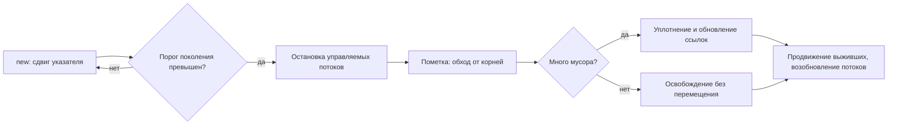

# Память и GC: экспертная теория

🌐 **Русский** · [English](expert.en.md)

**Уровни:** [обзор](overview.ru.md) · [1. Базовая](basics.ru.md) · [2. Продвинутая](advanced.ru.md) · **3. Экспертная** · [4. Квиз](quiz.ru.md) · [упражнения](exercises.ru.md) · [5–6. Код и тесты](code/)

## Как проходит сборка



- **Выделение** почти бесплатно: runtime выделяет память под объект, сдвигая указатель, — почти так же быстро, как в стеке.
- **Пометка** (mark): GC обходит граф от корней — переменных в стеке, которые сообщают JIT и обходчик стека (stack walker), статических данных, GC-дескрипторов, очереди финализации — и помечает достижимые объекты.
- **Уплотнение** (compact): выжившие объекты сдвигаются друг к другу, ссылки на них обновляются. GC уплотняет кучу, только если нашёл много мусора. Проверено: после обычного `GC.Collect()` свойство `GC.GetGCMemoryInfo().Compacted` было `False`, а после `GC.Collect(2, GCCollectionMode.Forced, blocking: true, compacting: true)` — `True`.
- **Ссылки из старших поколений в младшие.** Чтобы собрать поколение 0, не обходя всё поколение 2, GC должен знать, какие старые объекты ссылаются на молодые. Для этого при записи ссылки в поле JIT вставляет вызов барьера записи (write barrier): он отмечает «карту» — участок памяти, в котором изменилась ссылка. При сборке младших поколений GC просматривает только отмеченные карты. Поэтому запись ссылки в поле объекта немного дороже записи числа.
- **Регионы.** С .NET 7 на 64-битных Windows и Linux куча состоит не из больших сегментов, а из регионов — небольших блоков, которые GC свободно передаёт между поколениями.

Блокирующая сборка останавливает все управляемые потоки. **Фоновая сборка** (background GC, включена по умолчанию) собирает поколение 2 параллельно с работой программы, а сборки поколений 0 и 1 всё равно блокирующие, но короткие.

## Время жизни объекта и JIT

Объект становится собираемым не в конце метода и не после `obj = null`, а когда JIT больше не сообщает GC о ссылке на него. Это зависит от того, как скомпилирован код:

| Как скомпилирован метод | Локальная переменная после последнего использования |
|---|---|
| сборка Debug | жива до конца метода, даже после `obj = null` |
| Release, первые вызовы (tier 0, без оптимизаций) | может оставаться живой до конца метода |
| Release, оптимизированный код (tier 1, `AggressiveOptimization`) | может быть собрана сразу после последнего использования |

Проверено одним и тем же методом: `var obj = new object(); var weak = new WeakReference(obj); obj = null; GC.Collect(); return weak.IsAlive;` вернул `True` в Debug, `True` в Release при первом вызове и `False` в Release с `[MethodImpl(MethodImplOptions.AggressiveOptimization)]`.

Отсюда два вывода:

1. Тесты поведения GC пишут так, чтобы объект создавался в отдельном методе с `[MethodImpl(MethodImplOptions.NoInlining)]` — тогда результат одинаков в Debug и Release. Так устроены все примеры модуля.
2. Если объект должен жить до определённой точки — например, пока нативный код пользуется его ресурсом, — нужен `GC.KeepAlive(obj)` **в конце** этого участка. См. подвохи ниже.

## Финализация изнутри

1. При создании объекта с финализатором GC регистрирует его в очереди финализации.
2. Когда объект стал недостижим, GC не освобождает его память, а переносит объект в очередь готовых к финализации. Эта очередь — корень, поэтому объект и всё, на что он ссылается, переживают сборку и продвигаются в старшее поколение.
3. Отдельный поток финализации вызывает финализаторы. Порядок не гарантирован.
4. Память освобождается только при следующей сборке поколения, в котором теперь лежит объект.

`GC.SuppressFinalize(this)` убирает объект из очереди финализации — поэтому освобождённый через `Dispose` объект собирается за одну сборку.

**Воскрешение** (resurrection): финализатор может сохранить `this` в статическом поле, и объект снова станет достижимым. Проверено: объект воскрес, но его финализатор был вызван один раз. Когда ссылку обнулили и собрали мусор снова, финализатор не вызвался — для повторной финализации нужен `GC.ReRegisterForFinalize(this)`.

## LOH и POH

- **LOH** (large object heap): объекты от 85 000 байт. Размер считается вместе с заголовком: на 64-битном runtime у массива 24 байта заголовка, поэтому `byte[84_975]` создаётся в поколении 0, а `byte[84_976]` — уже в LOH (проверено). LOH собирается только вместе с поколением 2 и по умолчанию **не уплотняется**: копировать большие объекты дорого. Из-за этого LOH фрагментируется.
- Разовое уплотнение LOH: `GCSettings.LargeObjectHeapCompactionMode = GCLargeObjectHeapCompactionMode.CompactOnce` — применяется к следующей полной блокирующей сборке. Проверено: после `GC.Collect()` сборка была уплотняющей, а режим вернулся в `Default`.
- **POH** (pinned object heap): `GC.AllocateArray<T>(length, pinned: true)` создаёт массив, который GC никогда не перемещает. `GC.GetGeneration` возвращает для него `2`. Объекты POH не мешают уплотнению остальной кучи, в отличие от закреплённых обычных объектов.

Код: [Ex02_Generations.cs](code/Examples/Ex02_Generations.cs), [Ex11_GcControl.cs](code/Examples/Ex11_GcControl.cs).

## Закрепление объектов

Нативный код и указатели работают с адресом в памяти, а GC при уплотнении перемещает объекты. Закрепление (pinning) запрещает GC двигать объект:

```csharp
// fixed pins the array only for the duration of the block.
public static unsafe int SumWithPointer(byte[] data)
{
    int sum = 0;
    fixed (byte* start = data)
    {
        for (byte* p = start; p < start + data.Length; p++)
        {
            sum += *p;
        }
    }
    return sum;
}
```

`fixed` закрепляет объект только на время блока. Для долгого закрепления — `GCHandle`:

```csharp
// A pinned GCHandle keeps the object in place until Free — even across collections.
public static bool PinnedHandleAddressIsStable()
{
    var buffer = new byte[100];
    GCHandle handle = GCHandle.Alloc(buffer, GCHandleType.Pinned);
    try
    {
        nint before = handle.AddrOfPinnedObject();
        GC.Collect(2, GCCollectionMode.Forced, blocking: true, compacting: true);
        return before == handle.AddrOfPinnedObject();
    }
    finally
    {
        handle.Free(); // a forgotten Free pins the object forever and fragments the heap
    }
}
```

Адрес не изменился даже после уплотняющей сборки. Цена: закреплённый объект — «камень» посреди кучи, вокруг которого GC не может уплотнить память. Долгоживущие буферы для нативного кода лучше сразу выделять в POH. Для `fixed` и указателей проект должен разрешать небезопасный код: `<AllowUnsafeBlocks>true</AllowUnsafeBlocks>`. Код: [Ex12_Pinning.cs](code/Examples/Ex12_Pinning.cs).

## Управление GC из кода

### GC.Collect и режимы

`GC.Collect()` — немедленная блокирующая сборка всех поколений. Перегрузка `GC.Collect(generation, mode, blocking, compacting)` уточняет поведение.

| `GCCollectionMode` | Что делает |
|---|---|
| `Default` | сейчас то же, что `Forced` |
| `Forced` | сборка немедленно |
| `Optimized` | GC сам решает, стоит ли собирать сейчас |
| `Aggressive` | сборка с возвратом как можно большего объёма памяти операционной системе |

### Режимы задержки

`GCSettings.LatencyMode` задаёт компромисс между паузами и пропускной способностью:

| `GCLatencyMode` | Когда |
|---|---|
| `Batch` | фоновая сборка выключена; максимальная пропускная способность |
| `Interactive` | по умолчанию для Workstation и Server GC при включённой фоновой сборке |
| `LowLatency` | короткие промежутки, когда паузы недопустимы; только Workstation GC |
| `SustainedLowLatency` | долгие периоды, когда нужно избегать блокирующих полных сборок |
| `NoGCRegion` | только чтение: устанавливается через `GC.TryStartNoGCRegion` |

### Область без сборок

`GC.TryStartNoGCRegion(totalSize)` заранее резервирует память, и пока выделения укладываются в неё, сборок не будет. Выход — `GC.EndNoGCRegion()`, вложенные области запрещены. Проверено: внутри области `GCSettings.LatencyMode` был `NoGCRegion`, а 1000 выделений по 100 байт не вызвали ни одной сборки.

```csharp
// Inside a no-GC region allocations up to the requested size do not trigger a collection.
public static (bool Started, GCLatencyMode Inside, int Gen0Collections) NoGcRegion()
{
    bool started = GC.TryStartNoGCRegion(1_000_000);
    GCLatencyMode inside = GCSettings.LatencyMode;
    int before = GC.CollectionCount(0);
    for (int i = 0; i < 1_000; i++)
    {
        _ = new byte[100];
    }
    int collections = GC.CollectionCount(0) - before;
    if (started)
    {
        GC.EndNoGCRegion();
    }
    return (started, inside, collections);
}
```

Код: [Ex11_GcControl.cs](code/Examples/Ex11_GcControl.cs).

## Настройки GC

Настройки задаются в `.csproj` (MSBuild-свойство), в `runtimeconfig.json` или переменной окружения:

| Настройка | `runtimeconfig.json` | MSBuild | Переменная окружения | По умолчанию |
|---|---|---|---|---|
| Server GC | `System.GC.Server` | `ServerGarbageCollection` | `DOTNET_gcServer` | Workstation |
| Фоновая сборка | `System.GC.Concurrent` | `ConcurrentGarbageCollection` | `DOTNET_gcConcurrent` | включена |
| Жёсткий лимит кучи, байт | `System.GC.HeapHardLimit` | — | `DOTNET_GCHeapHardLimit` | не задан |
| Лимит кучи, % памяти | `System.GC.HeapHardLimitPercent` | — | `DOTNET_GCHeapHardLimitPercent` | в контейнере с лимитом — 75% |
| Экономия памяти (0–9) | `System.GC.ConserveMemory` | — | `DOTNET_GCConserveMemory` | 0 |
| Удерживать освобождённую память | `System.GC.RetainVM` | `RetainVMGarbageCollection` | `DOTNET_GCRetainVM` | нет, вернуть ОС |
| DATAS | `System.GC.DynamicAdaptationMode` | `GarbageCollectionAdaptationMode` | `DOTNET_GCDynamicAdaptationMode` | включён с .NET 9 |

- **Контейнеры.** Если у процесса есть лимит памяти (контейнер, cgroup), GC считает его всей физической памятью и по умолчанию ограничивает кучу 75% от него. Как лимиты задаются, — в треках [Linux](../../../linux/overview.ru.md) (cgroups) и [Kubernetes](../../../kubernetes/overview.ru.md) (requests и limits).
- **DATAS** (dynamic adaptation to application sizes) относится к Server GC: число куч подстраивается под нагрузку, поэтому небольшое приложение с Server GC не занимает память под кучу на каждое ядро.
- Числа в переменных окружения — **шестнадцатеричные**, в `runtimeconfig.json` — десятичные (см. подвохи).

## Справочник

### Класс GC

| Метод или свойство | Назначение |
|---|---|
| `GC.Collect(...)` | принудительная сборка |
| `GC.GetGeneration(obj)` | поколение объекта |
| `GC.CollectionCount(gen)` | число сборок поколения |
| `GC.MaxGeneration` | старшее поколение (2) |
| `GC.GetAllocatedBytesForCurrentThread()` / `GC.GetTotalAllocatedBytes()` | выделено байт потоком / процессом |
| `GC.GetTotalMemory(forceFullCollection)` | приблизительный объём занятой кучи |
| `GC.GetGCMemoryInfo()` | данные о последней сборке: поколение, уплотнение, паузы, доступная память |
| `GC.KeepAlive(obj)` | продлить жизнь объекта до этой точки |
| `GC.SuppressFinalize(obj)` / `GC.ReRegisterForFinalize(obj)` | отменить / вернуть финализацию |
| `GC.WaitForPendingFinalizers()` | дождаться выполнения финализаторов из очереди |
| `GC.AllocateArray<T>(n, pinned)` / `GC.AllocateUninitializedArray<T>(n, pinned)` | массив, в том числе в POH |
| `GC.TryStartNoGCRegion(size)` / `GC.EndNoGCRegion()` | область без сборок |
| `GC.AddMemoryPressure(bytes)` / `GC.RemoveMemoryPressure(bytes)` | сообщить GC о неуправляемой памяти, которую держит объект |

### Освобождение ресурсов в C#

| Конструкция | Что делает |
|---|---|
| `using (var x = …) { }` | `Dispose` в конце блока, в `finally` |
| `using var x = …;` | `Dispose` в конце охватывающего блока, в обратном порядке объявления |
| `await using` | `await DisposeAsync()` |
| `ref struct` с методом `Dispose()` | можно использовать в `using` без интерфейса (проверено) |
| `using` с `null` | допустимо: перед `Dispose` компилятор проверяет на `null` |

### Слабые ссылки и дескрипторы

| Тип | Назначение |
|---|---|
| `WeakReference<T>` | ссылка, которая не удерживает объект |
| `WeakReference(obj, trackResurrection: true)` | остаётся валидной, пока объект ждёт финализации |
| `ConditionalWeakTable<TKey, TValue>` | данные, прикреплённые к объекту и живущие, пока жив ключ |
| `GCHandle` (`Normal`, `Weak`, `Pinned`) | низкоуровневый дескриптор; требует `Free` |
| `SafeHandle` и наследники | обёртка над дескриптором ОС с гарантированным освобождением |

### Диагностика

| Инструмент | Для чего |
|---|---|
| `dotnet-counters monitor --process-id <PID> --counters System.Runtime` | счётчики в реальном времени: число сборок, размер кучи, паузы |
| `dotnet-gcdump collect --process-id <PID>` | снимок графа объектов (запускает полную сборку) |
| `dotnet-gcdump report <файл>` | статистика по типам из снимка |
| `GC.GetGCMemoryInfo()` | те же данные из кода |

## Подвохи

Каждый подвох проверен запуском.

### Обнуление переменной не освобождает объект в Debug

```csharp
var obj = new object();
var weak = new WeakReference(obj);
obj = null;
GC.Collect();
Console.WriteLine(weak.IsAlive);   // Debug: True
```

В Debug JIT продлевает жизнь локальных переменных до конца метода, а неоптимизированный код хранит копию ссылки во временной ячейке. Результат: `True` в Debug и при первом вызове в Release; `False` только в оптимизированном коде. Обнулять локальные переменные «для GC» бессмысленно.

### Объект собран до конца метода

```csharp
[MethodImpl(MethodImplOptions.NoInlining | MethodImplOptions.AggressiveOptimization)]
static bool EarlyCollect()
{
    Fin.Done = false;
    var f = new Fin();
    f.Touch();               // last use
    GC.Collect();
    GC.WaitForPendingFinalizers();
    return Fin.Done;         // Release: True — the finalizer ran while the method is still running
}
```

В оптимизированном коде объект собирается сразу после последнего использования, и финализатор выполнился, пока метод ещё работает. С `GC.KeepAlive(f)` в конце метода результат — `False`. Это важно, когда объект владеет ресурсом, с которым ещё работает нативный код: финализатор может закрыть дескриптор посреди вызова. `SafeHandle` решает эту проблему сам: он удерживается на время P/Invoke-вызова.

### Таймер без ссылки перестаёт срабатывать

```csharp
_ = new Timer(_ => Interlocked.Increment(ref ticks), null, 0, 10);
```

Если ссылку на `System.Threading.Timer` никто не хранит, таймер собирается вместе со своим колбэком. В оптимизированном методе в Release после `GC.Collect()` за 300 мс было **0** срабатываний, в Debug — **25**. При первом вызове метода в Release (tier 0, без оптимизаций) таймер тоже продолжал работать — он начинает пропадать, когда горячий метод перекомпилируется с оптимизациями. Код работает при отладке и тихо ломается в production. Храни таймер в поле и освобождай через `Dispose`.

### Исключение в Dispose подменяет исходное

```csharp
try
{
    using var t = new Throwing();                     // Dispose throws "from Dispose"
    throw new InvalidOperationException("from body");
}
catch (Exception e)
{
    Console.WriteLine(e.Message);                     // from Dispose
}
```

`using` — это `try/finally`. Исключение из `Dispose` в `finally` заменяет исключение из тела, и настоящая причина ошибки теряется. Поэтому `Dispose` не должен бросать исключений.

### Финализаторы не вызываются при завершении процесса

Объект с финализатором, который печатает строку, был недостижим к концу `Main` — строка не напечаталась ни в Debug, ни в Release: в .NET 11 финализаторы при выходе из процесса не выполняются. Освобождать ресурсы, которые важно закрыть, — данные в файле, транзакцию, — нужно явно через `Dispose`, а не надеяться на финализатор.

### GC.Collect() не обязательно уплотняет кучу

После `GC.Collect()` `GC.GetGCMemoryInfo().Compacted` было `False`: GC уплотняет кучу, только если находит много мусора. Нужно гарантированное уплотнение — `GC.Collect(2, GCCollectionMode.Forced, blocking: true, compacting: true)`.

### Шестнадцатеричные числа в переменных окружения

```bash
DOTNET_GCHeapHardLimit=10000000 dotnet run
```

Значение читается как шестнадцатеричное: `0x10000000` = 268 435 456 байт. Проверено: `GC.GetGCMemoryInfo().TotalAvailableMemoryBytes` вернул `268 435 456`, то есть лимит 256 МиБ, а не 10 МБ. В `runtimeconfig.json` то же число записывается в десятичном виде.

### Сборка поколения 2 считается и в младших поколениях

`GC.Collect(2)` увеличил `GC.CollectionCount(0)`, `CollectionCount(1)` и `CollectionCount(2)` на 1 каждый: полная сборка собирает и младшие поколения. Число сборок только поколения 0 — это разность `CollectionCount(0) - CollectionCount(1)`.

## Компромиссы и альтернативы

| Задача | Вариант | Цена |
|---|---|---|
| Освободить неуправляемый ресурс | `SafeHandle` + простой `Dispose` | почти никакой |
| | свой финализатор + `Dispose(bool)` | сложнее, лишняя сборка, легко ошибиться |
| Меньше пауз в сервере | Server GC (с DATAS) | больше памяти и потоков GC |
| Меньше памяти | Workstation GC, `ConserveMemory` | больше времени на сборки |
| Меньше выделений | структуры, пулы (`ArrayPool<T>`), `Span<T>` | сложнее код, риск ошибок с временем жизни |
| Буфер для нативного кода | `fixed` на короткое время | — |
| | `GCHandle.Pinned` надолго | фрагментация кучи |
| | массив в POH | память не уплотняется, но и не мешает остальным |
| Критичный по задержке участок | `GC.TryStartNoGCRegion`, `SustainedLowLatency` | больше памяти; не панацея |

`Span<T>`, `Memory<T>` и `stackalloc` — следующий шаг в борьбе с выделениями. Они разобраны в отдельном модуле 12a «Span и Memory» (ещё не создан), пулы и профилирование — в модуле 19 «Производительность».

## Вопросы с собеседований

**1. Как GC понимает, что объект можно удалить? Что такое корни?**

<details><summary>Ответ</summary>

GC обходит граф объектов от корней и помечает достижимые; всё остальное — мусор. Корни: локальные переменные и параметры в стеках потоков (о них сообщает JIT), регистры, статические поля, GC-дескрипторы, очередь финализации. Подсчёта ссылок нет, поэтому недостижимые циклы собираются (проверено).

</details>

**2. Зачем GC поколения? Сколько их?**

<details><summary>Ответ</summary>

Большинство объектов умирают молодыми, поэтому выгодно часто и быстро собирать только новые объекты (поколение 0), реже — поколение 1 и совсем редко — поколение 2. Поколений три: 0, 1, 2 (`GC.MaxGeneration == 2`); выживший объект продвигается: `[0, 1, 2, 2]`. LOH и POH логически относятся к поколению 2.

</details>

**3. Что такое LOH? Какие у него особенности?**

<details><summary>Ответ</summary>

Куча больших объектов: объекты от 85 000 байт с учётом заголовка (`byte[84_976]` на 64-битном runtime). Собирается только вместе с поколением 2 и по умолчанию не уплотняется, поэтому фрагментируется. Частые выделения больших временных массивов вызывают дорогие полные сборки — для них используют `ArrayPool<T>`. Разовое уплотнение — `GCLargeObjectHeapCompactionMode.CompactOnce`.

</details>

**4. Чем `Dispose` отличается от финализатора?**

<details><summary>Ответ</summary>

`Dispose` вызывает код — детерминированно, в известный момент, обычно через `using`. Финализатор вызывает GC в потоке финализации — неизвестно когда, в неизвестном порядке, а при завершении процесса не вызывает вовсе. Финализатор — страховка на случай, если `Dispose` забыли; `Dispose` вызывает `GC.SuppressFinalize`, чтобы отменить её.

</details>

**5. Опишите шаблон `Dispose(bool disposing)`. Что значит параметр?**

<details><summary>Ответ</summary>

Публичный `Dispose()` вызывает `Dispose(true)` и `GC.SuppressFinalize(this)`; финализатор (если есть) вызывает `Dispose(false)`. При `true` можно освобождать управляемые объекты; при `false` вызов идёт из финализатора, и другие управляемые объекты могут быть уже финализированы — освобождаются только неуправляемые ресурсы. Метод `protected virtual`, наследник переопределяет его и в конце вызывает `base.Dispose(disposing)`. Для `sealed`-класса без неуправляемых ресурсов достаточно простого `Dispose()`.

</details>

**6. Зачем вызывать `GC.SuppressFinalize(this)`, если у класса нет финализатора?**

<details><summary>Ответ</summary>

В шаблоне `Dispose(bool)` финализатор может добавить наследник. Если не вызвать `SuppressFinalize`, объект наследника после `Dispose` всё равно попадёт в очередь финализации, переживёт лишнюю сборку и будет финализирован повторно. Для `sealed`-класса без финализатора вызов не нужен.

</details>

**7. Почему финализаторы считаются дорогими?**

<details><summary>Ответ</summary>

Объект регистрируется в очереди финализации при создании. Когда он становится недостижимым, GC не освобождает его, а переносит в очередь готовых к финализации — это корень, поэтому объект и всё, на что он ссылается, переживают сборку и продвигаются в старшее поколение. Память освобождается только при следующей сборке этого поколения. Проверено: после первой сборки объект ещё в памяти, после финализации и второй — освобождён.

</details>

**8. Что такое `SafeHandle` и чем он лучше своего финализатора?**

<details><summary>Ответ</summary>

Базовый класс-обёртка над дескриптором ОС. В нём уже реализованы надёжный финализатор, освобождение ровно один раз (двойной `Dispose` закрыл дескриптор один раз) и подсчёт ссылок на время P/Invoke-вызовов, чтобы дескриптор не закрылся посреди вызова. Наследник пишет только `ReleaseHandle`. Классу, который хранит `SafeHandle`, свой финализатор не нужен.

</details>

**9. Как в .NET возникает утечка памяти, если есть GC?**

<details><summary>Ответ</summary>

Через забытые ссылки: GC не освобождает достижимое. Классика — подписка на событие долгоживущего объекта: делегат в событии ссылается на подписчика (проверено: без отписки подписчик пережил сборку). Ещё — статические коллекции и кеши без вытеснения, таймеры и колбэки, замыкания в долгоживущих делегатах, `GCHandle` без `Free`. Ищут снимками кучи (`dotnet-gcdump`) и сравнением снимков.

</details>

**10. Подвох: может ли объект быть собран, пока выполняется его метод?**

<details><summary>Ответ</summary>

Да. В оптимизированном коде объект собираем сразу после последнего использования ссылки на него, даже если метод, в котором он создан, ещё работает. Проверено: финализатор выполнился до конца метода в Release, а в Debug — нет. Если ресурс объекта ещё используется (нативным кодом), в конце участка ставят `GC.KeepAlive(obj)`.

</details>

**11. Подвох: почему этот код работает при отладке, а в production таймер иногда перестаёт срабатывать?**

```csharp
public void Start()
{
    _ = new Timer(_ => Poll(), null, 0, 10);
}
```

<details><summary>Ответ</summary>

На таймер никто не ссылается, и он собирается при ближайшей сборке вместе с колбэком. Сработает ли это, зависит от JIT. В проверке похожий код дал: Debug — 24 срабатывания за 300 мс после `GC.Collect()`; Release при первом, неоптимизированном вызове — 21; Release в оптимизированном методе — 1 (только самый первый вызов, до сборки). В Debug и в коде tier 0 ссылка живёт до конца метода, а когда горячий метод перекомпилируется оптимизированно, таймер начинает пропадать. Таймер хранят в поле и освобождают через `Dispose`.

</details>

**12. Чем Workstation GC отличается от Server GC? Что такое DATAS?**

<details><summary>Ответ</summary>

Workstation — одна куча, по умолчанию для обычных приложений, меньше памяти. Server — куча и поток GC на каждое логическое ядро, выше пропускная способность, больше памяти. Включается `<ServerGarbageCollection>true</ServerGarbageCollection>` или `DOTNET_gcServer=1`. DATAS — режим Server GC, включённый по умолчанию с .NET 9: число куч подстраивается под нагрузку, и маленькое приложение не держит кучу на каждое ядро. В обоих вариантах по умолчанию работает фоновая сборка.

</details>

**13. Что такое фоновая сборка мусора?**

<details><summary>Ответ</summary>

Сборка поколения 2, которая идёт параллельно с работой программы, — потоки приложения почти не останавливаются. Сборки поколений 0 и 1 (эфемерные) остаются блокирующими, но они короткие. Включена по умолчанию; отключается `<ConcurrentGarbageCollection>false</ConcurrentGarbageCollection>`, и тогда режим задержки по умолчанию — `Batch`.

</details>

**14. Почему не стоит вызывать `GC.Collect()`? Бывают ли исключения?**

<details><summary>Ответ</summary>

`GC.Collect()` — блокирующая сборка всех поколений: пауза, продвижение живых молодых объектов в старшие поколения, сбитая статистика, по которой GC подбирает пороги. И даже уплотнение не гарантировано (проверено: `Compacted == False`). Исключения редки: тесты и бенчмарки, разовая очистка после загрузки больших данных, которые точно больше не нужны, уплотнение LOH через `CompactOnce`.

</details>

**15. Как работает закрепление и чем оно плохо?**

<details><summary>Ответ</summary>

Закреплённый объект GC не перемещает: `fixed` — на время блока, `GCHandle.Alloc(obj, GCHandleType.Pinned)` — до `Free`. Нужно для указателей и нативного кода. Плохо тем, что закреплённый объект мешает уплотнению: вокруг него остаются дыры, куча фрагментируется. Долгоживущие буферы выделяют в POH через `GC.AllocateArray<T>(n, pinned: true)`.

</details>

**16. Как ведёт себя GC в контейнере с ограничением памяти?**

<details><summary>Ответ</summary>

GC считает лимит контейнера всей физической памятью и по умолчанию ограничивает кучу 75% от него (`HeapHardLimitPercent`). Лимит можно задать явно: `System.GC.HeapHardLimit` / `HeapHardLimitPercent` в `runtimeconfig.json` или переменными окружения — в шестнадцатеричном виде. Если куча упирается в лимит, GC собирает чаще, а в крайнем случае выделение памяти заканчивается `OutOfMemoryException`.

</details>

**17. Что такое воскрешение объекта?**

<details><summary>Ответ</summary>

Финализатор сохраняет `this` в доступное место (статическое поле), и объект снова становится достижимым. Финализатор при этом уже отработал и повторно не вызовется (проверено: один вызов), пока не вызвать `GC.ReRegisterForFinalize(this)`. Воскрешённый объект может быть в неконсистентном состоянии — это почти всегда ошибка дизайна.

</details>

**18. Что делает `ConditionalWeakTable` и чем он отличается от `Dictionary` со `WeakReference`?**

<details><summary>Ответ</summary>

Прикрепляет данные к объекту без изменения его класса. Ключи хранятся слабо, а значение живёт, пока жив ключ, — запись исчезает вместе с ключом (проверено: из двух записей осталась одна). В отличие от `Dictionary<WeakReference, TValue>`, мёртвые записи не нужно чистить вручную, а значение, которое ссылается на свой ключ, не удерживает его. Сравнение ключей — по ссылке.

</details>

## Шпаргалка

| Задача | Решение |
|---|---|
| Освободить ресурс | `using` / `using var` / `await using` |
| Свой освобождаемый класс | `sealed` + идемпотентный `Dispose`; `ObjectDisposedException.ThrowIf` |
| Класс с наследниками | `Dispose(bool)` + `GC.SuppressFinalize(this)` |
| Неуправляемый дескриптор | наследник `SafeHandle`, без своего финализатора |
| Асинхронное освобождение | `IAsyncDisposable` + `IDisposable` |
| Подписка на долгоживущее событие | отписка в `Dispose`, токен подписки |
| Данные к чужому объекту | `ConditionalWeakTable` |
| Объект должен жить до точки | `GC.KeepAlive(obj)` в конце участка |
| Буфер для нативного кода | `fixed`, `GC.AllocateArray(n, pinned: true)` |
| Измерить выделения | `GC.GetAllocatedBytesForCurrentThread()` |
| Наблюдать GC в работе | `dotnet-counters`, `dotnet-gcdump`, `GC.GetGCMemoryInfo()` |
| Сервер | Server GC (DATAS по умолчанию) |

## Связанные материалы

- Раньше: [базовая теория](basics.ru.md), [продвинутая теория](advanced.ru.md)
- Проверь себя: [квиз](quiz.ru.md), [упражнения](exercises.ru.md)
- Где хранятся значения, упаковка: [02 · Типы и переменные](../02-types-and-variables/expert.ru.md)
- Настройки runtime в `runtimeconfig.json`: [01 · Платформа .NET](../01-dotnet-platform/expert.ru.md)
- GC и lock-free-структуры (почему в .NET нет проблемы ABA): [18 · Многопоточность](../18-concurrency/expert.ru.md)
- Лимиты памяти процесса: [Linux](../../../linux/overview.ru.md) — cgroups; [Kubernetes](../../../kubernetes/overview.ru.md) — requests и limits

## Источники

- [Основы сборки мусора](https://learn.microsoft.com/dotnet/standard/garbage-collection/fundamentals)
- [Куча больших объектов](https://learn.microsoft.com/dotnet/standard/garbage-collection/large-object-heap)
- [Режимы задержки](https://learn.microsoft.com/dotnet/standard/garbage-collection/latency)
- [Параметры конфигурации сборщика мусора](https://learn.microsoft.com/dotnet/core/runtime-config/garbage-collector)
- [GC.Collect](https://learn.microsoft.com/dotnet/api/system.gc.collect)
- [GCCollectionMode](https://learn.microsoft.com/dotnet/api/system.gccollectionmode)
- [GCLatencyMode](https://learn.microsoft.com/dotnet/api/system.runtime.gclatencymode)
- [GC.TryStartNoGCRegion](https://learn.microsoft.com/dotnet/api/system.gc.trystartnogcregion)
- [GC.KeepAlive](https://learn.microsoft.com/dotnet/api/system.gc.keepalive)
- [GC.AllocateArray](https://learn.microsoft.com/dotnet/api/system.gc.allocatearray)
- [Book of the Runtime: Garbage Collection Design](https://github.com/dotnet/runtime/blob/main/docs/design/coreclr/botr/garbage-collection.md)
- [Что нового в среде выполнения .NET 10](https://learn.microsoft.com/dotnet/core/whats-new/dotnet-10/runtime)
