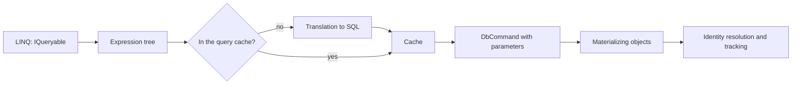

# EF Core: expert

🌐 [Русский](expert.ru.md) · **English**

**Levels:** [overview](overview.en.md) · [1. Basics](basics.en.md) · [2. Advanced](advanced.en.md) · **3. Expert** · [4. Quiz](quiz.en.md) · [exercises](exercises.en.md) · [5–6. Code and tests](code/)

## How a query runs



1. `Where`, `Select` and other methods on `IQueryable` execute nothing; they build an **expression tree**.
2. On enumeration EF looks for a tree of the same shape in the query cache. If it is not there, EF translates the tree to SQL and caches it. Translation is expensive, so the cache matters.
3. Values captured from closures become **parameters**, while literals in code become part of the SQL text. Verified:

```text
-- Where(p => p.Likes >= 25)        literal
WHERE "p"."Likes" >= 25
-- Where(p => p.Likes >= min)       variable
WHERE "p"."Likes" >= @min
-- Where(p => p.Likes >= EF.Constant(min))
WHERE "p"."Likes" >= 25
```

With a parameter, one SQL text and one execution plan serve every value. A literal gives a separate SQL per value. `EF.Constant` is rarely needed: when it helps the database optimizer to see the actual value.

4. Since EF Core 10 a collection in `Contains` becomes separate parameters by default, and the list is **padded to a "round" size** so that fewer SQL variants appear. Verified: for 11 values EF generated 20 parameters:

```text
WHERE "b"."Id" IN (@ids1, @ids2, @ids3, @ids4, @ids5, @ids6, @ids7, @ids8, @ids9, @ids10, @ids11, @ids12, @ids13, @ids14, @ids15, @ids16, @ids17, @ids18, @ids19, @ids20)
```

In EF 8 and 9 the collection was passed as one JSON parameter by default (`OPENJSON` in SQL Server).

5. Result rows become objects. In a tracking query EF checks whether an object with that key is already tracked and returns the existing instance — **identity resolution**.

## How change tracking works

By default EF uses **snapshot change tracking**: when an entity is loaded, the original property values are remembered. `ChangeTracker.DetectChanges()` compares the current values with the snapshot and sets the `Modified` state. You usually do not call it by hand: EF calls it itself in `SaveChanges`, `Entry()`, `Entries()` and some other methods — that is why in the [`Lifecycle`](code/Examples/Ex03_ChangeTracking.cs) example a plain assignment gave `Modified` right away.

Automatic detection can be turned off, for example when loading thousands of objects:

```csharp
context.ChangeTracker.AutoDetectChangesEnabled = false;
var blog = context.Blogs.Single(b => b.Id == 3);
blog.Name = "Changed silently";
Console.WriteLine(context.SaveChanges());   // 0: the change was not detected
context.ChangeTracker.DetectChanges();
Console.WriteLine(context.SaveChanges());   // 1
```

The actual output: `0`, then `1`. If you turn automatic detection off, call `DetectChanges()` yourself before `SaveChanges`.

Useful change tracker APIs:

| API | What it does |
|---|---|
| `Entry(e).State` | the entity's state; can be assigned |
| `Entry(e).Property(x => x.P).IsModified` | whether a specific property changed |
| `Entry(e).OriginalValues` / `CurrentValues` | the snapshot and the current values |
| `Entry(e).GetDatabaseValues()` | the database values right now (`null` if the row is gone) |
| `Entry(e).Reload()` | re-read the entity from the database, discarding local changes |
| `ChangeTracker.Entries<T>()` | all tracked entities of a type |
| `DbSet<T>.Local` | tracked entities without a database query |
| `ChangeTracker.Clear()` | detach all entities (verified: 5 → 0) |
| `ChangeTracker.QueryTrackingBehavior` | the default tracking mode for this context |

## Interceptors

An interceptor plugs into EF's work: it sees commands, connections, transactions, `SaveChanges`. It is registered with `AddInterceptors(...)`.

| Base class | What it intercepts |
|---|---|
| `DbCommandInterceptor` | creating and executing SQL commands |
| `DbConnectionInterceptor` | opening and closing the connection |
| `DbTransactionInterceptor` | transactions and savepoints |
| `SaveChangesInterceptor` | `SaveChanges` before and after writing, failures |
| `IMaterializationInterceptor` | creating objects from result rows |

Auditing is a classic task for a `SaveChangesInterceptor`. The interceptor fills `CreatedAt` before EF builds the SQL, so the value goes into the same `INSERT`:

```csharp
// Runs inside SaveChanges, before EF builds the SQL, so the changed values are saved in the same batch.
public sealed class AuditInterceptor(TimeProvider clock) : SaveChangesInterceptor
{
    public override InterceptionResult<int> SavingChanges(DbContextEventData eventData, InterceptionResult<int> result)
    {
        Stamp(eventData.Context);
        return result;
    }
```

Time comes from a `TimeProvider`: tests substitute a `FixedTimeProvider`, and the test is deterministic. Sync and async `SaveChanges` call different interceptor methods (`SavingChanges` and `SavingChangesAsync`), so override both. Code: [Ex11_Interceptors.cs](code/Examples/Ex11_Interceptors.cs). The `CommandLog` command interceptor that counts SQL queries in the examples is in [Ex01_Model.cs](code/Examples/Ex01_Model.cs).

## Lazy loading internals

- **Proxies.** The `Microsoft.EntityFrameworkCore.Proxies` package and `UseLazyLoadingProxies()`. EF creates a derived class (messages call it `BlogProxy`) and overrides the navigations. That is why navigations must be `virtual` and the class must allow inheritance.
- **Without proxies.** The entity receives the `ILazyLoader` service in its constructor and triggers loading itself in the navigation getter. No `virtual` or inheritance needed.

Lazy loading works only while the context is alive. After `Dispose`, touching an unloaded navigation throws:

```text
InvalidOperationException: An error was generated for warning 'Microsoft.EntityFrameworkCore.Infrastructure.LazyLoadOnDisposedContextWarning': An attempt was made to lazy-load navigation 'BlogProxy.Posts' after the associated DbContext was disposed or returned to the pool, or the entity was explicitly detached from the context.
```

## Inheritance: TPH, TPT, TPC

The hierarchy `Payment` → `CardPayment`, `CashPayment` maps in three ways. The strategy is chosen by calling `UseTphMappingStrategy()`, `UseTptMappingStrategy()` or `UseTpcMappingStrategy()` on the base type. The schemas below were generated by `GenerateCreateScript()`.

**TPH** (table per hierarchy, the default) — one table and a discriminator column:

```text
CREATE TABLE "Payments" (
    "Id" TEXT NOT NULL CONSTRAINT "PK_Payments" PRIMARY KEY,
    "Amount" TEXT NOT NULL,
    "Discriminator" TEXT NOT NULL,
    "CardLast4" TEXT NULL,
    "Change" TEXT NULL
);
```

**TPT** (table per type) — a table for the base type and one per subtype, linked by key:

```text
CREATE TABLE "Payments" (
    "Id" TEXT NOT NULL CONSTRAINT "PK_Payments" PRIMARY KEY,
    "Amount" TEXT NOT NULL
);
CREATE TABLE "CardPayment" (
    "Id" TEXT NOT NULL CONSTRAINT "PK_CardPayment" PRIMARY KEY,
    "CardLast4" TEXT NOT NULL,
    CONSTRAINT "FK_CardPayment_Payments_Id" FOREIGN KEY ("Id") REFERENCES "Payments" ("Id") ON DELETE CASCADE
);
```

**TPC** (table per concrete type) — a full table per non-abstract type, no table for the abstract base:

```text
CREATE TABLE "CardPayment" (
    "Id" TEXT NOT NULL CONSTRAINT "PK_CardPayment" PRIMARY KEY,
    "Amount" TEXT NOT NULL,
    "CardLast4" TEXT NOT NULL
);
CREATE TABLE "CashPayment" (
    "Id" TEXT NOT NULL CONSTRAINT "PK_CashPayment" PRIMARY KEY,
    "Amount" TEXT NOT NULL,
    "Change" TEXT NOT NULL
);
```

| | TPH | TPT | TPC |
|---|---|---|---|
| Tables | 1 | 1 + one per subtype | one per concrete type |
| Subtype properties | nullable columns | in their own tables, `NOT NULL` possible | in their own tables |
| Query on the base type | one `SELECT` | `JOIN` of all tables | `UNION ALL` of all tables |
| Query on one subtype | `WHERE Discriminator = …` | `JOIN` with the base | one table |
| Key generation | normal | normal | a key unique across all tables: sequences or `Guid` |
| When | the default, almost always | rarely: for a normalized schema | queries mostly hit concrete types |

In all three strategies a query on `Payments` is polymorphic: it returned 1 `CardPayment` and 1 `CashPayment`. The example uses a `Guid` key: SQLite cannot generate integer keys for TPC because it has no sequences. Code: [Ex12_Inheritance.cs](code/Examples/Ex12_Inheritance.cs).

## Mapping: converters, complex types, shadow properties

```csharp
modelBuilder.Entity<Order>(order =>
{
    // Value converter: store the enum as readable text instead of an integer.
    order.Property(o => o.Status).HasConversion<string>().HasMaxLength(20);
    order.ComplexProperty(o => o.ShippingAddress);
    // Shadow property: exists in the model and the table, but not in the CLR class.
    order.Property<DateTime>("LastModified");
});
```

The schema and the result:

```text
CREATE TABLE "Orders" (
    "Id" INTEGER NOT NULL CONSTRAINT "PK_Orders" PRIMARY KEY AUTOINCREMENT,
    "Status" TEXT NOT NULL,
    "LastModified" TEXT NOT NULL,
    "ShippingAddress_City" TEXT NOT NULL,
    "ShippingAddress_Street" TEXT NOT NULL
);
```

- **Value converter**: the `Status` column stores the string `"Paid"`, not a number. Verified by reading the column with ADO.NET.
- **Complex type**: `record Address(City, Street)` is stored in the owner's `ShippingAddress_*` columns. A complex type has no key and no identity of its own; it has value semantics. The same instance can be assigned to several entities — verified: two orders sharing one `Address` object were saved (`SaveChanges` returned 2). Complex types appeared in EF Core 8. Since EF Core 10 they can be optional (nullable), structs, mapped to a JSON column (`ToJson`), and collections of complex types are supported in JSON.
- **Owned type** (`OwnsOne`) is the older mechanism for the same job. An owned entity has a hidden key and identity, so one instance cannot be shared between owners.
- **Shadow property** `LastModified` exists in the model and the table but not in the class. Access goes through `Entry(order).Property("LastModified")`, in queries through `EF.Property<DateTime>(o, "LastModified")`.

Code: [Ex14_Mapping.cs](code/Examples/Ex14_Mapping.cs).

## Performance

**Compiled queries.** `EF.CompileQuery` translates a query to SQL once and returns a thread-safe delegate: a call needs neither to build an expression tree nor to look it up in the cache.

```csharp
// Translation LINQ → SQL happens once; the delegate is thread-safe and reusable across contexts.
private static readonly Func<BloggingContext, int, IEnumerable<Post>> PostsWithMinLikes =
    EF.CompileQuery<BloggingContext, int, Post>((context, minLikes) =>
        context.Posts.AsNoTracking().Where(p => p.Likes >= minLikes).OrderBy(p => p.Id));
```

**Context pooling.** `AddDbContextPool` or `PooledDbContextFactory` reset the context state on `Dispose` and return the instance to the pool. Verified: the second `CreateDbContext()` returned the same object. The default pool size is 1024. A limitation: `OnConfiguring` is called only when an instance is first created, so it cannot set state that varies per request (a tenant ID, for example). EF state is reset, but the database driver's state is not.

**Compiled model** (`dotnet ef dbcontext optimize`) speeds up startup of an application with a large model. Limitations: global query filters, lazy-loading and change-tracking proxies, value converters referencing private methods, and custom `IModelCacheKeyFactory` implementations are not supported. The model must be regenerated after every configuration change. Use it only if startup is really slow.

**Batching.** `SaveChanges` combines commands into batches when it can. For SQL Server a batch has at most 42 statements by default (`MaxBatchSize`). In SQLite three added blogs went as three `INSERT … RETURNING "Id"` commands.

Code: [Ex13_Performance.cs](code/Examples/Ex13_Performance.cs).

## Reference

### Query methods

| Method | Purpose |
|---|---|
| `AsNoTracking()` / `AsNoTrackingWithIdentityResolution()` | reading without tracking / without tracking, one object per row |
| `AsTracking()` | enable tracking when it is off by default |
| `Include(x => x.Nav)` / `ThenInclude` | eager loading, including a filter inside `Include` |
| `AsSplitQuery()` / `AsSingleQuery()` | collection loading mode for one query |
| `IgnoreQueryFilters()` / `IgnoreQueryFilters([name])` | turn off all filters / named ones (EF 10+) |
| `ToQueryString()` | SQL without execution |
| `FromSql($"…")` | raw SQL with parameters, composable with LINQ |
| `FromSqlRaw(sql, params)` | raw SQL as a string; parameters via `{0}` or `DbParameter` |
| `Database.SqlQuery<T>($"…")` | scalars and types outside the model; the scalar column is `Value` |
| `Database.ExecuteSql($"…")` | a command without results, returns the row count |
| `ExecuteUpdate(s => s.SetProperty(…))` / `ExecuteDelete()` | bulk changes without the tracker |
| `EF.Property<T>(e, "Name")` | access a shadow property in a query |
| `EF.Functions.Like(…)` etc. | database functions in LINQ |
| `EF.CompileQuery(…)` / `EF.CompileAsyncQuery(…)` | compiled query |

`FromSqlInterpolated` is obsolete in EF Core 11: warning CS0618 "Use FromSql() instead. This method is obsolete and will be removed in a future release."

### Model configuration

| Fluent API | Attribute | What it sets |
|---|---|---|
| `HasKey(x => x.Id)` | `[Key]` | primary key |
| `Property(x => x.P).IsRequired()` | `[Required]` | `NOT NULL` |
| `HasMaxLength(n)` | `[MaxLength(n)]` | string length |
| `HasIndex(x => x.P).IsUnique()` | `[Index(nameof(P), IsUnique = true)]` on the class | index |
| `IsConcurrencyToken()` | `[ConcurrencyCheck]` | concurrency token |
| `IsRowVersion()` | `[Timestamp]` | `rowversion` (SQL Server) |
| `Ignore(x => x.P)` | `[NotMapped]` | do not map the property |
| `ToTable("Name")` | `[Table("Name")]` | table name |
| `HasColumnName("Name")` | `[Column("Name")]` | column name |
| `HasConversion<T>()` | — | value converter |
| `HasQueryFilter(…)` | — | global filter |
| `ComplexProperty(x => x.P)` | `[ComplexType]` on the type | complex type |
| `OwnsOne` / `OwnsMany` | `[Owned]` on the type | owned type |
| `HasNoKey()` | `[Keyless]` | keyless entity (views, SQL results) |
| `HasDefaultValueSql("…")` | — | database default value |

The Fluent API beats attributes: on conflict the configuration from `OnModelCreating` wins.

### Delete behavior

What happens to **tracked** dependents when the principal is deleted:

| `DeleteBehavior` | Database schema | Required relationship | Optional relationship |
|---|---|---|---|
| `Cascade` | `ON DELETE CASCADE` | deleted | deleted |
| `ClientCascade` | no cascade | deleted | deleted |
| `SetNull` | `ON DELETE SET NULL` | error when creating the database | foreign key → `null` |
| `ClientSetNull` | no cascade | `InvalidOperationException` | foreign key → `null` |
| `Restrict` | `ON DELETE RESTRICT` (SQL Server: `NO ACTION`) | `InvalidOperationException` | foreign key → `null` |
| `NoAction` | no cascade | `InvalidOperationException` | foreign key → `null` |
| `ClientNoAction` | no cascade | `DbUpdateException` | `DbUpdateException` |

Only `Cascade` and `SetNull` cascade in the database itself. By default a required relationship is `Cascade` and an optional one is `ClientSetNull`. Verified on the model: `Post.Blog` → `Cascade`; the optional relationship `Item.Owner` → `ClientSetNull`, and after the owner was deleted the tracked `Item`'s `OwnerId` became `null`.

### DI registration

| Method | Lifetime | When |
|---|---|---|
| `AddDbContext<T>` | scoped (default) | web application: a context per request |
| `AddDbContextPool<T>` | a pooled context per scope | high load |
| `AddDbContextFactory<T>` | the factory is a singleton; code creates and disposes contexts | Blazor Server, several units of work in one scope |
| `AddPooledDbContextFactory<T>` | a pooling factory | the same + pooling |

### dotnet ef commands

| Command | What it does |
|---|---|
| `migrations add <Name>` | a new migration from the difference between model and snapshot |
| `migrations remove` | remove the last migration |
| `migrations list` | list migrations |
| `migrations script [from] [to]` | SQL script; `--idempotent` — a script for a database in any state |
| `migrations bundle` | an executable that updates the database |
| `migrations has-pending-model-changes` | whether the model changed without a migration (for CI) |
| `database update [migration]` | apply migrations; `0` reverts all |
| `database drop` | drop the database |
| `dbcontext scaffold` | generate a model from an existing database (database first) |
| `dbcontext optimize` | compiled model |
| `dbcontext script` | schema creation SQL without migrations |

## Gotchas

Every gotcha was verified by running it. Test data: 3 blogs with 2 posts each.

### A navigation without Include is empty

```csharp
var tag = context.Tags.Single(t => t.Name == "csharp");
Console.WriteLine(tag.Posts.Count);   // 0, although six posts have this tag
```

Lazy loading is off, and EF does not load navigations without `Include`. The result is `0`, and with `Include(t => t.Posts)` it is `6`. There is no error, so the bug is easy to miss.

### ExecuteDelete, then SaveChanges

```csharp
var blog = context.Blogs.Single(b => b.Name == "B-a");
context.Blogs.Where(b => b.Name == "B-a").ExecuteDelete();
blog.Name = "B-a2"; blog.Version++;
context.SaveChanges();   // DbUpdateConcurrencyException
```

`ExecuteDelete` deleted the row, but the tracker does not know. The `UPDATE` affected 0 rows, and EF reported a concurrency conflict. For the same reason, after `ExecuteUpdate` a loaded post shows `Likes = 10` while the database has `1000`.

### A forgotten token increment

```csharp
a.Name = "Alice"; alice.SaveChanges();   // no Version++
b.Name = "Bob";   bob.SaveChanges();     // saved, no conflict
```

The `Version` token is managed by the application. Alice did not increment it, and Bob's `WHERE "Version" = @p` matched. The final name is `Bob`: Alice's change is lost without an error. A database-managed token (`rowversion` in SQL Server) protects against this mistake.

### FromSqlRaw with interpolation

```csharp
string name = "x' OR '1'='1";
context.Blogs.FromSqlRaw($"SELECT * FROM Blogs WHERE Name = '{name}'").Count();   // 3
context.Blogs.FromSql($"SELECT * FROM Blogs WHERE Name = {name}").Count();        // 0
```

The strings look the same, but `FromSqlRaw` takes a `string`: C# inserts the value into the text **before** EF is called, and you get an injection. `FromSql` takes a `FormattableString` and turns values into parameters. The analyzer warns: EF1002 for interpolation in `FromSqlRaw`, EF1003 for concatenation.

### SqlQuery and the Value column

`SqlQuery<int>($"SELECT SUM(Likes) FROM Posts").Single()` fails with the SQLite error `no such column: s.Value`, while `.ToList()` with the same SQL returns `135`. `Single()` composes the query: EF wraps the SQL in a subquery and reads the `Value` column. If the result will be composed, name the column: `SELECT SUM(Likes) AS Value …`.

### SQLite specifics

- `==` on strings is case-sensitive: `Count(b => b.Name == "blog 2")` returned `0`, although `Blog 2` exists. In SQL Server with the usual collation the comparison is case-insensitive — behavior depends on the database.
- `HasMaxLength(100)` did not reach the schema: the column is `"Name" TEXT NOT NULL` without a length.
- `decimal` is stored as `TEXT` (the `Amount` column).
- `migrations script --idempotent` is not supported for SQLite.

Tests on SQLite do not prove the code behaves the same on the production database. That needs integration tests on the same DBMS.

### The concurrent-use detector

EF checks for concurrent use of a context only while an operation is inside a call: executing a command or reading a row. Two operations that did not overlap in time give no error, even if the code is wrong. In the example an interceptor deliberately holds the first command, and only then does the second query get `InvalidOperationException`. No error in tests does not prove the context is used safely.

### EnsureCreated and migrations

`EnsureCreated()` creates the schema without the `__EFMigrationsHistory` table. A later `Migrate()` assumes no migration is applied, starts from the first one, and fails on the existing tables. Verified: `SqliteException: SQLite Error 1: 'table "Blogs" already exists'`. Pick one: `EnsureCreated` for tests and prototypes, migrations for anything that lives longer.

## Trade-offs and alternatives

| Task | EF Core | Alternative |
|---|---|---|
| CRUD, business logic, object graphs | tracking, unit of work, migrations | — |
| Complex reporting SQL | `FromSql`, `SqlQuery`, views | Dapper: hand-written SQL and mapping |
| Bulk loading millions of rows | slow even with `ExecuteUpdate` | `SqlBulkCopy`, `COPY` (PostgreSQL) |
| Maximum read speed | `AsNoTracking`, projections, compiled queries | Dapper, ADO.NET |

- **Tracking or not.** Tracking is needed to save changes. For reading it is extra work: `AsNoTracking`, or globally `UseQueryTrackingBehavior(QueryTrackingBehavior.NoTracking)`.
- **Single or split.** A single query is consistent but duplicates data with several collections. Split queries do not duplicate, but make several round trips and do not guarantee consistency if data changed between them (mitigated by a serializable or snapshot transaction).
- **A repository over EF.** `DbContext` already implements the unit of work, and `DbSet` the repository. Your own wrapper is justified if EF must be hidden from the domain layer; otherwise it only hides `Include`, projections and `AsNoTracking`.
- **Lazy loading.** Convenient in prototypes, but it hides N+1. Web APIs usually do not enable it.

## Interview questions

**1. How do `IQueryable<T>` and `IEnumerable<T>` differ when working with EF Core?**

<details><summary>Answer</summary>

`IQueryable` holds an expression tree that EF translates to SQL: `Where`, `OrderBy`, `Select` run in the database. `IEnumerable` is LINQ to Objects: operators run in memory over objects that are already loaded. If you call `AsEnumerable()` or `ToList()` before `Where`, the database returns the whole table: in the example all 6 posts were read to find 1. More in [advanced](advanced.en.md#iqueryable-and-ienumerable).

</details>

**2. What is the N+1 problem? How do you detect and fix it?**

<details><summary>Answer</summary>

One query loads a list, then one query per element — usually because of lazy loading in a loop. For 3 blogs that is 4 commands; for 1000, 1001. Detect it with SQL logging (`LogTo`), a command interceptor, or a database profiler. Fix it with a projection (`Select` with the needed fields and aggregates) or `Include`; for several collections, `AsSplitQuery()`.

</details>

**3. How does EF Core know that an entity changed?**

<details><summary>Answer</summary>

By snapshots: original values are remembered on load, and `DetectChanges()` compares them with the current ones. EF calls `DetectChanges` automatically in `SaveChanges`, `Entry()`, `Entries()`. If `AutoDetectChangesEnabled` is turned off, changes are not saved without an explicit `DetectChanges()` (verified: `SaveChanges` returned 0). There is also an alternative — notifications through `INotifyPropertyChanged`.

</details>

**4. How do `Add`, `Attach`, `Update` and `Remove` differ?**

<details><summary>Answer</summary>

- `Add` — the graph goes to `Added` → `INSERT`.
- `Attach` — to `Unchanged`; then changed properties become `Modified`, and the `UPDATE` writes only them.
- `Update` — to `Modified` with **all** properties: the `UPDATE` overwrites every column (verified: `SET "IsDeleted" = @p0, "Name" = @p1, "Version" = @p2`).
- `Remove` — to `Deleted` → `DELETE`.

A gotcha with graphs: if the key is generated by the database and not set, `Attach` and `Update` mark such an entity as `Added`. Verified: a blog with `Id = 1` and a new post without a key → the blog is `Unchanged` (or `Modified` with `Update`), the post is `Added`.

</details>

**5. When do you use `AsNoTracking`, and how does `AsNoTrackingWithIdentityResolution` differ from it?**

<details><summary>Answer</summary>

`AsNoTracking` is for reading: no tracker overhead, but changes are not saved, and a database row met several times gives several objects (6 posts → 6 `Blog` objects). `AsNoTrackingWithIdentityResolution` uses a temporary tracker for the duration of the query only: 6 posts → 3 `Blog` objects. Use it when a graph has many repeats and you do not want copies.

</details>

**6. How does `Find` differ from `Single`/`FirstOrDefault` by key?**

<details><summary>Answer</summary>

`Find` first looks for the entity in the tracker and goes to the database only if it finds nothing (verified: 0 SQL commands for an already loaded blog). `Single` and `FirstOrDefault` always run SQL, although they too return the tracked instance afterwards (identity resolution). `Find` works only by primary key.

</details>

**7. What does this code print?**

```csharp
Post post = context.Posts.Single(p => p.Id == 1);
context.Posts.Where(p => p.Id == 1)
    .ExecuteUpdate(s => s.SetProperty(p => p.Likes, 1000));
Console.WriteLine(post.Likes);
```

<details><summary>Answer</summary>

`10` — the old value. `ExecuteUpdate` runs SQL directly and does not touch the tracker. To see `1000`, reload the entity (`Entry(post).Reload()`) or use a new context.

</details>

**8. Is `SaveChanges` atomic? How do you make several calls atomic?**

<details><summary>Answer</summary>

Yes: if the provider supports transactions, all changes of one `SaveChanges` are applied in a transaction. In the example the second blog violated the unique index, and the first was not saved either. Several calls are combined with `Database.BeginTransaction()` + `Commit()`. Inside an explicit transaction `SaveChanges` creates a savepoint: a failure rolls back only that call, and earlier work stays. `ExecuteUpdate`/`ExecuteDelete` do not open a transaction themselves.

</details>

**9. How do you implement optimistic concurrency in EF Core? How does it differ from pessimistic concurrency?**

<details><summary>Answer</summary>

A property is marked as a token (`IsConcurrencyToken()` / `[ConcurrencyCheck]` or `IsRowVersion()` / `[Timestamp]`). EF adds its original value to the `WHERE` of `UPDATE` and `DELETE`. If 0 rows are affected — `DbUpdateConcurrencyException`. Resolution: "database wins" (`Reload`), "client wins" (`OriginalValues.SetValues(GetDatabaseValues())` and retry), merging. A pessimistic lock holds a row lock (`SELECT … FOR UPDATE`, `UPDLOCK`) — in EF only through raw SQL. Optimistic is better when conflicts are rare, and it holds no locks.

</details>

**10. Trick question: `Version` is configured with `IsConcurrencyToken()`, yet no conflict was detected. Why?**

<details><summary>Answer</summary>

An application-managed token must be changed on every update. If `Version` is not incremented, the second user's `WHERE "Version" = @p` matches, and their `UPDATE` silently overwrites the first change (verified: the final name is `Bob`). `rowversion` in SQL Server is changed by the database itself.

</details>

**11. Is `DbContext` thread-safe? What is its lifetime in ASP.NET Core?**

<details><summary>Answer</summary>

No. A second operation started before the first completes throws `InvalidOperationException` "A second operation was started on this context instance…". A common cause is `Task.WhenAll` over queries on one context, or a missing `await`. `AddDbContext` registers the context as scoped: one per HTTP request. For parallel work use a separate context per task, for example from `IDbContextFactory<T>`. A compiled query delegate, on the other hand, is thread-safe.

</details>

**12. What does context pooling give you, and what are its limitations?**

<details><summary>Answer</summary>

The pool reuses instances: on `Dispose` EF resets the context state and returns it to the pool (verified: the second `CreateDbContext()` returned the same object). It saves allocations and service initialization. Limitations: the default size is 1024; `OnConfiguring` is called only when an instance is first created, so per-request state (a tenant and the like) cannot be set there — it is set after the context is taken from the pool; the database driver's state is not reset.

</details>

**13. What is a cartesian explosion and how do you avoid it?**

<details><summary>Answer</summary>

With `Include` of several collections in one SQL, the `JOIN` returns the product of rows: 10 posts × 10 tags give 100 rows per blog, and the blog's data repeats in each. EF warns (`MultipleCollectionIncludeWarning`). The fix is `AsSplitQuery()` (3 commands instead of 1 in the example) or globally `UseQuerySplittingBehavior(SplitQuery)`. The price: several round trips and no consistency guarantee between the queries.

</details>

**14. Compare TPH, TPT and TPC.**

<details><summary>Answer</summary>

- TPH — one table with a discriminator, subtype columns nullable. The fastest for polymorphic queries; the default strategy.
- TPT — a table per type, linked by key. A normalized schema, but a query on the base type joins all tables — slow.
- TPC — a full table per concrete type. Fast queries on a concrete type; a polymorphic query is a `UNION ALL`. Keys must be unique across the whole hierarchy: a sequence or `Guid` (in SQLite integer keys are not generated for TPC).

</details>

**15. When does EF run part of a query on the client?**

<details><summary>Answer</summary>

Only in the final `Select`: an untranslatable method in the projection runs over the loaded rows. In `Where`, `OrderBy` and elsewhere EF throws `InvalidOperationException` "…could not be translated…" and suggests switching to the client explicitly with `AsEnumerable` or `ToList`. This is deliberate, to avoid loading a table unnoticed (as happened in EF Core 2.x).

</details>

**16. How does EF Core protect against SQL injection? What is the catch with `FromSqlRaw`?**

<details><summary>Answer</summary>

LINQ queries are always parameterized: variable values are sent as parameters. `FromSql($"…{x}")` takes a `FormattableString` and turns values into parameters too. `FromSqlRaw` takes a plain string: if you pass it interpolation or concatenation, the value lands in the SQL text. The input `x' OR '1'='1` returned all 3 blogs. The analyzer warns (EF1002, EF1003). In `FromSqlRaw` parameters are passed via `{0}` or a `DbParameter`.

</details>

**17. How do global query filters work? What are their pitfalls?**

<details><summary>Answer</summary>

`HasQueryFilter` adds a condition to every query for the type, including `Include` and navigations. Since EF 10 filters are named and can be turned off one by one: `IgnoreQueryFilters([name])`. Pitfalls: a filter on `Blog` does not hide its posts in a query on `Posts` — `Post` needs its own filter, which adds a `JOIN` to every posts query. A compiled model does not support filters.

</details>

**18. How do migrations work, and how do you apply them in production?**

<details><summary>Answer</summary>

`migrations add` compares the current model with the snapshot (`ModelSnapshot.cs`) and generates a class with `Up` and `Down`. Applied migrations are recorded in `__EFMigrationsHistory`. For automated deployment the documentation suggests a bundle (`migrations bundle`), and when the SQL must be reviewed or handed to a DBA, a script (`migrations script`, with `--idempotent` where the provider supports it). `Database.Migrate()` at application startup is a trade-off: the application needs rights to change the schema, the SQL is applied without human review, rolling back is harder, and other applications may use the database during the migration. Before EF 9 several instances could apply migrations at the same time; since EF 9 `Migrate` takes a database-wide lock. `EnsureCreated` is not mixed with migrations.

</details>

**19. How does lazy loading work, and what happens if you touch a navigation after the context is disposed?**

<details><summary>Answer</summary>

Through proxies (a derived class overrides the `virtual` navigations) or through an `ILazyLoader` injected into the entity. Loading happens on the first access to the navigation. After the context is disposed EF throws `InvalidOperationException` because of the `LazyLoadOnDisposedContextWarning` warning, which is configured as an error by default (verified).

</details>

**20. What does `SaveChanges` return if you delete a blog with two loaded posts?**

<details><summary>Answer</summary>

`3`. `SaveChanges` returns the number of entities written. The relationship is required, so it is `Cascade` by default: the tracked posts also move to `Deleted` (verified: `Blog:Deleted, Post:Deleted, Post:Deleted`). For an optional relationship the default is `ClientSetNull`: the foreign key of tracked dependents becomes `null`, and the dependents themselves stay.

</details>

**21. What SQL does `Where(b => ids.Contains(b.Id))` generate in EF Core 10+?**

<details><summary>Answer</summary>

`IN (@ids1, @ids2, …)` — one parameter per value, with the list padded to a larger size: 11 values gave 20 parameters. That way different list sizes produce fewer SQL variants, and execution plans are reused. In EF 8–9 the default was one JSON parameter (`OPENJSON`); before EF 8 the values were inlined into the SQL as constants.

</details>

## Cheat sheet

| Task | Solution |
|---|---|
| See the SQL | `ToQueryString()`, `LogTo(Console.WriteLine)` |
| Read-only | `AsNoTracking()` + projection into a DTO |
| Related data | `Include`/`ThenInclude` or a projection; several collections — `AsSplitQuery()` |
| Bulk update or delete | `ExecuteUpdate` / `ExecuteDelete` (the tracker gets stale) |
| Protection against lost updates | a concurrency token + handling `DbUpdateConcurrencyException` |
| Several `SaveChanges` atomically | `Database.BeginTransaction()` |
| Soft delete | a named `HasQueryFilter` + an interceptor instead of `DELETE` |
| Auditing | `SaveChangesInterceptor` + `TimeProvider` |
| Raw SQL | `FromSql($"…")`, never concatenate strings |
| Hot query | `EF.CompileQuery` |
| High load | `AddDbContextPool` |
| Parallel work | a context per task via `IDbContextFactory<T>` |
| Schema in production | `migrations script` / `migrations bundle` |

## Related materials

- Before: [basics](basics.en.md), [advanced](advanced.en.md)
- Check yourself: [quiz](quiz.en.md), [exercises](exercises.en.md)
- Threads and `DbContext`: [18 · Concurrency](../18-concurrency/expert.en.md)
- `decimal` and precision: [02 · Types and variables](../02-types-and-variables/advanced.en.md)
- `dotnet tool` and local tools: [01 · The .NET platform](../01-dotnet-platform/expert.en.md)

## Sources

- [How queries work](https://learn.microsoft.com/ef/core/querying/how-query-works)
- [What's new in EF Core 10](https://learn.microsoft.com/ef/core/what-is-new/ef-core-10.0/whatsnew)
- [Change detection and notifications](https://learn.microsoft.com/ef/core/change-tracking/change-detection)
- [Tracking vs. no-tracking queries](https://learn.microsoft.com/ef/core/querying/tracking)
- [Interceptors](https://learn.microsoft.com/ef/core/logging-events-diagnostics/interceptors)
- [Lazy loading](https://learn.microsoft.com/ef/core/querying/related-data/lazy)
- [Inheritance](https://learn.microsoft.com/ef/core/modeling/inheritance)
- [Value conversions](https://learn.microsoft.com/ef/core/modeling/value-conversions)
- [Complex types](https://learn.microsoft.com/ef/core/modeling/complex-types)
- [Shadow properties](https://learn.microsoft.com/ef/core/modeling/shadow-properties)
- [Advanced performance topics](https://learn.microsoft.com/ef/core/performance/advanced-performance-topics)
- [Efficient updating](https://learn.microsoft.com/ef/core/performance/efficient-updating)
- [Cascade delete](https://learn.microsoft.com/ef/core/saving/cascade-delete)
- [Handling concurrency conflicts](https://learn.microsoft.com/ef/core/saving/concurrency)
- [dotnet ef reference](https://learn.microsoft.com/ef/core/cli/dotnet)
- [Applying migrations](https://learn.microsoft.com/ef/core/managing-schemas/migrations/applying)
