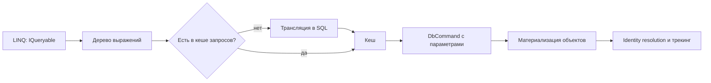

# EF Core: экспертная теория

🌐 **Русский** · [English](expert.en.md)

**Уровни:** [обзор](overview.ru.md) · [1. Базовая](basics.ru.md) · [2. Продвинутая](advanced.ru.md) · **3. Экспертная** · [4. Квиз](quiz.ru.md) · [упражнения](exercises.ru.md) · [5–6. Код и тесты](code/)

## Как выполняется запрос



1. Методы `Where`, `Select` и другие над `IQueryable` ничего не выполняют, а строят **дерево выражений** (expression tree).
2. При перечислении EF ищет дерево такой же формы в кеше запросов. Если не находит — транслирует его в SQL и кладёт в кеш. Трансляция дорогая, поэтому кеш важен.
3. Значения из замыканий становятся **параметрами**, а литералы в коде — частью текста SQL. Проверено:

```text
-- Where(p => p.Likes >= 25)        литерал
WHERE "p"."Likes" >= 25
-- Where(p => p.Likes >= min)       переменная
WHERE "p"."Likes" >= @min
-- Where(p => p.Likes >= EF.Constant(min))
WHERE "p"."Likes" >= 25
```

С параметром один SQL-текст и один план выполнения подходят для любых значений. Литерал даёт отдельный SQL на каждое значение. `EF.Constant` нужен редко: когда оптимизатору базы полезно видеть конкретное значение.

4. Коллекция в `Contains` с EF Core 10 по умолчанию превращается в отдельные параметры, и их список **дополняется до «круглого» размера** (padding), чтобы не плодить варианты SQL. Проверено: для 11 значений EF сгенерировал 20 параметров:

```text
WHERE "b"."Id" IN (@ids1, @ids2, @ids3, @ids4, @ids5, @ids6, @ids7, @ids8, @ids9, @ids10, @ids11, @ids12, @ids13, @ids14, @ids15, @ids16, @ids17, @ids18, @ids19, @ids20)
```

В EF 8 и 9 коллекция по умолчанию передавалась одним JSON-параметром (`OPENJSON` в SQL Server).

5. Строки результата превращаются в объекты. В отслеживающем запросе EF проверяет, есть ли объект с таким ключом в трекере, и возвращает существующий экземпляр — **identity resolution**.

## Как отслеживаются изменения

По умолчанию EF использует **снимки** (snapshot change tracking): при загрузке сущности запоминаются исходные значения свойств. Метод `ChangeTracker.DetectChanges()` сравнивает текущие значения со снимком и выставляет состояние `Modified`. Вызывать его вручную обычно не нужно: EF вызывает его сам в `SaveChanges`, `Entry()`, `Entries()` и некоторых других методах — поэтому в примере [`Lifecycle`](code/Examples/Ex03_ChangeTracking.cs) простое присваивание сразу дало `Modified`.

Автоматическое обнаружение можно выключить, например, при загрузке тысяч объектов:

```csharp
context.ChangeTracker.AutoDetectChangesEnabled = false;
var blog = context.Blogs.Single(b => b.Id == 3);
blog.Name = "Changed silently";
Console.WriteLine(context.SaveChanges());   // 0: the change was not detected
context.ChangeTracker.DetectChanges();
Console.WriteLine(context.SaveChanges());   // 1
```

Реальный вывод: `0`, затем `1`. Если выключаешь автообнаружение, вызывай `DetectChanges()` перед `SaveChanges` сам.

Полезные API трекера:

| API | Что делает |
|---|---|
| `Entry(e).State` | состояние сущности; можно присвоить |
| `Entry(e).Property(x => x.P).IsModified` | изменено ли конкретное свойство |
| `Entry(e).OriginalValues` / `CurrentValues` | снимок и текущие значения |
| `Entry(e).GetDatabaseValues()` | значения из базы прямо сейчас (`null`, если строки нет) |
| `Entry(e).Reload()` | перечитать сущность из базы, отменив локальные изменения |
| `ChangeTracker.Entries<T>()` | все отслеживаемые сущности типа |
| `DbSet<T>.Local` | отслеживаемые сущности без запроса к базе |
| `ChangeTracker.Clear()` | отсоединить все сущности (проверено: 5 → 0) |
| `ChangeTracker.QueryTrackingBehavior` | режим трекинга по умолчанию для этого контекста |

## Перехватчики

Перехватчик (interceptor) встраивается в работу EF: видит команды, подключения, транзакции, `SaveChanges`. Регистрируется через `AddInterceptors(...)`.

| Базовый класс | Что перехватывает |
|---|---|
| `DbCommandInterceptor` | создание и выполнение SQL-команд |
| `DbConnectionInterceptor` | открытие и закрытие подключения |
| `DbTransactionInterceptor` | транзакции и точки сохранения |
| `SaveChangesInterceptor` | `SaveChanges` до и после записи, ошибки |
| `IMaterializationInterceptor` | создание объектов из строк результата |

Аудит — классическая задача для `SaveChangesInterceptor`. Перехватчик заполняет `CreatedAt` до того, как EF построит SQL, поэтому значение уходит в тот же `INSERT`:

```csharp
// Runs inside SaveChanges, before EF builds the SQL, so the changed values are saved in the same batch.
public sealed class AuditInterceptor(TimeProvider clock) : SaveChangesInterceptor
{
    public override InterceptionResult<int> SavingChanges(DbContextEventData eventData, InterceptionResult<int> result)
    {
        Stamp(eventData.Context);
        return result;
    }
```

Время берётся из `TimeProvider`: в тестах подставляется `FixedTimeProvider`, и тест детерминирован. Синхронный и асинхронный `SaveChanges` вызывают разные методы перехватчика (`SavingChanges` и `SavingChangesAsync`), поэтому переопределять нужно оба. Код: [Ex11_Interceptors.cs](code/Examples/Ex11_Interceptors.cs). Перехватчик команд `CommandLog`, которым в примерах считаются SQL-запросы, — в [Ex01_Model.cs](code/Examples/Ex01_Model.cs).

## Ленивая загрузка изнутри

- **Прокси.** Пакет `Microsoft.EntityFrameworkCore.Proxies` и `UseLazyLoadingProxies()`. EF создаёт класс-наследник (в сообщениях он называется `BlogProxy`) и переопределяет навигации. Поэтому навигации должны быть `virtual`, а класс — допускать наследование.
- **Без прокси.** Сущность получает в конструктор сервис `ILazyLoader` и сама вызывает загрузку в геттере навигации. `virtual` и наследование не нужны.

Ленивая загрузка работает только пока жив контекст. После `Dispose` обращение к незагруженной навигации бросает исключение:

```text
InvalidOperationException: An error was generated for warning 'Microsoft.EntityFrameworkCore.Infrastructure.LazyLoadOnDisposedContextWarning': An attempt was made to lazy-load navigation 'BlogProxy.Posts' after the associated DbContext was disposed or returned to the pool, or the entity was explicitly detached from the context.
```

## Наследование: TPH, TPT, TPC

Иерархия `Payment` → `CardPayment`, `CashPayment` отображается тремя способами. Стратегия выбирается вызовом `UseTphMappingStrategy()`, `UseTptMappingStrategy()` или `UseTpcMappingStrategy()` для базового типа. Схемы ниже сгенерированы `GenerateCreateScript()`.

**TPH** (table per hierarchy, по умолчанию) — одна таблица и столбец-дискриминатор:

```text
CREATE TABLE "Payments" (
    "Id" TEXT NOT NULL CONSTRAINT "PK_Payments" PRIMARY KEY,
    "Amount" TEXT NOT NULL,
    "Discriminator" TEXT NOT NULL,
    "CardLast4" TEXT NULL,
    "Change" TEXT NULL
);
```

**TPT** (table per type) — таблица базового типа и по таблице на подтип, связанные ключом:

```text
CREATE TABLE "Payments" (
    "Id" TEXT NOT NULL CONSTRAINT "PK_Payments" PRIMARY KEY,
    "Amount" TEXT NOT NULL
);
CREATE TABLE "CardPayment" (
    "Id" TEXT NOT NULL CONSTRAINT "PK_CardPayment" PRIMARY KEY,
    "CardLast4" TEXT NOT NULL,
    CONSTRAINT "FK_CardPayment_Payments_Id" FOREIGN KEY ("Id") REFERENCES "Payments" ("Id") ON DELETE CASCADE
);
```

**TPC** (table per concrete type) — полная таблица на каждый неабстрактный тип, для абстрактной базы таблицы нет:

```text
CREATE TABLE "CardPayment" (
    "Id" TEXT NOT NULL CONSTRAINT "PK_CardPayment" PRIMARY KEY,
    "Amount" TEXT NOT NULL,
    "CardLast4" TEXT NOT NULL
);
CREATE TABLE "CashPayment" (
    "Id" TEXT NOT NULL CONSTRAINT "PK_CashPayment" PRIMARY KEY,
    "Amount" TEXT NOT NULL,
    "Change" TEXT NOT NULL
);
```

| | TPH | TPT | TPC |
|---|---|---|---|
| Таблиц | 1 | 1 + по одной на подтип | по одной на конкретный тип |
| Свойства подтипов | nullable-столбцы | в своих таблицах, `NOT NULL` возможен | в своих таблицах |
| Запрос к базовому типу | один `SELECT` | `JOIN` всех таблиц | `UNION ALL` всех таблиц |
| Запрос к одному подтипу | `WHERE Discriminator = …` | `JOIN` с базовой | одна таблица |
| Генерация ключей | обычная | обычная | ключ уникален во всех таблицах: последовательности или `Guid` |
| Когда | по умолчанию, почти всегда | редко: ради нормализованной схемы | запросы в основном к конкретным типам |

Во всех трёх стратегиях запрос к `Payments` полиморфный: вернул 1 `CardPayment` и 1 `CashPayment`. В примере ключ — `Guid`: SQLite не умеет генерировать целочисленные ключи для TPC, потому что у него нет последовательностей. Код: [Ex12_Inheritance.cs](code/Examples/Ex12_Inheritance.cs).

## Маппинг: конвертеры, complex types, теневые свойства

```csharp
modelBuilder.Entity<Order>(order =>
{
    // Value converter: store the enum as readable text instead of an integer.
    order.Property(o => o.Status).HasConversion<string>().HasMaxLength(20);
    order.ComplexProperty(o => o.ShippingAddress);
    // Shadow property: exists in the model and the table, but not in the CLR class.
    order.Property<DateTime>("LastModified");
});
```

Схема и результат:

```text
CREATE TABLE "Orders" (
    "Id" INTEGER NOT NULL CONSTRAINT "PK_Orders" PRIMARY KEY AUTOINCREMENT,
    "Status" TEXT NOT NULL,
    "LastModified" TEXT NOT NULL,
    "ShippingAddress_City" TEXT NOT NULL,
    "ShippingAddress_Street" TEXT NOT NULL
);
```

- **Конвертер значений** (value converter): в столбце `Status` хранится строка `"Paid"`, а не число. Проверено чтением столбца через ADO.NET.
- **Complex type**: `record Address(City, Street)` хранится в столбцах владельца `ShippingAddress_*`. У complex type нет ключа и собственной идентичности, у него семантика значения. Один и тот же экземпляр можно присвоить нескольким сущностям — проверено: два заказа с одним объектом `Address` сохранились (`SaveChanges` вернул 2). Complex types появились в EF Core 8. С EF Core 10 они бывают необязательными (nullable), структурами, отображаются в JSON-столбец (`ToJson`), и поддерживаются коллекции complex types в JSON.
- **Owned type** (`OwnsOne`) — более старый механизм для того же. У owned-сущности есть скрытый ключ и идентичность, поэтому разделять один экземпляр между владельцами нельзя.
- **Теневое свойство** (shadow property) `LastModified` есть в модели и в таблице, но не в классе. Доступ — через `Entry(order).Property("LastModified")`, в запросах — `EF.Property<DateTime>(o, "LastModified")`.

Код: [Ex14_Mapping.cs](code/Examples/Ex14_Mapping.cs).

## Производительность

**Скомпилированные запросы.** `EF.CompileQuery` один раз переводит запрос в SQL и возвращает потокобезопасный делегат: при вызове не нужно ни строить дерево выражений, ни искать его в кеше.

```csharp
// Translation LINQ → SQL happens once; the delegate is thread-safe and reusable across contexts.
private static readonly Func<BloggingContext, int, IEnumerable<Post>> PostsWithMinLikes =
    EF.CompileQuery<BloggingContext, int, Post>((context, minLikes) =>
        context.Posts.AsNoTracking().Where(p => p.Likes >= minLikes).OrderBy(p => p.Id));
```

**Пул контекстов.** `AddDbContextPool` или `PooledDbContextFactory` при `Dispose` сбрасывают состояние контекста и возвращают экземпляр в пул. Проверено: второй `CreateDbContext()` вернул тот же объект. Размер пула по умолчанию — 1024. Ограничение: `OnConfiguring` вызывается только при первом создании экземпляра, поэтому в нём нельзя задавать состояние, которое меняется от запроса к запросу (например, идентификатор арендатора). Сбрасывается состояние EF, но не состояние драйвера базы данных.

**Скомпилированная модель** (`dotnet ef dbcontext optimize`) ускоряет запуск приложения с большой моделью. Ограничения: не поддерживаются глобальные фильтры запросов, прокси ленивой загрузки и отслеживания изменений, конвертеры значений со ссылками на приватные методы, собственные `IModelCacheKeyFactory`. Модель нужно перегенерировать после каждого изменения конфигурации. Применять стоит, только если запуск действительно медленный.

**Пакетирование.** `SaveChanges` по возможности объединяет команды в пакеты. Для SQL Server по умолчанию в пакете не больше 42 команд (`MaxBatchSize`). В SQLite три добавленных блога ушли тремя командами `INSERT … RETURNING "Id"`.

Код: [Ex13_Performance.cs](code/Examples/Ex13_Performance.cs).

## Справочник

### Методы запросов

| Метод | Назначение |
|---|---|
| `AsNoTracking()` / `AsNoTrackingWithIdentityResolution()` | чтение без трекинга / без трекинга с одним объектом на строку |
| `AsTracking()` | включить трекинг, если по умолчанию он выключен |
| `Include(x => x.Nav)` / `ThenInclude` | жадная загрузка, в том числе с фильтром внутри `Include` |
| `AsSplitQuery()` / `AsSingleQuery()` | режим загрузки коллекций для одного запроса |
| `IgnoreQueryFilters()` / `IgnoreQueryFilters([name])` | отключить все фильтры / названные (EF 10+) |
| `ToQueryString()` | SQL без выполнения |
| `FromSql($"…")` | сырой SQL с параметрами, дальше можно компоновать LINQ |
| `FromSqlRaw(sql, params)` | сырой SQL строкой; параметры — `{0}` или `DbParameter` |
| `Database.SqlQuery<T>($"…")` | скаляры и типы вне модели; столбец скаляра — `Value` |
| `Database.ExecuteSql($"…")` | команда без результата, возвращает число строк |
| `ExecuteUpdate(s => s.SetProperty(…))` / `ExecuteDelete()` | массовые изменения без трекера |
| `EF.Property<T>(e, "Name")` | обращение к теневому свойству в запросе |
| `EF.Functions.Like(…)` и др. | функции базы данных в LINQ |
| `EF.CompileQuery(…)` / `EF.CompileAsyncQuery(…)` | скомпилированный запрос |

`FromSqlInterpolated` в EF Core 11 устарел: предупреждение CS0618 «Use FromSql() instead. This method is obsolete and will be removed in a future release.»

### Конфигурация модели

| Fluent API | Атрибут | Что задаёт |
|---|---|---|
| `HasKey(x => x.Id)` | `[Key]` | первичный ключ |
| `Property(x => x.P).IsRequired()` | `[Required]` | `NOT NULL` |
| `HasMaxLength(n)` | `[MaxLength(n)]` | длина строки |
| `HasIndex(x => x.P).IsUnique()` | `[Index(nameof(P), IsUnique = true)]` на классе | индекс |
| `IsConcurrencyToken()` | `[ConcurrencyCheck]` | токен конкурентности |
| `IsRowVersion()` | `[Timestamp]` | `rowversion` (SQL Server) |
| `Ignore(x => x.P)` | `[NotMapped]` | не отображать свойство |
| `ToTable("Name")` | `[Table("Name")]` | имя таблицы |
| `HasColumnName("Name")` | `[Column("Name")]` | имя столбца |
| `HasConversion<T>()` | — | конвертер значений |
| `HasQueryFilter(…)` | — | глобальный фильтр |
| `ComplexProperty(x => x.P)` | `[ComplexType]` на типе | complex type |
| `OwnsOne` / `OwnsMany` | `[Owned]` на типе | owned type |
| `HasNoKey()` | `[Keyless]` | сущность без ключа (представления, результаты SQL) |
| `HasDefaultValueSql("…")` | — | значение по умолчанию в базе |

Fluent API сильнее атрибутов: при конфликте побеждает конфигурация из `OnModelCreating`.

### Поведение при удалении

Что происходит с **отслеживаемыми** зависимыми при удалении главной сущности:

| `DeleteBehavior` | Схема базы | Обязательная связь | Необязательная связь |
|---|---|---|---|
| `Cascade` | `ON DELETE CASCADE` | удаляются | удаляются |
| `ClientCascade` | без каскада | удаляются | удаляются |
| `SetNull` | `ON DELETE SET NULL` | ошибка при создании базы | внешний ключ → `null` |
| `ClientSetNull` | без каскада | `InvalidOperationException` | внешний ключ → `null` |
| `Restrict` | `ON DELETE RESTRICT` (SQL Server: `NO ACTION`) | `InvalidOperationException` | внешний ключ → `null` |
| `NoAction` | без каскада | `InvalidOperationException` | внешний ключ → `null` |
| `ClientNoAction` | без каскада | `DbUpdateException` | `DbUpdateException` |

Каскад в самой базе дают только `Cascade` и `SetNull`. По умолчанию обязательная связь — `Cascade`, необязательная — `ClientSetNull`. Проверено на модели: `Post.Blog` → `Cascade`; у необязательной связи `Item.Owner` → `ClientSetNull`, и после удаления владельца `OwnerId` отслеживаемого `Item` стал `null`.

### Регистрация в DI

| Метод | Время жизни | Когда |
|---|---|---|
| `AddDbContext<T>` | scoped (по умолчанию) | веб-приложение: контекст на запрос |
| `AddDbContextPool<T>` | контекст из пула на scope | высокая нагрузка |
| `AddDbContextFactory<T>` | фабрика — singleton, контексты создаёт и освобождает код | Blazor Server, несколько единиц работы в одном scope |
| `AddPooledDbContextFactory<T>` | фабрика с пулом | то же + пул |

### Команды dotnet ef

| Команда | Что делает |
|---|---|
| `migrations add <Name>` | новая миграция по разнице модели и снимка |
| `migrations remove` | удалить последнюю миграцию |
| `migrations list` | список миграций |
| `migrations script [from] [to]` | SQL-скрипт; `--idempotent` — скрипт для базы в любом состоянии |
| `migrations bundle` | исполняемый файл, который обновляет базу |
| `migrations has-pending-model-changes` | есть ли изменения модели без миграции (для CI) |
| `database update [migration]` | применить миграции; `0` — откатить все |
| `database drop` | удалить базу |
| `dbcontext scaffold` | сгенерировать модель по существующей базе (database first) |
| `dbcontext optimize` | скомпилированная модель |
| `dbcontext script` | SQL создания схемы без миграций |

## Подвохи

Каждый подвох проверен запуском. Тестовые данные: 3 блога по 2 поста.

### Навигация без Include пуста

```csharp
var tag = context.Tags.Single(t => t.Name == "csharp");
Console.WriteLine(tag.Posts.Count);   // 0, although six posts have this tag
```

Ленивая загрузка выключена, и EF не загружает навигации без `Include`. Результат: `0`, а с `Include(t => t.Posts)` — `6`. Никакой ошибки нет, поэтому баг легко пропустить.

### ExecuteDelete, затем SaveChanges

```csharp
var blog = context.Blogs.Single(b => b.Name == "B-a");
context.Blogs.Where(b => b.Name == "B-a").ExecuteDelete();
blog.Name = "B-a2"; blog.Version++;
context.SaveChanges();   // DbUpdateConcurrencyException
```

`ExecuteDelete` удалил строку, но трекер о ней не знает. `UPDATE` затронул 0 строк, и EF сообщил о конфликте конкурентности. По той же причине после `ExecuteUpdate` загруженный пост показывает `Likes = 10`, хотя в базе `1000`.

### Забытое увеличение токена

```csharp
a.Name = "Alice"; alice.SaveChanges();   // no Version++
b.Name = "Bob";   bob.SaveChanges();     // saved, no conflict
```

Токен `Version` управляется приложением. Alice не увеличила его, и `WHERE "Version" = @p` у Bob совпал. Итоговое имя — `Bob`: изменение Alice потеряно без ошибки. Токен из базы (`rowversion` в SQL Server) от этой ошибки защищает.

### FromSqlRaw с интерполяцией

```csharp
string name = "x' OR '1'='1";
context.Blogs.FromSqlRaw($"SELECT * FROM Blogs WHERE Name = '{name}'").Count();   // 3
context.Blogs.FromSql($"SELECT * FROM Blogs WHERE Name = {name}").Count();        // 0
```

Строка выглядит так же, но `FromSqlRaw` принимает `string`: C# подставляет значение в текст **до** вызова EF, и получается инъекция. `FromSql` принимает `FormattableString` и превращает значения в параметры. Анализатор предупреждает: EF1002 для интерполяции в `FromSqlRaw`, EF1003 для конкатенации.

### SqlQuery и столбец Value

`SqlQuery<int>($"SELECT SUM(Likes) FROM Posts").Single()` падает с ошибкой SQLite `no such column: s.Value`, а `.ToList()` с тем же SQL возвращает `135`. `Single()` компонует запрос: EF оборачивает SQL в подзапрос и обращается к столбцу `Value`. Если результат будет компоноваться, назови столбец: `SELECT SUM(Likes) AS Value …`.

### Особенности SQLite

- `==` для строк чувствителен к регистру: `Count(b => b.Name == "blog 2")` вернул `0`, хотя есть `Blog 2`. В SQL Server с обычной collation сравнение регистронезависимо — поведение зависит от базы.
- `HasMaxLength(100)` не попал в схему: столбец `"Name" TEXT NOT NULL` без длины.
- `decimal` хранится как `TEXT` (столбец `Amount`).
- `migrations script --idempotent` для SQLite не поддерживается.

Тесты на SQLite не доказывают, что код так же поведёт себя на рабочей базе. Для этого нужны интеграционные тесты на той же СУБД.

### Детектор параллельного использования

EF проверяет параллельный доступ к контексту, только пока операция находится внутри вызова: выполняет команду или читает строку. Две операции, которые не пересеклись по времени, ошибку не дают, даже если код неправильный. В примере перехватчик специально задерживает первую команду, и только тогда второй запрос получает `InvalidOperationException`. Отсутствие ошибки в тестах не доказывает, что контекст используется безопасно.

### EnsureCreated и миграции

`EnsureCreated()` создаёт схему без таблицы `__EFMigrationsHistory`. Последующий `Migrate()` считает, что ни одна миграция не применена, начинает с первой и падает на существующих таблицах. Проверено: `SqliteException: SQLite Error 1: 'table "Blogs" already exists'`. Выбирай одно: `EnsureCreated` — для тестов и прототипов, миграции — для всего, что живёт дольше.

## Компромиссы и альтернативы

| Задача | EF Core | Альтернатива |
|---|---|---|
| CRUD, бизнес-логика, граф объектов | трекинг, единица работы, миграции | — |
| Сложный отчётный SQL | `FromSql`, `SqlQuery`, представления | Dapper: ручной SQL и маппинг |
| Массовая загрузка миллионов строк | медленно даже с `ExecuteUpdate` | `SqlBulkCopy`, `COPY` (PostgreSQL) |
| Максимальная скорость чтения | `AsNoTracking`, проекции, скомпилированные запросы | Dapper, ADO.NET |

- **Трекинг или нет.** Трекинг нужен, чтобы сохранять изменения. Для чтения он лишняя работа: `AsNoTracking` или глобально `UseQueryTrackingBehavior(QueryTrackingBehavior.NoTracking)`.
- **Single или split.** Один запрос согласован, но при нескольких коллекциях дублирует данные. Split-запросы не дублируют, но делают несколько обращений к базе и не гарантируют согласованность, если между ними данные изменились (смягчается serializable- или snapshot-транзакцией).
- **Репозиторий поверх EF.** `DbContext` уже реализует единицу работы, а `DbSet` — репозиторий. Своя обёртка оправдана, если нужно скрыть EF от доменного слоя; иначе она лишь прячет `Include`, проекции и `AsNoTracking`.
- **Ленивая загрузка.** Удобна в прототипах, но прячет N+1. В веб-API её обычно не включают.

## Вопросы с собеседований

**1. Чем `IQueryable<T>` отличается от `IEnumerable<T>` при работе с EF Core?**

<details><summary>Ответ</summary>

`IQueryable` хранит дерево выражений, которое EF переводит в SQL: `Where`, `OrderBy`, `Select` выполняются в базе. `IEnumerable` — LINQ to Objects: операторы работают в памяти над уже загруженными объектами. Если вызвать `AsEnumerable()` или `ToList()` до `Where`, база вернёт всю таблицу: в примере ради 1 поста прочитаны все 6. Подробнее — [продвинутая теория](advanced.ru.md#iqueryable-и-ienumerable).

</details>

**2. Что такое проблема N+1? Как её обнаружить и исправить?**

<details><summary>Ответ</summary>

Один запрос загружает список, затем по запросу на каждый элемент — обычно из-за ленивой загрузки в цикле. Для 3 блогов это 4 команды, для 1000 — 1001. Обнаружить: логирование SQL (`LogTo`), перехватчик команд, профилировщик базы. Исправить: проекция (`Select` с нужными полями и агрегатами) или `Include`; для нескольких коллекций — `AsSplitQuery()`.

</details>

**3. Как EF Core узнаёт, что сущность изменилась?**

<details><summary>Ответ</summary>

По снимкам: при загрузке запоминаются исходные значения, `DetectChanges()` сравнивает их с текущими. EF вызывает `DetectChanges` автоматически в `SaveChanges`, `Entry()`, `Entries()`. Если выключить `AutoDetectChangesEnabled`, изменения без явного `DetectChanges()` не сохранятся (проверено: `SaveChanges` вернул 0). Есть и альтернатива — уведомления через `INotifyPropertyChanged`.

</details>

**4. Чем отличаются `Add`, `Attach`, `Update` и `Remove`?**

<details><summary>Ответ</summary>

- `Add` — граф в `Added` → `INSERT`.
- `Attach` — в `Unchanged`; затем изменённые свойства становятся `Modified`, и `UPDATE` пишет только их.
- `Update` — в `Modified` со **всеми** свойствами: `UPDATE` перезаписывает все столбцы (проверено: `SET "IsDeleted" = @p0, "Name" = @p1, "Version" = @p2`).
- `Remove` — в `Deleted` → `DELETE`.

Подвох с графами: если ключ генерируется базой и не задан, `Attach` и `Update` помечают такую сущность как `Added`. Проверено: блог с `Id = 1` и новым постом без ключа → блог `Unchanged` (или `Modified` у `Update`), пост `Added`.

</details>

**5. Когда использовать `AsNoTracking` и чем от него отличается `AsNoTrackingWithIdentityResolution`?**

<details><summary>Ответ</summary>

`AsNoTracking` — для чтения: нет затрат на трекер, но изменения не сохранятся, а одна строка базы, встреченная несколько раз, даёт несколько объектов (6 постов → 6 объектов `Blog`). `AsNoTrackingWithIdentityResolution` использует временный трекер только на время запроса: 6 постов → 3 объекта `Blog`. Нужен, когда в графе много повторов и важно не плодить копии.

</details>

**6. Чем `Find` отличается от `Single`/`FirstOrDefault` по ключу?**

<details><summary>Ответ</summary>

`Find` сначала ищет сущность в трекере и ходит в базу, только если не нашёл (проверено: 0 SQL-команд для уже загруженного блога). `Single` и `FirstOrDefault` всегда выполняют SQL, хотя затем тоже вернут отслеживаемый экземпляр (identity resolution). `Find` работает только по первичному ключу.

</details>

**7. Что выведет код?**

```csharp
Post post = context.Posts.Single(p => p.Id == 1);
context.Posts.Where(p => p.Id == 1)
    .ExecuteUpdate(s => s.SetProperty(p => p.Likes, 1000));
Console.WriteLine(post.Likes);
```

<details><summary>Ответ</summary>

`10` — старое значение. `ExecuteUpdate` выполняет SQL напрямую и не трогает трекер. Чтобы увидеть `1000`, нужно перечитать сущность (`Entry(post).Reload()`) или использовать новый контекст.

</details>

**8. Атомарен ли `SaveChanges`? Как сделать атомарными несколько вызовов?**

<details><summary>Ответ</summary>

Да: если провайдер поддерживает транзакции, все изменения одного `SaveChanges` применяются в транзакции. В примере второй блог нарушил уникальный индекс, и первый тоже не сохранился. Несколько вызовов объединяет `Database.BeginTransaction()` + `Commit()`. Внутри явной транзакции `SaveChanges` создаёт точку сохранения: ошибка откатывает только этот вызов, предыдущая работа остаётся. `ExecuteUpdate`/`ExecuteDelete` сами транзакцию не открывают.

</details>

**9. Как реализовать оптимистическую конкурентность в EF Core? Чем она отличается от пессимистической?**

<details><summary>Ответ</summary>

Свойство помечается токеном (`IsConcurrencyToken()` / `[ConcurrencyCheck]` или `IsRowVersion()` / `[Timestamp]`). EF добавляет его исходное значение в `WHERE` у `UPDATE` и `DELETE`. Если затронуто 0 строк — `DbUpdateConcurrencyException`. Разрешение: «база побеждает» (`Reload`), «клиент побеждает» (`OriginalValues.SetValues(GetDatabaseValues())` и повторить), слияние. Пессимистическая блокировка держит блокировку строки (`SELECT … FOR UPDATE`, `UPDLOCK`) — в EF только через сырой SQL. Оптимистическая лучше при редких конфликтах и не держит блокировок.

</details>

**10. Подвох: токен `Version` задан через `IsConcurrencyToken()`, но конфликт не обнаружился. Почему?**

<details><summary>Ответ</summary>

Токен, которым управляет приложение, нужно менять при каждом изменении. Если не увеличить `Version`, `WHERE "Version" = @p` у второго пользователя совпадёт, и его `UPDATE` молча затрёт первое изменение (проверено: итоговое имя `Bob`). `rowversion` в SQL Server меняет сама база.

</details>

**11. Потокобезопасен ли `DbContext`? Какое время жизни у него в ASP.NET Core?**

<details><summary>Ответ</summary>

Нет. Вторая операция, начатая до завершения первой, бросает `InvalidOperationException` «A second operation was started on this context instance…». Частая причина — `Task.WhenAll` над запросами одного контекста или забытый `await`. `AddDbContext` регистрирует контекст как scoped: один на HTTP-запрос. Для параллельной работы — отдельный контекст на задачу, например из `IDbContextFactory<T>`. Скомпилированный делегат запроса при этом потокобезопасен.

</details>

**12. Что даёт пул контекстов и какие у него ограничения?**

<details><summary>Ответ</summary>

Пул переиспользует экземпляры: при `Dispose` EF сбрасывает состояние контекста и возвращает его в пул (проверено: второй `CreateDbContext()` вернул тот же объект). Экономит выделение памяти и инициализацию сервисов. Ограничения: размер по умолчанию 1024; `OnConfiguring` вызывается только при первом создании экземпляра, поэтому состояние на запрос (арендатор и т. п.) так задавать нельзя — его выставляют после получения контекста из пула; состояние драйвера базы данных не сбрасывается.

</details>

**13. Что такое декартов взрыв и как его избежать?**

<details><summary>Ответ</summary>

При `Include` нескольких коллекций в одном SQL `JOIN` возвращает произведение строк: 10 постов × 10 тегов дают 100 строк на блог, и данные блога повторяются в каждой. EF предупреждает (`MultipleCollectionIncludeWarning`). Решение — `AsSplitQuery()` (в примере 3 команды вместо 1) или глобально `UseQuerySplittingBehavior(SplitQuery)`. Цена: несколько обращений к базе и нет гарантии согласованности между запросами.

</details>

**14. Сравните TPH, TPT и TPC.**

<details><summary>Ответ</summary>

- TPH — одна таблица с дискриминатором, столбцы подтипов nullable. Самая быстрая для полиморфных запросов, стратегия по умолчанию.
- TPT — таблица на каждый тип, связь по ключу. Нормализованная схема, но запрос к базовому типу соединяет все таблицы — медленно.
- TPC — полная таблица на каждый конкретный тип. Быстрые запросы к конкретному типу, полиморфный запрос — `UNION ALL`. Ключи должны быть уникальны во всей иерархии: последовательность или `Guid` (в SQLite целочисленные ключи для TPC не генерируются).

</details>

**15. Когда EF выполняет часть запроса на клиенте?**

<details><summary>Ответ</summary>

Только в последнем `Select`: непереводимый метод в проекции выполняется над загруженными строками. В `Where`, `OrderBy` и других местах EF бросает `InvalidOperationException` «…could not be translated…» и предлагает явно перейти на клиент через `AsEnumerable` или `ToList`. Это сделано специально, чтобы не выгружать таблицу незаметно (так было в EF Core 2.x).

</details>

**16. Как EF Core защищает от SQL-инъекций? В чём подвох `FromSqlRaw`?**

<details><summary>Ответ</summary>

LINQ-запросы всегда параметризованы: значения переменных уходят как параметры. `FromSql($"…{x}")` принимает `FormattableString` и тоже превращает значения в параметры. `FromSqlRaw` принимает обычную строку: если передать в него интерполяцию или конкатенацию, значение попадёт в текст SQL. Ввод `x' OR '1'='1` вернул все 3 блога. Анализатор предупреждает (EF1002, EF1003). В `FromSqlRaw` параметры передаются через `{0}` или `DbParameter`.

</details>

**17. Как работают глобальные фильтры запросов? Какие у них подводные камни?**

<details><summary>Ответ</summary>

`HasQueryFilter` добавляет условие ко всем запросам к типу, включая `Include` и навигации. С EF 10 фильтры именованные, и их можно отключать по одному: `IgnoreQueryFilters([name])`. Подводные камни: фильтр на `Blog` не скрывает его посты при запросе к `Posts` — нужен свой фильтр на `Post`, который добавляет `JOIN` в каждый запрос к постам. Скомпилированная модель фильтры не поддерживает.

</details>

**18. Как устроены миграции и как применять их в production?**

<details><summary>Ответ</summary>

`migrations add` сравнивает текущую модель со снимком (`ModelSnapshot.cs`) и генерирует класс с `Up` и `Down`. Применённые миграции записываются в `__EFMigrationsHistory`. Для автоматического развёртывания документация советует бандл (`migrations bundle`), а когда SQL нужно проверить или отдать DBA — скрипт (`migrations script`, `--idempotent` там, где провайдер его поддерживает). `Database.Migrate()` при старте приложения — компромисс: приложению нужны права на изменение схемы, SQL применяется без проверки человеком, откатить сложнее, а другие приложения могут работать с базой во время миграции. До EF 9 несколько экземпляров могли применять миграции одновременно; с EF 9 `Migrate` берёт блокировку на всю базу. `EnsureCreated` с миграциями не смешивают.

</details>

**19. Как работает ленивая загрузка и что будет, если обратиться к навигации после `Dispose` контекста?**

<details><summary>Ответ</summary>

Через прокси (класс-наследник переопределяет `virtual`-навигации) или через `ILazyLoader`, внедрённый в сущность. Загрузка выполняется при первом обращении к навигации. После `Dispose` контекста EF бросает `InvalidOperationException` из-за предупреждения `LazyLoadOnDisposedContextWarning`, которое по умолчанию настроено как ошибка (проверено).

</details>

**20. Что вернёт `SaveChanges`, если удалить блог с двумя загруженными постами?**

<details><summary>Ответ</summary>

`3`. `SaveChanges` возвращает число записанных сущностей. Связь обязательная, поэтому по умолчанию `Cascade`: отслеживаемые посты тоже переходят в `Deleted` (проверено: `Blog:Deleted, Post:Deleted, Post:Deleted`). Для необязательной связи по умолчанию `ClientSetNull`: внешний ключ отслеживаемых зависимых становится `null`, а сами они остаются.

</details>

**21. Какой SQL сгенерирует `Where(b => ids.Contains(b.Id))` в EF Core 10+?**

<details><summary>Ответ</summary>

`IN (@ids1, @ids2, …)` — по параметру на значение, со списком, дополненным до большего размера: для 11 значений получилось 20 параметров. Так у разных размеров списка меньше вариантов SQL, и планы выполнения переиспользуются. В EF 8–9 по умолчанию был один JSON-параметр (`OPENJSON`), до EF 8 значения встраивались в SQL константами.

</details>

## Шпаргалка

| Задача | Решение |
|---|---|
| Посмотреть SQL | `ToQueryString()`, `LogTo(Console.WriteLine)` |
| Только чтение | `AsNoTracking()` + проекция в DTO |
| Связанные данные | `Include`/`ThenInclude` или проекция; несколько коллекций — `AsSplitQuery()` |
| Массово изменить или удалить | `ExecuteUpdate` / `ExecuteDelete` (трекер устаревает) |
| Защита от потерянных обновлений | токен конкурентности + обработка `DbUpdateConcurrencyException` |
| Несколько `SaveChanges` атомарно | `Database.BeginTransaction()` |
| Мягкое удаление | именованный `HasQueryFilter` + перехватчик вместо `DELETE` |
| Аудит | `SaveChangesInterceptor` + `TimeProvider` |
| Сырой SQL | `FromSql($"…")`, никогда не склеивать строки |
| Горячий запрос | `EF.CompileQuery` |
| Высокая нагрузка | `AddDbContextPool` |
| Параллельная работа | контекст на задачу через `IDbContextFactory<T>` |
| Схема в production | `migrations script` / `migrations bundle` |

## Связанные материалы

- Раньше: [базовая теория](basics.ru.md), [продвинутая теория](advanced.ru.md)
- Проверь себя: [квиз](quiz.ru.md), [упражнения](exercises.ru.md)
- Потоки и `DbContext`: [18 · Многопоточность](../18-concurrency/expert.ru.md)
- `decimal` и точность: [02 · Типы и переменные](../02-types-and-variables/advanced.ru.md)
- `dotnet tool` и локальные инструменты: [01 · Платформа .NET](../01-dotnet-platform/expert.ru.md)

## Источники

- [Как работают запросы](https://learn.microsoft.com/ef/core/querying/how-query-works)
- [Что нового в EF Core 10](https://learn.microsoft.com/ef/core/what-is-new/ef-core-10.0/whatsnew)
- [Обнаружение изменений и уведомления](https://learn.microsoft.com/ef/core/change-tracking/change-detection)
- [Отслеживание и запросы без отслеживания](https://learn.microsoft.com/ef/core/querying/tracking)
- [Перехватчики](https://learn.microsoft.com/ef/core/logging-events-diagnostics/interceptors)
- [Ленивая загрузка](https://learn.microsoft.com/ef/core/querying/related-data/lazy)
- [Наследование](https://learn.microsoft.com/ef/core/modeling/inheritance)
- [Конвертеры значений](https://learn.microsoft.com/ef/core/modeling/value-conversions)
- [Complex types](https://learn.microsoft.com/ef/core/modeling/complex-types)
- [Теневые свойства](https://learn.microsoft.com/ef/core/modeling/shadow-properties)
- [Продвинутые темы производительности](https://learn.microsoft.com/ef/core/performance/advanced-performance-topics)
- [Эффективное обновление](https://learn.microsoft.com/ef/core/performance/efficient-updating)
- [Каскадное удаление](https://learn.microsoft.com/ef/core/saving/cascade-delete)
- [Конфликты конкурентности](https://learn.microsoft.com/ef/core/saving/concurrency)
- [Справочник dotnet ef](https://learn.microsoft.com/ef/core/cli/dotnet)
- [Применение миграций](https://learn.microsoft.com/ef/core/managing-schemas/migrations/applying)
