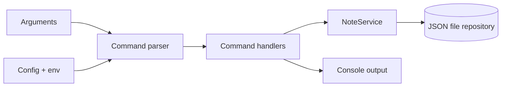

# Project: CLI tool

🌐 [Русский](overview.ru.md) · **English**

> We build a console utility `notes` for notes: commands, configuration, file storage, nice output and tests. It consolidates the language basics, LINQ, file handling and testing.

**Uses modules:** [03 · Control flow and methods](../../modules/03-control-flow-and-methods/overview.en.md), [06 · Collections and generics](../../modules/06-collections-and-generics/overview.en.md), [07 · LINQ](../../modules/07-linq/overview.en.md), [08 · Exceptions](../../modules/08-exceptions/overview.en.md), [13 · DI, configuration, logging](../../modules/13-di-config-logging/overview.en.md), [16 · Unit testing](../../modules/16-testing-unit/overview.en.md)
**Libraries that help:** [Spectre.Console](../../libraries/spectre-console/overview.en.md), [Serilog](../../libraries/serilog/overview.en.md), [FluentValidation](../../libraries/fluentvalidation/overview.en.md)
**Time:** ~6–8 h

## Requirements

### Mandatory

- Commands: `notes add "text" [--tag t]`, `notes list [--tag t]`, `notes done <id>`, `notes remove <id>`.
- Notes stored in a JSON file (the default path is in the user profile, overridable by config and an environment variable).
- Clear error messages and a non-zero exit code on error (no such note, a corrupt file).
- Configuration: a settings file + environment variables + command-line arguments (priority increasing in that order).
- The logic (working with notes) is separated from I/O and covered by unit tests.

### Extra

- A table with colored output in a terminal (Spectre.Console), plain text on redirection.
- A subcommand `notes export --format json|csv`.
- Highlighting overdue notes (a `due` field).
- A structured log to a file (Serilog) with a level from configuration.
- Publishing as a single executable (`dotnet publish`).

## Architecture

The notes repository is an interface: tests substitute an in-memory store.

## Stages

1. The application skeleton and argument parsing (by hand or Spectre.Console.Cli).
2. The `Note` model and `NoteService` (add, list, mark, remove).
3. A JSON-file repository, handling a missing and a corrupt file.
4. Commands and output; exit codes.
5. Configuration from a file, environment variables and arguments.
6. Unit tests of the service (an in-memory repository) and of error handling.
7. Extra: tables, export, logging.
8. Publishing and the README.

## Definition of done

- `dotnet test` passes; the service is tested without the file system.
- Errors — a clear message and an exit code `≠ 0`, no stack trace for the user.
- Configuration priority is respected and described in the README.
- `bin/` and `obj/` are not in the repository.

## Hints

Stuck on stage 3

Serialize the list through `System.Text.Json`. Write to a temporary file and then replace the main one — so an interrupted write does not corrupt the data. Turn I/O exceptions into clear messages ([08 · Exceptions](../../modules/08-exceptions/overview.en.md)).

Stuck on stage 5

`Microsoft.Extensions.Configuration` can assemble sources in order: JSON, environment variables, command-line arguments; a later source overrides an earlier one ([13 · Configuration](../../modules/13-di-config-logging/overview.en.md)).

## Solution

Your code goes to [src/](src/).
