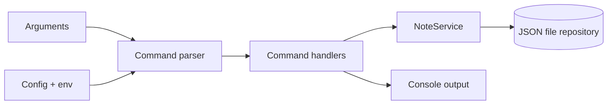

# Проект: CLI-утилита

🌐 **Русский** · [English](overview.en.md)

> Строим консольную утилиту `notes` для заметок: команды, конфигурация, хранение в файле, красивый вывод и тесты. Закрепляет основы языка, LINQ, работу с файлами и тестирование.

**Закрепляет модули:** [03 · Управление потоком и методы](../../modules/03-control-flow-and-methods/overview.ru.md), [06 · Коллекции и обобщения](../../modules/06-collections-and-generics/overview.ru.md), [07 · LINQ](../../modules/07-linq/overview.ru.md), [08 · Исключения](../../modules/08-exceptions/overview.ru.md), [13 · DI, конфигурация, логирование](../../modules/13-di-config-logging/overview.ru.md), [16 · Юнит-тестирование](../../modules/16-testing-unit/overview.ru.md)
**Помогут библиотеки:** [Spectre.Console](../../libraries/spectre-console/overview.ru.md), [Serilog](../../libraries/serilog/overview.ru.md), [FluentValidation](../../libraries/fluentvalidation/overview.ru.md)
**Время:** ~6–8 ч

## Требования

### Обязательные

- Команды: `notes add "текст" [--tag t]`, `notes list [--tag t]`, `notes done <id>`, `notes remove <id>`.
- Хранение заметок в JSON-файле (путь по умолчанию — в профиле пользователя, переопределяется конфигом и переменной окружения).
- Понятные сообщения об ошибках и ненулевой код возврата при ошибке (нет заметки, битый файл).
- Конфигурация: файл настроек + переменные окружения + аргументы командной строки (приоритет — в таком порядке возрастания).
- Логика (работа с заметками) отделена от ввода-вывода и покрыта юнит-тестами.

### Дополнительные

- Таблица с цветным выводом в терминале (Spectre.Console), чистый текст при перенаправлении.
- Подкоманда `notes export --format json|csv`.
- Подсветка просроченных заметок (поле `due`).
- Структурный лог в файл (Serilog) с уровнем из конфигурации.
- Публикация как один исполняемый файл (`dotnet publish`).

## Архитектура

Репозиторий заметок — интерфейс: в тестах подставляется хранилище в памяти.

## Этапы

1. Каркас приложения и разбор аргументов (вручную или Spectre.Console.Cli).
2. Модель `Note` и `NoteService` (добавление, список, отметка, удаление).
3. Репозиторий на JSON-файле, обработка отсутствующего и битого файла.
4. Команды и вывод; коды возврата.
5. Конфигурация из файла, переменных окружения и аргументов.
6. Юнит-тесты сервиса (репозиторий в памяти) и обработки ошибок.
7. Дополнительно: таблицы, экспорт, логирование.
8. Публикация и README.

## Критерии готовности

- `dotnet test` проходит; сервис тестируется без файловой системы.
- Ошибки — понятное сообщение и код возврата `≠ 0`, без трассировки стека для пользователя.
- Приоритет конфигурации соблюдается и описан в README.
- `bin/` и `obj/` не в репозитории.

## Подсказки

Застрял на этапе 3

Сериализуйте список через `System.Text.Json`. Пишите во временный файл и затем заменяйте основной — так обрыв записи не испортит данные. Исключения ввода-вывода превращайте в понятные сообщения ([08 · Исключения](../../modules/08-exceptions/overview.ru.md)).

Застрял на этапе 5

`Microsoft.Extensions.Configuration` умеет собирать источники по порядку: JSON, переменные окружения, аргументы командной строки; более поздний источник перекрывает ранний ([13 · Конфигурация](../../modules/13-di-config-logging/overview.ru.md)).

## Решение

Ваш код — в [src/](src/).
