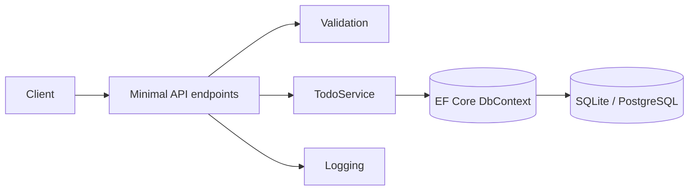

# Project: TODO API

🌐 [Русский](overview.ru.md) · **English**

> We build a REST API for a task list on Minimal API and EF Core: CRUD, validation, pagination, authentication, tests and a Docker image. It consolidates the web part of the course from routing to integration tests.

**Uses modules:** [14 · ASP.NET Core: Minimal API](../../modules/14-aspnet-core-minimal-api/overview.en.md), [15 · EF Core](../../modules/15-ef-core/overview.en.md), [13 · DI, configuration, logging](../../modules/13-di-config-logging/overview.en.md), [16 · Unit testing](../../modules/16-testing-unit/overview.en.md), [17 · Integration testing](../../modules/17-testing-integration/overview.en.md)
**Recipes and libraries that help:** [JWT authentication](../../recipes/jwt-auth/overview.en.md), [Pagination and filtering](../../recipes/pagination-filtering/overview.en.md), [Rate limiting](../../recipes/rate-limiting/overview.en.md), [FluentValidation](../../libraries/fluentvalidation/overview.en.md), [Serilog](../../libraries/serilog/overview.en.md)
**Time:** ~8–12 h

## Requirements

### Mandatory

- The entity `TodoItem`: `Id`, `Title` (required, up to 200 characters), `IsDone`, `CreatedAt`, `DueDate` (optional).
- Endpoints: `GET /todos` (a list), `GET /todos/{id}`, `POST /todos`, `PUT /todos/{id}`, `DELETE /todos/{id}`.
- Storage in a DB through EF Core (SQLite for development), migrations.
- Input validation; errors as `ProblemDetails` (`400` for invalid input, `404` for a missing record).
- A list with pagination and a filter by `IsDone`.
- Configuration and logging through the standard mechanisms (`appsettings.json`, `ILogger`).
- Unit tests of the logic and integration tests of the API (`WebApplicationFactory`).

### Extra

- JWT authentication: tasks belong to a user, others' tasks are inaccessible.
- Keyset pagination instead of offset.
- Rate limiting on writes.
- Structured logs (Serilog) with a request identifier.
- A Dockerfile and running with `docker compose up`.
- Integration tests on PostgreSQL in a container (Testcontainers).

## Architecture

Endpoints are thin: request parsing and the result; logic is in the service; data access is through the `DbContext`.

## Stages

1. The skeleton: a Minimal API project, `GET /health`, configuration, logging.
2. The model and DB: `TodoItem`, `DbContext`, the first migration.
3. CRUD endpoints and response codes.
4. Validation and `ProblemDetails`.
5. Pagination and a filter.
6. Unit tests of the service.
7. Integration tests through `WebApplicationFactory` (a separate DB per test).
8. Extra: JWT, rate limiting, Serilog.
9. A Dockerfile, `docker compose`, a README with run instructions.

## Definition of done

- All tests pass (`dotnet test`).
- Invalid input returns `400` with `ProblemDetails`, a missing record — `404`.
- The list does not return the whole table: there is pagination.
- Build and run are described in the README; `bin/` and `obj/` are not in the repository.
- (Extra) the image builds and the application responds in the container.

## Hints

Stuck on stage 3

Group routes through `MapGroup("/todos")`. The `DbContext` is injected as a handler parameter. For `404` return `Results.NotFound()`, for creation — `Results.Created($"/todos/{id}", item)`. See [14 · Minimal API](../../modules/14-aspnet-core-minimal-api/basics.en.md).

Stuck on stage 7

`WebApplicationFactory<Program>` requires `Program` to be accessible to the test project; in tests replace the `DbContext` registration with a separate DB. See [17 · Integration testing](../../modules/17-testing-integration/overview.en.md).

## Solution

Your code goes to [src/](src/).
