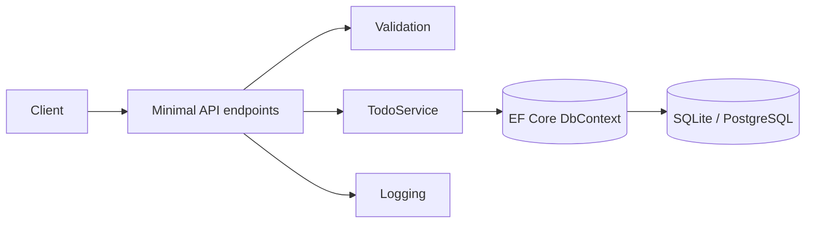

# Проект: TODO API

🌐 **Русский** · [English](overview.en.md)

> Строим REST API для списка задач на Minimal API и EF Core: CRUD, валидация, пагинация, аутентификация, тесты и Docker-образ. Закрепляет веб-часть курса от маршрутизации до интеграционных тестов.

**Закрепляет модули:** [14 · ASP.NET Core: Minimal API](../../modules/14-aspnet-core-minimal-api/overview.ru.md), [15 · EF Core](../../modules/15-ef-core/overview.ru.md), [13 · DI, конфигурация, логирование](../../modules/13-di-config-logging/overview.ru.md), [16 · Юнит-тестирование](../../modules/16-testing-unit/overview.ru.md), [17 · Интеграционное тестирование](../../modules/17-testing-integration/overview.ru.md)
**Помогут рецепты и библиотеки:** [JWT-аутентификация](../../recipes/jwt-auth/overview.ru.md), [Пагинация и фильтрация](../../recipes/pagination-filtering/overview.ru.md), [Rate limiting](../../recipes/rate-limiting/overview.ru.md), [FluentValidation](../../libraries/fluentvalidation/overview.ru.md), [Serilog](../../libraries/serilog/overview.ru.md)
**Время:** ~8–12 ч

## Требования

### Обязательные

- Сущность `TodoItem`: `Id`, `Title` (обязательно, до 200 символов), `IsDone`, `CreatedAt`, `DueDate` (необязательно).
- Эндпоинты: `GET /todos` (список), `GET /todos/{id}`, `POST /todos`, `PUT /todos/{id}`, `DELETE /todos/{id}`.
- Хранение в БД через EF Core (SQLite для разработки), миграции.
- Валидация входа; ошибки — `ProblemDetails` (`400` для невалидного ввода, `404` для отсутствующей записи).
- Список с пагинацией и фильтром по `IsDone`.
- Конфигурация и логирование через стандартные механизмы (`appsettings.json`, `ILogger`).
- Юнит-тесты логики и интеграционные тесты API (`WebApplicationFactory`).

### Дополнительные

- Аутентификация по JWT: задачи принадлежат пользователю, чужие недоступны.
- Keyset-пагинация вместо offset.
- Rate limiting на запись.
- Структурные логи (Serilog) с идентификатором запроса.
- Dockerfile и запуск `docker compose up`.
- Интеграционные тесты на PostgreSQL в контейнере (Testcontainers).

## Архитектура

Эндпоинты тонкие: разбор запроса и результат; логика — в сервисе; доступ к данным — через `DbContext`.

## Этапы

1. Каркас: проект Minimal API, `GET /health`, конфигурация, логирование.
2. Модель и БД: `TodoItem`, `DbContext`, первая миграция.
3. CRUD-эндпоинты и коды ответов.
4. Валидация и `ProblemDetails`.
5. Пагинация и фильтр.
6. Юнит-тесты сервиса.
7. Интеграционные тесты через `WebApplicationFactory` (отдельная БД на тест).
8. Дополнительно: JWT, rate limiting, Serilog.
9. Dockerfile, `docker compose`, README с запуском.

## Критерии готовности

- Все тесты проходят (`dotnet test`).
- Невалидный ввод возвращает `400` с `ProblemDetails`, отсутствующая запись — `404`.
- Список не возвращает всю таблицу: есть пагинация.
- Сборка и запуск описаны в README; `bin/` и `obj/` не в репозитории.
- (Дополнительно) образ собирается и приложение отвечает в контейнере.

## Подсказки

Застрял на этапе 3

Группируйте маршруты через `MapGroup("/todos")`. `DbContext` внедряется параметром обработчика. Для `404` возвращайте `Results.NotFound()`, для создания — `Results.Created($"/todos/{id}", item)`. См. [14 · Minimal API](../../modules/14-aspnet-core-minimal-api/basics.ru.md).

Застрял на этапе 7

`WebApplicationFactory<Program>` требует, чтобы `Program` был доступен тестовому проекту; в тестах подмените регистрацию `DbContext` на отдельную БД. См. [17 · Интеграционное тестирование](../../modules/17-testing-integration/overview.ru.md).

## Решение

Ваш код — в [src/](src/).
