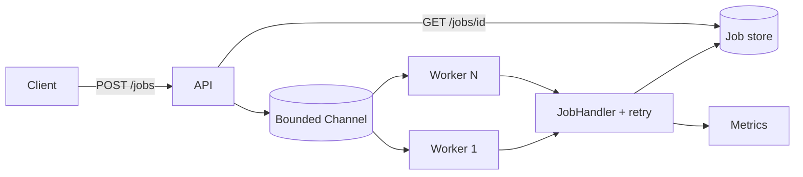

# Project: Worker service

🌐 [Русский](overview.ru.md) · **English**

> We build a service for background processing of a job queue: intake over HTTP, processing by workers with retries, graceful shutdown and metrics. It consolidates asynchrony, hosting, resilience and observability.

**Uses modules:** [10 · async/await](../../modules/10-async-await/overview.en.md), [13 · DI, configuration, logging](../../modules/13-di-config-logging/overview.en.md), [18 · Concurrency](../../modules/18-concurrency/overview.en.md), [22 · Observability](../../modules/22-observability/overview.en.md), [16 · Unit testing](../../modules/16-testing-unit/overview.en.md)
**Recipes and libraries that help:** [Background jobs](../../recipes/background-jobs/overview.en.md), [Resilient HttpClient](../../recipes/http-client-resilience/overview.en.md), [Polly](../../libraries/polly/overview.en.md), [Serilog](../../libraries/serilog/overview.en.md)
**Time:** ~8–10 h

## Requirements

### Mandatory

- Job intake: `POST /jobs` puts a job into a bounded queue (`Channel<T>`) and replies `202` at once; on overflow — `429`/`503` with a clear message.
- Workers (a configurable number) process jobs in parallel; the processing simulates work with a possible failure.
- Retries with an exponential delay for transient failures; after exhaustion the job goes to a "failed" list.
- `GET /jobs/{id}` — the status (`queued`, `running`, `done`, `failed`).
- Graceful shutdown: workers receive cancellation and finish the current job within a timeout.
- An exception in one job does not stop the worker.
- Tests of the processing logic (retries, errors, shutdown).

### Extra

- Metrics (`System.Diagnostics.Metrics`): accepted, completed, failed, queue length, processing time.
- Idempotency by job key (a repeated submission does not duplicate).
- Persisting job state in a DB (SQLite), restoring the queue after a restart.
- Structured logs (Serilog) with the job identifier.
- A health check: the queue is not overflowing, workers are alive.

## Architecture

## Stages

1. The skeleton: a host with a `BackgroundService`, `GET /health`.
2. A bounded `Channel<T>` queue and `POST /jobs`.
3. One worker, job statuses, `GET /jobs/{id}`.
4. N workers and parallelism; a scope per job if a `DbContext` is needed.
5. Retries and the failed list (a resilience policy).
6. Graceful shutdown and a timeout.
7. Tests: success, a failure with a retry, retries exhausted, cancellation.
8. Extra: metrics, idempotency, DB storage.
9. A README: running, parameters, how to check shutdown.

## Definition of done

- `dotnet test` passes; retry delays in tests are shortened (no real pauses).
- Queue overflow is handled explicitly, memory does not grow without limit.
- On shutdown the application does not lose a started job and does not hang.
- A failure in processing one job does not kill the worker.
- `bin/` and `obj/` are not in the repository.

## Hints

Stuck on stage 5

A Polly pipeline (`ResiliencePipeline`) is created once and reused; configure retries only for transient exceptions. In tests set a zero delay. See [Polly](../../libraries/polly/overview.en.md).

Stuck on stage 6

Pass a `CancellationToken` to all waits; on cancellation complete the channel writer and drain the rest. The shutdown timeout is `HostOptions.ShutdownTimeout` ([the "Background jobs" recipe](../../recipes/background-jobs/advanced.en.md#graceful-shutdown)).

## Solution

Your code goes to [src/](src/).
