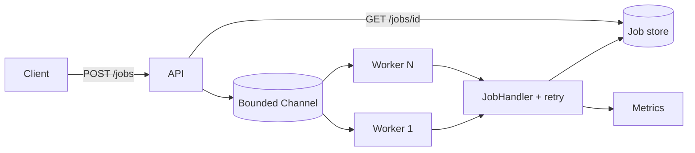

# Проект: Worker-сервис

🌐 **Русский** · [English](overview.en.md)

> Строим сервис фоновой обработки очереди заданий: приём через HTTP, обработка воркерами с ретраями, корректная остановка и метрики. Закрепляет асинхронность, хостинг, устойчивость и наблюдаемость.

**Закрепляет модули:** [10 · async/await](../../modules/10-async-await/overview.ru.md), [13 · DI, конфигурация, логирование](../../modules/13-di-config-logging/overview.ru.md), [18 · Конкурентность](../../modules/18-concurrency/overview.ru.md), [22 · Наблюдаемость](../../modules/22-observability/overview.ru.md), [16 · Юнит-тестирование](../../modules/16-testing-unit/overview.ru.md)
**Помогут рецепты и библиотеки:** [Фоновые задачи](../../recipes/background-jobs/overview.ru.md), [Устойчивый HttpClient](../../recipes/http-client-resilience/overview.ru.md), [Polly](../../libraries/polly/overview.ru.md), [Serilog](../../libraries/serilog/overview.ru.md)
**Время:** ~8–10 ч

## Требования

### Обязательные

- Приём заданий: `POST /jobs` кладёт задание в ограниченную очередь (`Channel<T>`) и сразу отвечает `202`; при переполнении — `429`/`503` с понятным сообщением.
- Воркеры (настраиваемое число) обрабатывают задания параллельно; обработка — имитация работы с возможным сбоем.
- Ретраи с экспоненциальной задержкой для транзиентных сбоев; после исчерпания — задание уходит в список «неудачных».
- `GET /jobs/{id}` — статус (`queued`, `running`, `done`, `failed`).
- Корректная остановка: воркеры получают отмену и дорабатывают текущее задание в пределах таймаута.
- Исключение в одном задании не останавливает воркер.
- Тесты логики обработки (ретраи, ошибки, остановка).

### Дополнительные

- Метрики (`System.Diagnostics.Metrics`): принято, выполнено, провалено, длина очереди, время обработки.
- Идемпотентность по ключу задания (повторная отправка не дублирует).
- Сохранение состояния заданий в БД (SQLite), восстановление очереди после перезапуска.
- Структурные логи (Serilog) с идентификатором задания.
- Health-check: очередь не переполнена, воркеры живы.

## Архитектура

## Этапы

1. Каркас: хост с `BackgroundService`, `GET /health`.
2. Очередь `Channel<T>` ограниченной ёмкости и `POST /jobs`.
3. Один воркер, статусы заданий, `GET /jobs/{id}`.
4. N воркеров и параллелизм; scope на задание, если нужен `DbContext`.
5. Ретраи и список неудачных (политика устойчивости).
6. Корректная остановка и таймаут.
7. Тесты: успех, сбой с ретраем, исчерпание ретраев, отмена.
8. Дополнительно: метрики, идемпотентность, хранение в БД.
9. README: запуск, параметры, как проверить остановку.

## Критерии готовности

- `dotnet test` проходит; время ретраев в тестах сокращено (без реальных пауз).
- Переполнение очереди обрабатывается явно, память не растёт без предела.
- При остановке приложение не теряет начатое задание и не зависает.
- Падение обработки одного задания не убивает воркер.
- `bin/` и `obj/` не в репозитории.

## Подсказки

Застрял на этапе 5

Пайплайн Polly (`ResiliencePipeline`) создаётся один раз и переиспользуется; ретраи настройте только на транзиентные исключения. В тестах задайте нулевую задержку. См. [Polly](../../libraries/polly/overview.ru.md).

Застрял на этапе 6

Передавайте `CancellationToken` во все ожидания; при отмене закройте писатель канала и дочитайте остаток. Таймаут остановки — `HostOptions.ShutdownTimeout` ([рецепт «Фоновые задачи»](../../recipes/background-jobs/advanced.ru.md#graceful-shutdown)).

## Решение

Ваш код — в [src/](src/).
