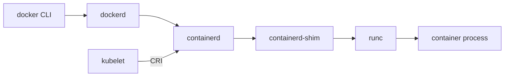

# Containers and Docker: expert

🌐 [Русский](expert.ru.md) · **English**

**Levels:** [overview](overview.en.md) · [1. Basics](basics.en.md) · [2. Advanced](advanced.en.md) · **3. Expert** · [4. Quiz](quiz.en.md)

## Under the hood

### What an image consists of

The image format is standardized by the Open Container Initiative (OCI). `docker save` exports an image in the OCI layout; the content of `hello:multi`:

```text
oci-layout
index.json            # entry point: a reference to the index by digest
manifest.json
blobs/sha256/<digest> # everything else: index, manifests, config, layers
```

The chain of references that you can read by hand:

| Object | What it stores |
|---|---|
| **index** (`application/vnd.oci.image.index.v1+json`) | a list of manifests per platform (`linux/amd64`, …) |
| **manifest** (`…image.manifest.v1+json`) | the config digest and the list of layer digests |
| **config** | `Entrypoint`, `Cmd`, `Env`, `ExposedPorts`, build history, the list of uncompressed layers |
| **layer** | a tar archive of file system changes (in our images it is gzip-compressed) |

Everything is addressed by content hash (content-addressable): identical layers of different images are stored and downloaded once. In our index, besides the `linux/amd64` manifest there is a second one with `vnd.docker.reference.type: attestation-manifest`: BuildKit adds a build provenance attestation to the image by default.

Deleting a file in a layer is expressed by a special tar entry (a "whiteout" file), not by removing bytes from the lower layer. That is why `RUN rm` does not shrink the image (see the gotcha below).

### How a container starts



- `dockerd` accepts commands, builds images, manages networks and volumes.
- `containerd` stores images, manages file system snapshots and the container lifecycle.
- `containerd-shim` holds the container process while `containerd` restarts.
- `runc` is a low-level runtime following the OCI specification: it creates namespaces and cgroups, does `pivot_root` into the image file system and starts the process. After the start `runc` exits.

On our installation `docker info` shows `Storage Driver: overlayfs` (`io.containerd.snapshotter.v1`), `Cgroup Version: 2`, `Default Runtime: runc`.

**File system.** Image layers are mounted through overlayfs as lower read-only layers (`lowerdir`), with the container's writable layer on top (`upperdir`). Writing to a file from a lower layer copies it up (copy-on-write). That is why `docker diff` shows only upper-layer changes.

**Isolation.** A container is a set of namespaces (PID, network, mount, UTS, IPC, user, cgroup) and cgroup limits. These are Linux kernel features; see the [Linux track](../../../linux/overview.en.md) for more. On Windows and macOS Docker Desktop runs Linux inside a virtual machine (WSL2), and containers use that machine's kernel.

**Kubernetes and Docker.** Kubernetes does not call `dockerd`: the kubelet talks to the runtime through the CRI interface, usually `containerd` or CRI-O. Direct Docker support (dockershim) was removed in Kubernetes 1.24, but images built by Docker keep working: the OCI format is common. In a kind cluster the node shows `containerd` and `containerd-shim` processes and no `dockerd` ([module 02](../02-architecture/overview.en.md)).

## Reference

### Dockerfile instructions

| Instruction | Purpose | Notes |
|---|---|---|
| `FROM [--platform=…] image [AS name]` | start of a stage | `scratch` is an empty image; `ARG` can be used before `FROM` |
| `RUN` | a command at build time | shell and exec forms; `--mount=type=cache\|secret\|bind\|ssh`, `--network` (BuildKit) |
| `COPY [--from=…] [--chown] [--chmod]` | copies files from the context or a stage | preferred over `ADD` |
| `ADD` | like `COPY`, plus URLs and unpacking of local tars | implicit behavior, use only when you need it |
| `WORKDIR` | the working folder | creates it if missing |
| `ENV` | an environment variable in the image and at runtime | stays in the image and in `docker history` |
| `ARG` | a variable for build time only | the value is visible in `docker history` |
| `USER` | the user for the following instructions and for the launch | |
| `EXPOSE` | documents a port | does not publish the port |
| `VOLUME` | declares a mount point; creates an anonymous volume at launch | file changes in the folder after `VOLUME` during the build are lost |
| `ENTRYPOINT` / `CMD` | launch command / default arguments | exec form preferred |
| `HEALTHCHECK` | a health check for Docker | Kubernetes ignores it |
| `STOPSIGNAL` | the signal for `docker stop` | `SIGTERM` by default |
| `SHELL` | the shell for the shell form | `["/bin/sh", "-c"]` by default |
| `LABEL` | key-value metadata | |
| `ONBUILD` | an instruction executed when building a child image | |

### Main `docker run` flags

| Flag | Meaning |
|---|---|
| `-d` / `-it` | background mode / an interactive terminal |
| `--rm` | remove the container after it stops |
| `--name` | the container name |
| `-p host:container` / `-P` | publish a port / publish all `EXPOSE` ports to random ones |
| `-e K=V`, `--env-file` | environment variables |
| `-v name:path`, `--mount` | a volume or a bind mount |
| `--network` | the container network |
| `--user`, `--read-only`, `--cap-drop`, `--security-opt` | narrowing privileges |
| `--memory`, `--cpus` | cgroup limits |
| `--restart` | restart policy (`no`, `on-failure`, `always`, `unless-stopped`) |
| `--init` | run an init process as PID 1 |
| `--entrypoint`, `-w` | replace `ENTRYPOINT` / the working folder |

### Commands for images and containers

| Command | What it does |
|---|---|
| `docker build -t name:tag [-f file] [--target stage] [--build-arg K=V] [--no-cache] [--progress=plain] .` | build an image |
| `docker buildx build --platform linux/amd64,linux/arm64 …` | multi-platform build |
| `docker image ls`, `history`, `inspect`, `rm`, `prune` | image accounting; `history --no-trunc` shows full layer commands |
| `docker tag`, `push`, `pull` | working with a registry |
| `docker save` / `docker load` | export and load an image as a tar |
| `docker ps -a`, `logs`, `exec`, `diff`, `cp`, `stats`, `inspect` | observing containers |
| `docker stop` (`SIGTERM`, 10 s, `SIGKILL`) / `docker kill` (`SIGKILL` at once) | stopping |
| `docker volume create\|ls\|rm\|prune` | volumes |

Defaults verified in this module: the `docker stop` timeout is 10 seconds (10.39 s in the experiment), ports without `-p` and `-P` are not published, the default user is root.

## Gotchas

### Gotcha: a scratch image has no shell

```text
$ docker exec h1 sh -c ls
OCI runtime exec failed: exec failed: unable to start container process: exec: "sh": executable file not found in $PATH
```

The image is built on `scratch` and contains one file, `/hello`. You can run in it only what it contains. For debugging in Kubernetes an ephemeral container with tools is attached to a running pod (module 21).

### Gotcha: a deleted file stays in the image

```dockerfile
FROM alpine:3.22
COPY big.bin /big.bin     # 20 MB
RUN rm /big.bin
```

```text
$ docker images g --format '{{.Repository}}:{{.Tag}} {{.Size}}'
g:rm 32.8MB
g:base 12.8MB
```

The `COPY` layer stayed unchanged, `rm` only added a whiteout entry. The image is 20 MB heavier than the base. Create and delete temporary files in one `RUN` or use multi-stage.

### Gotcha: ARG is visible in image history

```text
$ docker build --build-arg TOKEN=abc -f D2 -t g:arg .
$ docker run --rm g:arg
run: TOKEN=[] MODE=[prod]
$ docker history g:arg --no-trunc --format '{{.CreatedBy}}'
CMD ["sh" "-c" "echo run: TOKEN=[$TOKEN] MODE=[$MODE]"]
RUN |1 TOKEN=abc /bin/sh -c echo "build sees TOKEN=$TOKEN" # buildkit
ENV MODE=prod
```

In the running container `TOKEN` is empty, but the value `abc` is recorded in the layer history and available to anyone who gets the image. A secret passed by `RUN echo secret > /s && rm /s` is also visible in the command text. Pass build secrets through `RUN --mount=type=secret`.

### Gotcha: a process that does not handle SIGTERM dies after 10 seconds

`sleep` as PID 1 does not react to `SIGTERM`: `docker stop` took 10.392 s. With `--init` — 0.336 s. Details and output are in [advanced](advanced.en.md#pid-1-and-sigterm).

### Gotcha: EXPOSE does not publish a port

```text
$ docker run -d --name e1 hello:multi
$ docker port e1
                              # empty: no ports published
$ docker run -d --name e2 -P hello:multi
$ docker port e2
8080/tcp -> 0.0.0.0:32768
$ curl -s localhost:32768
Hello from 6376d6528ca9
```

`EXPOSE` is only documentation. A port is opened by `-p`, while `-P` publishes all declared `EXPOSE` ports to random host ports.

### Gotcha: HEALTHCHECK does not work in Kubernetes

An image with `HEALTHCHECK --interval=2s CMD false`:

```text
$ docker inspect hc --format 'docker health: {{.State.Health.Status}}'
docker health: unhealthy
$ kubectl get pod hc          # the same image in a kind cluster
NAME   READY   STATUS    RESTARTS   AGE
hc     1/1     Running   0          8s
```

Docker considers the container unhealthy, Kubernetes considers it ready. Health in Kubernetes is determined by probes from the manifest.

### Gotcha: latest in Kubernetes

The `g:latest` image is loaded onto the node with `kind load`, yet the pod does not start:

```text
$ kubectl run lt --image=g:latest
$ kubectl get pod lt
NAME   READY   STATUS         RESTARTS   AGE
lt     0/1     ErrImagePull   0          12s
$ kubectl get pod lt -o jsonpath='{.spec.containers[0].imagePullPolicy}'
Always
```

If the tag is `latest` or no tag is given, `imagePullPolicy` defaults to `Always`: the kubelet goes to the registry even if the image is on the node. For local images in kind use an explicit tag and `imagePullPolicy: IfNotPresent` ([module 03](../03-local-cluster-and-kubectl/overview.en.md)).

## Trade-offs and alternatives

| Approach | Pros | Cons |
|---|---|---|
| Docker Engine | a familiar CLI, BuildKit, Docker Desktop | a daemon with broad privileges; not needed by Kubernetes itself |
| Podman and Buildah | no permanent daemon, rootless mode | differences in networking and Compose compatibility |
| `scratch` or distroless | minimal size and attack surface | no shell, harder debugging |
| `alpine` | small size and a shell | musl instead of glibc: incompatibilities are possible |
| Building without a Dockerfile (Buildpacks, `ko`, Jib) | less manual work | less flexible configuration, dependence on the tool |
| A virtual machine | its own kernel, strong isolation | heavier and slower to start |

## Interview questions

**1. How does a container differ from a virtual machine?**

<details><summary>Answer</summary>

A virtual machine has its own kernel and virtual "hardware", a container uses the host kernel. A container is a process (or a group of processes) with isolated namespaces and cgroup limits. That is why it starts in a fraction of a second and weighs megabytes, but is isolated more weakly: a kernel vulnerability affects all containers of the host.

</details>

**2. What happens to data written inside a container?**

<details><summary>Answer</summary>

It is written to the container's writable layer and disappears when the container is deleted (`docker rm`). Persistent data is stored in a volume (in Kubernetes, a PersistentVolume).

</details>

**3. Why does `RUN rm big_file` in a separate layer not shrink the image?**

<details><summary>Answer</summary>

Layers are immutable: `rm` adds a new layer with a deletion record, while the layer with the file stays in the image. In the experiment the image with a 20 MB file and `rm` weighed 32.8 MB against 12.8 MB for the base. The fix: do not add the file at all, delete it in the same `RUN`, or use multi-stage.

</details>

**4. What is the difference between `ENTRYPOINT` and `CMD`? How do they map to Kubernetes manifest fields?**

<details><summary>Answer</summary>

`ENTRYPOINT` is the program, `CMD` is the default arguments. `docker run` arguments replace `CMD`, the `--entrypoint` flag replaces `ENTRYPOINT`. In a manifest `command` replaces `ENTRYPOINT`, `args` replaces `CMD`.

</details>

**5. (Trick) A container running `sleep 300` stops in 10 seconds, while a Go application stops instantly. Why?**

<details><summary>Answer</summary>

`docker stop` sends `SIGTERM` to the PID 1 process. The kernel does not apply the default action to PID 1, so a process without its own handler ignores the signal, and after 10 seconds `SIGKILL` arrives. The Go runtime installs a `SIGTERM` handler, and the program exits at once. Solutions: a handler in the application or `--init`.

</details>

**6. How does a tag differ from a digest?**

<details><summary>Answer</summary>

A tag is a mutable reference and can be redirected to another image. A digest is a hash of the manifest and unambiguously defines the content. For reproducible deployments an image is pinned by digest.

</details>

**7. How do you speed up an image build?**

<details><summary>Answer</summary>

Instruction order: first what changes rarely (dependency manifests, installation), then the sources, because the cache is invalidated from the first changed step. Plus `.dockerignore`, so that junk does not enter the context and invalidate `COPY . .`. In the experiment the context shrank from 5 MB to 111 bytes.

</details>

**8. Why is a multi-stage build needed?**

<details><summary>Answer</summary>

To separate build tools from the runtime: only the result is copied into the final image. On the Go example the image shrank from 516 MB to 12.8 MB, with 1 layer instead of 8.

</details>

**9. (Trick) Will `EXPOSE 8080` open the port on the host?**

<details><summary>Answer</summary>

No, `EXPOSE` only documents the port. It is published by `-p` or `-P`. Without them `docker port` is empty.

</details>

**10. (Trick) Is it safe to pass a password through `ARG`?**

<details><summary>Answer</summary>

No. The variable is absent in the running container, but the value is recorded in the layer history, and `docker history --no-trunc` shows it. Build secrets are passed through `RUN --mount=type=secret`, runtime secrets through the orchestrator's mechanisms (a Secret).

</details>

**11. (Trick) An image has a `HEALTHCHECK`. Will Kubernetes kill an unhealthy container?**

<details><summary>Answer</summary>

No, Kubernetes does not use `HEALTHCHECK`. In the experiment Docker showed `unhealthy` while the pod stayed `1/1 Running`. You need liveness and readiness probes in the manifest.

</details>

**12. (Trick) An image is loaded onto a kind node, but a pod with `image: app:latest` does not start. Why?**

<details><summary>Answer</summary>

For the `latest` tag the default policy is `Always`: the kubelet tries to pull the image from a registry and gets `ErrImagePull`. Use an explicit tag and `imagePullPolicy: IfNotPresent`.

</details>

**13. How does Linux isolate a container?**

<details><summary>Answer</summary>

Namespaces give a separate view of processes, network, mount points, host names and so on; cgroups limit CPU, memory and I/O; overlayfs assembles the file system from the image layers. `runc` sets all of this up at launch.

</details>

**14. Why can't you run `docker exec … sh` in a `scratch` image, and how do you debug such containers?**

<details><summary>Answer</summary>

There is no `sh` file in the image: you can run only what it contains. In Kubernetes an ephemeral container with debugging tools is attached to the pod (`kubectl debug`); in Docker a debugging container is started in the same namespaces.

</details>

**15. Did Kubernetes drop support for Docker images?**

<details><summary>Answer</summary>

No. Version 1.24 removed dockershim, the direct kubelet integration with Docker Engine. OCI images built by Docker keep working: the kubelet runs them through a CRI runtime (`containerd` or CRI-O).

</details>

## Cheat sheet

```bash
docker build -t name:1.0 .            # build
docker run -d --name n -p 8080:80 -e K=V name:1.0
docker ps -a; docker logs -f n; docker exec -it n sh
docker stop n; docker rm n            # SIGTERM, 10 s, SIGKILL
docker history --no-trunc name:1.0    # layers and commands
docker image inspect name:1.0 --format '{{index .RepoDigests 0}}'
docker tag name:1.0 reg/team/name:1.0 && docker push reg/team/name:1.0
docker run --rm -v data:/data alpine:3.22 ls /data
```

## Related materials

- Previous levels: [basics](basics.en.md), [advanced](advanced.en.md)
- Next module: [02 · Kubernetes architecture](../02-architecture/overview.en.md)
- Foundation: the [Linux track](../../../linux/overview.en.md) — namespaces and cgroups
- From C#: [Testcontainers](../../../csharp/libraries/testcontainers/overview.en.md)

## Sources

- [OCI Image Specification](https://github.com/opencontainers/image-spec/blob/main/spec.md)
- [Dockerfile reference](https://docs.docker.com/reference/dockerfile/)
- [docker container run](https://docs.docker.com/reference/cli/docker/container/run/)
- [Docker: storage drivers and overlayfs](https://docs.docker.com/engine/storage/drivers/overlayfs-driver/)
- [containerd](https://containerd.io/docs/)
- [Kubernetes: images and imagePullPolicy](https://kubernetes.io/docs/concepts/containers/images/#image-pull-policy)
- [Kubernetes: Container Runtime Interface](https://kubernetes.io/docs/concepts/architecture/cri/)
- [Dockershim removal FAQ](https://kubernetes.io/blog/2022/02/17/dockershim-faq/)
- [Build secrets](https://docs.docker.com/build/building/secrets/)
