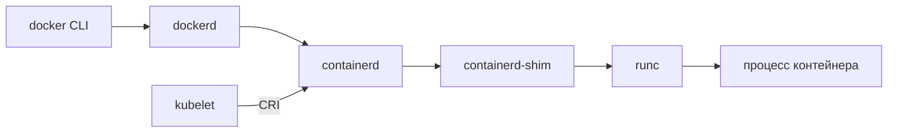

# Контейнеры и Docker: экспертная теория

🌐 **Русский** · [English](expert.en.md)

**Уровни:** [обзор](overview.ru.md) · [1. Базовая](basics.ru.md) · [2. Продвинутая](advanced.ru.md) · **3. Экспертная** · [4. Квиз](quiz.ru.md)

## Под капотом

### Из чего состоит образ

Формат образа стандартизован проектом Open Container Initiative (OCI). `docker save` выгружает образ в OCI-раскладку; содержимое `hello:multi`:

```text
oci-layout
index.json            # точка входа: ссылка на индекс по digest
manifest.json
blobs/sha256/<digest> # все остальное: индекс, манифесты, конфиг, слои
```

Цепочка ссылок, которую можно прочитать руками:

| Объект | Что хранит |
|---|---|
| **index** (`application/vnd.oci.image.index.v1+json`) | список манифестов по платформам (`linux/amd64`, …) |
| **manifest** (`…image.manifest.v1+json`) | digest конфига и список digest-ов слоёв |
| **config** | `Entrypoint`, `Cmd`, `Env`, `ExposedPorts`, история сборки, список слоёв без сжатия |
| **layer** | tar-архив изменений файловой системы (в наших образах он сжат gzip) |

Всё адресуется по хэшу содержимого (content-addressable): одинаковые слои у разных образов хранятся и скачиваются один раз. В нашем индексе, кроме манифеста `linux/amd64`, лежит второй, с `vnd.docker.reference.type: attestation-manifest`: BuildKit по умолчанию добавляет к образу аттестацию происхождения сборки (provenance).

Удаление файла в слое выражается специальной записью в tar (файл-«whiteout»), а не удалением байтов из нижнего слоя. Поэтому `RUN rm` не уменьшает образ (см. подвох ниже).

### Как запускается контейнер



- `dockerd` принимает команды, строит образы, управляет сетью и volume.
- `containerd` хранит образы, управляет снимками файловой системы и жизненным циклом контейнеров.
- `containerd-shim` держит процесс контейнера, пока `containerd` перезапускается.
- `runc` — низкоуровневый рантайм по спецификации OCI: создаёт namespaces и cgroups, делает `pivot_root` в файловую систему образа и запускает процесс. После запуска `runc` завершается.

В нашей установке `docker info` показывает `Storage Driver: overlayfs` (`io.containerd.snapshotter.v1`), `Cgroup Version: 2`, `Default Runtime: runc`.

**Файловая система.** Слои образа монтируются через overlayfs как нижние read-only слои (`lowerdir`), поверх них — слой контейнера для записи (`upperdir`). Запись в файл из нижнего слоя копирует его наверх (copy-on-write). Поэтому `docker diff` показывает только изменения верхнего слоя.

**Изоляция.** Контейнер — набор namespace-ов (PID, network, mount, UTS, IPC, user, cgroup) и ограничений cgroups. Это возможности ядра Linux, подробнее — в [треке Linux](../../../linux/overview.ru.md). На Windows и macOS Docker Desktop запускает Linux внутри виртуальной машины (WSL2), и контейнеры используют ядро этой машины.

**Kubernetes и Docker.** Kubernetes не вызывает `dockerd`: kubelet говорит с рантаймом по интерфейсу CRI, обычно это `containerd` или CRI-O. Прямая поддержка Docker (dockershim) удалена в Kubernetes 1.24, но образы, собранные Docker, продолжают работать: формат OCI общий. В кластере kind на ноде видны процессы `containerd` и `containerd-shim`, а `dockerd` внутри ноды нет ([модуль 02](../02-architecture/overview.ru.md)).

## Справочник

### Инструкции Dockerfile

| Инструкция | Назначение | Замечания |
|---|---|---|
| `FROM [--platform=…] образ [AS имя]` | начало стадии | `scratch` — пустой образ; `ARG` можно использовать до `FROM` |
| `RUN` | команда при сборке | форма shell и форма exec; `--mount=type=cache\|secret\|bind\|ssh`, `--network` (BuildKit) |
| `COPY [--from=…] [--chown] [--chmod]` | копирует файлы из контекста или стадии | предпочтительнее `ADD` |
| `ADD` | как `COPY`, плюс URL и распаковка локальных tar | неявное поведение, брать только когда оно нужно |
| `WORKDIR` | рабочая папка | создаёт её, если нет |
| `ENV` | переменная окружения в образе и при запуске | остаётся в образе и в `docker history` |
| `ARG` | переменная только на время сборки | значение видно в `docker history` |
| `USER` | пользователь для следующих инструкций и запуска | |
| `EXPOSE` | документирует порт | порт не публикует |
| `VOLUME` | объявляет точку монтирования; создаёт анонимный volume при запуске | изменения файлов в папке после `VOLUME` в сборке теряются |
| `ENTRYPOINT` / `CMD` | команда запуска / аргументы по умолчанию | форма exec предпочтительнее |
| `HEALTHCHECK` | проверка здоровья для Docker | Kubernetes её игнорирует |
| `STOPSIGNAL` | сигнал для `docker stop` | по умолчанию `SIGTERM` |
| `SHELL` | оболочка для формы shell | по умолчанию `["/bin/sh", "-c"]` |
| `LABEL` | метаданные ключ-значение | |
| `ONBUILD` | инструкция, выполняемая при сборке дочернего образа | |

### Основные флаги `docker run`

| Флаг | Смысл |
|---|---|
| `-d` / `-it` | фоновый режим / интерактивный терминал |
| `--rm` | удалить контейнер после остановки |
| `--name` | имя контейнера |
| `-p хост:контейнер` / `-P` | опубликовать порт / опубликовать все `EXPOSE`-порты на случайные |
| `-e K=V`, `--env-file` | переменные окружения |
| `-v имя:путь`, `--mount` | volume или bind mount |
| `--network` | сеть контейнера |
| `--user`, `--read-only`, `--cap-drop`, `--security-opt` | сужение прав |
| `--memory`, `--cpus` | ограничения cgroups |
| `--restart` | политика перезапуска (`no`, `on-failure`, `always`, `unless-stopped`) |
| `--init` | запустить init-процесс как PID 1 |
| `--entrypoint`, `-w` | заменить `ENTRYPOINT` / рабочую папку |

### Команды работы с образами и контейнерами

| Команда | Что делает |
|---|---|
| `docker build -t имя:тег [-f файл] [--target стадия] [--build-arg K=V] [--no-cache] [--progress=plain] .` | собрать образ |
| `docker buildx build --platform linux/amd64,linux/arm64 …` | сборка под несколько платформ |
| `docker image ls`, `history`, `inspect`, `rm`, `prune` | учёт образов; `history --no-trunc` показывает полные команды слоёв |
| `docker tag`, `push`, `pull` | работа с реестром |
| `docker save` / `docker load` | выгрузка и загрузка образа в tar |
| `docker ps -a`, `logs`, `exec`, `diff`, `cp`, `stats`, `inspect` | наблюдение за контейнерами |
| `docker stop` (`SIGTERM`, 10 с, `SIGKILL`) / `docker kill` (сразу `SIGKILL`) | остановка |
| `docker volume create\|ls\|rm\|prune` | тома |

Умолчания, проверенные в этом модуле: тайм-аут `docker stop` — 10 секунд (в опыте 10.39 с), порты без `-p` и `-P` не публикуются, пользователь по умолчанию — root.

## Подвохи

### Подвох: в образе на scratch нет shell

```text
$ docker exec h1 sh -c ls
OCI runtime exec failed: exec failed: unable to start container process: exec: "sh": executable file not found in $PATH
```

Образ собран на `scratch` и содержит один файл `/hello`. Выполнить в нём можно только то, что в нём лежит. Для отладки в Kubernetes подключают эфемерный контейнер с инструментами к работающему поду (модуль 21).

### Подвох: удалённый файл остаётся в образе

```dockerfile
FROM alpine:3.22
COPY big.bin /big.bin     # 20 МБ
RUN rm /big.bin
```

```text
$ docker images g --format '{{.Repository}}:{{.Tag}} {{.Size}}'
g:rm 32.8MB
g:base 12.8MB
```

Слой `COPY` остался неизменным, `rm` лишь добавил запись-whiteout. Образ на 20 МБ тяжелее базового. Создавайте и удаляйте временные файлы в одном `RUN` или используйте multi-stage.

### Подвох: ARG виден в истории образа

```text
$ docker build --build-arg TOKEN=abc -f D2 -t g:arg .
$ docker run --rm g:arg
run: TOKEN=[] MODE=[prod]
$ docker history g:arg --no-trunc --format '{{.CreatedBy}}'
CMD ["sh" "-c" "echo run: TOKEN=[$TOKEN] MODE=[$MODE]"]
RUN |1 TOKEN=abc /bin/sh -c echo "build sees TOKEN=$TOKEN" # buildkit
ENV MODE=prod
```

В запущенном контейнере `TOKEN` пуст, но значение `abc` записано в истории слоёв и доступно любому, кто получит образ. Секрет, переданный командой `RUN echo секрет > /s && rm /s`, тоже виден в тексте команды. Секреты сборки передают через `RUN --mount=type=secret`.

### Подвох: процесс, не обрабатывающий SIGTERM, умирает через 10 секунд

`sleep` в роли PID 1 не реагирует на `SIGTERM`: `docker stop` занял 10.392 с. С `--init` — 0.336 с. Подробности и вывод — в [продвинутой теории](advanced.ru.md#pid-1-и-sigterm).

### Подвох: EXPOSE не публикует порт

```text
$ docker run -d --name e1 hello:multi
$ docker port e1
                              # пусто: порты не опубликованы
$ docker run -d --name e2 -P hello:multi
$ docker port e2
8080/tcp -> 0.0.0.0:32768
$ curl -s localhost:32768
Hello from 6376d6528ca9
```

`EXPOSE` — только документация. Порт открывает `-p`, а `-P` публикует все объявленные `EXPOSE`-порты на случайные порты хоста.

### Подвох: HEALTHCHECK в Kubernetes не работает

Образ с `HEALTHCHECK --interval=2s CMD false`:

```text
$ docker inspect hc --format 'docker health: {{.State.Health.Status}}'
docker health: unhealthy
$ kubectl get pod hc          # тот же образ в кластере kind
NAME   READY   STATUS    RESTARTS   AGE
hc     1/1     Running   0          8s
```

Docker считает контейнер нездоровым, Kubernetes — готовым. Здоровье в Kubernetes определяют probes из манифеста.

### Подвох: latest в Kubernetes

Образ `g:latest` загружен на ноду командой `kind load`, но под не стартует:

```text
$ kubectl run lt --image=g:latest
$ kubectl get pod lt
NAME   READY   STATUS         RESTARTS   AGE
lt     0/1     ErrImagePull   0          12s
$ kubectl get pod lt -o jsonpath='{.spec.containers[0].imagePullPolicy}'
Always
```

Если тег `latest` или тег не указан, `imagePullPolicy` по умолчанию `Always`: kubelet идёт в реестр, даже если образ на ноде есть. Для локальных образов в kind используйте явный тег и `imagePullPolicy: IfNotPresent` ([модуль 03](../03-local-cluster-and-kubectl/overview.ru.md)).

## Компромиссы и альтернативы

| Подход | Плюсы | Минусы |
|---|---|---|
| Docker Engine | привычный CLI, BuildKit, Docker Desktop | демон с широкими правами; для Kubernetes сам по себе не нужен |
| Podman и Buildah | без постоянного демона, режим rootless | отличия в сети и Compose-совместимости |
| `scratch` или distroless | минимум размера и поверхности атаки | нет shell, сложнее отладка |
| `alpine` | малый размер и shell | musl вместо glibc: возможны несовместимости |
| Сборка без Dockerfile (Buildpacks, `ko`, Jib) | меньше ручной работы | менее гибкая настройка, зависимость от инструмента |
| Виртуальная машина | своё ядро, сильная изоляция | тяжелее и медленнее старта |

## Вопросы с собеседований

**1. Чем контейнер отличается от виртуальной машины?**

<details><summary>Ответ</summary>

У виртуальной машины своё ядро и виртуальное «железо», у контейнера — ядро хоста. Контейнер — процесс (или группа процессов) с изолированными namespaces и ограничениями cgroups. Поэтому он стартует за доли секунды и весит мегабайты, но изолирован слабее: уязвимость ядра затрагивает все контейнеры хоста.

</details>

**2. Что происходит с данными, записанными внутри контейнера?**

<details><summary>Ответ</summary>

Они пишутся в слой контейнера для записи и пропадают при его удалении (`docker rm`). Постоянные данные хранят в volume (в Kubernetes — в PersistentVolume).

</details>

**3. Почему `RUN rm большой_файл` в отдельном слое не уменьшает образ?**

<details><summary>Ответ</summary>

Слои неизменяемы: `rm` добавляет новый слой с записью об удалении, а слой с файлом остаётся в образе. В опыте образ с 20 МБ файла и `rm` весил 32.8 МБ против 12.8 МБ базового. Решение: не добавлять файл вовсе, удалять в том же `RUN` или использовать multi-stage.

</details>

**4. В чём разница между `ENTRYPOINT` и `CMD`? Как они соотносятся с полями манифеста Kubernetes?**

<details><summary>Ответ</summary>

`ENTRYPOINT` — программа, `CMD` — аргументы по умолчанию. Аргументы `docker run` заменяют `CMD`, флаг `--entrypoint` заменяет `ENTRYPOINT`. В манифесте `command` заменяет `ENTRYPOINT`, `args` — `CMD`.

</details>

**5. (С подвохом) Контейнер на `sleep 300` останавливается 10 секунд, а приложение на Go — мгновенно. Почему?**

<details><summary>Ответ</summary>

`docker stop` посылает `SIGTERM` процессу PID 1. Ядро не применяет к PID 1 действие по умолчанию, поэтому процесс без собственного обработчика сигнал игнорирует, и через 10 секунд приходит `SIGKILL`. Рантайм Go устанавливает обработчик `SIGTERM`, и программа завершается сразу. Решения: обработчик в приложении или `--init`.

</details>

**6. Чем тег отличается от digest?**

<details><summary>Ответ</summary>

Тег — изменяемая ссылка, его можно перенаправить на другой образ. Digest — хэш манифеста, он однозначно определяет содержимое. Для воспроизводимых деплоев образ закрепляют по digest.

</details>

**7. Как ускорить сборку образа?**

<details><summary>Ответ</summary>

Порядок инструкций: сначала редко меняющееся (манифесты зависимостей, установка), потом исходники, потому что кэш сбрасывается с первого изменившегося шага. Плюс `.dockerignore`, чтобы мусор не попадал в контекст и не инвалидировал `COPY . .`. В опыте контекст уменьшился с 5 МБ до 111 байт.

</details>

**8. Зачем нужна multi-stage сборка?**

<details><summary>Ответ</summary>

Отделить инструменты сборки от рантайма: в финальный образ копируется только результат. На Go-примере образ уменьшился с 516 МБ до 12.8 МБ, слоёв стало 1 вместо 8.

</details>

**9. (С подвохом) Откроет ли `EXPOSE 8080` порт на хосте?**

<details><summary>Ответ</summary>

Нет, `EXPOSE` только документирует порт. Публикуют его `-p` или `-P`. Без них `docker port` пуст.

</details>

**10. (С подвохом) Безопасно ли передавать пароль через `ARG`?**

<details><summary>Ответ</summary>

Нет. В запущенном контейнере переменной нет, но значение записано в историю слоёв, и `docker history --no-trunc` его показывает. Секреты сборки передают через `RUN --mount=type=secret`, секреты запуска — через механизмы оркестратора (Secret).

</details>

**11. (С подвохом) Образ имеет `HEALTHCHECK`. Будет ли Kubernetes убивать нездоровый контейнер?**

<details><summary>Ответ</summary>

Нет, Kubernetes `HEALTHCHECK` не использует. В опыте Docker показывал `unhealthy`, а под оставался `1/1 Running`. Нужны liveness и readiness probes в манифесте.

</details>

**12. (С подвохом) Образ загружен на ноду kind, но под с `image: app:latest` не стартует. Почему?**

<details><summary>Ответ</summary>

Для тега `latest` политика по умолчанию `Always`: kubelet пытается скачать образ из реестра и получает `ErrImagePull`. Используйте явный тег и `imagePullPolicy: IfNotPresent`.

</details>

**13. Как Linux изолирует контейнер?**

<details><summary>Ответ</summary>

Namespaces дают отдельное представление о процессах, сети, точках монтирования, именах хоста и т. д.; cgroups ограничивают CPU, память и ввод-вывод; overlayfs собирает файловую систему из слоёв образа. Всё это настраивает `runc` при запуске.

</details>

**14. Почему в образе на `scratch` нельзя выполнить `docker exec … sh` и как отлаживать такие контейнеры?**

<details><summary>Ответ</summary>

В образе нет файла `sh`: выполнить можно только то, что в нём есть. В Kubernetes к поду подключают эфемерный контейнер с отладочными инструментами (`kubectl debug`), в Docker — запускают отладочный контейнер в тех же namespace-ах.

</details>

**15. Удалил ли Kubernetes поддержку Docker-образов?**

<details><summary>Ответ</summary>

Нет. В версии 1.24 удалён dockershim — прямая интеграция kubelet с Docker Engine. Образы формата OCI, собранные Docker, продолжают работать: kubelet запускает их через CRI-рантайм (`containerd` или CRI-O).

</details>

## Шпаргалка

```bash
docker build -t name:1.0 .            # собрать
docker run -d --name n -p 8080:80 -e K=V name:1.0
docker ps -a; docker logs -f n; docker exec -it n sh
docker stop n; docker rm n            # SIGTERM, 10 c, SIGKILL
docker history --no-trunc name:1.0    # слои и команды
docker image inspect name:1.0 --format '{{index .RepoDigests 0}}'
docker tag name:1.0 reg/team/name:1.0 && docker push reg/team/name:1.0
docker run --rm -v data:/data alpine:3.22 ls /data
```

## Связанные материалы

- Предыдущие уровни: [базовая](basics.ru.md), [продвинутая](advanced.ru.md)
- Следующий модуль: [02 · Архитектура Kubernetes](../02-architecture/overview.ru.md)
- Фундамент: [трек Linux](../../../linux/overview.ru.md) — namespaces и cgroups
- Из C#: [Testcontainers](../../../csharp/libraries/testcontainers/overview.ru.md)

## Источники

- [OCI Image Specification](https://github.com/opencontainers/image-spec/blob/main/spec.md)
- [Dockerfile reference](https://docs.docker.com/reference/dockerfile/)
- [docker container run](https://docs.docker.com/reference/cli/docker/container/run/)
- [Docker: storage drivers и overlayfs](https://docs.docker.com/engine/storage/drivers/overlayfs-driver/)
- [containerd](https://containerd.io/docs/)
- [Kubernetes: изображения и imagePullPolicy](https://kubernetes.io/docs/concepts/containers/images/#image-pull-policy)
- [Kubernetes: Container Runtime Interface](https://kubernetes.io/docs/concepts/architecture/cri/)
- [Dockershim removal FAQ](https://kubernetes.io/blog/2022/02/17/dockershim-faq/)
- [Build secrets](https://docs.docker.com/build/building/secrets/)
