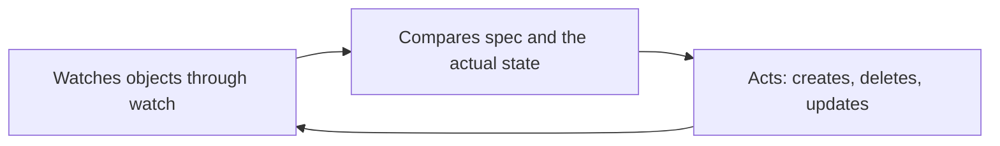
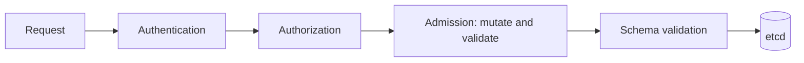

# Kubernetes architecture: advanced

🌐 [Русский](advanced.ru.md) · **English**

**Levels:** [overview](overview.en.md) · [1. Basics](basics.en.md) · **2. Advanced** · [3. Expert](expert.en.md) · [4. Quiz](quiz.en.md)

Builds on [basics](basics.en.md): the component list and ports are not repeated.

## The reconciliation loop

Every controller runs the same loop:



The desired state is the `spec` field, the observed one is `status` and the real child objects. A controller reacts not to commands like "create a pod" but to the difference between desired and actual. This approach is called *level-triggered* (by level, not by event): if an event is lost or a component restarted, the next loop will still notice and fix the discrepancy.

A consequence: you do not need to "deliver" a command to the cluster exactly once; it is enough that the desired state lies in etcd.

## What happens when a component is unavailable

An experiment on a kind cluster: a component's static manifest was temporarily removed from the node (`mv` out of `/etc/kubernetes/manifests`), the kubelet stopped its pod, then the manifest was put back.

**The scheduler is stopped.** We raise `replicas` from 2 to 3:

```text
$ kubectl -n learn-02 scale deploy/web --replicas=3
$ kubectl -n learn-02 get pods
web-689b9bdbdd-7hpbd 1/1 Running
web-689b9bdbdd-jcc7k 0/1 Pending
web-689b9bdbdd-r4tkv 1/1 Running
$ kubectl -n learn-02 get events --field-selector reason=FailedScheduling
No resources found in learn-02 namespace.
```

The pod is created (controllers work) but stays `Pending`: without a scheduler it has no node. There are no `FailedScheduling` events because the scheduler itself emits them. After the manifest was returned, the pod got a node and became `Running`. Already running pods were not affected by the scheduler.

**The controller-manager is stopped.** We delete one pod:

```text
$ kubectl -n learn-02 delete pod <name> --now
$ kubectl -n learn-02 get pods
web-689b9bdbdd-jcc7k 1/1 Running
web-689b9bdbdd-r4tkv 1/1 Running
$ kubectl -n learn-02 get deploy web
NAME   READY   UP-TO-DATE   AVAILABLE   AGE
web    3/3     3            3           13m
```

There are two pods, yet the Deployment shows `3/3`: the status is updated by a controller that is not there. There is no self-healing until the controllers return; after the manifest was returned a new pod appeared.

A summary by component (the first two rows are verified by the experiment above):

| Component stopped | What stops working | What keeps working |
|---|---|---|
| scheduler | new pods stay `Pending` | already running pods |
| controller-manager | self-healing, status updates, scaling | already running pods |
| API server | any changes and reads through kubectl | already running containers keep running |
| etcd | the API server cannot read and write the state | already running containers keep running |
| the kubelet on a node | the node becomes `NotReady`, new pods do not start on it | containers already started by the runtime |

> ⚠️ Verify: the rows about the API server, etcd and the kubelet are given from documentation and not reproduced by an experiment in this material.

## Watch and paginated lists

Controllers do not poll the API on a timer but open a **watch** — a long HTTP request in which the server sends changes as they appear. kubectl can do this too:

```text
$ kubectl -n learn-02 get pods -w --no-headers
web-689b9bdbdd-7hpbd 1/1 Running
web-689b9bdbdd-r4tkv 1/1 Running
web-689b9bdbdd-f2ppw 0/1 Pending
web-689b9bdbdd-f2ppw 0/1 ContainerCreating
web-689b9bdbdd-f2ppw 1/1 Running
```

The first two lines are the current state, the rest are events after `kubectl scale --replicas=3` (repeated `Pending` and `ContainerCreating` lines were removed from the output).

An ordinary `get` is an HTTP request to the REST API. The `-v=6` flag shows it:

```text
$ kubectl -n learn-02 get pods -v=6
"Response" verb="GET" url="https://API/api/v1/namespaces/learn-02/pods?limit=500" status="200 OK" milliseconds=6
```

You can see the path `/api/v1/namespaces/<ns>/pods` and the `limit=500` parameter: kubectl reads lists in chunks. If there are more items, the response contains a `continue` token:

```text
$ kubectl get --raw "/api/v1/namespaces/learn-02/pods?limit=1"
{"kind":"PodList","apiVersion":"v1","metadata":{"resourceVersion":"1787","continue":"eyJ2…","remainingItemCount":1},"items":[ … ]}
```

## Object owners

Objects created by controllers refer to their owner in `metadata.ownerReferences`:

```text
$ kubectl -n learn-02 get pods -o custom-columns=NAME:.metadata.name,OWNER:.metadata.ownerReferences[0].kind
NAME                   OWNER
web-689b9bdbdd-24sgv   ReplicaSet
web-689b9bdbdd-7hpbd   ReplicaSet
$ kubectl -n learn-02 get rs -o custom-columns=NAME:.metadata.name,OWNER:.metadata.ownerReferences[0].kind
NAME             OWNER
web-689b9bdbdd   Deployment
```

The chain is Deployment → ReplicaSet → Pod. When an owner is deleted, the garbage collector deletes the dependents, so `kubectl delete deployment web` removes the ReplicaSet and the pods too. A pod name is built from the ReplicaSet name (`web-689b9bdbdd`) and a suffix.

## Optimistic locking

Every object has `metadata.resourceVersion` — the record version. On `update` the client sends the version it read; if the object has changed since then, the server answers `Conflict`:

```text
$ kubectl -n learn-02 get deploy web -o jsonpath='{.metadata.resourceVersion} gen={.metadata.generation}{"\n"}'
876 gen=1
$ kubectl -n learn-02 get deploy web -o json | sed 's/"resourceVersion": "[0-9]*"/"resourceVersion": "1"/' | kubectl replace -f -
Error from server (Conflict): error when replacing "STDIN": Operation cannot be fulfilled on deployments.apps "web": the object has been modified; please apply your changes to the latest version and try again
```

The client must re-read the object and repeat the operation. This protects against lost updates when two controllers, or a human and a controller, edit the same object.

## The request path through the API server

A request passes sequential stages:



1. **Authentication** determines who has come (a certificate, a token).
2. **Authorization** decides whether they may do this. In our kind: `--authorization-mode=Node,RBAC`. Permissions can be checked with `kubectl auth can-i`:

   ```text
   $ kubectl auth can-i create pods -n learn-02
   yes
   $ kubectl auth can-i get nodes --as=system:serviceaccount:learn-02:default
   no
   ```

3. **Admission controllers** may modify or reject the request. Our API server explicitly enables `NodeRestriction` (`--enable-admission-plugins=NodeRestriction`): it limits a kubelet to rights over its own objects.
4. **Validation** checks the object against the API schema.
5. The object is written to etcd.

More about RBAC is in module 10 (Namespaces and RBAC).

## API groups and versions

The API is divided into groups. The core group (pods, services, namespaces) lives at `/api/v1`, the others at `/apis/<group>/<version>`, for example `/apis/apps/v1` for Deployment. In our cluster `kubectl api-resources` shows 71 resource types. The list of groups:

```text
$ kubectl get --raw /apis | grep -o '"name":"[a-z.0-9-]*"' | head -4
"name":"apiregistration.k8s.io"
"name":"apps"
"name":"events.k8s.io"
"name":"authentication.k8s.io"
```

The `apiVersion` field in a manifest is `group/version` (`apps/v1`) or just a version for core (`v1`). Stable versions (`v1`) keep compatibility, `beta` and `alpha` may change. Third-party resources are added through CRDs (module 19).

## Leader election

In a highly available cluster the controller-manager and the scheduler run several copies, but only one is active: the copies compete for a `Lease` object.

```text
$ kubectl -n kube-system get lease
NAME                                   HOLDER                                                       AGE
apiserver-wsmremmdcgv3n55fjdkpodgmka   apiserver-wsmremmdcgv3n55fjdkpodgmka_692d5210-…              3m44s
kube-controller-manager                learn-control-plane_f76a269f-…                               3m41s
kube-scheduler                         learn-control-plane_2d20c0cd-…                               3m40s
```

In the output: `HOLDER` is the current leader (the `apiserver-…` row is not an election but a record of an API server instance). If the leader fails, another copy takes over. The controller-manager manifest enables the `--leader-elect=true` flag.

## Control plane fault tolerance

In production the control plane runs on several machines: several API server instances behind a load balancer and an etcd cluster with an odd number of members (usually 3 or 5), because etcd requires a quorum — a majority of members. Managed cloud Kubernetes (EKS, GKE, AKS) takes this part over.

## Best practices

- Read events and statuses (`kubectl describe`, `kubectl get events`), not just the state: they show which component did what.
- Design applications so that a pod can be deleted at any moment.
- Do not edit fields managed by controllers (`status`, `ownerReferences`) by hand.
- Handle `Conflict` with a re-read and retry if you write your own client.

## Common mistakes

- ❌ Treating `Pending` as an application error → ✅ it means the node is not yet assigned or the image is not yet pulled: look at `describe`; without a scheduler `Pending` is endless.
- ❌ Trusting `READY 3/3` on a Deployment when there are fewer pods → ✅ the status is updated by a controller; if the controller-manager is unavailable, the status goes stale.
- ❌ Reading values straight from etcd as YAML → ✅ values are stored in a binary format ([expert](expert.en.md#gotcha-etcd-values-are-not-yaml)).
- ❌ Setting `spec.nodeName` by hand to "pin" a pod → ✅ this way the pod bypasses the scheduler and its checks (in the experiment the `Scheduled` event is absent); use selectors and affinity (module 18).

## Comparison with other tracks

- [Linux](../../../linux/overview.en.md): the kubelet manages processes, while isolation comes from the kernel (namespaces, cgroups).
- [C#](../../../csharp/modules/10-async-await/overview.en.md): the reconciliation loop resembles a background worker that checks state on a timer or on an event; see also [background jobs](../../../csharp/recipes/background-jobs/overview.en.md).

## Related materials

- Previous level: [basics](basics.en.md)
- Next: [expert](expert.en.md)
- Next module: [03 · Local cluster and kubectl](../03-local-cluster-and-kubectl/overview.en.md)
- Previous module: [01 · Containers and Docker](../01-containers/overview.en.md)

## Sources

- [Controllers](https://kubernetes.io/docs/concepts/architecture/controller/)
- [Kubernetes API concepts: watch and resourceVersion](https://kubernetes.io/docs/reference/using-api/api-concepts/)
- [Owners and Dependents](https://kubernetes.io/docs/concepts/overview/working-with-objects/owners-dependents/)
- [Controlling Access to the Kubernetes API](https://kubernetes.io/docs/concepts/security/controlling-access/)
- [Leases](https://kubernetes.io/docs/concepts/architecture/leases/)
- [Operating etcd clusters](https://kubernetes.io/docs/tasks/administer-cluster/configure-upgrade-etcd/)
- [Options for Highly Available Topology](https://kubernetes.io/docs/setup/production-environment/tools/kubeadm/ha-topology/)
