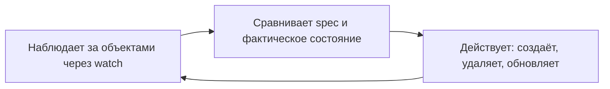
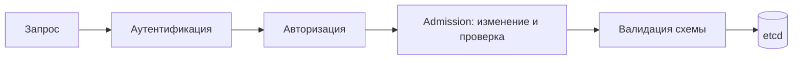

# Архитектура Kubernetes: продвинутая теория

🌐 **Русский** · [English](advanced.en.md)

**Уровни:** [обзор](overview.ru.md) · [1. Базовая](basics.ru.md) · **2. Продвинутая** · [3. Экспертная](expert.ru.md) · [4. Квиз](quiz.ru.md)

Опирается на [базовую теорию](basics.ru.md): список компонентов и порты не повторяются.

## Цикл согласования

Каждый контроллер выполняет один и тот же цикл:



Желаемое состояние — поле `spec`, наблюдаемое — `status` и реальные дочерние объекты. Контроллер реагирует не на команды вроде «создай под», а на разницу между желаемым и фактическим. Такой подход называют *level-triggered* (по уровню, а не по событию): если событие потеряно или компонент перезапускался, при следующем цикле расхождение всё равно будет замечено и исправлено.

Следствие: не нужно «доставлять» команду кластеру ровно один раз; достаточно, чтобы желаемое состояние лежало в etcd.

## Что бывает, когда компонент недоступен

Эксперимент на кластере kind: статический манифест компонента временно убран с ноды (`mv` из `/etc/kubernetes/manifests`), kubelet остановил его под, затем манифест возвращён.

**Scheduler остановлен.** Увеличиваем `replicas` с 2 до 3:

```text
$ kubectl -n learn-02 scale deploy/web --replicas=3
$ kubectl -n learn-02 get pods
web-689b9bdbdd-7hpbd 1/1 Running
web-689b9bdbdd-jcc7k 0/1 Pending
web-689b9bdbdd-r4tkv 1/1 Running
$ kubectl -n learn-02 get events --field-selector reason=FailedScheduling
No resources found in learn-02 namespace.
```

Под создан (контроллеры работают), но остаётся `Pending`: без scheduler у него нет ноды. Событий `FailedScheduling` нет, потому что их порождает сам scheduler. После возврата манифеста под получил ноду и стал `Running`. Уже работающие поды scheduler не затронуло.

**Controller-manager остановлен.** Удаляем один под:

```text
$ kubectl -n learn-02 delete pod <имя> --now
$ kubectl -n learn-02 get pods
web-689b9bdbdd-jcc7k 1/1 Running
web-689b9bdbdd-r4tkv 1/1 Running
$ kubectl -n learn-02 get deploy web
NAME   READY   UP-TO-DATE   AVAILABLE   AGE
web    3/3     3            3           13m
```

Подов два, а Deployment показывает `3/3`: статус обновляет контроллер, которого нет. Самовосстановления нет, пока контроллеры не вернутся; после возврата манифеста появился новый под.

Сводка по компонентам (две первые строки проверены опытом выше):

| Компонент остановлен | Что перестаёт работать | Что продолжает работать |
|---|---|---|
| scheduler | новые поды остаются `Pending` | уже запущенные поды |
| controller-manager | самовосстановление, обновление статусов, масштабирование | уже запущенные поды |
| API server | любые изменения и чтение через kubectl | уже запущенные контейнеры продолжают работать |
| etcd | API server не может читать и писать состояние | уже запущенные контейнеры продолжают работать |
| kubelet на ноде | нода становится `NotReady`, новые поды на ней не стартуют | контейнеры, уже запущенные рантаймом |

> ⚠️ Проверить: строки про API server, etcd и kubelet даны по документации и не воспроизведены опытом в этом материале.

## Watch и список с пагинацией

Контроллеры не опрашивают API по таймеру, а открывают **watch** — длинный HTTP-запрос, в котором сервер присылает изменения по мере появления. kubectl тоже умеет так:

```text
$ kubectl -n learn-02 get pods -w --no-headers
web-689b9bdbdd-7hpbd 1/1 Running
web-689b9bdbdd-r4tkv 1/1 Running
web-689b9bdbdd-f2ppw 0/1 Pending
web-689b9bdbdd-f2ppw 0/1 ContainerCreating
web-689b9bdbdd-f2ppw 1/1 Running
```

Первые две строки — текущее состояние, остальные — события после `kubectl scale --replicas=3` (повторные `Pending` и `ContainerCreating` в выводе убраны).

Обычный `get` — это HTTP-запрос к REST API. Флаг `-v=6` показывает его:

```text
$ kubectl -n learn-02 get pods -v=6
"Response" verb="GET" url="https://API/api/v1/namespaces/learn-02/pods?limit=500" status="200 OK" milliseconds=6
```

Видно путь `/api/v1/namespaces/<ns>/pods` и параметр `limit=500`: kubectl читает списки порциями. Если элементов больше, ответ содержит `continue`-токен:

```text
$ kubectl get --raw "/api/v1/namespaces/learn-02/pods?limit=1"
{"kind":"PodList","apiVersion":"v1","metadata":{"resourceVersion":"1787","continue":"eyJ2…","remainingItemCount":1},"items":[ … ]}
```

## Владельцы объектов

Объекты, которые создают контроллеры, ссылаются на владельца в `metadata.ownerReferences`:

```text
$ kubectl -n learn-02 get pods -o custom-columns=NAME:.metadata.name,OWNER:.metadata.ownerReferences[0].kind
NAME                   OWNER
web-689b9bdbdd-24sgv   ReplicaSet
web-689b9bdbdd-7hpbd   ReplicaSet
$ kubectl -n learn-02 get rs -o custom-columns=NAME:.metadata.name,OWNER:.metadata.ownerReferences[0].kind
NAME             OWNER
web-689b9bdbdd   Deployment
```

Цепочка Deployment → ReplicaSet → Pod. При удалении владельца сборщик мусора удаляет зависимые объекты, поэтому `kubectl delete deployment web` убирает и ReplicaSet, и поды. Имя пода строится из имени ReplicaSet (`web-689b9bdbdd`) и суффикса.

## Оптимистичная блокировка

У каждого объекта есть `metadata.resourceVersion` — версия записи. При `update` клиент присылает версию, которую прочитал; если с тех пор объект изменился, сервер отвечает `Conflict`:

```text
$ kubectl -n learn-02 get deploy web -o jsonpath='{.metadata.resourceVersion} gen={.metadata.generation}{"\n"}'
876 gen=1
$ kubectl -n learn-02 get deploy web -o json | sed 's/"resourceVersion": "[0-9]*"/"resourceVersion": "1"/' | kubectl replace -f -
Error from server (Conflict): error when replacing "STDIN": Operation cannot be fulfilled on deployments.apps "web": the object has been modified; please apply your changes to the latest version and try again
```

Клиент должен перечитать объект и повторить операцию. Это защищает от потерянных обновлений, когда два контроллера или человек и контроллер правят один объект.

## Путь запроса через API server

Запрос проходит последовательные этапы:



1. **Аутентификация** определяет, кто пришёл (сертификат, токен).
2. **Авторизация** решает, можно ли ему это действие. В нашем kind: `--authorization-mode=Node,RBAC`. Проверить права можно командой `kubectl auth can-i`:

   ```text
   $ kubectl auth can-i create pods -n learn-02
   yes
   $ kubectl auth can-i get nodes --as=system:serviceaccount:learn-02:default
   no
   ```

3. **Admission-контроллеры** могут изменить или отклонить запрос. В нашем API server явно включён `NodeRestriction` (`--enable-admission-plugins=NodeRestriction`): он ограничивает kubelet правами только на свои объекты.
4. **Валидация** проверяет объект по схеме API.
5. Объект записывается в etcd.

Подробнее про RBAC — в модуле 10 (Namespace и RBAC).

## API-группы и версии

API разделён на группы. Core-группа (поды, сервисы, namespace) живёт по пути `/api/v1`, остальные — `/apis/<группа>/<версия>`, например `/apis/apps/v1` для Deployment. В нашем кластере `kubectl api-resources` показывает 71 тип ресурсов. Список групп:

```text
$ kubectl get --raw /apis | grep -o '"name":"[a-z.0-9-]*"' | head -4
"name":"apiregistration.k8s.io"
"name":"apps"
"name":"events.k8s.io"
"name":"authentication.k8s.io"
```

Поле `apiVersion` в манифесте — это `группа/версия` (`apps/v1`) или просто версия для core (`v1`). Стабильные версии (`v1`) сохраняют совместимость, `beta` и `alpha` могут меняться. Сторонние ресурсы добавляются через CRD (модуль 19).

## Leader election

Controller-manager и scheduler в отказоустойчивом кластере запускают несколько копий, но активна только одна: копии борются за объект `Lease`.

```text
$ kubectl -n kube-system get lease
NAME                                   HOLDER                                                       AGE
apiserver-wsmremmdcgv3n55fjdkpodgmka   apiserver-wsmremmdcgv3n55fjdkpodgmka_692d5210-…              3m44s
kube-controller-manager                learn-control-plane_f76a269f-…                               3m41s
kube-scheduler                         learn-control-plane_2d20c0cd-…                               3m40s
```

В выводе: `HOLDER` — текущий лидер (строка `apiserver-…` — не выборы, а запись об экземпляре API server). Если лидер упадёт, лидерство перехватит другая копия. В манифесте controller-manager включён флаг `--leader-elect=true`.

## Отказоустойчивость control plane

В продакшене control plane запускают на нескольких машинах: несколько экземпляров API server за балансировщиком и кластер etcd из нечётного числа узлов (обычно 3 или 5), так как etcd требует кворума — большинства узлов. Управляемые облачные Kubernetes (EKS, GKE, AKS) берут эту часть на себя.

## Лучшие практики

- Читайте события и статусы (`kubectl describe`, `kubectl get events`), а не только состояние: они показывают, какой компонент что сделал.
- Проектируйте приложения так, чтобы под можно было удалить в любой момент.
- Не правьте поля, которыми управляют контроллеры (`status`, `ownerReferences`), вручную.
- Обрабатывайте `Conflict` повтором с перечитыванием, если пишете свой клиент.

## Частые ошибки

- ❌ Считать, что `Pending` — ошибка приложения → ✅ это значит, что нода ещё не назначена или образ не скачан: смотрите `describe`; без scheduler `Pending` бесконечен.
- ❌ Верить `READY 3/3` у Deployment, когда подов меньше → ✅ статус обновляет контроллер; если controller-manager недоступен, статус устаревает.
- ❌ Читать значения прямо из etcd как YAML → ✅ значения хранятся в бинарном формате ([экспертная теория](expert.ru.md#подвох-значения-в-etcd-не-yaml)).
- ❌ Назначать `spec.nodeName` вручную, чтобы «закрепить» под → ✅ так под минует scheduler и его проверки (в опыте событие `Scheduled` отсутствует); используйте селекторы и affinity (модуль 18).

## Сравнение с другими треками

- [Linux](../../../linux/overview.ru.md): kubelet управляет процессами, а изоляцию даёт ядро (namespaces, cgroups).
- [C#](../../../csharp/modules/10-async-await/overview.ru.md): цикл согласования похож на фоновый воркер, который по таймеру или событию сверяет состояние; см. также [фоновые задачи](../../../csharp/recipes/background-jobs/overview.ru.md).

## Связанные материалы

- Предыдущий уровень: [базовая теория](basics.ru.md)
- Дальше: [экспертная теория](expert.ru.md)
- Следующий модуль: [03 · Локальный кластер и kubectl](../03-local-cluster-and-kubectl/overview.ru.md)
- Предыдущий модуль: [01 · Контейнеры и Docker](../01-containers/overview.ru.md)

## Источники

- [Controllers](https://kubernetes.io/docs/concepts/architecture/controller/)
- [Kubernetes API concepts: watch и resourceVersion](https://kubernetes.io/docs/reference/using-api/api-concepts/)
- [Owners and Dependents](https://kubernetes.io/docs/concepts/overview/working-with-objects/owners-dependents/)
- [Controlling Access to the Kubernetes API](https://kubernetes.io/docs/concepts/security/controlling-access/)
- [Leases](https://kubernetes.io/docs/concepts/architecture/leases/)
- [Operating etcd clusters](https://kubernetes.io/docs/tasks/administer-cluster/configure-upgrade-etcd/)
- [Options for Highly Available Topology](https://kubernetes.io/docs/setup/production-environment/tools/kubeadm/ha-topology/)
