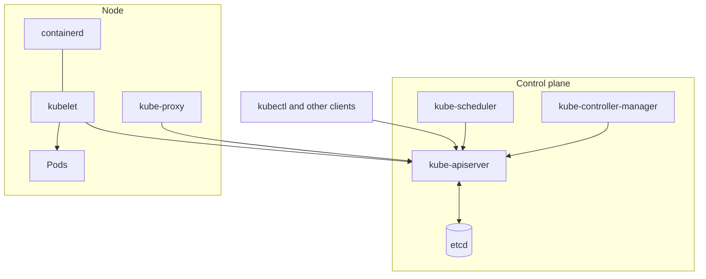

# Kubernetes architecture: basics

🌐 [Русский](basics.ru.md) · **English**

**Levels:** [overview](overview.en.md) · **1. Basics** · [2. Advanced](advanced.en.md) · [3. Expert](expert.en.md) · [4. Quiz](quiz.en.md)

**Prerequisites:** [01 · Containers and Docker](../01-containers/overview.en.md) · **Time:** ~2 h

All output examples were obtained on a kind cluster (one node, `learn-control-plane`) with Kubernetes 1.37.0. How to create such a cluster is in [module 03](../03-local-cluster-and-kubectl/overview.en.md).

## Why it matters

Docker runs one container. When there are hundreds of containers on dozens of machines, questions arise: on which machine to run, what to do when it fails, how to distribute traffic, how to update without downtime. Kubernetes answers them by accepting a **description of the desired state** ("I want 3 copies of this image") from you and continuously maintaining it.

## What a cluster consists of



The cluster is divided into two parts:

- The **control plane** is the "brain": it stores the state and makes decisions.
- **Nodes** are the machines (physical or virtual) on which pods run.

In a small cluster (including kind) the control plane and the nodes can sit on one machine.

| Component | Where | What it does | Port (in our kind) |
|---|---|---|---|
| `kube-apiserver` | control plane | the single entry point of the REST API: validates requests, reads and writes etcd | 6443 |
| `etcd` | control plane | the cluster state storage | 2379 (clients), 2380 (between etcd members) |
| `kube-scheduler` | control plane | picks a node for a new pod | 10259 |
| `kube-controller-manager` | control plane | runs controllers (Deployment, ReplicaSet, Node and others) | 10257 |
| `kubelet` | every node | starts and supervises the pods of its node | 10250 |
| `kube-proxy` | every node | implements Service: network routing rules | 10256 |
| container runtime (`containerd`) | every node | starts containers at the kubelet's request | — |

The ports were obtained with `ss -ltnp` inside the node. In kind the scheduler and controller-manager listen only on `127.0.0.1`, the kubelet on all interfaces.

## What is visible in kind

The control plane components are ordinary pods in the `kube-system` namespace:

```text
$ kubectl get pods -n kube-system
NAME                                          READY  STATUS   NODE
coredns-559f6c778d-fcg82                      1/1    Running  learn-control-plane
coredns-559f6c778d-x7s57                      1/1    Running  learn-control-plane
etcd-learn-control-plane                      1/1    Running  learn-control-plane
kindnet-mvczw                                 1/1    Running  learn-control-plane
kube-apiserver-learn-control-plane            1/1    Running  learn-control-plane
kube-controller-manager-learn-control-plane   1/1    Running  learn-control-plane
kube-proxy-nxs9n                              1/1    Running  learn-control-plane
kube-scheduler-learn-control-plane            1/1    Running  learn-control-plane
```

Besides the cluster's own components there are **CoreDNS** (DNS inside the cluster) and **kindnet** (a network plugin; in other clusters it is Calico, Cilium and so on).

The kubelet starts these four control plane components as "static pods" from manifests in a folder on the node:

```text
$ docker exec learn-control-plane ls /etc/kubernetes/manifests
etcd.yaml
kube-apiserver.yaml
kube-controller-manager.yaml
kube-scheduler.yaml
```

On the node itself the `kubelet` and `containerd` processes run, while `kube-apiserver`, `etcd`, `kube-scheduler` and `kube-controller-manager` are visible as ordinary processes of the node host.

The API server state can be checked with a `readyz` request:

```text
$ kubectl get --raw '/readyz?verbose' | head -4
[+]ping ok
[+]log ok
[+]etcd ok
[+]etcd-readiness ok
```

And the version:

```text
$ kubectl get --raw /version
{ "major": "1", "minor": "37", "gitVersion": "v1.37.0", "goVersion": "go1.26.6", "platform": "linux/amd64", ... }
```

## What happens when a Deployment is created

The command `kubectl create deployment web --image=nginx:1.29 --replicas=2` starts a chain that can be read in the events:

```text
REASON              SOURCE                  MSG
ScalingReplicaSet   deployment-controller   Scaled up replica set web-689b9bdbdd from 0 to 2
SuccessfulCreate    replicaset-controller   Created pod: web-689b9bdbdd-24sgv
SuccessfulCreate    replicaset-controller   Created pod: web-689b9bdbdd-7hpbd
Scheduled           default-scheduler       Successfully assigned learn-02/web-689b9bdbdd-24sgv to learn-control-plane
Pulling             kubelet                 Pulling image "nginx:1.29"
Pulled              kubelet                 Successfully pulled image "nginx:1.29" in 15.768s (15.768s including waiting). Image size: 62964090 bytes.
Created             kubelet                 Container created
Started             kubelet                 Container started
```

(the lines were picked from the real output and rearranged in logical order: in the actual output of `kubectl get events --sort-by=.metadata.creationTimestamp` the order within one second is arbitrary, see the [gotchas](expert.en.md#gotcha-event-order-is-imprecise))

Step by step:

1. **kubectl** sends a request to the API server; it validates it and writes the Deployment object to etcd.
2. The **deployment-controller** sees the new Deployment and creates a ReplicaSet.
3. The **replicaset-controller** sees a ReplicaSet with 2 replicas and creates two Pod objects (still without a node).
4. The **scheduler** sees pods without a node and writes the chosen node for each.
5. The **kubelet** of that node sees a pod assigned to it, pulls the image and starts the container through containerd.
6. The kubelet reports the pod status to the API server.

Each component does only its own part and talks through the API server.

## Self-healing

Controllers maintain the desired state. Let us delete one pod:

```text
$ kubectl -n learn-02 delete pod web-689b9bdbdd-24sgv
$ kubectl -n learn-02 get pods
NAME                  READY  STATUS   AGE
web-689b9bdbdd-7hpbd  1/1    Running  21s
web-689b9bdbdd-r4tkv  1/1    Running  3s
```

A new pod `r4tkv` appeared (age 3 s): the ReplicaSet noticed there were fewer replicas than the desired two and created the missing one.

## Beginner mistakes

- ❌ Treating a pod as a virtual machine to "repair" → ✅ a pod is disposable: it is replaced, not healed; persistent data is stored outside the pod.
- ❌ Deleting a pod hoping to stop the application → ✅ the controller creates it again; reduce `replicas` or delete the Deployment.
- ❌ Expecting an instant result → ✅ changes are asynchronous: after `kubectl apply` the cluster brings the state to the desired one within seconds; watch `kubectl get events`.
- ❌ Looking for running containers with `docker ps` on your machine → ✅ in kind nodes are Docker containers and the pods inside them go through containerd; use `kubectl`.

## Related materials

- Next: [advanced](advanced.en.md) — the reconciliation loop, watch, the request path
- Next module: [03 · Local cluster and kubectl](../03-local-cluster-and-kubectl/overview.en.md)
- Previous module: [01 · Containers and Docker](../01-containers/overview.en.md)
- Foundation: the [Linux track](../../../linux/overview.en.md)

## Sources

- [Kubernetes Components](https://kubernetes.io/docs/concepts/overview/components/)
- [Cluster Architecture](https://kubernetes.io/docs/concepts/architecture/)
- [Nodes](https://kubernetes.io/docs/concepts/architecture/nodes/)
- [Ports and Protocols](https://kubernetes.io/docs/reference/networking/ports-and-protocols/)
- [kind: quick start](https://kind.sigs.k8s.io/docs/user/quick-start/)
