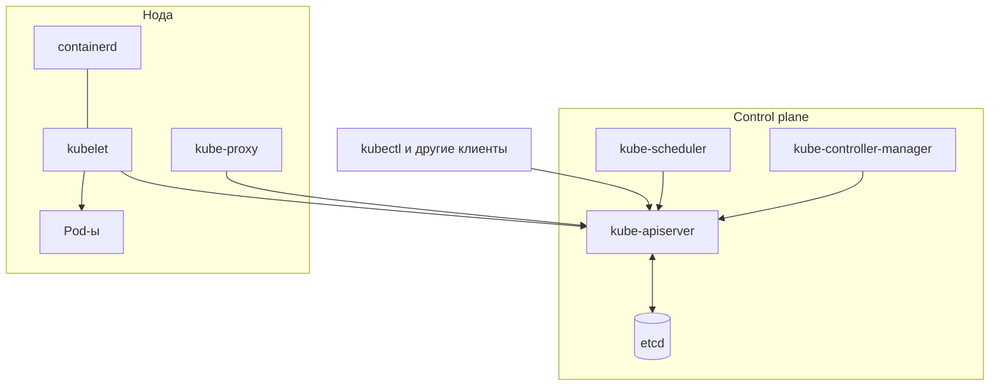

# Архитектура Kubernetes: базовая теория

🌐 **Русский** · [English](basics.en.md)

**Уровни:** [обзор](overview.ru.md) · **1. Базовая** · [2. Продвинутая](advanced.ru.md) · [3. Экспертная](expert.ru.md) · [4. Квиз](quiz.ru.md)

**Пререквизиты:** [01 · Контейнеры и Docker](../01-containers/overview.ru.md) · **Время:** ~2 ч

Все примеры вывода получены на кластере kind (один узел `learn-control-plane`) с Kubernetes 1.37.0. Как создать такой кластер, — в [модуле 03](../03-local-cluster-and-kubectl/overview.ru.md).

## Зачем это нужно

Один контейнер запускает Docker. Когда контейнеров сотни, на десятках машин, возникают вопросы: на какой машине запустить, что делать, если она упала, как раздать трафик, как обновить без простоя. Kubernetes отвечает на них, принимая от вас **описание желаемого состояния** («хочу 3 копии этого образа») и непрерывно поддерживая его.

## Из чего состоит кластер



Кластер делится на две части:

- **Control plane** — «мозг»: хранит состояние и принимает решения.
- **Ноды (nodes)** — машины (физические или виртуальные), на которых работают поды.

В маленьком кластере (в том числе kind) control plane и ноды могут находиться на одной машине.

| Компонент | Где | Что делает | Порт (в нашем kind) |
|---|---|---|---|
| `kube-apiserver` | control plane | единственная точка входа REST API: проверяет запросы, читает и пишет etcd | 6443 |
| `etcd` | control plane | хранилище состояния кластера | 2379 (клиенты), 2380 (между узлами etcd) |
| `kube-scheduler` | control plane | выбирает ноду для нового пода | 10259 |
| `kube-controller-manager` | control plane | запускает контроллеры (Deployment, ReplicaSet, Node и др.) | 10257 |
| `kubelet` | каждая нода | запускает и контролирует поды своей ноды | 10250 |
| `kube-proxy` | каждая нода | реализует Service: правила маршрутизации сети | 10256 |
| контейнерный рантайм (`containerd`) | каждая нода | запускает контейнеры по запросу kubelet | — |

Порты получены командой `ss -ltnp` внутри ноды. Scheduler и controller-manager в kind слушают только `127.0.0.1`, kubelet — на всех интерфейсах.

## Что видно в kind

Компоненты control plane — обычные поды в namespace `kube-system`:

```text
$ kubectl get pods -n kube-system
NAME                                          READY  STATUS   NODE
coredns-559f6c778d-fcg82                      1/1    Running  learn-control-plane
coredns-559f6c778d-x7s57                      1/1    Running  learn-control-plane
etcd-learn-control-plane                      1/1    Running  learn-control-plane
kindnet-mvczw                                 1/1    Running  learn-control-plane
kube-apiserver-learn-control-plane            1/1    Running  learn-control-plane
kube-controller-manager-learn-control-plane   1/1    Running  learn-control-plane
kube-proxy-nxs9n                              1/1    Running  learn-control-plane
kube-scheduler-learn-control-plane            1/1    Running  learn-control-plane
```

Кроме компонентов самого кластера здесь есть **CoreDNS** (DNS внутри кластера) и **kindnet** (сетевой плагин; в других кластерах это Calico, Cilium и т. д.).

Эти четыре компонента control plane kubelet запускает как «статические поды» из манифестов в папке на ноде:

```text
$ docker exec learn-control-plane ls /etc/kubernetes/manifests
etcd.yaml
kube-apiserver.yaml
kube-controller-manager.yaml
kube-scheduler.yaml
```

На самой ноде работают процессы `kubelet` и `containerd`, а `kube-apiserver`, `etcd`, `kube-scheduler`, `kube-controller-manager` видны как обычные процессы хоста-ноды.

Проверить состояние API server можно запросом `readyz`:

```text
$ kubectl get --raw '/readyz?verbose' | head -4
[+]ping ok
[+]log ok
[+]etcd ok
[+]etcd-readiness ok
```

И версия:

```text
$ kubectl get --raw /version
{ "major": "1", "minor": "37", "gitVersion": "v1.37.0", "goVersion": "go1.26.6", "platform": "linux/amd64", ... }
```

## Что происходит при создании Deployment

Команда `kubectl create deployment web --image=nginx:1.29 --replicas=2` запускает цепочку, которую можно прочитать в событиях:

```text
REASON              SOURCE                  MSG
ScalingReplicaSet   deployment-controller   Scaled up replica set web-689b9bdbdd from 0 to 2
SuccessfulCreate    replicaset-controller   Created pod: web-689b9bdbdd-24sgv
SuccessfulCreate    replicaset-controller   Created pod: web-689b9bdbdd-7hpbd
Scheduled           default-scheduler       Successfully assigned learn-02/web-689b9bdbdd-24sgv to learn-control-plane
Pulling             kubelet                 Pulling image "nginx:1.29"
Pulled              kubelet                 Successfully pulled image "nginx:1.29" in 15.768s (15.768s including waiting). Image size: 62964090 bytes.
Created             kubelet                 Container created
Started             kubelet                 Container started
```

(строки выбраны из реального вывода и переставлены в логическом порядке: в настоящей выдаче `kubectl get events --sort-by=.metadata.creationTimestamp` порядок внутри одной секунды произвольный, см. [подвохи](expert.ru.md#подвох-порядок-событий-неточен))

По шагам:

1. **kubectl** отправляет запрос в API server; тот проверяет его и записывает объект Deployment в etcd.
2. **deployment-controller** видит новый Deployment и создаёт ReplicaSet.
3. **replicaset-controller** видит ReplicaSet с 2 репликами и создаёт два объекта Pod (пока без ноды).
4. **scheduler** видит поды без ноды и для каждого записывает выбранную ноду.
5. **kubelet** этой ноды видит назначенный ему под, скачивает образ и запускает контейнер через containerd.
6. kubelet сообщает о статусе пода в API server.

Каждый компонент делает только свою часть и общается через API server.

## Самовосстановление

Контроллеры поддерживают желаемое состояние. Удалим один под:

```text
$ kubectl -n learn-02 delete pod web-689b9bdbdd-24sgv
$ kubectl -n learn-02 get pods
NAME                  READY  STATUS   AGE
web-689b9bdbdd-7hpbd  1/1    Running  21s
web-689b9bdbdd-r4tkv  1/1    Running  3s
```

Появился новый под `r4tkv` (возраст 3 с): ReplicaSet заметил, что реплик стало меньше желаемых двух, и создал недостающий.

## Ошибки новичка

- ❌ Считать, что под — виртуальная машина, которую нужно «чинить» → ✅ под одноразовый: его заменяют, а не лечат; постоянные данные хранят вне пода.
- ❌ Удалять под, надеясь остановить приложение → ✅ контроллер создаст его заново; уменьшайте `replicas` или удаляйте Deployment.
- ❌ Ожидать мгновенного результата → ✅ изменения асинхронны: после `kubectl apply` кластер приводит состояние к желаемому за секунды; смотрите `kubectl get events`.
- ❌ Искать запущенные контейнеры командой `docker ps` на своей машине → ✅ в kind ноды — это контейнеры Docker, а поды внутри них идут через containerd; используйте `kubectl`.

## Связанные материалы

- Дальше: [продвинутая теория](advanced.ru.md) — цикл согласования, watch, путь запроса
- Следующий модуль: [03 · Локальный кластер и kubectl](../03-local-cluster-and-kubectl/overview.ru.md)
- Предыдущий модуль: [01 · Контейнеры и Docker](../01-containers/overview.ru.md)
- Фундамент: [трек Linux](../../../linux/overview.ru.md)

## Источники

- [Kubernetes Components](https://kubernetes.io/docs/concepts/overview/components/)
- [Cluster Architecture](https://kubernetes.io/docs/concepts/architecture/)
- [Nodes](https://kubernetes.io/docs/concepts/architecture/nodes/)
- [Ports and Protocols](https://kubernetes.io/docs/reference/networking/ports-and-protocols/)
- [kind: быстрый старт](https://kind.sigs.k8s.io/docs/user/quick-start/)
