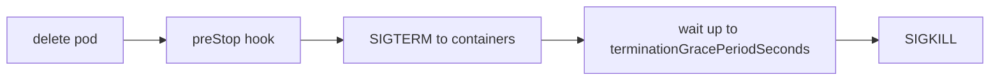

# Pod: advanced

🌐 [Русский](advanced.ru.md) · **English**

**Levels:** [overview](overview.en.md) · [1. Basics](basics.en.md) · **2. Advanced** · [3. Expert](expert.en.md) · [4. Quiz](quiz.en.md)

Builds on [basics](basics.en.md): the pod manifest, phases and `restartPolicy` are not repeated.

## Several containers in a pod

Containers of one pod share a network space and can share volumes. The `multi` pod with three containers: `web` (nginx) serves a folder, `writer` writes the time into it every 2 seconds, `probe` is an empty container for checks.

```yaml
apiVersion: v1
kind: Pod
metadata: {name: multi}
spec:
  volumes:
    - name: shared
      emptyDir: {}
  containers:
    - name: web
      image: nginx:1.29
      volumeMounts:
        - {name: shared, mountPath: /usr/share/nginx/html}
      env:
        - name: POD_NAME
          valueFrom: {fieldRef: {fieldPath: metadata.name}}
        - name: POD_IP
          valueFrom: {fieldRef: {fieldPath: status.podIP}}
    - name: writer
      image: alpine:3.22
      command: ["sh", "-c", "while true; do date +%T > /data/index.html; sleep 2; done"]
      volumeMounts:
        - {name: shared, mountPath: /data}
    - name: probe
      image: alpine:3.22
      command: ["sh", "-c", "sleep 3600"]
```

```text
$ kubectl -n learn-04 get pod multi
NAME    READY   STATUS    RESTARTS   AGE
multi   3/3     Running   0          1s
```

What the containers share and what they do not:

- **Network and `localhost`:** `probe` reaches the neighbor container's nginx through `localhost`. The address is one.

  ```text
  $ kubectl -n learn-04 exec multi -c probe -- wget -qO- http://localhost:80
  16:26:43
  $ kubectl -n learn-04 exec multi -c probe -- sh -c 'echo ip: $(hostname -i)'
  ip: 10.244.0.43
  $ kubectl -n learn-04 exec multi -c web -- sh -c 'echo ip: $(hostname -i)'
  ip: 10.244.0.43
  ```

- **A volume:** the `index.html` file written by `writer` is served by `web`: this is a shared `emptyDir`. An `emptyDir` volume is created with the pod and deleted with it.
- **The host name:** for all containers `hostname` equals the pod name (`multi`).
- **File systems and processes are separate:** `probe` has no `/usr/share/nginx`, and `ps` shows only its own processes. A shared process list is enabled with `shareProcessNamespace: true`: then `ps` in any container sees the neighbors' processes too, and PID 1 is taken by the service `/pause`.

  ```text
  $ kubectl -n learn-04 exec spn -c a -- ps      # shareProcessNamespace: true
  PID   USER     TIME  COMMAND
      1 65535     0:00 /pause
      6 root      0:00 sleep 3600
     16 root      0:00 sleep 3601
  ```

Variables from pod metadata are set through `fieldRef` (the Downward API):

```text
$ kubectl -n learn-04 exec multi -c web -- sh -c 'echo $POD_NAME $POD_IP'
multi 10.244.0.11
```

### Logs and choosing a container

When there are several containers, `kubectl logs` without `-c` picks the first one and says so:

```text
$ kubectl -n learn-04 logs multi
Defaulted container "web" out of: web, writer, probe
/docker-entrypoint.sh: /docker-entrypoint.d/ is not empty, will attempt to perform configuration
$ kubectl -n learn-04 logs multi -c writer
```

The default container can be set with the annotation `kubectl.kubernetes.io/default-container`.

> ⚠️ Verify: the annotation `kubectl.kubernetes.io/default-container` was not run in this material.

### The sidecar pattern

A sidecar is an additional container that helps the main one: collects logs, refreshes configuration, terminates TLS. It shares network and volumes with the main one and scales with it. If two containers must scale independently, they are two different pods.

## Init containers

Init containers run one after another, before the main ones start. Each must finish successfully, otherwise the next one does not start.

```yaml
apiVersion: v1
kind: Pod
metadata: {name: init-demo}
spec:
  initContainers:
    - name: wait-a
      image: alpine:3.22
      command: ["sh", "-c", "echo init-a; sleep 6"]
    - name: wait-b
      image: alpine:3.22
      command: ["sh", "-c", "echo init-b; sleep 3"]
  containers:
    - name: app
      image: alpine:3.22
      command: ["sh", "-c", "echo app-started; sleep 3600"]
```

```text
$ kubectl -n learn-04 get pod init-demo -w
0/1 Init:0/2
0/1 Init:1/2
1/1 Running
$ kubectl -n learn-04 logs init-demo -c wait-a
init-a
$ kubectl -n learn-04 logs init-demo
Defaulted container "app" out of: app, wait-a (init), wait-b (init)
app-started
```

The status `Init:N/M` means N of M init containers are done. If an init container fails, the pod does not reach `Running`:

```text
$ kubectl -n learn-04 get pod init-fail
NAME        READY   STATUS       RESTARTS      AGE
init-fail   0/1     Init:Error   2 (24s ago)   25s
```

With the `Always` policy the kubelet restarts a failed init container. Init containers are for preparation: wait for a dependency, copy files into a shared volume, run a migration. They must not run forever.

## Native sidecar

An init container with `restartPolicy: Always` does not finish: it starts before the main containers and runs for the whole life of the pod. This is the "native sidecar":

```yaml
spec:
  initContainers:
    - name: logger
      image: alpine:3.22
      restartPolicy: Always
      command: ["sh", "-c", "while true; do echo sidecar-alive; sleep 5; done"]
  containers:
    - name: app
      image: alpine:3.22
      command: ["sh", "-c", "echo app-up; sleep 3600"]
```

```text
$ kubectl -n learn-04 get pod sidecar-demo
NAME           READY   STATUS    RESTARTS   AGE
sidecar-demo   2/2     Running   0          1s
$ kubectl -n learn-04 get pod sidecar-demo -o jsonpath='{.status.initContainerStatuses[0].ready} started={.status.initContainerStatuses[0].started}{"\n"}'
true started=true
```

The pod became `Running` although the "init container" did not finish: `READY 2/2` counts the sidecar too. Such a sidecar starts before the main containers and stops after them, which is not guaranteed for ordinary containers in the `containers` list.

## Pod termination

When a pod is deleted, the kubelet performs these steps:



The default wait is 30 seconds. Three pods: one waits on `sleep` (ignores `SIGTERM`), the second handles the signal with `trap`, the third has `terminationGracePeriodSeconds: 5`:

```text
$ kubectl -n learn-04 delete pod term-ignore
term-ignore deleted in 32s
$ kubectl -n learn-04 delete pod term-trap
term-trap deleted in 1s
$ kubectl -n learn-04 delete pod term-short
term-short deleted in 6s
```

`sleep` as PID 1 does not react to `SIGTERM` ([module 01](../01-containers/advanced.en.md#pid-1-and-sigterm)), so the pod waited the full 30 seconds until `SIGKILL`; the signal handler finished the second pod in a second, and the third has its wait cut to 5 seconds.

**The `preStop` hook** runs before `SIGTERM`. An example with a hook that "prepares" for 3 seconds:

```yaml
lifecycle:
  preStop:
    exec:
      command: ["sh", "-c", "echo preStop-running >> /proc/1/fd/1; sleep 3"]
```

```text
$ kubectl -n learn-04 delete pod prestop
prestop deleted in 4s
$ kubectl -n learn-04 logs prestop
preStop-running
got-SIGTERM
```

First `preStop` ran, then the container received `SIGTERM` (the deletion took 4 seconds: 3 seconds of the hook and another second to handle the signal). The hook time counts toward the total `terminationGracePeriodSeconds`.

In parallel with the pod stopping, Kubernetes removes it from the endpoint list of a Service (module 06); the application must finish its current requests correctly.

## Best practices

- One main process per container, logs to stdout/stderr.
- The application must handle `SIGTERM` and finish in less than `terminationGracePeriodSeconds`.
- Shared data between containers goes through `emptyDir`; durable data through a PersistentVolume (module 08).
- Do not use "bare" pods for long-lived services.
- Use init containers for preparatory steps and a sidecar for helper processes.

## Common mistakes

- ❌ Using `sleep` or a program without a signal handler as PID 1 → ✅ add a `SIGTERM` handler or run through an init process: otherwise every deletion waits 30 seconds.
- ❌ Expecting `kubectl logs` without `-c` to show all containers → ✅ it picks one (`Defaulted container …`); use `-c` or `--all-containers`.
- ❌ Putting needed data into `emptyDir` and expecting it after the pod is recreated → ✅ `emptyDir` lives only with the pod.
- ❌ Making an init container long-lived → ✅ use a native sidecar for long-lived helpers.
- ❌ Scaling an application and a DB as two containers of one pod → ✅ separate pods: they have different lifecycles.

## Comparison with other tracks

- [Linux](../../../linux/overview.en.md): a shared `localhost` is a shared network namespace; a shared process list is a shared PID namespace.
- [Docker](../01-containers/overview.en.md): the analog is `docker run --network container:<name>`, but in Kubernetes combining containers is the primary model.
- [C#](../../../csharp/recipes/background-jobs/overview.en.md): correct worker shutdown on `SIGTERM` is the same graceful shutdown.

## Related materials

- Previous level: [basics](basics.en.md)
- Next: [expert](expert.en.md)
- Next module: [05 · Deployment and ReplicaSet](../05-deployments/overview.en.md)
- Containers: [01 · Containers and Docker](../01-containers/overview.en.md)

## Sources

- [Init Containers](https://kubernetes.io/docs/concepts/workloads/pods/init-containers/)
- [Sidecar Containers](https://kubernetes.io/docs/concepts/workloads/pods/sidecar-containers/)
- [Container Lifecycle Hooks](https://kubernetes.io/docs/concepts/containers/container-lifecycle-hooks/)
- [Pod termination](https://kubernetes.io/docs/concepts/workloads/pods/pod-lifecycle/#pod-termination)
- [Share Process Namespace between Containers in a Pod](https://kubernetes.io/docs/tasks/configure-pod-container/share-process-namespace/)
- [Downward API: fieldRef](https://kubernetes.io/docs/concepts/workloads/pods/downward-api/)
- [Volumes: emptyDir](https://kubernetes.io/docs/concepts/storage/volumes/#emptydir)
