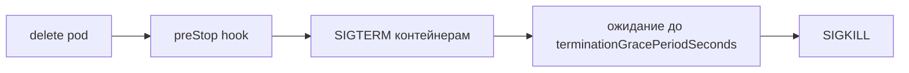

# Pod: продвинутая теория

🌐 **Русский** · [English](advanced.en.md)

**Уровни:** [обзор](overview.ru.md) · [1. Базовая](basics.ru.md) · **2. Продвинутая** · [3. Экспертная](expert.ru.md) · [4. Квиз](quiz.ru.md)

Опирается на [базовую теорию](basics.ru.md): манифест пода, фазы и `restartPolicy` не повторяются.

## Несколько контейнеров в поде

Контейнеры одного пода делят сетевое пространство и могут делить тома. Под `multi` с тремя контейнерами: `web` (nginx) раздаёт папку, `writer` каждые 2 секунды пишет в неё время, `probe` — пустой контейнер для проверок.

```yaml
apiVersion: v1
kind: Pod
metadata: {name: multi}
spec:
  volumes:
    - name: shared
      emptyDir: {}
  containers:
    - name: web
      image: nginx:1.29
      volumeMounts:
        - {name: shared, mountPath: /usr/share/nginx/html}
      env:
        - name: POD_NAME
          valueFrom: {fieldRef: {fieldPath: metadata.name}}
        - name: POD_IP
          valueFrom: {fieldRef: {fieldPath: status.podIP}}
    - name: writer
      image: alpine:3.22
      command: ["sh", "-c", "while true; do date +%T > /data/index.html; sleep 2; done"]
      volumeMounts:
        - {name: shared, mountPath: /data}
    - name: probe
      image: alpine:3.22
      command: ["sh", "-c", "sleep 3600"]
```

```text
$ kubectl -n learn-04 get pod multi
NAME    READY   STATUS    RESTARTS   AGE
multi   3/3     Running   0          1s
```

Что общее у контейнеров, а что нет:

- **Сеть и `localhost`:** `probe` обращается к nginx соседнего контейнера по `localhost`. Адрес один.

  ```text
  $ kubectl -n learn-04 exec multi -c probe -- wget -qO- http://localhost:80
  16:26:43
  $ kubectl -n learn-04 exec multi -c probe -- sh -c 'echo ip: $(hostname -i)'
  ip: 10.244.0.43
  $ kubectl -n learn-04 exec multi -c web -- sh -c 'echo ip: $(hostname -i)'
  ip: 10.244.0.43
  ```

- **Том:** файл `index.html`, который пишет `writer`, отдаёт `web`: это общий `emptyDir`. Том `emptyDir` создаётся вместе с подом и удаляется вместе с ним.
- **Имя хоста:** у всех контейнеров `hostname` равен имени пода (`multi`).
- **Файловая система и процессы раздельны:** в `probe` нет `/usr/share/nginx`, а `ps` показывает только его собственные процессы. Общий список процессов включается полем `shareProcessNamespace: true`: тогда `ps` в любом контейнере видит и процессы соседей, а PID 1 занимает служебный `/pause`.

  ```text
  $ kubectl -n learn-04 exec spn -c a -- ps      # shareProcessNamespace: true
  PID   USER     TIME  COMMAND
      1 65535     0:00 /pause
      6 root      0:00 sleep 3600
     16 root      0:00 sleep 3601
  ```

Переменные из метаданных пода задаются через `fieldRef` (Downward API):

```text
$ kubectl -n learn-04 exec multi -c web -- sh -c 'echo $POD_NAME $POD_IP'
multi 10.244.0.11
```

### Логи и выбор контейнера

Когда контейнеров несколько, `kubectl logs` без `-c` выбирает первый и сообщает об этом:

```text
$ kubectl -n learn-04 logs multi
Defaulted container "web" out of: web, writer, probe
/docker-entrypoint.sh: /docker-entrypoint.d/ is not empty, will attempt to perform configuration
$ kubectl -n learn-04 logs multi -c writer
```

Контейнер по умолчанию можно задать аннотацией `kubectl.kubernetes.io/default-container`.

> ⚠️ Проверить: аннотация `kubectl.kubernetes.io/default-container` не запускалась в этом материале.

### Паттерн sidecar

Sidecar — дополнительный контейнер, который помогает основному: собирает логи, обновляет конфигурацию, терминирует TLS. Он делится с основным сетью и томами и масштабируется вместе с ним. Если два контейнера нужно масштабировать независимо, это два разных пода.

## Init-контейнеры

Init-контейнеры выполняются по очереди, до запуска основных. Каждый должен завершиться успешно, иначе следующий не стартует.

```yaml
apiVersion: v1
kind: Pod
metadata: {name: init-demo}
spec:
  initContainers:
    - name: wait-a
      image: alpine:3.22
      command: ["sh", "-c", "echo init-a; sleep 6"]
    - name: wait-b
      image: alpine:3.22
      command: ["sh", "-c", "echo init-b; sleep 3"]
  containers:
    - name: app
      image: alpine:3.22
      command: ["sh", "-c", "echo app-started; sleep 3600"]
```

```text
$ kubectl -n learn-04 get pod init-demo -w
0/1 Init:0/2
0/1 Init:1/2
1/1 Running
$ kubectl -n learn-04 logs init-demo -c wait-a
init-a
$ kubectl -n learn-04 logs init-demo
Defaulted container "app" out of: app, wait-a (init), wait-b (init)
app-started
```

Статус `Init:N/M` — выполнено N из M init-контейнеров. Если init-контейнер падает, под не доходит до `Running`:

```text
$ kubectl -n learn-04 get pod init-fail
NAME        READY   STATUS       RESTARTS      AGE
init-fail   0/1     Init:Error   2 (24s ago)   25s
```

При политике `Always` kubelet перезапускает упавший init-контейнер. Init-контейнеры нужны для подготовки: дождаться зависимости, скопировать файлы в общий том, выполнить миграцию. Они не должны работать вечно.

## Нативный sidecar

Init-контейнер с `restartPolicy: Always` не завершается: он запускается до основных контейнеров и работает всё время жизни пода. Это «нативный sidecar»:

```yaml
spec:
  initContainers:
    - name: logger
      image: alpine:3.22
      restartPolicy: Always
      command: ["sh", "-c", "while true; do echo sidecar-alive; sleep 5; done"]
  containers:
    - name: app
      image: alpine:3.22
      command: ["sh", "-c", "echo app-up; sleep 3600"]
```

```text
$ kubectl -n learn-04 get pod sidecar-demo
NAME           READY   STATUS    RESTARTS   AGE
sidecar-demo   2/2     Running   0          1s
$ kubectl -n learn-04 get pod sidecar-demo -o jsonpath='{.status.initContainerStatuses[0].ready} started={.status.initContainerStatuses[0].started}{"\n"}'
true started=true
```

Под стал `Running`, хотя «init-контейнер» не завершился: в `READY 2/2` учтён и sidecar. Такой sidecar стартует раньше основных контейнеров и останавливается после них, чего обычным контейнерам в списке `containers` не гарантировано.

## Остановка пода

Когда под удаляют, kubelet выполняет шаги:



Время ожидания по умолчанию — 30 секунд. Три пода: один ждёт `sleep` (игнорирует `SIGTERM`), второй обрабатывает сигнал через `trap`, у третьего `terminationGracePeriodSeconds: 5`:

```text
$ kubectl -n learn-04 delete pod term-ignore
term-ignore deleted in 32s
$ kubectl -n learn-04 delete pod term-trap
term-trap deleted in 1s
$ kubectl -n learn-04 delete pod term-short
term-short deleted in 6s
```

`sleep` как PID 1 не реагирует на `SIGTERM` ([модуль 01](../01-containers/advanced.ru.md#pid-1-и-sigterm)), поэтому под ждал полные 30 секунд до `SIGKILL`; обработчик сигнала завершил второй под за секунду, у третьего ожидание сокращено до 5 секунд.

**Хук `preStop`** выполняется до `SIGTERM`. Пример с хуком, который 3 секунды «готовится»:

```yaml
lifecycle:
  preStop:
    exec:
      command: ["sh", "-c", "echo preStop-running >> /proc/1/fd/1; sleep 3"]
```

```text
$ kubectl -n learn-04 delete pod prestop
prestop deleted in 4s
$ kubectl -n learn-04 logs prestop
preStop-running
got-SIGTERM
```

Сначала отработал `preStop`, затем контейнер получил `SIGTERM` (удаление заняло 4 секунды: 3 секунды хука и ещё секунда на обработку сигнала). Время хука входит в общий `terminationGracePeriodSeconds`.

Параллельно с остановкой пода Kubernetes убирает его из списка эндпоинтов Service (модуль 06); приложение должно корректно завершать текущие запросы.

## Лучшие практики

- Один основной процесс на контейнер, логи — в stdout/stderr.
- Приложение должно обрабатывать `SIGTERM` и завершаться за время, меньшее `terminationGracePeriodSeconds`.
- Общие данные между контейнерами — через `emptyDir`; долговременные — через PersistentVolume (модуль 08).
- Не используйте «голые» поды для долгоживущих сервисов.
- Для подготовительных шагов используйте init-контейнеры, для вспомогательных процессов — sidecar.

## Частые ошибки

- ❌ Использовать `sleep` или программу без обработчика сигналов как PID 1 → ✅ добавить обработчик `SIGTERM` или запускать через init-процесс: иначе каждое удаление ждёт 30 секунд.
- ❌ Ждать, что `kubectl logs` без `-c` покажет все контейнеры → ✅ он выбирает один (`Defaulted container …`); используйте `-c` или `--all-containers`.
- ❌ Класть нужные данные в `emptyDir` и ожидать их после пересоздания пода → ✅ `emptyDir` живёт только вместе с подом.
- ❌ Делать init-контейнер долгоживущим → ✅ для долгоживущих помощников используйте нативный sidecar.
- ❌ Масштабировать приложение и БД как два контейнера одного пода → ✅ разные поды: у них разные жизненные циклы.

## Сравнение с другими треками

- [Linux](../../../linux/overview.ru.md): общий `localhost` — это общий network namespace; общий список процессов — общий PID namespace.
- [Docker](../01-containers/overview.ru.md): аналог — `docker run --network container:<имя>`, но в Kubernetes объединение контейнеров является основной моделью.
- [C#](../../../csharp/recipes/background-jobs/overview.ru.md): корректная остановка воркера по `SIGTERM` — тот же graceful shutdown.

## Связанные материалы

- Предыдущий уровень: [базовая теория](basics.ru.md)
- Дальше: [экспертная теория](expert.ru.md)
- Следующий модуль: [05 · Deployment и ReplicaSet](../05-deployments/overview.ru.md)
- Контейнеры: [01 · Контейнеры и Docker](../01-containers/overview.ru.md)

## Источники

- [Init Containers](https://kubernetes.io/docs/concepts/workloads/pods/init-containers/)
- [Sidecar Containers](https://kubernetes.io/docs/concepts/workloads/pods/sidecar-containers/)
- [Container Lifecycle Hooks](https://kubernetes.io/docs/concepts/containers/container-lifecycle-hooks/)
- [Pod termination](https://kubernetes.io/docs/concepts/workloads/pods/pod-lifecycle/#pod-termination)
- [Share Process Namespace between Containers in a Pod](https://kubernetes.io/docs/tasks/configure-pod-container/share-process-namespace/)
- [Downward API: fieldRef](https://kubernetes.io/docs/concepts/workloads/pods/downward-api/)
- [Volumes: emptyDir](https://kubernetes.io/docs/concepts/storage/volumes/#emptydir)
