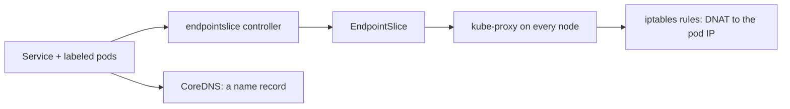

# Service and networking: expert

🌐 [Русский](expert.ru.md) · **English**

**Levels:** [overview](overview.en.md) · [1. Basics](basics.en.md) · [2. Advanced](advanced.en.md) · **3. Expert** · [4. Quiz](quiz.en.md)

## Under the hood

### How a Service becomes rules



1. You create a Service. The API server allocates a ClusterIP from the `--service-cluster-ip-range` range (`10.96.0.0/16` in our kind).
2. The EndpointSlice controller finds pods by `selector` and writes the addresses of **ready** pods into an `EndpointSlice` object (the label `kubernetes.io/service-name`).
3. `kube-proxy` on every node watches Services and EndpointSlices and updates the rules: the chain `KUBE-SERVICES` → `KUBE-SVC-…` (random choice) → `KUBE-SEP-…` (DNAT to the pod IP) ([advanced](advanced.en.md#how-kube-proxy-balances-traffic)).
4. CoreDNS watches Services through the API and answers DNS queries.

Traffic does not pass through kube-proxy as through a proxy: it only configures the kernel, and netfilter rewrites the packets. That is why a ClusterIP belongs to no interface and ping does not work.

### DNS from the inside

The CoreDNS configuration lies in the ConfigMap `coredns` (kube-system):

```text
.:53 {
    errors
    health { lameduck 5s }
    ready
    kubernetes cluster.local in-addr.arpa ip6.arpa {
       pods insecure
       fallthrough in-addr.arpa ip6.arpa
       ttl 30
    }
    prometheus :9153
    forward . /etc/resolv.conf { max_concurrent 1000 }
    …
}
```

The `kubernetes` plugin serves the `cluster.local` zone and answers Service names itself; everything else the `forward` plugin sends to the node's external DNS. The record TTL is 30 seconds.

In a pod the resolver is configured like this:

```text
search learn-06.svc.cluster.local svc.cluster.local cluster.local
nameserver 10.96.0.10
options ndots:5
```

`ndots:5` means: a name with fewer than five dots is first tried with the suffixes from `search` and only then queried as is. That is why `web` becomes `web.learn-06.svc.cluster.local`. An external name (for example, `api.example.com` — two dots) first causes extra queries with suffixes; to avoid this, add a trailing dot (`api.example.com.`).

The DNS records of a Service other than A:

```text
$ kubectl -n learn-06 exec client2 -- nslookup -type=SRV _http._tcp.web.learn-06.svc.cluster.local
_http._tcp.web.learn-06.svc.cluster.local	service = 0 100 80 web.learn-06.svc.cluster.local
```

An SRV record is returned for a named port (`http`, protocol `tcp`): the answer has the priority, weight, port and name.

## Reference

### Service `spec` fields

The list from `kubectl explain service.spec`:

| Field | Meaning | Default (verified) |
|---|---|---|
| `type` | `ClusterIP`, `NodePort`, `LoadBalancer`, `ExternalName` | `ClusterIP` |
| `selector` | pod labels | — |
| `ports` (`name`, `port`, `targetPort`, `nodePort`, `protocol`) | ports | protocol TCP |
| `clusterIP`, `clusterIPs` | the address; `None` — headless | allocated from the range |
| `ipFamilies`, `ipFamilyPolicy` | address families | `["IPv4"]`, `SingleStack` |
| `internalTrafficPolicy` | `Cluster` or `Local` for traffic from inside | `Cluster` |
| `externalTrafficPolicy` | `Cluster` or `Local` for external traffic | `Cluster` |
| `sessionAffinity`, `sessionAffinityConfig` | pinning a client to a pod | `None` |
| `externalName` | the target for `ExternalName` | — |
| `externalIPs` | additional external addresses | — |
| `loadBalancerClass`, `loadBalancerIP`, `loadBalancerSourceRanges`, `allocateLoadBalancerNodePorts`, `healthCheckNodePort` | LoadBalancer settings | — |
| `publishNotReadyAddresses` | publish the addresses of not-ready pods | `false` |
| `trafficDistribution` | a locality hint when choosing a pod | — |

The defaults marked "verified" were obtained with `kubectl get svc … -o jsonpath` on our setup. The fields `externalIPs`, `loadBalancer*`, `trafficDistribution`, `healthCheckNodePort`, `publishNotReadyAddresses` are taken from the `explain` output; their behavior was not run here.

> ⚠️ Verify: the behavior of `externalTrafficPolicy: Local`, `internalTrafficPolicy: Local`, `sessionAffinity: ClientIP`, `trafficDistribution` and `publishNotReadyAddresses` was not reproduced in this material; check against the [Service documentation](https://kubernetes.io/docs/concepts/services-networking/service/).

### Address types and ports

| What | Value |
|---|---|
| ClusterIP range | `10.96.0.0/16` in kind (`--service-cluster-ip-range`) |
| NodePort range | 30000–32767 (verified: port 20000 was rejected) |
| The CoreDNS address | `10.96.0.10` (`nameserver` in a pod) |
| DNS name format | `<service>.<namespace>.svc.cluster.local` |
| SRV format | `_<port>._<protocol>.<service>.<namespace>.svc.cluster.local` |

## Gotchas

### Gotcha: the short name works only in its own namespace

```text
$ kubectl -n learn-06b exec other -- wget -qO- -T 3 http://web
wget: bad address 'web'
$ kubectl -n learn-06b exec other -- wget -qO- -T 3 http://web.learn-06
hello from web-8678fd4948-h9lds
$ kubectl -n learn-06b exec other -- cat /etc/resolv.conf | head -1
search learn-06b.svc.cluster.local svc.cluster.local cluster.local
```

`search` gets the pod's own namespace (`learn-06b`), while the Service `web` lives in `learn-06`. From another namespace write `web.learn-06`.

### Gotcha: ping to a ClusterIP does not work

```text
$ kubectl -n learn-06 exec client2 -- ping -c 1 -W 2 10.96.37.242
1 packets transmitted, 0 packets received, 100% packet loss
```

A ClusterIP is virtual: the DNAT rules are designed for TCP/UDP ports and do not handle ICMP. Check a port (`wget`, `nc`), not ping.

### Gotcha: two different failures give one error

A typo in `selector` (empty endpoints) and a wrong `targetPort` (endpoints exist, the port is foreign) both give `Connection refused`. `kubectl get endpointslices` tells them apart: `<nil>` in the first case, an address with port `8081` in the second.

### Gotcha: a not-ready pod gets no traffic

A pod with a failing readiness probe `0/1 Running` does not get into the endpoints although the container is running. This is protection, not a Service failure; look for the cause in the probe.

### Gotcha: a LoadBalancer without a cloud hangs in `<pending>`

In kind `EXTERNAL-IP` stays `<pending>` forever: there is no controller to allocate an address. The NodePort is nevertheless allocated (`80:31708/TCP`) and works.

### Gotcha: Endpoints is deprecated

`kubectl get endpoints` on our cluster prints `Warning: v1 Endpoints is deprecated in v1.33+; use discovery.k8s.io/v1 EndpointSlice`. Scripts and monitoring are better moved to `EndpointSlice`.

### Gotcha: Service environment variables depend on creation order

`WEB_SERVICE_HOST` and the like appear in a pod only if the Service existed when the pod was created. A pod started earlier does not get them; DNS does not depend on order.

## Trade-offs and alternatives

| Approach | Pros | Cons |
|---|---|---|
| ClusterIP + DNS | simple, stable | only inside the cluster |
| NodePort | access without a cloud | non-standard ports, a node address is needed |
| LoadBalancer | an external address out of the box in a cloud | a separate balancer per service (money) |
| Ingress, Gateway API | routing by host and path, TLS, one entry point (module 09) | a separate controller |
| Headless | the client sees all pods | no kube-proxy balancing |
| A service mesh (Istio, Linkerd) | mTLS, retries, metrics | complexity and resources |
| kube-proxy modes: `iptables` (in our kind), `ipvs`, `nftables` | a choice by scale and kernel capabilities | modes other than `iptables` were not run here |

## Interview questions

**1. Why is a Service needed if pods have IPs?**

<details><summary>Answer</summary>

A pod's IP changes on every replacement. A Service gives a stable virtual address and DNS name and distributes traffic among ready pods. In the experiment after deleting the pods the ClusterIP stayed `10.96.37.242` while the endpoints changed.

</details>

**2. How does a Service select pods?**

<details><summary>Answer</summary>

By `selector` (pod labels). The EndpointSlice controller writes the addresses of ready pods; kube-proxy builds rules from them.

</details>

**3. (Trick) Why does ping to a ClusterIP get no reply?**

<details><summary>Answer</summary>

A ClusterIP is a virtual address without an interface; the iptables rules (DNAT) work on the level of TCP/UDP ports. In the experiment `100% packet loss`.

</details>

**4. How do `port`, `targetPort` and `nodePort` differ?**

<details><summary>Answer</summary>

`port` is the Service port (ClusterIP), `targetPort` the container port (a number or a port name), `nodePort` the port on every node for NodePort/LoadBalancer (30000–32767).

</details>

**5. How does balancing work and why is it not round-robin?**

<details><summary>Answer</summary>

kube-proxy in iptables mode creates a chain with `statistic --mode random` rules with probabilities 1/3, 1/2 and 1 for the last: each pod gets an equal share on average, but a concrete sequence is random (3, 2 and 5 requests out of ten in the experiment).

</details>

**6. (Trick) `Connection refused` when calling a Service. What to check?**

<details><summary>Answer</summary>

`kubectl get endpointslices`/`endpoints`: empty — a typo in `selector` or pods not ready; an address with a foreign port — a wrong `targetPort`. Both failures give one error.

</details>

**7. How do you reach a Service from another namespace?**

<details><summary>Answer</summary>

`service.namespace` (`web.learn-06`) or the full `web.learn-06.svc.cluster.local`. The short name gets the pod's own namespace in `search` (in the experiment `bad address 'web'`).

</details>

**8. What is a headless Service?**

<details><summary>Answer</summary>

A Service with `clusterIP: None`. DNS returns the addresses of all pods (three A records in the experiment), kube-proxy does not balance. It is used for databases and StatefulSets.

</details>

**9. What does ExternalName do?**

<details><summary>Answer</summary>

It returns a CNAME to an external name (`example.com`), with no proxy and no ClusterIP. It is for giving an external service an internal name.

</details>

**10. (Trick) Why does `LoadBalancer` in kind stay `<pending>`?**

<details><summary>Answer</summary>

The external address is issued by a cloud controller, and kind has none. The NodePort is nevertheless allocated (`80:31708/TCP`) and works. For experiments MetalLB or cloud-provider-kind are used.

</details>

**11. What is `ndots:5` and what does it risk?**

<details><summary>Answer</summary>

Names with fewer than five dots are first tried with the `search` suffixes and only then queried as is. For external names these are extra DNS queries; a trailing dot in the name helps (`api.example.com.`).

</details>

**12. What records does CoreDNS create for a named port?**

<details><summary>Answer</summary>

Besides A/AAAA, an SRV record `_http._tcp.web.learn-06.svc.cluster.local` with priority, weight, port and name (in the experiment `0 100 80 web.learn-06.svc.cluster.local`).

</details>

## Cheat sheet

```bash
kubectl expose deploy web --port=80 --target-port=http          # create a Service
kubectl get svc -o wide
kubectl get endpointslices -l kubernetes.io/service-name=web
kubectl get endpoints web                                       # deprecated but illustrative
kubectl exec client -- wget -qO- http://web.learn-06
kubectl exec client -- nslookup web.learn-06.svc.cluster.local
kubectl port-forward svc/web 18080:80
kubectl get pods --show-labels                                  # compare the selector
```

## Related materials

- Previous levels: [basics](basics.en.md), [advanced](advanced.en.md)
- Previous modules: [05 · Deployment and ReplicaSet](../05-deployments/overview.en.md), [04 · Pod](../04-pods/overview.en.md), [02 · Architecture](../02-architecture/overview.en.md)
- Foundation: the [Linux track](../../../linux/overview.en.md)

## Sources

- [Service](https://kubernetes.io/docs/concepts/services-networking/service/)
- [Service API reference](https://kubernetes.io/docs/reference/kubernetes-api/service-resources/service-v1/)
- [EndpointSlices](https://kubernetes.io/docs/concepts/services-networking/endpoint-slices/)
- [DNS for Services and Pods](https://kubernetes.io/docs/concepts/services-networking/dns-pod-service/)
- [Virtual IPs and Service Proxies](https://kubernetes.io/docs/reference/networking/virtual-ips/)
- [Customizing DNS Service (CoreDNS)](https://kubernetes.io/docs/tasks/administer-cluster/dns-custom-nameservers/)
- [Debug Services](https://kubernetes.io/docs/tasks/debug/debug-application/debug-service/)
