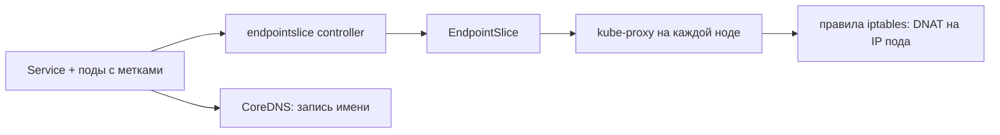

# Service и сеть: экспертная теория

🌐 **Русский** · [English](expert.en.md)

**Уровни:** [обзор](overview.ru.md) · [1. Базовая](basics.ru.md) · [2. Продвинутая](advanced.ru.md) · **3. Экспертная** · [4. Квиз](quiz.ru.md)

## Под капотом

### Как Service становится правилами



1. Вы создаёте Service. API server выделяет ему ClusterIP из диапазона `--service-cluster-ip-range` (`10.96.0.0/16` в нашем kind).
2. Контроллер EndpointSlice находит поды по `selector` и записывает адреса **готовых** подов в объект `EndpointSlice` (метка `kubernetes.io/service-name`).
3. `kube-proxy` на каждой ноде следит за Service и EndpointSlice и обновляет правила: цепочка `KUBE-SERVICES` → `KUBE-SVC-…` (случайный выбор) → `KUBE-SEP-…` (DNAT на IP пода) ([продвинутая теория](advanced.ru.md#как-kube-proxy-балансирует-трафик)).
4. CoreDNS наблюдает за Service через API и отвечает на DNS-запросы.

Трафик не проходит через kube-proxy как через прокси: он лишь настраивает ядро, а пакеты переписывает netfilter. Поэтому ClusterIP не принадлежит ни одному интерфейсу, а ping не работает.

### DNS изнутри

Конфигурация CoreDNS лежит в ConfigMap `coredns` (kube-system):

```text
.:53 {
    errors
    health { lameduck 5s }
    ready
    kubernetes cluster.local in-addr.arpa ip6.arpa {
       pods insecure
       fallthrough in-addr.arpa ip6.arpa
       ttl 30
    }
    prometheus :9153
    forward . /etc/resolv.conf { max_concurrent 1000 }
    …
}
```

Плагин `kubernetes` обслуживает зону `cluster.local` и сам отвечает на имена Service; всё остальное плагин `forward` отправляет на внешние DNS ноды. TTL записей — 30 секунд.

В поде резолвер настроен так:

```text
search learn-06.svc.cluster.local svc.cluster.local cluster.local
nameserver 10.96.0.10
options ndots:5
```

`ndots:5` означает: имя с менее чем пятью точками сначала перебирается с суффиксами из `search`, и только потом запрашивается как есть. Поэтому `web` превращается в `web.learn-06.svc.cluster.local`. У внешнего имени (например, `api.example.com` — две точки) сперва уйдут лишние запросы с суффиксами; чтобы этого избежать, добавляют точку в конце (`api.example.com.`).

DNS-записи Service, кроме A:

```text
$ kubectl -n learn-06 exec client2 -- nslookup -type=SRV _http._tcp.web.learn-06.svc.cluster.local
_http._tcp.web.learn-06.svc.cluster.local	service = 0 100 80 web.learn-06.svc.cluster.local
```

SRV-запись возвращается для именованного порта (`http`, протокол `tcp`): в ответе приоритет, вес, порт и имя.

## Справочник

### Поля `spec` у Service

Список из `kubectl explain service.spec`:

| Поле | Смысл | По умолчанию (проверено) |
|---|---|---|
| `type` | `ClusterIP`, `NodePort`, `LoadBalancer`, `ExternalName` | `ClusterIP` |
| `selector` | метки подов | — |
| `ports` (`name`, `port`, `targetPort`, `nodePort`, `protocol`) | порты | протокол TCP |
| `clusterIP`, `clusterIPs` | адрес; `None` — headless | выделяется из диапазона |
| `ipFamilies`, `ipFamilyPolicy` | семейства адресов | `["IPv4"]`, `SingleStack` |
| `internalTrafficPolicy` | `Cluster` или `Local` для трафика изнутри | `Cluster` |
| `externalTrafficPolicy` | `Cluster` или `Local` для внешнего трафика | `Cluster` |
| `sessionAffinity`, `sessionAffinityConfig` | привязка клиента к поду | `None` |
| `externalName` | цель для `ExternalName` | — |
| `externalIPs` | дополнительные внешние адреса | — |
| `loadBalancerClass`, `loadBalancerIP`, `loadBalancerSourceRanges`, `allocateLoadBalancerNodePorts`, `healthCheckNodePort` | настройки LoadBalancer | — |
| `publishNotReadyAddresses` | публиковать адреса неготовых подов | `false` |
| `trafficDistribution` | подсказка по близости при выборе пода | — |

Значения по умолчанию, помеченные «проверено», получены `kubectl get svc … -o jsonpath` на нашем стенде. Поля `externalIPs`, `loadBalancer*`, `trafficDistribution`, `healthCheckNodePort`, `publishNotReadyAddresses` взяты из вывода `explain`; их поведение здесь не запускалось.

> ⚠️ Проверить: поведение `externalTrafficPolicy: Local`, `internalTrafficPolicy: Local`, `sessionAffinity: ClientIP`, `trafficDistribution` и `publishNotReadyAddresses` не воспроизводилось в этом материале; сверяйте с [документацией Service](https://kubernetes.io/docs/concepts/services-networking/service/).

### Типы адресов и порты

| Что | Значение |
|---|---|
| Диапазон ClusterIP | `10.96.0.0/16` в kind (`--service-cluster-ip-range`) |
| Диапазон NodePort | 30000–32767 (проверено: порт 20000 отклонён) |
| Адрес CoreDNS | `10.96.0.10` (`nameserver` в поде) |
| Формат DNS-имени | `<service>.<namespace>.svc.cluster.local` |
| Формат SRV | `_<порт>._<протокол>.<service>.<namespace>.svc.cluster.local` |

## Подвохи

### Подвох: короткое имя работает только в своём namespace

```text
$ kubectl -n learn-06b exec other -- wget -qO- -T 3 http://web
wget: bad address 'web'
$ kubectl -n learn-06b exec other -- wget -qO- -T 3 http://web.learn-06
hello from web-8678fd4948-h9lds
$ kubectl -n learn-06b exec other -- cat /etc/resolv.conf | head -1
search learn-06b.svc.cluster.local svc.cluster.local cluster.local
```

В `search` подставляется namespace самого пода (`learn-06b`), а Service `web` живёт в `learn-06`. Из другого namespace пишите `web.learn-06`.

### Подвох: ping на ClusterIP не работает

```text
$ kubectl -n learn-06 exec client2 -- ping -c 1 -W 2 10.96.37.242
1 packets transmitted, 0 packets received, 100% packet loss
```

ClusterIP виртуальный: правила DNAT рассчитаны на TCP/UDP-порты, ICMP они не обрабатывают. Проверяйте порт (`wget`, `nc`), а не ping.

### Подвох: две разные поломки дают одну ошибку

Опечатка в `selector` (endpoints пусты) и неверный `targetPort` (endpoints есть, порт чужой) оба дают `Connection refused`. Различает их `kubectl get endpointslices`: в первом случае `<nil>`, во втором адрес с портом `8081`.

### Подвох: неготовый под не получает трафик

Под с проваленной readiness probe `0/1 Running` не попадает в endpoints, хотя контейнер запущен. Это защита, а не сбой Service; ищите причину в probe.

### Подвох: LoadBalancer без облака висит в `<pending>`

В kind `EXTERNAL-IP` остаётся `<pending>` бесконечно: нет контроллера, который выделит адрес. NodePort при этом выделен (`80:31708/TCP`) и работает.

### Подвох: Endpoints устарел

`kubectl get endpoints` в нашем кластере выводит `Warning: v1 Endpoints is deprecated in v1.33+; use discovery.k8s.io/v1 EndpointSlice`. Скрипты и мониторинг лучше переводить на `EndpointSlice`.

### Подвох: переменные окружения Service зависят от порядка создания

`WEB_SERVICE_HOST` и подобные появляются в поде, только если Service существовал в момент его создания. Под, запущенный раньше, их не получит; DNS от порядка не зависит.

## Компромиссы и альтернативы

| Подход | Плюсы | Минусы |
|---|---|---|
| ClusterIP + DNS | просто, стабильно | только внутри кластера |
| NodePort | доступ без облака | нестандартные порты, нужен адрес ноды |
| LoadBalancer | внешний адрес из коробки в облаке | на каждый сервис свой балансировщик (деньги) |
| Ingress, Gateway API | маршрутизация по хосту и пути, TLS, один вход (модуль 09) | отдельный контроллер |
| Headless | клиент видит все поды | нет балансировки kube-proxy |
| Service mesh (Istio, Linkerd) | mTLS, ретраи, метрики | сложность и ресурсы |
| Режимы kube-proxy: `iptables` (в нашем kind), `ipvs`, `nftables` | выбор по масштабу и возможностям ядра | режимы, кроме `iptables`, здесь не запускались |

## Вопросы с собеседований

**1. Зачем нужен Service, если у подов есть IP?**

<details><summary>Ответ</summary>

IP пода меняется при каждой замене. Service даёт стабильный виртуальный адрес и DNS-имя и распределяет трафик по готовым подам. В опыте после удаления подов ClusterIP остался `10.96.37.242`, а endpoints сменились.

</details>

**2. Как Service выбирает поды?**

<details><summary>Ответ</summary>

По `selector` (метки подов). Контроллер EndpointSlice записывает адреса готовых подов; kube-proxy строит по ним правила.

</details>

**3. (С подвохом) Почему ping на ClusterIP не отвечает?**

<details><summary>Ответ</summary>

ClusterIP — виртуальный адрес без интерфейса; правила iptables (DNAT) работают на уровне портов TCP/UDP. В опыте `100% packet loss`.

</details>

**4. Чем отличаются `port`, `targetPort` и `nodePort`?**

<details><summary>Ответ</summary>

`port` — порт Service (ClusterIP), `targetPort` — порт контейнера (число или имя порта), `nodePort` — порт на каждой ноде у типа NodePort/LoadBalancer (30000–32767).

</details>

**5. Как работает балансировка и почему не по кругу?**

<details><summary>Ответ</summary>

kube-proxy в режиме iptables создаёт цепочку с правилами `statistic --mode random` с вероятностями 1/3, 1/2 и 1 для последнего: каждый под получает равную долю в среднем, но конкретная последовательность случайна (в опыте 3, 2 и 5 запросов из десяти).

</details>

**6. (С подвохом) `Connection refused` при обращении к Service. Что проверить?**

<details><summary>Ответ</summary>

`kubectl get endpointslices`/`endpoints`: пусто — опечатка в `selector` или поды не готовы; адрес с чужим портом — неверный `targetPort`. Обе поломки дают одну ошибку.

</details>

**7. Как обратиться к Service из другого namespace?**

<details><summary>Ответ</summary>

`сервис.namespace` (`web.learn-06`) или полное `web.learn-06.svc.cluster.local`. Короткое имя в `search` подставляет namespace самого пода (в опыте `bad address 'web'`).

</details>

**8. Что такое headless Service?**

<details><summary>Ответ</summary>

Service с `clusterIP: None`. DNS возвращает адреса всех подов (в опыте три A-записи), kube-proxy не балансирует. Применяют для баз данных и StatefulSet.

</details>

**9. Что делает ExternalName?**

<details><summary>Ответ</summary>

Возвращает CNAME на внешнее имя (`example.com`), без прокси и ClusterIP. Нужен, чтобы дать внешнему сервису внутреннее имя.

</details>

**10. (С подвохом) Почему `LoadBalancer` в kind остаётся в `<pending>`?**

<details><summary>Ответ</summary>

Внешний адрес выдаёт облачный контроллер, а в kind его нет. NodePort при этом выделен (`80:31708/TCP`) и работает. Для опытов используют MetalLB или cloud-provider-kind.

</details>

**11. Что такое `ndots:5` и чем это грозит?**

<details><summary>Ответ</summary>

Имена с менее чем пятью точками сначала перебираются с суффиксами `search` и лишь потом запрашиваются как есть. Для внешних имён это лишние DNS-запросы; помогает точка в конце имени (`api.example.com.`).

</details>

**12. Какие записи создаёт CoreDNS для именованного порта?**

<details><summary>Ответ</summary>

Кроме A/AAAA, SRV-запись `_http._tcp.web.learn-06.svc.cluster.local` с приоритетом, весом, портом и именем (в опыте `0 100 80 web.learn-06.svc.cluster.local`).

</details>

## Шпаргалка

```bash
kubectl expose deploy web --port=80 --target-port=http          # создать Service
kubectl get svc -o wide
kubectl get endpointslices -l kubernetes.io/service-name=web
kubectl get endpoints web                                       # устарело, но наглядно
kubectl exec client -- wget -qO- http://web.learn-06
kubectl exec client -- nslookup web.learn-06.svc.cluster.local
kubectl port-forward svc/web 18080:80
kubectl get pods --show-labels                                  # сверить selector
```

## Связанные материалы

- Предыдущие уровни: [базовая](basics.ru.md), [продвинутая](advanced.ru.md)
- Предыдущие модули: [05 · Deployment и ReplicaSet](../05-deployments/overview.ru.md), [04 · Pod](../04-pods/overview.ru.md), [02 · Архитектура](../02-architecture/overview.ru.md)
- Фундамент: [трек Linux](../../../linux/overview.ru.md)

## Источники

- [Service](https://kubernetes.io/docs/concepts/services-networking/service/)
- [Service API reference](https://kubernetes.io/docs/reference/kubernetes-api/service-resources/service-v1/)
- [EndpointSlices](https://kubernetes.io/docs/concepts/services-networking/endpoint-slices/)
- [DNS for Services and Pods](https://kubernetes.io/docs/concepts/services-networking/dns-pod-service/)
- [Virtual IPs and Service Proxies](https://kubernetes.io/docs/reference/networking/virtual-ips/)
- [Customizing DNS Service (CoreDNS)](https://kubernetes.io/docs/tasks/administer-cluster/dns-custom-nameservers/)
- [Debug Services](https://kubernetes.io/docs/tasks/debug/debug-application/debug-service/)
