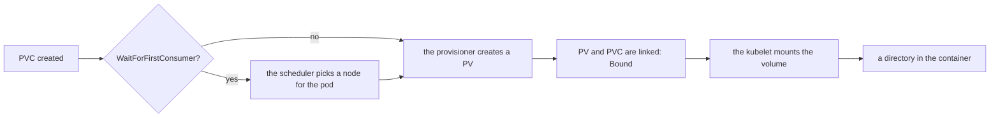

# Storage: expert

🌐 [Русский](expert.ru.md) · **English**

**Levels:** [overview](overview.en.md) · [1. Basics](basics.en.md) · [2. Advanced](advanced.en.md) · **3. Expert** · [4. Quiz](quiz.en.md)

## Under the hood

### The path from a PVC to a file in the container



1. A user creates a PVC. If the class has `WaitForFirstConsumer`, the controller emits the event `waiting for first consumer to be created before binding` and waits.
2. When a pod with the PVC appears, the scheduler picks a node with the storage in mind.
3. The **provisioner** (an external component, in kind — `local-path-provisioner`) creates a directory on the node and a PV object with `nodeAffinity`. The events show: `Provisioning`, `ExternalProvisioning`.
4. The PV controller links the PV and PVC (`claimRef` in the PV, `volumeName` in the PVC) — the status is `Bound`.
5. The kubelet on the node mounts the volume and hands the directory to the container.

The provisioner in kind keeps data on the node in a directory from the ConfigMap `local-path-config`:

```json
{"nodePathMap":[{"node":"DEFAULT_PATH_FOR_NON_LISTED_NODES","paths":["/var/local-path-provisioner"]}]}
```

The default class is marked with the annotation `storageclass.kubernetes.io/is-default-class: "true"` (verified on `standard`).

### CSI

Modern storage drivers plug in through **CSI (Container Storage Interface)**: a standard interface between Kubernetes and storage systems. A driver consists of a controller part (creating and deleting volumes, snapshots, expansion) and a node part (mounting). The cluster has the objects `CSIDriver`, `CSINode`, `CSIStorageCapacity`, `VolumeAttachment`, `StorageClass`, `VolumeAttributesClass` (the `storage.k8s.io` group, from `kubectl api-resources`). Our kind has no CSI drivers (`kubectl get csidrivers` — `No resources found`, the node shows `DRIVERS 0`): it uses its own provisioner `rancher.io/local-path`.

The pod's `spec.volumes` fields include, besides the ones covered, `csi`, `nfs`, `image` (a volume from an image), `ephemeral` (a temporary PVC for the pod's lifetime), `projected`, `downwardAPI` and many deprecated in-tree types (`awsElasticBlockStore`, `gcePersistentDisk`, `azureDisk` and others); for new projects use CSI.

> ⚠️ Verify: the `image`, `ephemeral` and `projected` volumes were not run in this material; describing the in-tree types as "deprecated" is given from documentation.

### The PV lifecycle

| Phase | Meaning | Verified |
|---|---|---|
| `Available` | the PV is free and not yet bound | yes (after removing `claimRef`) |
| `Bound` | bound to a PVC | yes |
| `Released` | the PVC is deleted, but the PV is not freed for reuse | yes (with `Retain`) |
| `Failed` | automatic reclamation failed | no |

> ⚠️ Verify: the `Failed` phase was not reproduced.

### Binding rules

A PVC picks a PV by: `storageClassName`, access modes, `volumeMode`, capacity (the PV is not less than the request), a selector (`selector`) and `volumeName`. Binding is one to one: a 500 MiB PV goes whole to a 200 MiB PVC.

## Reference

### PVC, PV and StorageClass fields

The lists from `kubectl explain` (kubectl 1.36.1, cluster 1.37.0):

| Object | `spec` fields |
|---|---|
| PVC | `accessModes`, `dataSource`, `dataSourceRef`, `resources`, `selector`, `storageClassName`, `volumeAttributesClassName`, `volumeMode`, `volumeName` |
| PV | `accessModes`, `capacity`, `claimRef`, `csi`, `hostPath`, `local`, `nfs`, `nodeAffinity`, `persistentVolumeReclaimPolicy`, `storageClassName`, `mountOptions`, `volumeAttributesClassName`, `volumeMode` and deprecated source types |
| StorageClass | `provisioner`, `parameters`, `reclaimPolicy`, `volumeBindingMode`, `allowVolumeExpansion`, `allowedTopologies`, `mountOptions` |

### Defaults (verified in kind)

| Parameter | Value |
|---|---|
| The default StorageClass | `standard` (`rancher.io/local-path`) |
| `reclaimPolicy` of a dynamic PV | `Delete` |
| `volumeBindingMode` of `standard` | `WaitForFirstConsumer` |
| `allowVolumeExpansion` of `standard` | `false` |
| PV `volumeMode` | `Filesystem` |
| PVC protection | the finalizer `kubernetes.io/pvc-protection` |

### Access modes

| Mode | Verified |
|---|---|
| `ReadWriteOnce` | yes: used in the examples |
| `ReadWriteOncePod` | yes: the second pod got `FailedScheduling` (`already in-use by another pod`) |
| `ReadOnlyMany`, `ReadWriteMany` | no: a driver with support is needed (NFS, cloud file systems) |

## Gotchas

### Gotcha: a PVC in `Pending` is normal

Without a pod a `standard` PVC stays `Pending` with the event `waiting for first consumer to be created before binding`. There is no error. What should alarm you is `Pending` when a pod exists: then look for `ProvisioningFailed` in the events.

### Gotcha: deleting a PVC wipes the data

With `reclaimPolicy: Delete` deleting a PVC deletes the PV and the data directory (in the experiment `/var/local-path-provisioner/` became empty). A PVC under the finalizer is deleted only after the pod is deleted, but that does not save the data.

### Gotcha: a Released PV does not accept a new PVC

Under `Retain` after the PVC is deleted the PV stays `Released` with the former `claimRef`; a new PVC will not bind to it until the reference is removed. After removing it the PV is `Available`, but the old data stays.

### Gotcha: a PVC gets more than it asked for

A 200 MiB PVC bound to a 500 MiB static PV and got `500Mi` in `CAPACITY`.

### Gotcha: `Immediate` with a provisioner bound to a node

```text
ProvisioningFailed  failed to provision volume with StorageClass "imm-sc": configuration error, no node was specified
```

`local-path` must know the node in advance; use `WaitForFirstConsumer`.

### Gotcha: expanding a volume without the class's permission

`Forbidden: … only dynamically provisioned pvc can be resized and the storageclass that provisions the pvc must support resize`.

### Gotcha: `standard` in kind has no block volumes

`ProvisioningFailed  rancher.io/local-path does not support block volume provisioning`.

### Gotcha: `ReadWriteOnce` is about the node, not the pod

RWO allows several pods on one node. If you need exactly one pod, use `ReadWriteOncePod`.

### Gotcha: hostPath reads node files

A pod with `hostPath: /etc/kubernetes` saw `admin.conf`. Access to `hostPath` is equivalent to access to the node.

## Snapshots and backups

Volume snapshots (`VolumeSnapshot`) and cloning (`dataSource`) are implemented by CSI drivers and external snapshotter CRDs. Our kind has no snapshot CRDs (`kubectl api-resources` does not show `volumesnapshots`), so they were not run in this material.

> ⚠️ Verify: `VolumeSnapshot`, `VolumeSnapshotClass`, cloning through `dataSource` and the need to install the snapshotter CRDs separately were not verified by running; check against the [documentation](https://kubernetes.io/docs/concepts/storage/volume-snapshots/).

Data backup is usually done by separate means: a CronJob with a database dump (the `cronjob-backup` recipe), Velero and cloud disk snapshots.

## Trade-offs and alternatives

| Approach | Pros | Cons |
|---|---|---|
| PVC + dynamic provisioning | simple for the application, portable | behavior depends on the StorageClass and driver |
| Static PVs | full control, existing disks | manual work for the administrator |
| `emptyDir` | fast, no setup | data is lost with the pod |
| `hostPath` / `local` | fast local disks | binding to a node, a security risk (hostPath) |
| Network file systems (NFS, cloud) | RWX, shared access | latency, dependence on the network |
| Managed databases | remove the state problem | price and cloud lock-in |
| StatefulSet + `volumeClaimTemplates` | a PVC per replica | module 12 |

## Interview questions

**1. How does a PV differ from a PVC?**

<details><summary>Answer</summary>

A PV is the storage itself, a cluster-level resource. A PVC is an application's request for storage in a namespace. The cluster links them by class, access modes and capacity (`Bound`).

</details>

**2. (Trick) A PVC is `Pending` and there are no errors. What is it?**

<details><summary>Answer</summary>

Most likely a class with `volumeBindingMode: WaitForFirstConsumer`: the volume is not created until there is a pod (the event `waiting for first consumer to be created before binding`). After a pod is created the PVC becomes `Bound`.

</details>

**3. What is a StorageClass and dynamic provisioning?**

<details><summary>Answer</summary>

A StorageClass describes the provisioner and storage parameters. When a PVC with a class is created, the provisioner creates a PV automatically. Without a class an administrator creates the PV by hand (static provisioning).

</details>

**4. What happens to the data if you delete a PVC?**

<details><summary>Answer</summary>

It depends on `reclaimPolicy`. `Delete` (the default for dynamic ones) deletes the PV and data (in the experiment the node directory vanished). `Retain` leaves the PV in `Released` together with the data.

</details>

**5. (Trick) Can you delete a PVC while a pod uses it?**

<details><summary>Answer</summary>

No: the finalizer `kubernetes.io/pvc-protection` keeps the PVC in `Terminating` until the pod is deleted. After that the PVC is deleted, and the data per `reclaimPolicy`.

</details>

**6. What does `Released` mean and how do you return a PV to service?**

<details><summary>Answer</summary>

The PVC is deleted, the PV is kept (`Retain`), but it still holds the `claimRef` reference. For the PV to be bound again, the reference is removed (`patch … remove /spec/claimRef`) and the PV becomes `Available`. The data is not cleaned.

</details>

**7. How does RWO differ from RWOP?**

<details><summary>Answer</summary>

`ReadWriteOnce` — writing from one node (several pods on it may use the volume). `ReadWriteOncePod` — only one pod; a second pod gets `FailedScheduling` (it stayed `Pending` in the experiment).

</details>

**8. Why may expanding a PVC be rejected?**

<details><summary>Answer</summary>

The class must have `allowVolumeExpansion: true`, the volume must be dynamically provisioned and the driver must support expansion. `standard` in kind has `false`: `Forbidden: … storageclass … must support resize`. Shrinking a PVC is unavailable.

</details>

**9. What is CSI?**

<details><summary>Answer</summary>

Container Storage Interface — a standard interface between Kubernetes and storage systems. A driver has a controller part (creation, snapshots, expansion) and a node part (mounting). In-tree volume types are being replaced by CSI.

</details>

**10. Why is `hostPath` dangerous?**

<details><summary>Answer</summary>

It gives a pod access to the node's files (in the experiment a pod read the `/etc/kubernetes` directory with `admin.conf`) and binds the pod to the node. It is restricted by security policies.

</details>

**11. (Trick) A 200 MiB PVC bound to a 500 MiB PV. What about the remainder?**

<details><summary>Answer</summary>

Binding is whole: the PVC gets the entire PV (`500Mi` in `CAPACITY`), the remainder is not given to other PVCs.

</details>

**12. How do you run a stateful application in several replicas?**

<details><summary>Answer</summary>

A StatefulSet with `volumeClaimTemplates`: each replica has its own PVC and a stable name. A Deployment with one PVC (RWO) does not fit writing from replicas on different nodes.

</details>

## Cheat sheet

```bash
kubectl get pvc,pv                                         # the bindings
kubectl get sc                                             # classes; (default) — the default one
kubectl describe pvc NAME                                  # events: WaitForFirstConsumer, ProvisioningFailed
kubectl get pv -o custom-columns=NAME:.metadata.name,CAP:.spec.capacity.storage,RECLAIM:.spec.persistentVolumeReclaimPolicy,STATUS:.status.phase,CLAIM:.spec.claimRef.name
kubectl patch pv NAME -p '{"spec":{"persistentVolumeReclaimPolicy":"Retain"}}'
kubectl patch pv NAME --type=json -p '[{"op":"remove","path":"/spec/claimRef"}]'   # free a Released one
kubectl patch pvc NAME -p '{"spec":{"resources":{"requests":{"storage":"2Gi"}}}}'   # expansion (needs allowVolumeExpansion)
```

## Related materials

- Previous levels: [basics](basics.en.md), [advanced](advanced.en.md)
- Previous modules: [07 · ConfigMap and Secret](../07-config-and-secrets/overview.en.md), [04 · Pod](../04-pods/overview.en.md), [02 · Architecture](../02-architecture/overview.en.md)
- Foundation: the [Linux track](../../../linux/overview.en.md)

## Sources

- [Persistent Volumes](https://kubernetes.io/docs/concepts/storage/persistent-volumes/)
- [Storage Classes](https://kubernetes.io/docs/concepts/storage/storage-classes/)
- [Volume Snapshots](https://kubernetes.io/docs/concepts/storage/volume-snapshots/)
- [Container Storage Interface (CSI)](https://kubernetes-csi.github.io/docs/)
- [Volumes](https://kubernetes.io/docs/concepts/storage/volumes/)
- [Storage Capacity](https://kubernetes.io/docs/concepts/storage/storage-capacity/)
