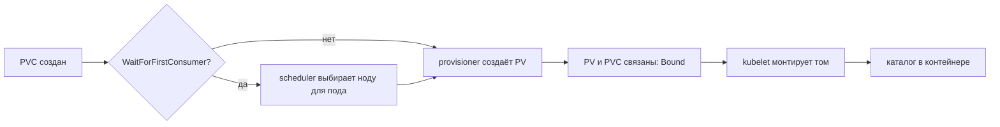

# Хранилище: экспертная теория

🌐 **Русский** · [English](expert.en.md)

**Уровни:** [обзор](overview.ru.md) · [1. Базовая](basics.ru.md) · [2. Продвинутая](advanced.ru.md) · **3. Экспертная** · [4. Квиз](quiz.ru.md)

## Под капотом

### Путь от PVC до файла в контейнере



1. Пользователь создаёт PVC. Если у класса `WaitForFirstConsumer`, контроллер выставляет событие `waiting for first consumer to be created before binding` и ждёт.
2. Когда появляется под с PVC, планировщик выбирает ноду с учётом хранилища.
3. **Provisioner** (внешний компонент, в kind — `local-path-provisioner`) создаёт каталог на ноде и объект PV с `nodeAffinity`. В событиях видно: `Provisioning`, `ExternalProvisioning`.
4. Контроллер PV связывает PV и PVC (`claimRef` в PV, `volumeName` в PVC) — статус `Bound`.
5. Kubelet на ноде монтирует том и передаёт каталог контейнеру.

Provisioner в kind хранит данные на ноде в каталоге из ConfigMap `local-path-config`:

```json
{"nodePathMap":[{"node":"DEFAULT_PATH_FOR_NON_LISTED_NODES","paths":["/var/local-path-provisioner"]}]}
```

Класс по умолчанию помечен аннотацией `storageclass.kubernetes.io/is-default-class: "true"` (проверено у `standard`).

### CSI

Современные драйверы хранилищ подключаются через **CSI (Container Storage Interface)**: стандартный интерфейс между Kubernetes и системами хранения. Драйвер состоит из контроллерной части (создание и удаление томов, снимки, расширение) и нодовой (монтирование). В кластере описаны объекты `CSIDriver`, `CSINode`, `CSIStorageCapacity`, `VolumeAttachment`, `StorageClass`, `VolumeAttributesClass` (группа `storage.k8s.io`, из `kubectl api-resources`). В нашем kind драйверов CSI нет (`kubectl get csidrivers` — `No resources found`, у ноды `DRIVERS 0`): он использует собственный provisioner `rancher.io/local-path`.

Поля `spec.volumes` пода включают, помимо рассмотренных, `csi`, `nfs`, `image` (том из образа), `ephemeral` (временный PVC на время жизни пода), `projected`, `downwardAPI` и многие устаревшие встроенные типы (`awsElasticBlockStore`, `gcePersistentDisk`, `azureDisk` и др.); для новых проектов используйте CSI.

> ⚠️ Проверить: том `image`, `ephemeral` и `projected` не запускались в этом материале; описание встроенных типов как «устаревших» дано по документации.

### Жизненный цикл PV

| Фаза | Значение | Проверено |
|---|---|---|
| `Available` | PV свободен и ещё не связан | да (после удаления `claimRef`) |
| `Bound` | связан с PVC | да |
| `Released` | PVC удалён, но PV не освобождён для повторного использования | да (при `Retain`) |
| `Failed` | автоматическое освобождение не удалось | нет |

> ⚠️ Проверить: фаза `Failed` не воспроизводилась.

### Правила привязки

PVC подбирает PV по: `storageClassName`, режимам доступа, `volumeMode`, ёмкости (PV не меньше запроса), селектору (`selector`) и `volumeName`. Привязка один к одному: PV с 500 МиБ целиком достаётся PVC на 200 МиБ.

## Справочник

### Поля PVC, PV и StorageClass

Списки из `kubectl explain` (kubectl 1.36.1, кластер 1.37.0):

| Объект | Поля `spec` |
|---|---|
| PVC | `accessModes`, `dataSource`, `dataSourceRef`, `resources`, `selector`, `storageClassName`, `volumeAttributesClassName`, `volumeMode`, `volumeName` |
| PV | `accessModes`, `capacity`, `claimRef`, `csi`, `hostPath`, `local`, `nfs`, `nodeAffinity`, `persistentVolumeReclaimPolicy`, `storageClassName`, `mountOptions`, `volumeAttributesClassName`, `volumeMode` и устаревшие типы источников |
| StorageClass | `provisioner`, `parameters`, `reclaimPolicy`, `volumeBindingMode`, `allowVolumeExpansion`, `allowedTopologies`, `mountOptions` |

### Значения по умолчанию (проверено в kind)

| Параметр | Значение |
|---|---|
| StorageClass по умолчанию | `standard` (`rancher.io/local-path`) |
| `reclaimPolicy` у динамического PV | `Delete` |
| `volumeBindingMode` у `standard` | `WaitForFirstConsumer` |
| `allowVolumeExpansion` у `standard` | `false` |
| `volumeMode` PV | `Filesystem` |
| Защита PVC | finalizer `kubernetes.io/pvc-protection` |

### Режимы доступа

| Режим | Проверено |
|---|---|
| `ReadWriteOnce` | да: используется в примерах |
| `ReadWriteOncePod` | да: второй под получил `FailedScheduling` (`already in-use by another pod`) |
| `ReadOnlyMany`, `ReadWriteMany` | нет: нужен драйвер с поддержкой (NFS, облачные файловые системы) |

## Подвохи

### Подвох: PVC в `Pending` — это норма

Без пода PVC `standard` остаётся `Pending` с событием `waiting for first consumer to be created before binding`. Ошибки нет. Тревожить должна `Pending` при существующем поде: тогда ищите `ProvisioningFailed` в событиях.

### Подвох: удаление PVC стирает данные

При `reclaimPolicy: Delete` удаление PVC удаляет PV и каталог с данными (в опыте `/var/local-path-provisioner/` опустел). PVC под защитой finalizer удалится только после удаления пода, но данные это не спасает.

### Подвох: Released PV не принимает новый PVC

При `Retain` после удаления PVC PV остаётся `Released` с прежним `claimRef`; новый PVC к нему не привяжется, пока ссылка не удалена. После её удаления PV `Available`, но старые данные остаются.

### Подвох: PVC получает больше, чем просил

PVC на 200 МиБ привязался к статическому PV на 500 МиБ и получил `500Mi` в `CAPACITY`.

### Подвох: `Immediate` у провайдера, привязанного к ноде

```text
ProvisioningFailed  failed to provision volume with StorageClass "imm-sc": configuration error, no node was specified
```

`local-path` должен знать ноду заранее; используйте `WaitForFirstConsumer`.

### Подвох: расширение тома без разрешения класса

`Forbidden: … only dynamically provisioned pvc can be resized and the storageclass that provisions the pvc must support resize`.

### Подвох: у `standard` в kind нет блочных томов

`ProvisioningFailed  rancher.io/local-path does not support block volume provisioning`.

### Подвох: `ReadWriteOnce` — про ноду, а не про под

RWO разрешает несколько подов на одной ноде. Нужно ровно один под — `ReadWriteOncePod`.

### Подвох: hostPath читает файлы ноды

Под с `hostPath: /etc/kubernetes` увидел `admin.conf`. Доступ к `hostPath` равнозначен доступу к ноде.

## Снимки и резервные копии

Снимки томов (`VolumeSnapshot`) и клонирование (`dataSource`) реализуются CSI-драйверами и внешними CRD снапшотера. В нашем kind CRD снимков нет (`kubectl api-resources` не показывает `volumesnapshots`), поэтому в этом материале они не запускались.

> ⚠️ Проверить: `VolumeSnapshot`, `VolumeSnapshotClass`, клонирование через `dataSource` и необходимость отдельной установки CRD снапшотера не проверялись запуском; сверяйте с [документацией](https://kubernetes.io/docs/concepts/storage/volume-snapshots/).

Резервное копирование данных обычно делают отдельными средствами: CronJob с дампом базы (рецепт `cronjob-backup`), Velero и снимки облачных дисков.

## Компромиссы и альтернативы

| Подход | Плюсы | Минусы |
|---|---|---|
| PVC + динамическое выделение | просто для приложения, переносимо | поведение зависит от StorageClass и драйвера |
| Статические PV | полный контроль, существующие диски | ручная работа администратора |
| `emptyDir` | быстро, без настройки | данные теряются с подом |
| `hostPath` / `local` | быстрые локальные диски | привязка к ноде, риск безопасности (hostPath) |
| Сетевые файловые системы (NFS, облачные) | RWX, общий доступ | задержки, зависимость от сети |
| Управляемые базы данных | снимают проблему состояния | цена и привязка к облаку |
| StatefulSet + `volumeClaimTemplates` | свой PVC на реплику | модуль 12 |

## Вопросы с собеседований

**1. Чем PV отличается от PVC?**

<details><summary>Ответ</summary>

PV — само хранилище, ресурс уровня кластера. PVC — запрос приложения на хранилище в namespace. Кластер связывает их по классу, режимам доступа и ёмкости (`Bound`).

</details>

**2. (С подвохом) PVC `Pending` и нет ошибок. Что это?**

<details><summary>Ответ</summary>

Скорее всего класс с `volumeBindingMode: WaitForFirstConsumer`: том не создаётся, пока нет пода (событие `waiting for first consumer to be created before binding`). После создания пода PVC становится `Bound`.

</details>

**3. Что такое StorageClass и динамическое выделение?**

<details><summary>Ответ</summary>

StorageClass описывает провайдера и параметры хранилища. При создании PVC с классом provisioner автоматически создаёт PV. Без класса администратор создаёт PV вручную (статическое выделение).

</details>

**4. Что произойдёт с данными, если удалить PVC?**

<details><summary>Ответ</summary>

Зависит от `reclaimPolicy`. `Delete` (по умолчанию для динамических) удаляет PV и данные (в опыте каталог на ноде исчез). `Retain` оставляет PV в состоянии `Released` вместе с данными.

</details>

**5. (С подвохом) Можно ли удалить PVC, пока им пользуется под?**

<details><summary>Ответ</summary>

Нет: finalizer `kubernetes.io/pvc-protection` оставляет PVC в `Terminating`, пока под не будет удалён. После этого PVC удаляется, а данные — по `reclaimPolicy`.

</details>

**6. Что значит `Released` и как вернуть PV в работу?**

<details><summary>Ответ</summary>

PVC удалён, PV сохранён (`Retain`), но в нём осталась ссылка `claimRef`. Чтобы PV можно было связать заново, ссылку удаляют (`patch … remove /spec/claimRef`), PV становится `Available`. Данные не очищаются.

</details>

**7. Чем RWO отличается от RWOP?**

<details><summary>Ответ</summary>

`ReadWriteOnce` — запись с одной ноды (несколько подов на ней могут использовать том). `ReadWriteOncePod` — только один под; второй под получает `FailedScheduling` (в опыте остался `Pending`).

</details>

**8. Почему расширение PVC может быть отклонено?**

<details><summary>Ответ</summary>

Класс должен иметь `allowVolumeExpansion: true`, том должен быть выделен динамически, а драйвер — поддерживать расширение. У `standard` в kind это `false`: `Forbidden: … storageclass … must support resize`. Уменьшение PVC недоступно.

</details>

**9. Что такое CSI?**

<details><summary>Ответ</summary>

Container Storage Interface — стандартный интерфейс между Kubernetes и системами хранения. Драйвер имеет контроллерную часть (создание, снимки, расширение) и нодовую (монтирование). Встроенные типы томов вытесняются CSI.

</details>

**10. Почему `hostPath` опасен?**

<details><summary>Ответ</summary>

Он даёт поду доступ к файлам ноды (в опыте под прочитал каталог `/etc/kubernetes` с `admin.conf`) и привязывает под к ноде. Его ограничивают политиками безопасности.

</details>

**11. (С подвохом) PVC на 200 МиБ привязался к PV на 500 МиБ. Что с остатком?**

<details><summary>Ответ</summary>

Привязка идёт целиком: PVC получает весь PV (в `CAPACITY` `500Mi`), остаток другим PVC не отдаётся.

</details>

**12. Как запустить приложение с состоянием на несколько реплик?**

<details><summary>Ответ</summary>

StatefulSet с `volumeClaimTemplates`: у каждой реплики свой PVC и стабильное имя. Deployment с одним PVC (RWO) не подходит для записи из реплик на разных нодах.

</details>

## Шпаргалка

```bash
kubectl get pvc,pv                                         # связки
kubectl get sc                                             # классы; (default) — по умолчанию
kubectl describe pvc NAME                                  # события: WaitForFirstConsumer, ProvisioningFailed
kubectl get pv -o custom-columns=NAME:.metadata.name,CAP:.spec.capacity.storage,RECLAIM:.spec.persistentVolumeReclaimPolicy,STATUS:.status.phase,CLAIM:.spec.claimRef.name
kubectl patch pv NAME -p '{"spec":{"persistentVolumeReclaimPolicy":"Retain"}}'
kubectl patch pv NAME --type=json -p '[{"op":"remove","path":"/spec/claimRef"}]'   # освободить Released
kubectl patch pvc NAME -p '{"spec":{"resources":{"requests":{"storage":"2Gi"}}}}'   # расширение (нужен allowVolumeExpansion)
```

## Связанные материалы

- Предыдущие уровни: [базовая](basics.ru.md), [продвинутая](advanced.ru.md)
- Предыдущие модули: [07 · ConfigMap и Secret](../07-config-and-secrets/overview.ru.md), [04 · Pod](../04-pods/overview.ru.md), [02 · Архитектура](../02-architecture/overview.ru.md)
- Фундамент: [трек Linux](../../../linux/overview.ru.md)

## Источники

- [Persistent Volumes](https://kubernetes.io/docs/concepts/storage/persistent-volumes/)
- [Storage Classes](https://kubernetes.io/docs/concepts/storage/storage-classes/)
- [Volume Snapshots](https://kubernetes.io/docs/concepts/storage/volume-snapshots/)
- [Container Storage Interface (CSI)](https://kubernetes-csi.github.io/docs/)
- [Volumes](https://kubernetes.io/docs/concepts/storage/volumes/)
- [Storage Capacity](https://kubernetes.io/docs/concepts/storage/storage-capacity/)
