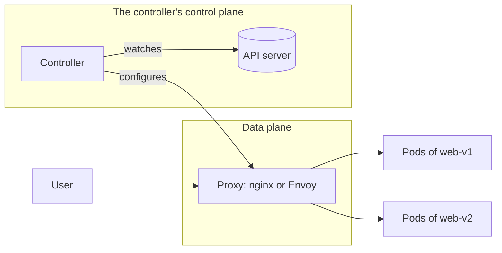

# Ingress and Gateway API: expert

🌐 [Русский](expert.ru.md) · **English**

**Levels:** [overview](overview.en.md) · [1. Basics](basics.en.md) · [2. Advanced](advanced.en.md) · **3. Expert** · [4. Quiz](quiz.en.md)

## Under the hood

### Control plane and data plane



- The **controller** (control plane) watches the Ingress, Gateway, HTTPRoute and Service/EndpointSlice objects through the API server ([module 02](../02-architecture/advanced.en.md#watch-and-paginated-lists)) and builds a proxy configuration from them.
- The **proxy** (data plane) — nginx or Envoy — accepts user traffic and sends it **straight to pod addresses**, bypassing the Service's ClusterIP: from the Service the controller needs only the endpoint list (the `describe ingress` output shows the pod addresses).
- So balancing is per request (L7), not per connection as with kube-proxy ([module 06](../06-services/advanced.en.md#how-kube-proxy-balances-traffic)).

Envoy Gateway creates a separate proxy Deployment and Service for each `Gateway`. In our cluster (namespace `envoy-gateway-system`):

```text
service/envoy-learn-09-main-gw-2dc8f82a   LoadBalancer   10.96.33.43   <pending>
pod/envoy-learn-09-main-gw-2dc8f82a-…     2/2 Running
```

The name is built from the namespace and the `Gateway` name plus a hash. The ingress-nginx controller, by contrast, is one shared Deployment `ingress-nginx-controller` (namespace `ingress-nginx`) for all Ingresses.

### Choosing a controller

The class chooses the executor: an `IngressClass` has `k8s.io/ingress-nginx` in `spec.controller`, a `GatewayClass` has `controllerName: gateway.envoyproxy.io/gatewayclass-controller`. A controller handles only objects of "its" class.

## Reference

### Gateway API resources

The CRDs from `kubectl get crd` after installing Envoy Gateway v1.7.4 (the CRD set v1.4.1):

| Resource | Purpose |
|---|---|
| `GatewayClass` | describes the implementing controller |
| `Gateway` | an entry point: listeners (port, protocol, TLS, `allowedRoutes`) |
| `HTTPRoute` | HTTP routing |
| `GRPCRoute` | gRPC routing |
| `TLSRoute` | TLS routing by SNI (including passthrough) |
| `TCPRoute`, `UDPRoute` | TCP and UDP routing |
| `ReferenceGrant` | permission for a cross-namespace reference |
| `BackendTLSPolicy` | TLS between the proxy and the backend |

> ⚠️ Verify: `GRPCRoute`, `TLSRoute`, `TCPRoute`, `UDPRoute`, `BackendTLSPolicy`, `ReferenceGrant` are only present in the CRD list; their behavior was not run.

### Gateway and Ingress fields

From `kubectl explain` (kubectl 1.36.1):

| Object | `spec` fields |
|---|---|
| Gateway | `gatewayClassName`, `listeners`, `addresses`, `allowedListeners`, `defaultScope`, `infrastructure`, `tls` |
| Ingress | `ingressClassName`, `rules`, `tls`, `defaultBackend` |

A Gateway listener: `name`, `protocol` (`HTTP`, `HTTPS` and others), `port`, `hostname`, `tls` (`mode`: `Terminate`/`Passthrough`, `certificateRefs`), `allowedRoutes`.

### HTTPRoute filters

The enumeration `filters[].type` in our CRD version (from `kubectl explain`):

| Filter | What it does | Verified |
|---|---|---|
| `RequestRedirect` | redirects the request (code, scheme, host, path) | yes (301) |
| `URLRewrite` | changes the path or host before sending to the backend | yes (`ReplacePrefixMatch`) |
| `RequestHeaderModifier` | adds, changes, removes request headers | no |
| `ResponseHeaderModifier` | the same for the response | no |
| `RequestMirror` | mirrors requests to another backend | no |
| `CORS` | CORS settings | no |
| `ExternalAuth` | external authorization | no |
| `ExtensionRef` | an implementation-specific extension | no |

> ⚠️ Verify: the filters marked "no" and the field set of each filter were not run; support depends on the implementation and the CRD channel (standard or experimental).

### Status conditions (observed)

| Object | Condition and reason | Meaning |
|---|---|---|
| GatewayClass | `Accepted=True` | the controller accepted the class |
| Gateway | `Programmed=False (AddressNotAssigned)` | no external address (in kind) |
| Listener | `Programmed`, `Accepted`, `ResolvedRefs` = `True` | the listener is ready |
| HTTPRoute | `Accepted=False (NotAllowedByListeners)` | the listener does not allow the namespace |
| HTTPRoute | `ResolvedRefs=False (BackendNotFound)` | the Service was not found |

### Match types

| Type | Where | Meaning |
|---|---|---|
| `pathType: Exact` / `Prefix` / `ImplementationSpecific` | Ingress (required) | an exact path / a prefix / at the controller's discretion |
| `path.type: Exact` / `PathPrefix` / `RegularExpression` | HTTPRoute | likewise (a regular expression is extended support) |
| `headers`, `queryParams`, `method` | HTTPRoute | extra conditions |

## Gotchas

### Gotcha: a Gateway is `Programmed=False` in kind but traffic flows

In kind the proxy's Service has `EXTERNAL-IP <pending>`, so the Gateway has `Programmed=False (AddressNotAssigned)`. The proxy nevertheless works: requests to the ClusterIP of its Service get answers. The listeners are `Programmed=True`.

### Gotcha: an Ingress object without a controller does not work

`kubectl apply` succeeds, the object appears in the list, but traffic does not flow: there is no controller or the class does not match. Check `kubectl get ingressclass` and `ingressClassName`.

### Gotcha: an Ingress ADDRESS is `localhost` in kind

The `ADDRESS` column in `kubectl get ingress` shows `localhost`: the controller from the kind manifest publishes the address "localhost" through the node's `hostPort`. For your own clients in kind the address is of no use until the node's ports are forwarded to the host.

> ⚠️ Verify: the explanation that `localhost` comes from the kind manifest settings through hostPort, and forwarding kind ports to the host, were not verified.

### Gotcha: one controller's annotations do not work in another

`nginx.ingress.kubernetes.io/rewrite-target` and regular-expression paths work only in ingress-nginx. When you change the controller, all annotation-based configuration is rewritten.

### Gotcha: an Ingress without a class might be handled "by itself"

In our kind ingress-nginx runs with `--watch-ingress-without-class=true`, and an object without `ingressClassName` answered `200`. This is a setting of a particular deployment, not a property of Ingress.

### Gotcha: 404 and 500

No suitable rule — `404` (a request with a foreign `Host`). The rule exists but the backend is not found — `500` (in the experiment `ResolvedRefs=False (BackendNotFound)`, `http=500`).

### Gotcha: HTTP is redirected to HTTPS automatically

With ingress-nginx, when `tls` is present HTTP requests get `308` to HTTPS (`http->308 redirect=https://app.example.test/`). This is the controller's behavior, not the standard's.

### Gotcha: testing an entry point without the Host header

Rules are bound to a domain. A request by IP without the right `Host` gives `404` (in the experiment for both Gateway and Ingress).

### Gotcha: `pathType` is required

`Required value: pathType must be specified`. In old manifests (without `pathType`) the field has to be added.

## Trade-offs and alternatives

| Approach | Pros | Cons |
|---|---|---|
| Gateway API | a standard, roles, typed capabilities, extensible | newer; feature support depends on the implementation |
| Ingress | simple, widely known | a frozen API; extensions through controller annotations |
| ingress-nginx | familiar, lots of documentation | retired (no patches after March 2026) |
| Envoy Gateway, Traefik, Istio Gateway, NGINX Gateway Fabric and others | maintained implementations | choosing and comparing features is up to you |
| A `LoadBalancer` Service per application | simple for non-HTTP | many balancers and addresses |
| A service mesh gateway | unified policy, mTLS | complexity |

> ⚠️ Verify: Traefik, Istio Gateway and NGINX Gateway Fabric as Gateway API implementations and the comparison of their features were not run and are given from documentation.

## Interview questions

**1. Why is an Ingress needed if there is a Service of type LoadBalancer?**

<details><summary>Answer</summary>

An Ingress (and Gateway API) give one external address and routing by host and path for many applications, and TLS termination at the entry. A `LoadBalancer` per application is a separate balancer and address, and it cannot route HTTP by path.

</details>

**2. (Trick) You created an Ingress, it is visible in `kubectl get ingress`, but traffic does not flow. Why?**

<details><summary>Answer</summary>

The object is only a description. You need a controller that handles its class. Check that the controller runs (`IngressClass`), `ingressClassName` matches, the Ingress has a rule for your `Host` and path, and the backend Service has endpoints.

</details>

**3. What is the role of an entry controller?**

<details><summary>Answer</summary>

It watches Ingress/Gateway/Route and Service/EndpointSlice objects and configures the proxy (nginx, Envoy), which accepts traffic and sends it to pod addresses.

</details>

**4. (Trick) What about ingress-nginx?**

<details><summary>Answer</summary>

The Kubernetes community's project is retired: after March 2026 there are no releases, fixes or security updates. Existing deployments keep working but get no patches. Gateway API or another maintained controller is recommended.

</details>

**5. Which objects are in Gateway API and who owns them?**

<details><summary>Answer</summary>

`GatewayClass` (the controller vendor), `Gateway` (the cluster administrator: listeners, TLS, `allowedRoutes`), `HTTPRoute` and other routes (the application developer in their namespace).

</details>

**6. How do you do an 80/20 canary rollout with Gateway API?**

<details><summary>Answer</summary>

In an `HTTPRoute` specify two `backendRefs` with `weight: 80` and `weight: 20`. In the experiment 100 requests gave 81 and 19. By changing the weights you move traffic to the new version without redeploying.

</details>

**7. How do `404` and `500` differ at an entry point?**

<details><summary>Answer</summary>

`404` — there is no suitable rule (a foreign `Host` or path). `500` — the rule exists but the backend is not found (`ResolvedRefs=False (BackendNotFound)`).

</details>

**8. (Trick) A route from the namespace `learn-09b` did not attach to the Gateway in `learn-09`. Why?**

<details><summary>Answer</summary>

A listener with `allowedRoutes: {namespaces: {from: Same}}` accepts routes only from its own namespace: `Accepted=False (NotAllowedByListeners)`. It can be allowed through `from: All` or `Selector`. A reference to a Service from another namespace additionally requires a `ReferenceGrant`.

</details>

**9. Why is a Gateway `Programmed=False` while traffic flows?**

<details><summary>Answer</summary>

The reason is `AddressNotAssigned`: there is no external address because kind has no cloud balancer for the proxy Service. The proxy itself works, reachable through the ClusterIP; the listeners are `Programmed=True`.

</details>

**10. How is path rewriting set in Ingress and in Gateway API?**

<details><summary>Answer</summary>

In Ingress — by a controller annotation (`nginx.ingress.kubernetes.io/rewrite-target`) that works only there. In Gateway API — by the standard `URLRewrite` filter (in the experiment `ReplacePrefixMatch: /` removed the `/canary` prefix).

</details>

**11. Why is `pathType` required in Ingress and what are its values?**

<details><summary>Answer</summary>

To define path matching unambiguously: `Exact`, `Prefix`, `ImplementationSpecific`. Without it the API rejects the object: `pathType must be specified`.

</details>

**12. How do you move from Ingress to Gateway API?**

<details><summary>Answer</summary>

Install the CRDs and a controller, create a `GatewayClass` and `Gateway`, move the rules to `HTTPRoute` (replace annotations with filters), check both entry points in parallel, then switch DNS. An `ingress2gateway` utility exists for conversion (not run here).

</details>

## Cheat sheet

```bash
kubectl get ingressclass,gatewayclass                         # which controllers exist
kubectl get ingress,gateway,httproute -A                      # entry objects
kubectl describe ingress NAME                                 # rules and pod addresses
kubectl get gateway NAME -o jsonpath='{range .status.conditions[*]}{.type}={.status} ({.reason}){"\n"}{end}'
kubectl get httproute NAME -o jsonpath='{range .status.parents[0].conditions[*]}{.type}={.status} ({.reason}){"\n"}{end}'
curl -H 'Host: app.example.test' http://<IP>/path             # check by domain
curl --resolve app.example.test:443:<IP> https://app.example.test/   # check TLS
kubectl get svc -n envoy-gateway-system                       # Envoy Gateway proxy Services
```

## Related materials

- Previous levels: [basics](basics.en.md), [advanced](advanced.en.md)
- Previous modules: [06 · Service and networking](../06-services/overview.en.md), [07 · ConfigMap and Secret](../07-config-and-secrets/overview.en.md), [02 · Architecture](../02-architecture/overview.en.md)
- Foundation: the [Linux track](../../../linux/overview.en.md)

## Sources

- [Kubernetes: Gateway API](https://kubernetes.io/docs/concepts/services-networking/gateway/)
- [Kubernetes: Ingress](https://kubernetes.io/docs/concepts/services-networking/ingress/)
- [Gateway API: project documentation](https://gateway-api.sigs.k8s.io/)
- [Ingress NGINX Retirement: What You Need to Know](https://kubernetes.io/blog/2025/11/11/ingress-nginx-retirement/)
- [Ingress NGINX: Statement from the Kubernetes Steering and Security Response Committees](https://www.kubernetes.io/blog/2026/01/29/ingress-nginx-statement/)
- [Envoy Gateway: Quickstart](https://gateway.envoyproxy.io/docs/tasks/quickstart/)
