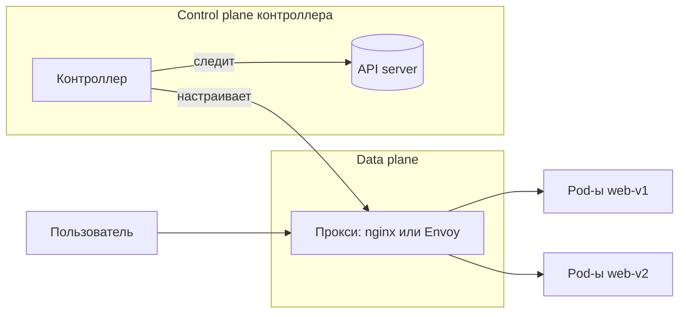

# Ingress и Gateway API: экспертная теория

🌐 **Русский** · [English](expert.en.md)

**Уровни:** [обзор](overview.ru.md) · [1. Базовая](basics.ru.md) · [2. Продвинутая](advanced.ru.md) · **3. Экспертная** · [4. Квиз](quiz.ru.md)

## Под капотом

### Control plane и data plane



- **Контроллер** (control plane) наблюдает за объектами Ingress, Gateway, HTTPRoute и Service/EndpointSlice через API server ([модуль 02](../02-architecture/advanced.ru.md#watch-и-список-с-пагинацией)) и собирает из них конфигурацию прокси.
- **Прокси** (data plane) — nginx или Envoy — принимает пользовательский трафик и направляет его **сразу на адреса подов**, минуя ClusterIP Service: от Service контроллеру нужен только список endpoints (в выводе `describe ingress` видны адреса подов).
- Поэтому балансировка идёт на уровне запроса (L7), а не соединения, как у kube-proxy ([модуль 06](../06-services/advanced.ru.md#как-kube-proxy-балансирует-трафик)).

Envoy Gateway для каждого `Gateway` создаёт отдельный Deployment и Service прокси. В нашем кластере (namespace `envoy-gateway-system`):

```text
service/envoy-learn-09-main-gw-2dc8f82a   LoadBalancer   10.96.33.43   <pending>
pod/envoy-learn-09-main-gw-2dc8f82a-…     2/2 Running
```

Имя собрано из namespace и имени `Gateway` плюс хэш. Контроллер ingress-nginx, напротив, — один общий Deployment `ingress-nginx-controller` (namespace `ingress-nginx`) на все Ingress.

### Выбор контроллера

Класс выбирает исполнителя: у `IngressClass` в поле `spec.controller` стоит `k8s.io/ingress-nginx`, у `GatewayClass` — `controllerName: gateway.envoyproxy.io/gatewayclass-controller`. Контроллер обрабатывает только объекты «своего» класса.

## Справочник

### Ресурсы Gateway API

CRD из `kubectl get crd` после установки Envoy Gateway v1.7.4 (набор CRD v1.4.1):

| Ресурс | Назначение |
|---|---|
| `GatewayClass` | описывает контроллер-реализацию |
| `Gateway` | точка входа: слушатели (порт, протокол, TLS, `allowedRoutes`) |
| `HTTPRoute` | маршрутизация HTTP |
| `GRPCRoute` | маршрутизация gRPC |
| `TLSRoute` | маршрутизация TLS по SNI (в том числе passthrough) |
| `TCPRoute`, `UDPRoute` | маршрутизация TCP и UDP |
| `ReferenceGrant` | разрешение на ссылку из одного namespace в другой |
| `BackendTLSPolicy` | TLS между прокси и backend |

> ⚠️ Проверить: `GRPCRoute`, `TLSRoute`, `TCPRoute`, `UDPRoute`, `BackendTLSPolicy`, `ReferenceGrant` только присутствуют в списке CRD; их поведение не запускалось.

### Поля Gateway и Ingress

Из `kubectl explain` (kubectl 1.36.1):

| Объект | Поля `spec` |
|---|---|
| Gateway | `gatewayClassName`, `listeners`, `addresses`, `allowedListeners`, `defaultScope`, `infrastructure`, `tls` |
| Ingress | `ingressClassName`, `rules`, `tls`, `defaultBackend` |

Слушатель Gateway: `name`, `protocol` (`HTTP`, `HTTPS` и др.), `port`, `hostname`, `tls` (`mode`: `Terminate`/`Passthrough`, `certificateRefs`), `allowedRoutes`.

### Фильтры HTTPRoute

Перечисление `filters[].type` в нашей версии CRD (из `kubectl explain`):

| Фильтр | Что делает | Проверено |
|---|---|---|
| `RequestRedirect` | перенаправляет запрос (код, схема, хост, путь) | да (301) |
| `URLRewrite` | меняет путь или хост перед отправкой на backend | да (`ReplacePrefixMatch`) |
| `RequestHeaderModifier` | добавляет, меняет, удаляет заголовки запроса | нет |
| `ResponseHeaderModifier` | то же для ответа | нет |
| `RequestMirror` | дублирует запросы на другой backend | нет |
| `CORS` | настройки CORS | нет |
| `ExternalAuth` | внешняя авторизация | нет |
| `ExtensionRef` | расширение, специфичное для реализации | нет |

> ⚠️ Проверить: фильтры, помеченные «нет», и набор полей каждого фильтра не запускались; поддержка зависит от реализации и канала CRD (стандартный или экспериментальный).

### Условия состояния (наблюдались)

| Объект | Условие и причина | Значение |
|---|---|---|
| GatewayClass | `Accepted=True` | контроллер принял класс |
| Gateway | `Programmed=False (AddressNotAssigned)` | нет внешнего адреса (в kind) |
| Listener | `Programmed`, `Accepted`, `ResolvedRefs` = `True` | слушатель готов |
| HTTPRoute | `Accepted=False (NotAllowedByListeners)` | слушатель не допускает namespace |
| HTTPRoute | `ResolvedRefs=False (BackendNotFound)` | Service не найден |

### Типы совпадения

| Тип | Где | Смысл |
|---|---|---|
| `pathType: Exact` / `Prefix` / `ImplementationSpecific` | Ingress (обязателен) | точный путь / префикс / по усмотрению контроллера |
| `path.type: Exact` / `PathPrefix` / `RegularExpression` | HTTPRoute | аналогично (регулярное выражение — расширенная поддержка) |
| `headers`, `queryParams`, `method` | HTTPRoute | дополнительные условия |

## Подвохи

### Подвох: Gateway `Programmed=False` в kind, но трафик идёт

В kind у Service прокси `EXTERNAL-IP <pending>`, поэтому у Gateway `Programmed=False (AddressNotAssigned)`. Прокси при этом работает: запросы к ClusterIP его Service получают ответы. Слушатели при этом `Programmed=True`.

### Подвох: объект Ingress без контроллера не работает

`kubectl apply` успешен, объект появляется в списке, но трафик не идёт: контроллера нет или класс не совпадает. Проверьте `kubectl get ingressclass` и `ingressClassName`.

### Подвох: ADDRESS у Ingress — `localhost` в kind

Колонка `ADDRESS` в `kubectl get ingress` показывает `localhost`: контроллер из kind-манифеста публикует адрес «localhost» через `hostPort` ноды. Для своих клиентов в kind адрес не годится, пока порты ноды не проброшены на хост.

> ⚠️ Проверить: объяснение, что `localhost` приходит из настроек kind-манифеста через hostPort, и проброс портов kind на хост не проверялись.

### Подвох: аннотации одного контроллера не работают в другом

`nginx.ingress.kubernetes.io/rewrite-target` и регулярные пути работают только в ingress-nginx. При смене контроллера вся конфигурация на аннотациях переписывается.

### Подвох: Ingress без класса мог обрабатываться «сам»

В нашем kind ingress-nginx запущен с `--watch-ingress-without-class=true`, и объект без `ingressClassName` ответил `200`. Это настройка конкретного развёртывания, а не свойство Ingress.

### Подвох: 404 и 500

Нет подходящего правила — `404` (запрос с чужим `Host`). Правило есть, но backend не найден — `500` (в опыте `ResolvedRefs=False (BackendNotFound)`, `http=500`).

### Подвох: HTTP автоматически перенаправляется на HTTPS

У ingress-nginx при наличии `tls` HTTP-запросы получают `308` на HTTPS (`http->308 redirect=https://app.example.test/`). Это поведение контроллера, а не стандарта.

### Подвох: проверка входа без заголовка Host

Правила привязаны к домену. Запрос по IP без нужного `Host` даёт `404` (в опыте и для Gateway, и для Ingress).

### Подвох: `pathType` обязателен

`Required value: pathType must be specified`. В старых манифестах (без `pathType`) такое поле приходится добавить.

## Компромиссы и альтернативы

| Подход | Плюсы | Минусы |
|---|---|---|
| Gateway API | стандарт, роли, типизированные возможности, расширяется | новее; поддержка функций зависит от реализации |
| Ingress | простой, широко известный | замороженное API; расширения через аннотации контроллера |
| ingress-nginx | привычный, много документации | выведен из поддержки (после марта 2026 нет патчей) |
| Envoy Gateway, Traefik, Istio Gateway, NGINX Gateway Fabric и др. | поддерживаемые реализации | выбор и сравнение функций остаются за вами |
| `Service` типа `LoadBalancer` на приложение | простота для не-HTTP | много балансировщиков и адресов |
| Service mesh gateway | единая политика, mTLS | сложность |

> ⚠️ Проверить: Traefik, Istio Gateway и NGINX Gateway Fabric как реализации Gateway API и сравнение их возможностей не запускались и даны по документации.

## Вопросы с собеседований

**1. Зачем нужен Ingress, если есть Service типа LoadBalancer?**

<details><summary>Ответ</summary>

Ingress (и Gateway API) дают один внешний адрес и маршрутизацию по хосту и пути для многих приложений, терминацию TLS на входе. `LoadBalancer` на каждое приложение — отдельный балансировщик и адрес, и маршрутизировать HTTP по пути он не умеет.

</details>

**2. (С подвохом) Вы создали Ingress, он виден в `kubectl get ingress`, но трафик не идёт. Почему?**

<details><summary>Ответ</summary>

Объект — только описание. Нужен контроллер, который обрабатывает его класс. Проверьте, что контроллер запущен (`IngressClass`), совпадает `ingressClassName`, у Ingress есть правило под ваш `Host` и путь, а backend Service имеет endpoints.

</details>

**3. Какая роль у контроллера входа?**

<details><summary>Ответ</summary>

Он наблюдает за Ingress/Gateway/Route и Service/EndpointSlice и настраивает прокси (nginx, Envoy), который принимает трафик и направляет его на адреса подов.

</details>

**4. (С подвохом) Что с ingress-nginx?**

<details><summary>Ответ</summary>

Проект сообщества Kubernetes выведен из поддержки: после марта 2026 нет выпусков, исправлений и обновлений безопасности. Уже работающие развёртывания продолжают работать, но патчей не получают. Рекомендуется Gateway API или другой поддерживаемый контроллер.

</details>

**5. Какие объекты в Gateway API и кто их владелец?**

<details><summary>Ответ</summary>

`GatewayClass` (поставщик контроллера), `Gateway` (администратор кластера: слушатели, TLS, `allowedRoutes`), `HTTPRoute` и другие маршруты (разработчик приложения в своём namespace).

</details>

**6. Как сделать canary-выкатку 80/20 средствами Gateway API?**

<details><summary>Ответ</summary>

В `HTTPRoute` указать два `backendRefs` с `weight: 80` и `weight: 20`. В опыте 100 запросов дали 81 и 19. Меняя веса, переводят трафик на новую версию без переразвёртывания.

</details>

**7. Чем отличаются `404` и `500` на входе?**

<details><summary>Ответ</summary>

`404` — подходящего правила нет (чужой `Host` или путь). `500` — правило есть, но backend не найден (`ResolvedRefs=False (BackendNotFound)`).

</details>

**8. (С подвохом) Маршрут из namespace `learn-09b` не привязался к Gateway из `learn-09`. Почему?**

<details><summary>Ответ</summary>

Слушатель с `allowedRoutes: {namespaces: {from: Same}}` принимает маршруты только из своего namespace: `Accepted=False (NotAllowedByListeners)`. Разрешить можно через `from: All` или `Selector`. Ссылка на Service из другого namespace дополнительно требует `ReferenceGrant`.

</details>

**9. Почему у Gateway `Programmed=False`, а трафик идёт?**

<details><summary>Ответ</summary>

Причина `AddressNotAssigned`: нет внешнего адреса, потому что в kind нет облачного балансировщика для Service прокси. Сам прокси работает, до него доступно через ClusterIP; слушатели `Programmed=True`.

</details>

**10. Как задаётся перезапись пути в Ingress и в Gateway API?**

<details><summary>Ответ</summary>

В Ingress — аннотацией контроллера (`nginx.ingress.kubernetes.io/rewrite-target`), работающей только у него. В Gateway API — стандартным фильтром `URLRewrite` (в опыте `ReplacePrefixMatch: /` убрал префикс `/canary`).

</details>

**11. Зачем в Ingress обязателен `pathType` и какие у него значения?**

<details><summary>Ответ</summary>

Чтобы однозначно определить сопоставление пути: `Exact`, `Prefix`, `ImplementationSpecific`. Без него API отклоняет объект: `pathType must be specified`.

</details>

**12. Как перейти с Ingress на Gateway API?**

<details><summary>Ответ</summary>

Установить CRD и контроллер, создать `GatewayClass` и `Gateway`, перенести правила в `HTTPRoute` (аннотации заменить фильтрами), проверить оба входа параллельно, затем переключить DNS. Для преобразования существует утилита `ingress2gateway` (не запускалась здесь).

</details>

## Шпаргалка

```bash
kubectl get ingressclass,gatewayclass                         # какие контроллеры есть
kubectl get ingress,gateway,httproute -A                      # объекты входа
kubectl describe ingress NAME                                 # правила и адреса подов
kubectl get gateway NAME -o jsonpath='{range .status.conditions[*]}{.type}={.status} ({.reason}){"\n"}{end}'
kubectl get httproute NAME -o jsonpath='{range .status.parents[0].conditions[*]}{.type}={.status} ({.reason}){"\n"}{end}'
curl -H 'Host: app.example.test' http://<IP>/path             # проверка по домену
curl --resolve app.example.test:443:<IP> https://app.example.test/   # проверка TLS
kubectl get svc -n envoy-gateway-system                       # Service прокси Envoy Gateway
```

## Связанные материалы

- Предыдущие уровни: [базовая](basics.ru.md), [продвинутая](advanced.ru.md)
- Предыдущие модули: [06 · Service и сеть](../06-services/overview.ru.md), [07 · ConfigMap и Secret](../07-config-and-secrets/overview.ru.md), [02 · Архитектура](../02-architecture/overview.ru.md)
- Фундамент: [трек Linux](../../../linux/overview.ru.md)

## Источники

- [Kubernetes: Gateway API](https://kubernetes.io/docs/concepts/services-networking/gateway/)
- [Kubernetes: Ingress](https://kubernetes.io/docs/concepts/services-networking/ingress/)
- [Gateway API: документация проекта](https://gateway-api.sigs.k8s.io/)
- [Ingress NGINX Retirement: What You Need to Know](https://kubernetes.io/blog/2025/11/11/ingress-nginx-retirement/)
- [Ingress NGINX: Statement from the Kubernetes Steering and Security Response Committees](https://www.kubernetes.io/blog/2026/01/29/ingress-nginx-statement/)
- [Envoy Gateway: Quickstart](https://gateway.envoyproxy.io/docs/tasks/quickstart/)
