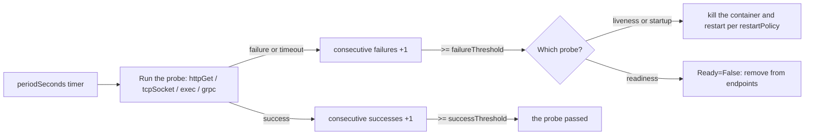

# Probes and resources: expert

🌐 [Русский](expert.ru.md) · **English**

**Levels:** [overview](overview.en.md) · [1. Basics](basics.en.md) · [2. Advanced](advanced.en.md) · **3. Expert** · [4. Quiz](quiz.en.md)

## Under the hood

### How the kubelet runs probes

Probes are run by the **kubelet** on the node where the pod runs: it does not ask the API server. For each probe the kubelet keeps a counter of consecutive successes and failures and compares it with `successThreshold` and `failureThreshold`:



- **Liveness and startup** on failure lead to killing the container (in the experiment the event `Killing: Container c failed liveness probe, will be restarted`), and then `restartPolicy` takes over ([module 04](../04-pods/basics.en.md#restartpolicy-what-happens-when-a-container-ends)).
- **Readiness** changes the pod conditions `Ready` and `ContainersReady` (in the experiment `Ready=False ContainersReady=False`), and the EndpointSlice controller removes the pod's address from the Service.
- **Startup** runs first: until it passes, the other probes do not start; after success startup no longer runs.
- An `httpGet` probe goes to the pod IP from the node itself; `tcpSocket` checks only that a connection is possible (an application may accept a connection and still not serve requests); `exec` launches a process inside the container every period.

A timeout also counts as a failure: for the gRPC probe on a closed port the message was `timeout: failed to connect service … within 1s: context deadline exceeded`.

### QoS and oom_score_adj

Besides the QoS class in the pod status, the kubelet sets the container's processes an `oom_score_adj` value — a priority offset for the kernel's OOM killer. The values from inside the containers (verified):

| Pod | QoS | `oom_score_adj` of PID 1 |
|---|---|---|
| `guaranteed` (requests = limits) | Guaranteed | `-997` |
| `burstable` (requests 50m/32Mi) | Burstable | `999` |
| `onlyreq` (requests 100m/64Mi) | Burstable | `998` |
| `besteffort` | BestEffort | `1000` |

The **higher** the value, the earlier the process is killed when a node runs short of memory. `Guaranteed` is almost protected (`-997`), `BestEffort` is the first candidate (`1000`), and for `Burstable` the value depends on the claim's share of the node's memory (a larger request gives a lower value: 998 against 999).

This is a "kernel" mechanism. Separately, eviction by the kubelet itself works when a node runs short of memory, disk or PIDs: it chooses victims by QoS class and by exceeding claims instead of waiting for the OOM killer.

> ⚠️ Verify: the kubelet's eviction order under node resource pressure and the `oom_score_adj` formula for `Burstable` are given from documentation and were not reproduced in this material.

### CPU: weight and quota

On cgroup v2 `requests.cpu` turns into `cpu.weight` (17 for `100m`, 11 for `50m`, 1 for `BestEffort`), and `limits.cpu` into `cpu.max` (`10000 100000` for `100m`). The weight matters only under contention, the quota always applies (in the experiment 202 of 202 periods of throttling on an idle node).

## Reference

### Probe fields

From `kubectl explain pod.spec.containers.livenessProbe`:

| Field | Meaning | Default (verified) |
|---|---|---|
| `httpGet` / `tcpSocket` / `exec` / `grpc` | the mechanism (exactly one) | — |
| `initialDelaySeconds` | the delay before the first check | 0 |
| `periodSeconds` | the interval | 10 |
| `timeoutSeconds` | the timeout of one check | 1 |
| `successThreshold` | consecutive successes | 1 |
| `failureThreshold` | consecutive failures | 3 |
| `terminationGracePeriodSeconds` | probe-level: the time to stop on a liveness failure (overrides the pod's value) | not set |

> ⚠️ Verify: the default `successThreshold` for readiness and the restriction "for liveness and startup `successThreshold` must be 1", and the action of the probe-level `terminationGracePeriodSeconds`, were not verified by running; the field exists (visible in `kubectl explain`).

### Resource fields

From `kubectl explain pod.spec.containers.resources`: `requests`, `limits`, `claims` (dynamic resources, for example GPUs through DRA).

| Resource | Units | Notes |
|---|---|---|
| `cpu` | cores (`1`), millicores (`100m`) | compressible: when the limit is exceeded — throttling |
| `memory` | bytes and the suffixes `Mi`, `Gi` (powers of 1024), `M`, `G` (powers of 1000) | incompressible: when the limit is exceeded — OOMKilled |
| `ephemeral-storage` | the same | local disk; a separate line in `describe node` (values `0`) |
| `hugepages-*` | the same | huge pages; lines `hugepages-1Gi`, `hugepages-2Mi` in `describe node` |

> ⚠️ Verify: the behavior of the `ephemeral-storage` limit (pod eviction), `hugepages` and `claims` was not run.

### Node capacity

| Parameter | Value on our node |
|---|---|
| `allocatable.cpu` | `12` |
| `allocatable.memory` | `32736456Ki` |
| `allocatable.pods` | `110` |
| Claims of all pods (at the time of measuring) | cpu `1200m (10%)`, memory `450Mi (1%)` |

### QoS classes and their manifestations

| Class | Condition | `cpu.weight` (experiment) | `oom_score_adj` (experiment) |
|---|---|---|---|
| `Guaranteed` | requests = limits, CPU and memory, on all containers | 17 (for 100m) | -997 |
| `Burstable` | something is set, not as for Guaranteed | 11 (50m), 17 (100m) | 999, 998 |
| `BestEffort` | nothing is set | 1 | 1000 |

## Gotchas

### Gotcha: a restart by liveness looks like a normal exit (code 0)

A container killed by liveness exited with code `0` and the reason `Completed`: nginx ended gracefully on `SIGTERM`. This is not an abnormal termination, so logs and `describe` show no signs of a crash other than the `Unhealthy` and `Killing` events.

### Gotcha: without readiness a pod is "ready" at once

The pod `slow-nostartup` without a readiness probe had `READY 1/1` while the application did not listen on the port for another 25 seconds. Traffic goes to a not-ready pod.

### Gotcha: a liveness failure during a slow start is an endless loop

Liveness with `failureThreshold: 2` and a 3 s period kills an application that starts for 25 seconds before it manages to answer. A startup probe is needed.

### Gotcha: readiness does not restart

A pod with a failed readiness stays `Running` and can hang at `0/1` as long as you like: `kubectl get pod` shows `Running`, but there is no traffic.

### Gotcha: tcpSocket does not check that the application works

`tcpSocket` passes if the port accepts a connection, even if the application inside hung and does not serve requests. A real check needs `httpGet` or `exec`.

### Gotcha: a CPU limit slows even on an idle node

A pod with a `100m` limit got 2.0 of 20 seconds of CPU and was throttled in all 202 periods although the node has 12 free cores.

### Gotcha: a claim is not consumption

`describe node` and the scheduler count requests (`cpu 1200m (10%)`). Real consumption is visible through metrics-server (`kubectl top`), which kind does not have (`error: Metrics API not available`).

### Gotcha: a limit below the claim is a validation error

`Invalid value: "500m": must be less than or equal to cpu limit of 100m`.

### Gotcha: `Insufficient cpu` is about claims

A pod with `requests.cpu: "100"` on a node of 12 cores stayed `Pending`. The event `FailedScheduling: … Insufficient cpu`: the node uses not even a tenth, the matter is claims, not load.

### Gotcha: a `grpc` check needs gRPC health

A `grpc` probe on a port without a gRPC service fails with `context deadline exceeded`. The application must implement `grpc.health.v1.Health`.

## Trade-offs and alternatives

| Choice | Pros | Cons |
|---|---|---|
| A CPU limit equal to the claim (Guaranteed) | predictability, high priority on OOM | throttling at peaks, underused cores |
| Only CPU requests, no limit | no throttling, cores fully used | neighbors may compete for CPU |
| Memory limit = request | node protection and a predictable OOM | a kill on a leak or a peak |
| Liveness with dependencies | notices problems quickly | mass restarts when a dependency fails |
| Startup instead of `initialDelaySeconds` | a fast start and protection of a slow one | one more probe to tune |
| VPA and in-place resize | tuning resources by load | a separate component or a version feature (module 15) |

> ⚠️ Verify: VPA and changing pod resources without a restart (in-place resize) were not run in this material; the `resizePolicy` field exists in `kubectl explain`.

## Interview questions

**1. How do liveness, readiness and startup differ in the consequences of failure?**

<details><summary>Answer</summary>

Liveness — the kubelet kills and restarts the container. Readiness — the pod gets `Ready=False` and is removed from endpoints, the container is not restarted. Startup — until it passes, the other probes are off; on failure the container is restarted.

</details>

**2. (Trick) A container restarts with exit code 0 and the reason `Completed`. What can it be?**

<details><summary>Answer</summary>

A restart by liveness: the kubelet sent `SIGTERM`, the application (nginx) ended gracefully, code 0. The sign is the `Unhealthy` and `Killing … failed liveness probe` events.

</details>

**3. (Trick) A pod is not `Ready`, yet it is `Running` and does not restart. Why?**

<details><summary>Answer</summary>

The readiness probe failed: the condition `Ready=False`, the pod is excluded from endpoints, while only liveness does restarts (in the experiment `0/1 Running`).

</details>

**4. Why is a startup probe needed?**

<details><summary>Answer</summary>

For slow-starting applications: until it passes, liveness and readiness do not run, and the application is not killed during startup. The reserve is `failureThreshold × periodSeconds` (in the experiment 15 × 3 = 45 s; a 25 s start passed with two failed attempts).

</details>

**5. What are the probe defaults?**

<details><summary>Answer</summary>

`initialDelaySeconds: 0`, `periodSeconds: 10`, `timeoutSeconds: 1`, `successThreshold: 1`, `failureThreshold: 3` (visible in `kubectl describe pod`).

</details>

**6. How do requests differ from limits?**

<details><summary>Answer</summary>

Requests are a claim: the scheduler picks a node by them and the CPU weight is set. Limits are a ceiling: CPU above the limit is throttled, memory above the limit — OOMKilled.

</details>

**7. How is the QoS class computed?**

<details><summary>Answer</summary>

`Guaranteed` — every container has both CPU and memory with requests = limits. `BestEffort` — nothing is set. The rest is `Burstable` (in the experiment a pod with only requests and a pod with a limit only on memory).

</details>

**8. (Trick) A CPU limit of 100m, the node is idle. Will the container be limited?**

<details><summary>Answer</summary>

Yes: `cpu.max` (the quota) acts regardless of node load. In the experiment the pod got 2.0 of 20 seconds of CPU, `nr_throttled 202` of `nr_periods 202`; the pod without a limit got all 20 seconds.

</details>

**9. Why is a pod `Pending` with the event `Insufficient cpu` although the node is idle?**

<details><summary>Answer</summary>

The scheduler compares requests with allocatable, not actual load. The claim (in the experiment `requests.cpu: "100"` on a 12-core node) exceeds capacity.

</details>

**10. What happens when the memory limit is exceeded?**

<details><summary>Answer</summary>

The kernel kills the process (the OOM killer): `reason=OOMKilled`, code 137. Memory is an incompressible resource.

</details>

**11. What is `oom_score_adj` and how does it relate to QoS?**

<details><summary>Answer</summary>

A process priority offset for the OOM killer: the higher, the earlier it is killed. `Guaranteed` has −997, `BestEffort` 1000, `Burstable` 998–999 (in the experiment), so when a node runs short of memory `BestEffort` suffers first.

</details>

**12. (Trick) Should a liveness probe check the availability of a database?**

<details><summary>Answer</summary>

No. A database failure would restart all pods simultaneously, and they would then be unavailable for long. Dependencies are checked by readiness (the pod is excluded from traffic but not killed).

</details>

## Cheat sheet

```bash
kubectl describe pod NAME | grep -E "Liveness|Readiness|Startup|Restart Count|Last State"
kubectl get pod NAME -o jsonpath='{.status.qosClass}'
kubectl get pod NAME -o jsonpath='{.status.containerStatuses[0].restartCount}'
kubectl get events --field-selector involvedObject.name=NAME      # Unhealthy, Killing, FailedScheduling
kubectl describe node NODE | sed -n '/Allocated resources/,/Events/p'
kubectl get node NODE -o jsonpath='{.status.allocatable}'
kubectl exec POD -- cat /sys/fs/cgroup/cpu.max /sys/fs/cgroup/memory.max /sys/fs/cgroup/cpu.stat
kubectl top pods                                                   # needs metrics-server
```

## Related materials

- Previous levels: [basics](basics.en.md), [advanced](advanced.en.md)
- Previous modules: [10 · Namespaces and RBAC](../10-namespaces-and-rbac/overview.en.md), [06 · Service and networking](../06-services/overview.en.md), [04 · Pod](../04-pods/overview.en.md)
- Foundation: the [Linux track](../../../linux/overview.en.md) — cgroups and the OOM killer

## Sources

- [Liveness, Readiness, and Startup Probes](https://kubernetes.io/docs/concepts/configuration/liveness-readiness-startup-probes/)
- [Pod Quality of Service Classes](https://kubernetes.io/docs/concepts/workloads/pods/pod-qos/)
- [Node-pressure Eviction](https://kubernetes.io/docs/concepts/scheduling-eviction/node-pressure-eviction/)
- [Resource Management for Pods and Containers](https://kubernetes.io/docs/concepts/configuration/manage-resources-containers/)
- [Pod API reference: Probe](https://kubernetes.io/docs/reference/kubernetes-api/workload-resources/pod-v1/#Probe)
- [Linux kernel: cgroup v2](https://docs.kernel.org/admin-guide/cgroup-v2.html)
