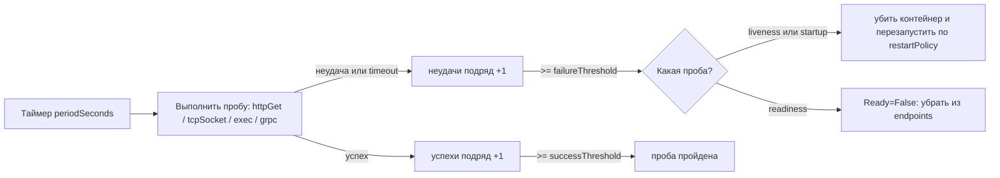

# Probes и ресурсы: экспертная теория

🌐 **Русский** · [English](expert.en.md)

**Уровни:** [обзор](overview.ru.md) · [1. Базовая](basics.ru.md) · [2. Продвинутая](advanced.ru.md) · **3. Экспертная** · [4. Квиз](quiz.ru.md)

## Под капотом

### Как kubelet выполняет пробы

Пробы выполняет **kubelet** на той ноде, где работает под: он не спрашивает API server. Для каждой пробы kubelet ведёт счётчик подряд идущих успехов и неудач и сравнивает с `successThreshold` и `failureThreshold`:



- **Liveness и startup** при провале приводят к убийству контейнера (в опыте событие `Killing: Container c failed liveness probe, will be restarted`), и дальше работает `restartPolicy` ([модуль 04](../04-pods/basics.ru.md#restartpolicy-что-происходит-когда-контейнер-завершился)).
- **Readiness** меняет условие пода `Ready` и `ContainersReady` (в опыте `Ready=False ContainersReady=False`), а контроллер EndpointSlice убирает адрес пода из Service.
- **Startup** выполняется первой: пока не пройдена, остальные пробы не запускаются; после успеха startup больше не работает.
- Проба `httpGet` идёт на IP пода с самой ноды; `tcpSocket` проверяет только возможность соединения (приложение может принять соединение и всё равно не обслуживать запросы); `exec` запускает процесс внутри контейнера каждый период.

Таймаут тоже считается неудачей: у gRPC-пробы на закрытом порту сообщение было `timeout: failed to connect service … within 1s: context deadline exceeded`.

### QoS и oom_score_adj

Помимо QoS-класса в статусе пода, kubelet выставляет процессам контейнера значение `oom_score_adj` — смещение приоритета для убийцы OOM ядра. Значения изнутри контейнеров (проверено):

| Под | QoS | `oom_score_adj` у PID 1 |
|---|---|---|
| `guaranteed` (requests = limits) | Guaranteed | `-997` |
| `burstable` (requests 50m/32Mi) | Burstable | `999` |
| `onlyreq` (requests 100m/64Mi) | Burstable | `998` |
| `besteffort` | BestEffort | `1000` |

Чем **выше** значение, тем раньше процесс убьют при нехватке памяти на ноде. `Guaranteed` почти защищён (`-997`), `BestEffort` — первый кандидат (`1000`), а у `Burstable` значение зависит от доли заявки в памяти ноды (у большего requests оно ниже: 998 против 999).

Это «ядерный» механизм. Отдельно работает вытеснение (eviction) самим kubelet при нехватке памяти, дисков или PID на ноде: он выбирает жертвы по QoS-классу и превышению заявок, а не ждёт OOM killer.

> ⚠️ Проверить: порядок вытеснения kubelet (eviction) при нехватке ресурсов ноды и формула `oom_score_adj` для `Burstable` даны по документации и не воспроизводились в этом материале.

### CPU: вес и квота

На cgroup v2 `requests.cpu` превращается в `cpu.weight` (17 для `100m`, 11 для `50m`, 1 для `BestEffort`), а `limits.cpu` — в `cpu.max` (`10000 100000` для `100m`). Вес влияет только при конкуренции, квота действует всегда (в опыте 202 из 202 периодов притормозки на свободной ноде).

## Справочник

### Поля пробы

Из `kubectl explain pod.spec.containers.livenessProbe`:

| Поле | Смысл | По умолчанию (проверено) |
|---|---|---|
| `httpGet` / `tcpSocket` / `exec` / `grpc` | механизм (ровно один) | — |
| `initialDelaySeconds` | задержка перед первой проверкой | 0 |
| `periodSeconds` | интервал | 10 |
| `timeoutSeconds` | таймаут одной проверки | 1 |
| `successThreshold` | успехов подряд | 1 |
| `failureThreshold` | неудач подряд | 3 |
| `terminationGracePeriodSeconds` | на уровне пробы: время на остановку при провале liveness (переопределяет значение пода) | не задано |

> ⚠️ Проверить: значение по умолчанию `successThreshold` для readiness и ограничение «у liveness и startup `successThreshold` должен быть 1», а также действие `probe-level terminationGracePeriodSeconds` не проверялись запуском; поле существует (видно в `kubectl explain`).

### Поля ресурсов

Из `kubectl explain pod.spec.containers.resources`: `requests`, `limits`, `claims` (динамические ресурсы, например GPU через DRA).

| Ресурс | Единицы | Особенности |
|---|---|---|
| `cpu` | ядра (`1`), милли-ядра (`100m`) | сжимаемый: при превышении лимита — throttling |
| `memory` | байты и суффиксы `Mi`, `Gi` (степени 1024), `M`, `G` (степени 1000) | несжимаемый: при превышении лимита — OOMKilled |
| `ephemeral-storage` | то же | локальный диск; в `describe node` отдельная строка (значения `0`) |
| `hugepages-*` | то же | большие страницы; в `describe node` строки `hugepages-1Gi`, `hugepages-2Mi` |

> ⚠️ Проверить: поведение лимита `ephemeral-storage` (вытеснение пода), `hugepages` и `claims` не запускалось.

### Ёмкость ноды

| Параметр | Значение в нашей ноде |
|---|---|
| `allocatable.cpu` | `12` |
| `allocatable.memory` | `32736456Ki` |
| `allocatable.pods` | `110` |
| Заявки всех подов (на момент замера) | cpu `1200m (10%)`, memory `450Mi (1%)` |

### QoS-классы и их проявления

| Класс | Условие | `cpu.weight` (опыт) | `oom_score_adj` (опыт) |
|---|---|---|---|
| `Guaranteed` | requests = limits, CPU и память, у всех контейнеров | 17 (для 100m) | -997 |
| `Burstable` | что-то задано, не как у Guaranteed | 11 (50m), 17 (100m) | 999, 998 |
| `BestEffort` | ничего не задано | 1 | 1000 |

## Подвохи

### Подвох: перезапуск по liveness выглядит как штатное завершение (код 0)

Контейнер, убитый liveness, вышел с кодом `0` и причиной `Completed`: nginx корректно завершился по `SIGTERM`. Это не аварийное завершение, поэтому в логах и в `describe` нет признаков падения, кроме событий `Unhealthy` и `Killing`.

### Подвох: без readiness под «готов» сразу

У пода `slow-nostartup` без readiness-пробы было `READY 1/1`, пока приложение ещё 25 секунд не слушало порт. Трафик уходит на не готовый под.

### Подвох: провал liveness при медленном старте — бесконечный цикл

Liveness с `failureThreshold: 2` и периодом 3 с убивает приложение, стартующее 25 секунд, раньше, чем оно успевает ответить. Нужна startup-проба.

### Подвох: readiness не перезапускает

Под с провалившейся readiness остаётся `Running` и может висеть в `0/1` сколько угодно: проверка `kubectl get pod` показывает `Running`, а трафика нет.

### Подвох: tcpSocket не проверяет работу приложения

`tcpSocket` проходит, если порт принимает соединение, даже если приложение внутри зависло и не обслуживает запросы. Для настоящей проверки нужен `httpGet` или `exec`.

### Подвох: CPU-лимит замедляет даже на свободной ноде

Под с лимитом `100m` получил 2.0 из 20 секунд CPU, притормаживался во всех 202 периодах, хотя на ноде 12 свободных ядер.

### Подвох: заявка не равна потреблению

`describe node` и планировщик считают requests (`cpu 1200m (10%)`). Реальное потребление видно через metrics-server (`kubectl top`), которого в kind нет (`error: Metrics API not available`).

### Подвох: лимит меньше заявки — ошибка валидации

`Invalid value: "500m": must be less than or equal to cpu limit of 100m`.

### Подвох: `Insufficient cpu` — это про заявки

Под с `requests.cpu: "100"` на ноде с 12 ядрами остался `Pending`. Событие `FailedScheduling: … Insufficient cpu`: нода не использует и десятой доли, дело в заявках, а не в нагрузке.

### Подвох: проверка `grpc` требует gRPC health

Проба `grpc` на порту без gRPC-сервиса падает с `context deadline exceeded`. Приложение должно реализовывать `grpc.health.v1.Health`.

## Компромиссы и альтернативы

| Выбор | Плюсы | Минусы |
|---|---|---|
| CPU-лимит равен заявке (Guaranteed) | предсказуемость, высокий приоритет при OOM | throttling при пиках, недоиспользование ядер |
| Только requests по CPU, без лимита | нет throttling, ядра используются полностью | соседи могут конкурировать за CPU |
| Memory limit = request | защита ноды и предсказуемый OOM | убийство при утечке или пике |
| Liveness с зависимостями | быстро замечает проблемы | массовые перезапуски при сбое зависимости |
| Startup вместо `initialDelaySeconds` | быстрый старт и защита медленного | ещё одна проба для настройки |
| VPA и in-place resize | подбор ресурсов по нагрузке | отдельный компонент или функция версии (модуль 15) |

> ⚠️ Проверить: VPA и изменение ресурсов пода без перезапуска (in-place resize) не запускались в этом материале; поле `resizePolicy` существует в `kubectl explain`.

## Вопросы с собеседований

**1. Чем liveness, readiness и startup отличаются по последствиям провала?**

<details><summary>Ответ</summary>

Liveness — kubelet убивает и перезапускает контейнер. Readiness — под получает `Ready=False` и убирается из endpoints, контейнер не перезапускается. Startup — пока не пройдена, остальные пробы выключены; при провале контейнер перезапускается.

</details>

**2. (С подвохом) Контейнер перезапускается с кодом выхода 0 и причиной `Completed`. Что это может быть?**

<details><summary>Ответ</summary>

Перезапуск по liveness: kubelet послал `SIGTERM`, приложение (nginx) завершилось штатно, код 0. Признак — события `Unhealthy` и `Killing … failed liveness probe`.

</details>

**3. (С подвохом) Под не `Ready`, но он `Running` и не перезапускается. Почему?**

<details><summary>Ответ</summary>

Провалена readiness-проба: условие `Ready=False`, под исключён из endpoints, а перезапуск делает только liveness (в опыте `0/1 Running`).

</details>

**4. Зачем нужна startup-проба?**

<details><summary>Ответ</summary>

Для медленно стартующих приложений: пока она не пройдена, liveness и readiness не выполняются, и приложение не убивается во время запуска. Запас — `failureThreshold × periodSeconds` (в опыте 15 × 3 = 45 с; запуск за 25 с прошёл с двумя неудачными попытками).

</details>

**5. Какие значения по умолчанию у проб?**

<details><summary>Ответ</summary>

`initialDelaySeconds: 0`, `periodSeconds: 10`, `timeoutSeconds: 1`, `successThreshold: 1`, `failureThreshold: 3` (видно в `kubectl describe pod`).

</details>

**6. Чем requests отличаются от limits?**

<details><summary>Ответ</summary>

Requests — заявка: по ним планировщик выбирает ноду и задаётся вес CPU. Limits — потолок: CPU сверх лимита притормаживается (throttling), память сверх лимита — OOMKilled.

</details>

**7. Как вычисляется QoS-класс?**

<details><summary>Ответ</summary>

`Guaranteed` — у всех контейнеров и CPU, и память с requests = limits. `BestEffort` — ничего не задано. Остальное — `Burstable` (в опыте под только с requests и под с лимитом только по памяти).

</details>

**8. (С подвохом) CPU-лимит 100m, нода простаивает. Будет ли контейнер ограничен?**

<details><summary>Ответ</summary>

Да: `cpu.max` (квота) действует независимо от загрузки ноды. В опыте под получил 2.0 из 20 секунд CPU, `nr_throttled 202` из `nr_periods 202`; под без лимита получил все 20 секунд.

</details>

**9. Почему под в `Pending` с событием `Insufficient cpu`, хотя нода свободна?**

<details><summary>Ответ</summary>

Планировщик сравнивает requests с allocatable, а не фактическую нагрузку. Заявка (в опыте `requests.cpu: "100"` на ноде с 12 ядрами) превышает ёмкость.

</details>

**10. Что происходит при превышении лимита памяти?**

<details><summary>Ответ</summary>

Ядро убивает процесс (OOM killer): `reason=OOMKilled`, код 137. Память — несжимаемый ресурс.

</details>

**11. Что такое `oom_score_adj` и как он связан с QoS?**

<details><summary>Ответ</summary>

Смещение приоритета процесса для OOM killer: чем выше, тем раньше убьют. У `Guaranteed` −997, у `BestEffort` 1000, у `Burstable` 998–999 (в опыте), поэтому при нехватке памяти на ноде первыми страдают `BestEffort`.

</details>

**12. (С подвохом) Должна ли liveness-проба проверять доступность базы данных?**

<details><summary>Ответ</summary>

Нет. Падение базы приведёт к одновременному перезапуску всех подов, которые из-за этого станут недоступны надолго. Зависимости проверяет readiness (пода исключат из трафика, но не убьют).

</details>

## Шпаргалка

```bash
kubectl describe pod NAME | grep -E "Liveness|Readiness|Startup|Restart Count|Last State"
kubectl get pod NAME -o jsonpath='{.status.qosClass}'
kubectl get pod NAME -o jsonpath='{.status.containerStatuses[0].restartCount}'
kubectl get events --field-selector involvedObject.name=NAME      # Unhealthy, Killing, FailedScheduling
kubectl describe node NODE | sed -n '/Allocated resources/,/Events/p'
kubectl get node NODE -o jsonpath='{.status.allocatable}'
kubectl exec POD -- cat /sys/fs/cgroup/cpu.max /sys/fs/cgroup/memory.max /sys/fs/cgroup/cpu.stat
kubectl top pods                                                   # нужен metrics-server
```

## Связанные материалы

- Предыдущие уровни: [базовая](basics.ru.md), [продвинутая](advanced.ru.md)
- Предыдущие модули: [10 · Namespace и RBAC](../10-namespaces-and-rbac/overview.ru.md), [06 · Service и сеть](../06-services/overview.ru.md), [04 · Pod](../04-pods/overview.ru.md)
- Фундамент: [трек Linux](../../../linux/overview.ru.md) — cgroups и OOM killer

## Источники

- [Liveness, Readiness, and Startup Probes](https://kubernetes.io/docs/concepts/configuration/liveness-readiness-startup-probes/)
- [Pod Quality of Service Classes](https://kubernetes.io/docs/concepts/workloads/pods/pod-qos/)
- [Node-pressure Eviction](https://kubernetes.io/docs/concepts/scheduling-eviction/node-pressure-eviction/)
- [Resource Management for Pods and Containers](https://kubernetes.io/docs/concepts/configuration/manage-resources-containers/)
- [Pod API reference: Probe](https://kubernetes.io/docs/reference/kubernetes-api/workload-resources/pod-v1/#Probe)
- [Linux kernel: cgroup v2](https://docs.kernel.org/admin-guide/cgroup-v2.html)
