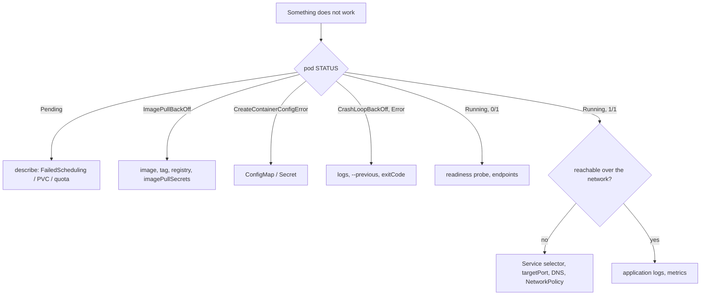

# Troubleshooting: expert

🌐 [Русский](expert.ru.md) · **English**

**Levels:** [overview](overview.en.md) · [1. Basics](basics.en.md) · [2. Advanced](advanced.en.md) · **3. Expert** · [4. Quiz](quiz.en.md)

Builds on [basic](basics.en.md) and [advanced](advanced.en.md) theory. What was confirmed by an experiment in kind (Kubernetes 1.37.0) is marked "in the experiment".

## Reference

### Container waiting reasons (`state.waiting.reason`)

| Reason | What happened | Where to look |
|---|---|---|
| `ContainerCreating` | the image is being pulled, a volume mounted (visible in the first seconds in the experiment) | pod events |
| `ErrImagePull` / `ImagePullBackOff` | the image cannot be pulled (in the experiment) | `state.message`, events |
| `CreateContainerConfigError` | no ConfigMap/Secret or a wrong reference (in the experiment) | `state.message` |
| `RunContainerError` | the process does not start: a wrong command (in the experiment) | `Failed` events |
| `CrashLoopBackOff` | the container crashes and waits for a restart | `logs`, `lastState` |

> ⚠️ Verify: `InvalidImageName`, `CreateContainerError`, `PodInitializing` and the `Init:…` statuses of init containers are taken from the documentation and were not reproduced.

### Container termination (`lastState.terminated`)

| Field | Value |
|---|---|
| `reason` | `OOMKilled` (in the experiment), `Error`, `Completed` |
| `exitCode` | `137` for `OOMKilled` (in the experiment); `255` and `Error` for a failing command (in the experiment); `0` is success |
| `startedAt`, `finishedAt` | the running time; identical seconds point to an instant crash |

Exit codes above 128 denote a signal: `code − 128` (`137 = 128 + 9`, `SIGKILL`). Code `143` corresponds to `SIGTERM` and usually means a graceful stop.

> ⚠️ Verify: the decoding of codes `139` (`SIGSEGV`) and `143` comes from general Linux practice and was not reproduced in the experiments.

### Object conditions

| Object | Condition | Meaning |
|---|---|---|
| Pod | `PodScheduled`, `Initialized`, `ContainersReady`, `Ready` | stages of the pod's life |
| Deployment | `Available`, `Progressing`, `ReplicaFailure` (`FailedCreate` — in the experiment with a quota) | the rollout state |
| Node | `Ready`, `MemoryPressure`, `DiskPressure`, `PIDPressure` (`Unknown` on lost contact — in the experiment) | node health |

### Commands

| Command | Purpose |
|---|---|
| `kubectl get pod -o wide` | status, node, IP |
| `kubectl describe <object>` | state and events |
| `kubectl get events --field-selector reason=…,involvedObject.name=…` | exact events |
| `kubectl logs [--previous] [-c C]` | container output |
| `kubectl exec P -c C -- …` | run a command |
| `kubectl debug pod/P --image=… --target=C -c dbg` | a temporary container (in the experiment) |
| `kubectl debug node/N --image=…` | a pod on the node with `/host` (in the experiment) |
| `kubectl get endpoints S` / `endpointslices` | the addresses behind a Service (in the experiment) |
| `kubectl get node N -o jsonpath='{.spec.taints}'` | node taints (in the experiment) |
| `kubectl port-forward`, `kubectl cp`, `kubectl auth can-i` | port forwarding, copying, permissions |

> ⚠️ Verify: `port-forward`, `cp` and `auth can-i` were not run in this module (the first two are used in other modules, `auth can-i` — [in module 10](../10-namespaces-and-rbac/overview.en.md)).

## Internals

- **Where the status comes from.** `STATUS` in `kubectl get pods` is not an API field but a computed string: `kubectl` picks the most important reason from `containerStatuses`, phases and conditions. So in the raw `status` the word `ImagePullBackOff` may exist not as a "status" but only as `waiting.reason`.
- **Where events come from.** Events are written by the kubelet (image, start, probes), the scheduler (`FailedScheduling`, `Scheduled`), controllers (`FailedCreate`, `Preempted`). An event has a source object, a reason and a counter; repeats are folded together (`x4 over 37s`).
- **The pause before a retry.** The kubelet increases the pause between restarts and image pull retries (`BackOff`); hence the `…BackOff` statuses between attempts.
- **Endpoints are built by the Service controller.** It selects pods by `selector`, takes readiness into account and writes the addresses and ports (`targetPort`) to `Endpoints`/`EndpointSlice`. Kube-proxy on each node turns them into rules; for a Service without addresses the connection is refused (in the experiment `Connection refused`).
- **Ephemeral containers** are added through a separate pod subresource (`ephemeralContainers`); they cannot be changed or removed after being added (in the experiment they stay in the pod's `spec`).
- **The node lifecycle.** The node controller waits for updates from the kubelet; if there are none for about 40–50 seconds (in the experiment the node became `NotReady` after ≈50 s), it sets `Unknown` conditions and `unreachable` taints. Pod eviction happens by `tolerationSeconds` (300 s by default).
- **Quota** is checked by an admission plugin when an object is created: that is why the failure happens at the moment a ReplicaSet creates the pod, not at start (in the experiment `exceeded quota`).

> ⚠️ Verify: the exact wait times of the node controller (`node-monitor-grace-period`) were not read from the configuration in the experiment; the ≈50 seconds is the value measured in kind.



## Gotchas

### 1. `137` is not always OOM

In the experiment one command gave `255` and `Error`, and `OOMKilled` appeared only on a real limit breach. Look at `lastState.reason`.

### 2. `--previous` is unavailable for quickly crashing containers

Earlier instances may be removed by the kubelet (see [module 16](../16-observability/expert.en.md#1---previous-does-not-always-return-logs)).

### 3. `ENDPOINTS <none>` and `Connection refused`

A Service without endpoints does not "hang", it refuses connections (in the experiment). `get endpoints` first, then the network.

### 4. The right `targetPort` is the container port

Endpoints with port `8080` and no listening process: there are addresses but no connection (in the experiment).

### 5. A rolling update "stuck" because of a probe

The new pod is `0/1 Running`, the old ones serve traffic, and `rollout status` waits and ends with a timeout (in the experiment). The `Unhealthy` event gives the response code.

### 6. A Deployment without pods and without visible errors in it

The cause is in `ReplicaFailure` and the ReplicaSet events (in the experiment: a quota).

### 7. Removing a finalizer leaves garbage

`finalizers: null` unblocks deletion, but the cleanup the finalizer was there for will not run.

### 8. A `NotReady` node, but the pods are `Running`

Until `tolerationSeconds` expires, the pods of an unreachable node stay `Running` (in the experiment) although they do not really work. Do not trust the `STATUS` column alone.

### 9. The node debugging pod stays

`kubectl debug node/…` leaves a pod `node-debugger-…`: it must be deleted (in the experiment it stayed in the pod list).

## Trade-offs and alternatives

| Approach | Pros | Cons |
|---|---|---|
| `kubectl exec` | simple | a shell is needed in the image |
| `kubectl debug` (ephemeral) | any tools, no image rebuild | rights on the subresource are needed, the container cannot be removed |
| An image with tools in every pod | always at hand | a bigger attack surface and size |
| `kubectl debug node` | access to the host | privileges, sensitive for security |
| UIs (k9s, Lens) | a quick overview | not run |
| Centralized logs and metrics ([module 16](../16-observability/overview.en.md)) | history | must be set up in advance |

## Interview questions

<details><summary>1. A pod is <code>Pending</code>. Where do you start?</summary>

`kubectl describe pod`: the `FailedScheduling` event names the cause (resources, taints, selectors, PVC).

→ [Basic theory](basics.en.md#pending)

</details>

<details><summary>2. How does <code>ErrImagePull</code> differ from <code>ImagePullBackOff</code>?</summary>

`ErrImagePull` is the pull error, `ImagePullBackOff` is the pause before the next attempt.

→ [Basic theory](basics.en.md#imagepullbackoff-and-errimagepull)

</details>

<details><summary>3. What does <code>CreateContainerConfigError</code> mean?</summary>

The container cannot be created because of its configuration: most often a ConfigMap or Secret is missing.

→ [Basic theory](basics.en.md#createcontainerconfigerror)

</details>

<details><summary>4. Trick: is exit code <code>137</code> always a lack of memory?</summary>

No: it is `SIGKILL`. `lastState.reason` confirms `OOMKilled`.

→ [Gotcha 1](#1-137-is-not-always-oom)

</details>

<details><summary>5. How do you find the cause of a container crash?</summary>

`logs`, `logs --previous`, `lastState.terminated` (code and reason), events.

→ [Basic theory](basics.en.md#crashloopbackoff)

</details>

<details><summary>6. A Service does not respond. What do you check?</summary>

Endpoints, the selector, pod readiness, `targetPort`, DNS, NetworkPolicy.

→ [Advanced theory](advanced.en.md#a-service-without-endpoints)

</details>

<details><summary>7. Trick: a Service has endpoints but the connection is refused. Why?</summary>

`targetPort` does not match the port the container listens on.

→ [Gotcha 4](#4-the-right-targetport-is-the-container-port)

</details>

<details><summary>8. Why did a rolling update hang while the old pods keep working?</summary>

The new pod does not pass the readiness probe; the Deployment does not switch traffic until it is ready.

→ [Advanced theory](advanced.en.md#unready-pods-do-not-get-into-endpoints)

</details>

<details><summary>9. How do you debug a container without a shell?</summary>

`kubectl debug` with a temporary container and `--target` for a shared process namespace.

→ [Advanced theory](advanced.en.md#kubectl-debug-looking-inside)

</details>

<details><summary>10. An object is stuck in <code>Terminating</code>. The cause and the fix?</summary>

A finalizer: look at `metadata.finalizers` and `deletionTimestamp`, find the controller; remove it by hand only deliberately.

→ [Advanced theory](advanced.en.md#an-object-stuck-in-terminating)

</details>

<details><summary>11. A Deployment shows <code>0/5</code> with no errors in the Deployment itself. Where is the cause?</summary>

In the `ReplicaFailure` condition and the ReplicaSet events: quota or admission (`FailedCreate`).

→ [Advanced theory](advanced.en.md#quota-replicafailure)

</details>

<details><summary>12. A node is <code>NotReady</code>, yet the pods are <code>Running</code>. Why?</summary>

Eviction from an unreachable node happens by `tolerationSeconds` (300 s by default); until then the pod statuses do not change.

→ [Gotcha 8](#8-a-notready-node-but-the-pods-are-running)

</details>

## Cheat sheet

```text
kubectl get pod -o wide ; kubectl describe pod P
kubectl get events --sort-by=.lastTimestamp
kubectl logs P [-c C] [--previous]
kubectl get endpoints S ; kubectl exec P -- nslookup S
kubectl debug pod/P --image=busybox:1.37 --target=C -c dbg -- sleep 300
kubectl debug node/N --image=busybox:1.37 -- sh
kubectl get node N -o jsonpath='{.spec.taints}'
```

- Status → events → logs → inside.
- `Pending` — the scheduler and volumes; `…BackOff` — image/application; `0/1 Running` — the probe.
- Service: endpoints → port → DNS → NetworkPolicy.
- A finalizer holds `Terminating`; quota and admission give `ReplicaFailure`.

## Related materials

- Previous level: [advanced theory](advanced.en.md)
- Logs and metrics: [16 · Observability](../16-observability/expert.en.md)
- Scheduling and nodes: [18 · Pod scheduling](../18-scheduling/expert.en.md)
- Security and admission: [17 · Security](../17-security/expert.en.md)
- Probes: [11 · Probes and resources](../11-probes-and-resources/expert.en.md)

## Sources

- [Debug Pods](https://kubernetes.io/docs/tasks/debug/debug-application/debug-pods/)
- [Debug Services](https://kubernetes.io/docs/tasks/debug/debug-application/debug-service/)
- [Ephemeral Containers](https://kubernetes.io/docs/concepts/workloads/pods/ephemeral-containers/)
- [Pod Lifecycle: container states](https://kubernetes.io/docs/concepts/workloads/pods/pod-lifecycle/#container-states)
- [Node status and taints](https://kubernetes.io/docs/concepts/architecture/nodes/)
