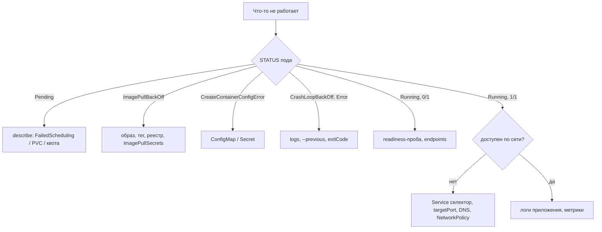

# Диагностика: экспертная теория

🌐 **Русский** · [English](expert.en.md)

**Уровни:** [обзор](overview.ru.md) · [1. Базовая](basics.ru.md) · [2. Продвинутая](advanced.ru.md) · **3. Экспертная** · [4. Квиз](quiz.ru.md)

Опирается на [базовую](basics.ru.md) и [продвинутую](advanced.ru.md) теорию. Что подтверждено опытом в kind (Kubernetes 1.37.0) — помечено «в опыте».

## Справочник

### Причины ожидания контейнера (`state.waiting.reason`)

| Причина | Что случилось | Где смотреть |
|---|---|---|
| `ContainerCreating` | образ тянется, том монтируется (в опыте виден в первые секунды) | события пода |
| `ErrImagePull` / `ImagePullBackOff` | образ не скачивается (в опыте) | `state.message`, события |
| `CreateContainerConfigError` | нет ConfigMap/Secret или неверная ссылка (в опыте) | `state.message` |
| `RunContainerError` | процесс не запускается: неверная команда (в опыте) | события `Failed` |
| `CrashLoopBackOff` | контейнер падает и ждёт перезапуска | `logs`, `lastState` |

> ⚠️ Проверить: `InvalidImageName`, `CreateContainerError`, `PodInitializing` и `Init:…` статусы init-контейнеров взяты из документации и не воспроизводились.

### Завершение контейнера (`lastState.terminated`)

| Поле | Значение |
|---|---|
| `reason` | `OOMKilled` (в опыте), `Error`, `Completed` |
| `exitCode` | `137` для `OOMKilled` (в опыте); `255` и `Error` для сбойной команды (в опыте); `0` — успех |
| `startedAt`, `finishedAt` | время работы; совпадающие секунды указывают на мгновенное падение |

Коды выхода выше 128 обозначают сигнал: `код − 128` (`137 = 128 + 9`, `SIGKILL`). Код `143` соответствует `SIGTERM` и обычно означает корректную остановку.

> ⚠️ Проверить: расшифровка кодов `139` (`SIGSEGV`) и `143` взята из общей практики Linux и в опытах не воспроизводилась.

### Условия объектов

| Объект | Условие | Смысл |
|---|---|---|
| Pod | `PodScheduled`, `Initialized`, `ContainersReady`, `Ready` | этапы жизни пода |
| Deployment | `Available`, `Progressing`, `ReplicaFailure` (`FailedCreate` — в опыте при квоте) | состояние раскатки |
| Node | `Ready`, `MemoryPressure`, `DiskPressure`, `PIDPressure` (`Unknown` при потере связи — в опыте) | здоровье ноды |

### Команды

| Команда | Назначение |
|---|---|
| `kubectl get pod -o wide` | статус, нода, IP |
| `kubectl describe <объект>` | состояние и события |
| `kubectl get events --field-selector reason=…,involvedObject.name=…` | точные события |
| `kubectl logs [--previous] [-c C]` | вывод контейнера |
| `kubectl exec P -c C -- …` | выполнить команду |
| `kubectl debug pod/P --image=… --target=C -c dbg` | временный контейнер (в опыте) |
| `kubectl debug node/N --image=…` | под на ноде с `/host` (в опыте) |
| `kubectl get endpoints S` / `endpointslices` | адреса за Service (в опыте) |
| `kubectl get node N -o jsonpath='{.spec.taints}'` | taints ноды (в опыте) |
| `kubectl port-forward`, `kubectl cp`, `kubectl auth can-i` | проброс порта, копирование, права |

> ⚠️ Проверить: `port-forward`, `cp` и `auth can-i` в этом модуле не запускались (первые два использованы в других модулях, `auth can-i` — [в модуле 10](../10-namespaces-and-rbac/overview.ru.md)).

## Внутреннее устройство

- **Откуда берётся статус.** `STATUS` в `kubectl get pods` — не поле API, а вычисленная строка: `kubectl` выбирает самую важную причину из `containerStatuses`, фаз и условий. Поэтому в сыром `status` слов `ImagePullBackOff` может не быть как «статуса», а только как `waiting.reason`.
- **Откуда события.** События пишут kubelet (образ, запуск, пробы), планировщик (`FailedScheduling`, `Scheduled`), контроллеры (`FailedCreate`, `Preempted`). У события есть объект-источник, причина, счётчик; повторы сворачиваются (`x4 over 37s`).
- **Пауза перед повтором.** Kubelet увеличивает паузу между перезапусками и повторами загрузки образа (`BackOff`); отсюда статусы `…BackOff` между попытками.
- **Endpoints строит контроллер Service.** Он выбирает поды по `selector`, учитывает готовность (readiness) и пишет адреса и порты (`targetPort`) в `Endpoints`/`EndpointSlice`. Kube-proxy на каждой ноде превращает их в правила; для Service без адресов соединение отклоняется (в опыте `Connection refused`).
- **Ephemeral-контейнеры** добавляются через отдельный subresource пода (`ephemeralContainers`); их нельзя изменить или убрать после добавления (в опыте они остаются в `spec` пода).
- **Жизненный цикл ноды.** Контроллер нод ждёт обновлений от kubelet; если их нет примерно 40–50 секунд (в опыте нода стала `NotReady` через ≈50 с), он ставит условия `Unknown` и taints `unreachable`. Выселение подов наступает по `tolerationSeconds` (по умолчанию 300 с).
- **Квота** проверяется admission-плагином при создании объекта: поэтому сбой происходит в момент создания пода ReplicaSet'ом, а не при запуске (в опыте `exceeded quota`).

> ⚠️ Проверить: точные значения времени ожидания контроллера нод (`node-monitor-grace-period`) в опыте не читались из конфигурации; ориентир ≈50 секунд — это измеренное значение в kind.



## Подвохи

### 1. `137` — не всегда OOM

В опыте одна команда дала `255` и `Error`, а `OOMKilled` — только при реальном превышении лимита. Смотрите `lastState.reason`.

### 2. `--previous` недоступен для быстро падающих контейнеров

Предыдущие экземпляры могут быть удалены kubelet'ом (см. [модуль 16](../16-observability/expert.ru.md#1---previous-не-всегда-возвращает-логи)).

### 3. `ENDPOINTS <none>` и `Connection refused`

Service без endpoints не «висит», а отклоняет соединения (в опыте). Сначала `get endpoints`, потом сеть.

### 4. Верный `targetPort` — это порт контейнера

Endpoints с портом `8080` без слушающего процесса: адреса есть, соединения нет (в опыте).

### 5. Rolling update «застрял» из-за пробы

Новый под `0/1 Running`, старые обслуживают трафик, а `rollout status` ждёт и завершается по таймауту (в опыте). Событие `Unhealthy` даёт код ответа.

### 6. Deployment без подов и без видимых ошибок в нём

Причина в `ReplicaFailure` и событиях ReplicaSet (в опыте: квота).

### 7. Снятие финализатора оставляет мусор

`finalizers: null` разблокирует удаление, но очистка, ради которой стоял финализатор, не выполнится.

### 8. Нода `NotReady`, но поды `Running`

Пока не истёк `tolerationSeconds`, поды недоступной ноды остаются `Running` (в опыте), хотя фактически не работают. Не доверяйте только колонке `STATUS`.

### 9. Отладочный под ноды остаётся

`kubectl debug node/…` оставляет под `node-debugger-…`: его нужно удалять (в опыте он остался в списке подов).

## Компромиссы и альтернативы

| Подход | Плюсы | Минусы |
|---|---|---|
| `kubectl exec` | просто | нужна оболочка в образе |
| `kubectl debug` (ephemeral) | любые инструменты, без пересборки образа | нужны права на subresource, контейнер не убрать |
| Образ с инструментами в каждом поде | всегда под рукой | больше поверхность атаки и размер |
| `kubectl debug node` | доступ к хосту | привилегии, чувствительно к безопасности |
| Интерфейсы (k9s, Lens) | быстрый обзор | не запускались |
| Централизованные логи и метрики ([модуль 16](../16-observability/overview.ru.md)) | история | требуют настройки заранее |

## Вопросы с собеседований

<details><summary>1. Под в <code>Pending</code>. С чего начнёте?</summary>

`kubectl describe pod`: событие `FailedScheduling` называет причину (ресурсы, taints, селекторы, PVC).

→ [Базовая теория](basics.ru.md#pending)

</details>

<details><summary>2. Чем <code>ErrImagePull</code> отличается от <code>ImagePullBackOff</code>?</summary>

`ErrImagePull` — ошибка загрузки, `ImagePullBackOff` — пауза перед следующей попыткой.

→ [Базовая теория](basics.ru.md#imagepullbackoff-и-errimagepull)

</details>

<details><summary>3. Что означает <code>CreateContainerConfigError</code>?</summary>

Контейнер нельзя создать из-за конфигурации: чаще всего отсутствует ConfigMap или Secret.

→ [Базовая теория](basics.ru.md#createcontainerconfigerror)

</details>

<details><summary>4. Ловушка: код выхода <code>137</code> — всегда нехватка памяти?</summary>

Нет: это `SIGKILL`. Причину `OOMKilled` подтверждает `lastState.reason`.

→ [Подвох 1](#1-137--не-всегда-oom)

</details>

<details><summary>5. Как найти причину падения контейнера?</summary>

`logs`, `logs --previous`, `lastState.terminated` (код и причина), события.

→ [Базовая теория](basics.ru.md#crashloopbackoff)

</details>

<details><summary>6. Service не отвечает. Что проверить?</summary>

Endpoints, селектор, готовность подов, `targetPort`, DNS, NetworkPolicy.

→ [Продвинутая теория](advanced.ru.md#service-без-endpoints)

</details>

<details><summary>7. Ловушка: у Service есть endpoints, но соединение отклоняется. Почему?</summary>

`targetPort` не совпадает с портом, который слушает контейнер.

→ [Подвох 4](#4-верный-targetport--это-порт-контейнера)

</details>

<details><summary>8. Почему rolling update завис, а старые поды продолжают работать?</summary>

Новый под не проходит readiness-пробу; Deployment не переключает трафик, пока он не готов.

→ [Продвинутая теория](advanced.ru.md#неготовые-поды-не-попадают-в-endpoints)

</details>

<details><summary>9. Как отладить контейнер без оболочки?</summary>

`kubectl debug` с временным контейнером и `--target` для общего пространства процессов.

→ [Продвинутая теория](advanced.ru.md#kubectl-debug-заглянуть-внутрь)

</details>

<details><summary>10. Объект висит в <code>Terminating</code>. Причина и решение?</summary>

Финализатор: смотрите `metadata.finalizers` и `deletionTimestamp`, выясните контроллер; снимайте вручную лишь осознанно.

→ [Продвинутая теория](advanced.ru.md#объект-завис-в-terminating)

</details>

<details><summary>11. Deployment показывает <code>0/5</code> без ошибок в самом Deployment. Где причина?</summary>

В условии `ReplicaFailure` и событиях ReplicaSet: квота или admission (`FailedCreate`).

→ [Продвинутая теория](advanced.ru.md#квота-replicafailure)

</details>

<details><summary>12. Нода <code>NotReady</code>, а поды <code>Running</code>. Почему?</summary>

Выселение с недоступной ноды наступает по `tolerationSeconds` (по умолчанию 300 с), до этого статусы подов не меняются.

→ [Подвох 8](#8-нода-notready-но-поды-running)

</details>

## Шпаргалка

```text
kubectl get pod -o wide ; kubectl describe pod P
kubectl get events --sort-by=.lastTimestamp
kubectl logs P [-c C] [--previous]
kubectl get endpoints S ; kubectl exec P -- nslookup S
kubectl debug pod/P --image=busybox:1.37 --target=C -c dbg -- sleep 300
kubectl debug node/N --image=busybox:1.37 -- sh
kubectl get node N -o jsonpath='{.spec.taints}'
```

- Статус → события → логи → внутрь.
- `Pending` — планировщик и тома; `…BackOff` — образ/приложение; `0/1 Running` — проба.
- Service: endpoints → порт → DNS → NetworkPolicy.
- Финализатор держит `Terminating`; квота и admission дают `ReplicaFailure`.

## Связанные материалы

- Предыдущий уровень: [продвинутая теория](advanced.ru.md)
- Логи и метрики: [16 · Наблюдаемость](../16-observability/expert.ru.md)
- Планирование и ноды: [18 · Планирование подов](../18-scheduling/expert.ru.md)
- Безопасность и admission: [17 · Безопасность](../17-security/expert.ru.md)
- Пробы: [11 · Probes и ресурсы](../11-probes-and-resources/expert.ru.md)

## Источники

- [Debug Pods](https://kubernetes.io/docs/tasks/debug/debug-application/debug-pods/)
- [Debug Services](https://kubernetes.io/docs/tasks/debug/debug-application/debug-service/)
- [Ephemeral Containers](https://kubernetes.io/docs/concepts/workloads/pods/ephemeral-containers/)
- [Pod Lifecycle: container states](https://kubernetes.io/docs/concepts/workloads/pods/pod-lifecycle/#container-states)
- [Node status and taints](https://kubernetes.io/docs/concepts/architecture/nodes/)
