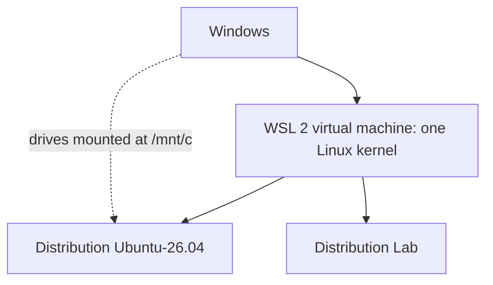

# Environment setup: expert

🌐 [Русский](expert.ru.md) · **English**

**Levels:** [overview](overview.en.md) · [1. Basics](basics.en.md) · [2. Advanced](advanced.en.md) · **3. Expert** · [4. Quiz](quiz.en.md)

## Under the hood

WSL 2 is a single lightweight virtual machine running a Linux kernel shipped by Microsoft; distributions run inside it and share that kernel. That is why `wsl --shutdown` stops everything at once and memory limits are global.



A container has no kernel of its own either: `uname -r` inside shows the host kernel while `/etc/os-release` shows the image's distribution. The output in the basics (`6.6.87.2-microsoft-standard-WSL2` together with Ubuntu 26.04) is exactly that.

## Reference

| `wsl` command | Effect |
|---|---|
| `--install [-d <name>]` | install; `--no-launch`, `--location`, `--web-download`, `--no-distribution` |
| `--list` (`-l`) | `--online`, `--verbose`, `--running`, `--all`, `--quiet` |
| `--set-default <name>` | default distribution |
| `--set-default-version 1\|2` | version for new installs |
| `--set-version <name> 1\|2` | convert a distribution |
| `-d <name>` | start a specific distribution |
| `--status`, `--version` | state and versions |
| `--terminate <name>`, `--shutdown` | stop one or all |
| `--export <name> <file>` | snapshot to tar; `--vhd` for VHDX (WSL 2) |
| `--import <name> <dir> <file>` | create a distribution from a snapshot |
| `--import-in-place <name> <vhdx>` | register an ext4 VHDX without copying |
| `--unregister <name>` | delete together with its data |

| `wsl.conf` | Default |
|---|---|
| `[boot] systemd` | `false` (a distribution may ship with `true`) |
| `[boot] command` | a command run as root at start |
| `[automount] enabled`, `mountFsTab` | `true` |
| `[automount] root` | `/mnt/` |
| `[automount] options` | `uid`, `gid`, `umask=022`, `fmask=000`, `dmask=000`, `case=off`; `metadata` is off |

`umask`, `fmask` and `dmask` take effect only when `metadata` is enabled.

## Case sensitivity

Filesystems inside WSL are case-sensitive: `Readme` and `README` are two files. Windows is not by default. A single NTFS directory can be made case-sensitive (`fsutil.exe file setCaseSensitiveInfo <path> enable`, elevated, the directory must be empty), but Windows programs may not expect it.

## Gotchas

### A script with Windows line endings

```bash
printf '#!/bin/bash\r\necho hi\r\n' > crlf.sh
chmod +x crlf.sh
./crlf.sh; echo "exit=$?"
file crlf.sh
sed -i 's/\r$//' crlf.sh
./crlf.sh
```

```text
bash: ./crlf.sh: /bin/bash^M: bad interpreter: No such file or directory
exit=126
crlf.sh: Bourne-Again shell script, ASCII text executable, with CRLF line terminators
hi
```

The kernel reads the first line and looks for the interpreter `/bin/bash\r`. Save with LF or fix with `sed` as above. In git, a `.gitattributes` line `*.sh text eol=lf` prevents it.

### sudo elevates only the program it starts

```bash
id -u
sudo id -u
cd /root; echo "exit=$?"
```

```text
1000
0
bash: line 6: cd: /root: Permission denied
exit=1
```

`sudo id -u` prints `0`, but the current shell is unchanged: `cd` is a shell builtin, so `sudo cd` cannot help. This lab has passwordless sudo; your system will ask for a password.

## Trade-offs and alternatives

| Option | Pros | Cons |
|---|---|---|
| WSL 2 | quick start, Windows integration | not a full boot: no bootloader or distribution kernel of its own |
| Container | disposable, reproducible | minimised image, shared kernel, usually no systemd |
| Virtual machine (Hyper-V, VirtualBox, Multipass) | a complete system: boot, disks, kernel | heavier |
| Cloud server | like production | costs money, exposed to the internet, so it must be secured |

The disk and boot modules (13 and 18 on the roadmap) will need a virtual machine.

## Interview questions

1. Is Linux an operating system?
<details><summary>Answer</summary>

Strictly, it is a kernel. The operating system is the kernel plus userland programs; such a bundle is a distribution.
</details>

2. How does a terminal differ from a shell?
<details><summary>Answer</summary>

The terminal handles input and display; the shell parses lines and starts programs. They can be swapped independently.
</details>

3. Which kernel does a container see?
<details><summary>Answer</summary>

The host's: a container has none of its own. So `uname -r` and `/etc/os-release` describe different things.
</details>

4. Why not work as root all the time?
<details><summary>Answer</summary>

Any mistake or malicious script gets full access. `sudo` limits elevation to one command and leaves a log entry.
</details>

5. What is LTS?
<details><summary>Answer</summary>

A long-term support release. Servers and learners pick it: behaviour stays stable while security updates keep coming.
</details>

6. Why does `sudo echo x > /etc/file` give `Permission denied`?
<details><summary>Answer</summary>

Your shell performs the redirection before sudo starts. Use `echo x | sudo tee /etc/file`. See module 03.
</details>

7. How do you clone a WSL distribution?
<details><summary>Answer</summary>

`wsl --export`, then `wsl --import` with a new name and directory.
</details>

8. Why might a `.wslconfig` change have no effect?
<details><summary>Answer</summary>

The VM was not restarted, the distribution is WSL 1, or the file is malformed, in which case it is silently ignored.
</details>

9. A script works on a colleague's Fedora but behaves differently on your Ubuntu 26.04. What do you check?
<details><summary>Answer</summary>

Utility versions and implementations (`--version`): many are uutils on 26.04. Also which shell runs the script: `/bin/sh` is dash on Ubuntu.
</details>

10. When can WSL not replace a virtual machine?
<details><summary>Answer</summary>

When studying boot, the distribution kernel, disk partitioning, or when you need the networking of a separate server.
</details>

## Cheat sheet

```powershell
wsl -l -v                 # PowerShell: what is installed
wsl --terminate <name>    # PowerShell: restart a distribution
cat /etc/os-release       # which distribution
uname -r                  # which kernel
sudo apt update && sudo apt upgrade
```

## Related materials

- Next: [02 · Filesystem](../02-filesystem/overview.en.md), [03 · Shell basics](../03-shell-basics/overview.en.md)
- Containers as a disposable environment: [Kubernetes 01 · Containers](../../../kubernetes/modules/01-containers/overview.en.md)

## Sources

- [Install WSL](https://learn.microsoft.com/en-us/windows/wsl/install)
- [Basic commands for WSL](https://learn.microsoft.com/en-us/windows/wsl/basic-commands)
- [Working across file systems](https://learn.microsoft.com/en-us/windows/wsl/filesystems)
- [Advanced settings configuration in WSL](https://learn.microsoft.com/en-us/windows/wsl/wsl-config)
- [Comparing WSL versions](https://learn.microsoft.com/en-us/windows/wsl/compare-versions)
- [File permissions for WSL](https://learn.microsoft.com/en-us/windows/wsl/file-permissions)
- [Case sensitivity](https://learn.microsoft.com/en-us/windows/wsl/case-sensitivity)
- [Ubuntu 26.04 LTS release notes: summary for LTS users](https://documentation.ubuntu.com/release-notes/26.04/summary-for-lts-users/)
