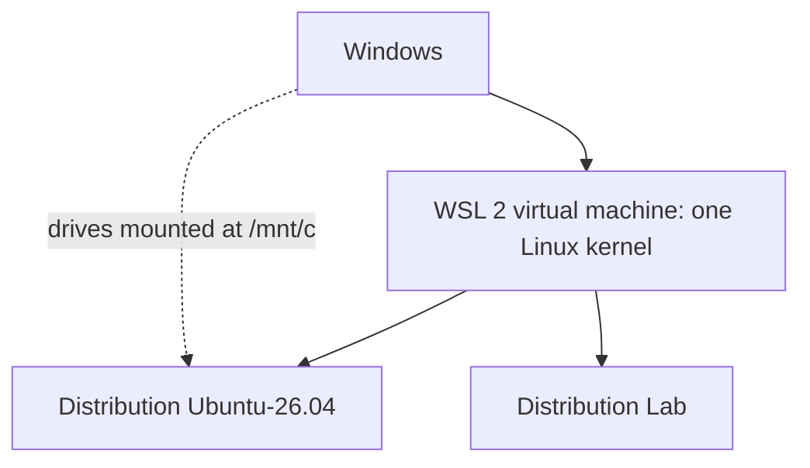

# Подготовка окружения: экспертный уровень

🌐 **Русский** · [English](expert.en.md)

**Уровни:** [обзор](overview.ru.md) · [1. Основы](basics.ru.md) · [2. Продвинутый](advanced.ru.md) · **3. Эксперт** · [4. Квиз](quiz.ru.md)

## Под капотом

WSL 2 — это одна лёгкая виртуальная машина с ядром Linux, которое поставляет Microsoft; дистрибутивы работают внутри неё и делят это ядро. Поэтому `wsl --shutdown` останавливает всё сразу, а лимиты памяти задаются глобально.



Контейнер тоже не имеет своего ядра: `uname -r` внутри него показывает ядро хоста, а `/etc/os-release` — дистрибутив образа. Вывод в базовой теории (`6.6.87.2-microsoft-standard-WSL2` вместе с Ubuntu 26.04) — именно такой случай.

## Справочник

| Команда `wsl` | Действие |
|---|---|
| `--install [-d <имя>]` | установить; `--no-launch`, `--location`, `--web-download`, `--no-distribution` |
| `--list` (`-l`) | `--online`, `--verbose`, `--running`, `--all`, `--quiet` |
| `--set-default <имя>` | дистрибутив по умолчанию |
| `--set-default-version 1\|2` | версия для новых установок |
| `--set-version <имя> 1\|2` | преобразовать дистрибутив |
| `-d <имя>` | запустить конкретный дистрибутив |
| `--status`, `--version` | состояние и версии |
| `--terminate <имя>`, `--shutdown` | остановить один или все |
| `--export <имя> <файл>` | снимок в tar; `--vhd` — в VHDX (WSL 2) |
| `--import <имя> <каталог> <файл>` | создать дистрибутив из снимка |
| `--import-in-place <имя> <vhdx>` | подключить VHDX с ext4 без копирования |
| `--unregister <имя>` | удалить вместе с данными |

| `wsl.conf` | Значение по умолчанию |
|---|---|
| `[boot] systemd` | `false` (дистрибутив может поставляться с `true`) |
| `[boot] command` | команда от root при старте |
| `[automount] enabled`, `mountFsTab` | `true` |
| `[automount] root` | `/mnt/` |
| `[automount] options` | `uid`, `gid`, `umask=022`, `fmask=000`, `dmask=000`, `case=off`; `metadata` выключена |

`umask`, `fmask` и `dmask` действуют только при включённой `metadata`.

## Регистр имён

Файловые системы внутри WSL чувствительны к регистру: `Readme` и `README` — два файла. Windows по умолчанию — нет. Отдельному каталогу NTFS можно включить чувствительность (`fsutil.exe file setCaseSensitiveInfo <путь> enable`, с правами администратора, каталог должен быть пустым), но программы Windows могут этого не ожидать.

## Подвохи

### Скрипт с переводами строк Windows

```bash
printf '#!/bin/bash\r\necho hi\r\n' > crlf.sh
chmod +x crlf.sh
./crlf.sh; echo "exit=$?"
file crlf.sh
sed -i 's/\r$//' crlf.sh
./crlf.sh
```

```text
bash: ./crlf.sh: /bin/bash^M: bad interpreter: No such file or directory
exit=126
crlf.sh: Bourne-Again shell script, ASCII text executable, with CRLF line terminators
hi
```

Ядро читает первую строку и ищет интерпретатор `/bin/bash\r`. Лечится сохранением в LF или `sed`, как выше. В git помогает `.gitattributes` со строкой `*.sh text eol=lf`.

### sudo повышает права только запущенной программе

```bash
id -u
sudo id -u
cd /root; echo "exit=$?"
```

```text
1000
0
bash: line 6: cd: /root: Permission denied
exit=1
```

`sudo id -u` печатает `0`, но текущий shell остаётся прежним: `cd` — встроенная команда shell, и `sudo cd` ничего не даст. В этой учебной среде sudo настроен без пароля; на вашей системе он спросит пароль.

## Компромиссы и альтернативы

| Вариант | Плюсы | Минусы |
|---|---|---|
| WSL 2 | быстрый старт, интеграция с Windows | не полноценная загрузка: нет своего загрузчика и ядра дистрибутива |
| Контейнер | одноразовый, воспроизводимый | урезанный образ, общее ядро, обычно без systemd |
| Виртуальная машина (Hyper-V, VirtualBox, Multipass) | полная система: загрузка, диски, ядро | тяжелее |
| Облачный сервер | как в продакшене | платно, открыт в интернет — нужна защита |

Модулям про диски и загрузку (13 и 18 дорожной карты) понадобится виртуальная машина.

## Вопросы с собеседований

1. Linux — это операционная система?
<details><summary>Ответ</summary>

Строго говоря, это ядро. Операционную систему образуют ядро и пользовательские программы; такую сборку называют дистрибутивом.
</details>

2. Чем терминал отличается от shell?
<details><summary>Ответ</summary>

Терминал отвечает за ввод и отображение текста, shell разбирает строки и запускает программы. Их можно менять независимо.
</details>

3. Какое ядро видит контейнер?
<details><summary>Ответ</summary>

Ядро хоста: своего у контейнера нет. Поэтому `uname -r` и `/etc/os-release` говорят о разном.
</details>

4. Почему не работать под root постоянно?
<details><summary>Ответ</summary>

Любая ошибка или вредоносный скрипт получают полный доступ. `sudo` ограничивает повышение одной командой и оставляет след в журнале.
</details>

5. Что такое LTS?
<details><summary>Ответ</summary>

Выпуск с длительной поддержкой. Для серверов и учёбы берут его: поведение долго не меняется, а обновления безопасности приходят.
</details>

6. Почему `sudo echo x > /etc/file` даёт `Permission denied`?
<details><summary>Ответ</summary>

Перенаправление выполняет ваш shell до запуска sudo. Нужно `echo x | sudo tee /etc/file`. Подробнее в модуле 03.
</details>

7. Как сделать копию дистрибутива WSL?
<details><summary>Ответ</summary>

`wsl --export`, затем `wsl --import` под новым именем и в новый каталог.
</details>

8. Почему изменение `.wslconfig` могло «не сработать»?
<details><summary>Ответ</summary>

Виртуальная машина не перезапущена, у дистрибутива WSL 1 или в файле ошибка синтаксиса: тогда он молча игнорируется.
</details>

9. Скрипт работает у коллеги на Fedora, а у вас на Ubuntu 26.04 ведёт себя иначе. Что проверить?
<details><summary>Ответ</summary>

Версии и реализации утилит (`--version`): в 26.04 многие из uutils. Ещё — какой shell запускает скрипт: `/bin/sh` в Ubuntu это dash.
</details>

10. Когда WSL не заменит виртуальную машину?
<details><summary>Ответ</summary>

Когда изучают загрузку, ядро дистрибутива, разметку дисков или нужна сеть как у отдельного сервера.
</details>

## Шпаргалка

```powershell
wsl -l -v                 # PowerShell: what is installed
wsl --terminate <name>    # PowerShell: restart a distribution
cat /etc/os-release       # which distribution
uname -r                  # which kernel
sudo apt update && sudo apt upgrade
```

## Связанные материалы

- Дальше: [02 · Файловая система](../02-filesystem/overview.ru.md), [03 · Основы shell](../03-shell-basics/overview.ru.md)
- Контейнеры как одноразовая среда: [Kubernetes 01 · Контейнеры](../../../kubernetes/modules/01-containers/overview.ru.md)

## Источники

- [Install WSL](https://learn.microsoft.com/en-us/windows/wsl/install)
- [Basic commands for WSL](https://learn.microsoft.com/en-us/windows/wsl/basic-commands)
- [Working across file systems](https://learn.microsoft.com/en-us/windows/wsl/filesystems)
- [Advanced settings configuration in WSL](https://learn.microsoft.com/en-us/windows/wsl/wsl-config)
- [Comparing WSL versions](https://learn.microsoft.com/en-us/windows/wsl/compare-versions)
- [File permissions for WSL](https://learn.microsoft.com/en-us/windows/wsl/file-permissions)
- [Case sensitivity](https://learn.microsoft.com/en-us/windows/wsl/case-sensitivity)
- [Ubuntu 26.04 LTS release notes: summary for LTS users](https://documentation.ubuntu.com/release-notes/26.04/summary-for-lts-users/)
