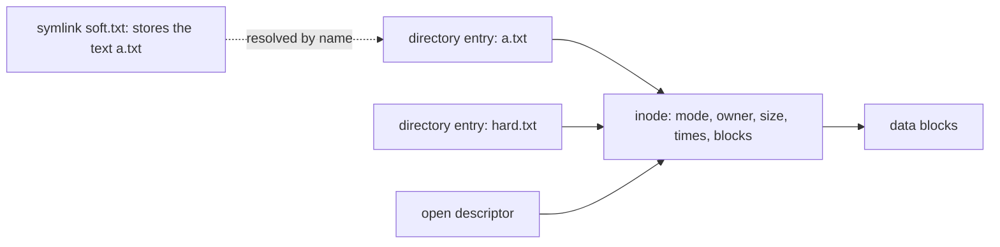

# Linux filesystem: expert

🌐 [Русский](expert.ru.md) · **English**

**Levels:** [overview](overview.en.md) · [1. Basics](basics.en.md) · [2. Advanced](advanced.en.md) · **3. Expert** · [4. Quiz](quiz.en.md)

## Under the hood

A program passes a path, and the kernel resolves it component by component: in each directory it looks up the name and gets an inode number. Each step needs search permission (`x`) on the directory. A symbolic link in the middle of a path is always followed; the last one depends on the system call. An open file is no longer a path: the process holds a descriptor tied to the inode.



Blocks are freed when the link count is zero **and** nobody has the file open.

## Reference

| Command | Purpose | Useful options |
|---|---|---|
| `ls` | listing | `-l`, `-a`, `-A`, `-i`, `-h`, `-R`, `-d` (the directory itself), `-t` (by time) |
| `stat` | inode fields | `-c` format: `%i %h %s %Y %Z %d` |
| `cp` | copy | `-r`, `-a` (keep attributes and links), `-i`, `-u` |
| `mv` | rename, move | `-i`, `-n` |
| `rm` | remove a name | `-r`, `-f`, `-i`, `--` |
| `mkdir`, `rmdir` | directories | `-p` |
| `ln` | links | `-s`, `-f`, `-n`, `-r` |
| `readlink`, `realpath` | link target, canonical path | `readlink -f` |
| `find` | search | `-name`, `-type`, `-size`, `-mtime`, `-newer`, `-samefile`, `-exec`, `-print0`, `-delete` |
| `df`, `du` | space | `df -h`, `df -i`, `du -sh` |
| `findmnt` | what is mounted where | `findmnt <path>` |

| Timestamp | Changes when |
|---|---|
| atime | the file is read (with `relatime`, not on every read) |
| mtime | the content changes |
| ctime | the inode changes: permissions, owner, link count, also content |
| btime | creation; not supported everywhere |

| Limit | Value on common Linux filesystems |
|---|---|
| Length of one name | 255 bytes |
| Forbidden in a name | `/` and the null byte |

### Permissions and timestamps

```bash
echo a > f
before_m=$(stat -c %.9Y f); before_c=$(stat -c %.9Z f)
sleep 0.1; chmod 600 f
[ "$(stat -c %.9Y f)" = "$before_m" ] && echo 'chmod: mtime same'
[ "$(stat -c %.9Z f)" != "$before_c" ] && echo 'chmod: ctime changed'
```

```text
chmod: mtime same
chmod: ctime changed
```

### Move: rename or copy

Within one filesystem `mv` only changes directory entries. Across filesystems it is a copy plus a delete: slow, and the result is a different file.

```bash
echo x > f
a=$(stat -c %i f); mv f g; b=$(stat -c %i g)
[ "$a" = "$b" ] && echo 'same filesystem: same inode'
mv g /dev/shm/g
echo "device before: $(stat -c %d .) after: $(stat -c %d /dev/shm/g)"
rm /dev/shm/g
```

```text
same filesystem: same inode
device before: 120 after: 3145865
```

## Gotchas

### A deleted file still takes space

```bash
echo 'important data' > log
exec 3< log          # keep the file open on descriptor 3
rm log
ls log
cat /proc/$$/fd/3
exec 3<&-            # close it: now the space is freed
```

```text
ls: cannot access 'log': No such file or directory
important data
```

While a process keeps the file open, the data is reachable via `/proc/<pid>/fd/N` and the space stays used. The classic case is a huge log of a running service deleted by hand. Find such files with `sudo lsof +L1`.

### Link count of a directory

```bash
mkdir p; stat -c '%h' p
mkdir p/c1 p/c2; stat -c '%h' p
```

```text
2
4
```

On this filesystem a directory has its name in the parent, its own `.`, and one `..` from each subdirectory. Not every filesystem counts this way.

### A trailing slash on a link to a directory

```bash
mkdir d; echo x > d/f; ln -s d l
ls -l l | cut -c1
ls l/
rm -r l/
rm l
ls d
```

```text
l
f
rm: cannot remove 'l/': Not a directory
```

With `l/` the command addresses the directory, but `rm -r l/` fails without removing it; `rm l` removes just the link. The files in `d` survive. Tools and versions differ about the trailing slash, so remove a link by its bare name.

### `..` after a link

```bash
mkdir -p r/s; echo > r/marker; ln -s r/s l
ls l/..
cd l; cd ..; pwd | sed "s|$HOME|~|"
cd -P l; cd ..; pwd | sed "s|$HOME|~|"
```

```text
marker
s
~/lab
~/lab/r
```

`ls` (the kernel) takes the real parent of `r/s`. Bash's `cd` by default handles `..` textually and returns you where you came from; `-P` follows the physical structure.

### A link loop

```bash
ln -s b a; ln -s a b
cat a
```

```text
cat: a: Too many levels of symbolic links
```

### A newline in a file name

```bash
touch $'two\nlines'
ls | wc -l
find . -type f -print0 | tr -cd '\0' | wc -c
```

```text
2
1
```

One file, two lines. To process file lists use `find -print0` with `xargs -0`, or `find -exec`.

### Files in /proc report size 0

```bash
stat -c '%s %n' /proc/version
wc -c < /proc/version
ls -l /proc/self/cwd | sed 's/.*-> //' | sed "s|$HOME|~|"
cat /proc/sys/fs/protected_symlinks /proc/sys/fs/protected_hardlinks
```

```text
0 /proc/version
166
~/lab
1
1
```

The content is generated on read. The last two values are `fs.protected_symlinks` and `fs.protected_hardlinks`: at `1` the kernel restricts following other users' links in directories like `/tmp` and hard-linking files you don't own.

## Trade-offs and alternatives

| Task | Choice |
|---|---|
| Switch an application version | a symbolic link and `ln -sfn` |
| Snapshots that share unchanged files | hard links (the `rsync --link-dest` style of backup) |
| Replace a file atomically | write a temporary file on the same filesystem and `mv` over |
| Expose a directory elsewhere | `mount --bind` (module 13 on the roadmap) |

## Interview questions

1. What is in an inode and what is not?
<details><summary>Answer</summary>

Type, permissions, owner, size, timestamps, link count, data location. Not the name: that is in the directory.
</details>

2. To delete a file, which permissions matter: the file's or the directory's?
<details><summary>Answer</summary>

Write and search permission on the directory: you remove an entry from it. The sticky bit adds an ownership restriction.
</details>

3. `df` says the disk is full but `du` disagrees. Why?
<details><summary>Answer</summary>

Deleted but still open files (`lsof +L1`); files hidden under a mount point; directories you are not allowed to read.
</details>

4. There is free space but creating a file says `No space left on device`. What do you check?
<details><summary>Answer</summary>

`df -i`: inodes may be exhausted, usually by a huge number of small files.
</details>

5. Why can't you hard-link a directory?
<details><summary>Answer</summary>

It would create cycles and an ambiguous parent; tree traversal might never end.
</details>

6. How do mtime and ctime differ?
<details><summary>Answer</summary>

mtime is a content change, ctime an inode change. `chmod` changes only ctime. ctime is not the creation time.
</details>

7. How do you update a config file atomically?
<details><summary>Answer</summary>

Write the new version next to it (same filesystem) and rename over: a reader sees either the old or the new file.
</details>

8. What happens to a hard link after such an update?
<details><summary>Answer</summary>

It keeps pointing at the old inode: the rename replaced a name, not the content.
</details>

9. What permissions does a symbolic link have?
<details><summary>Answer</summary>

On Linux `lrwxrwxrwx`, not changeable; the target's permissions apply.
</details>

10. How do you find dangling links?
<details><summary>Answer</summary>

`find <dir> -xtype l`.
</details>

11. Where do you see what a process has open?
<details><summary>Answer</summary>

`ls -l /proc/<pid>/fd` or `lsof -p <pid>`.
</details>

12. How do `/tmp` and `/var/tmp` differ in intent?
<details><summary>Answer</summary>

Both hold temporary files; `/tmp` may be cleared at boot, `/var/tmp` is meant to keep files longer. The exact policy depends on the distribution.
</details>

## Cheat sheet

```bash
ls -lai                      # names, inodes, hidden files
stat file                    # all inode fields
ln -sfn target link          # create or repoint a symlink
realpath path                # canonical path
find . -xtype l              # dangling links
df -h; df -i; du -sh *       # space and inodes
sudo lsof +L1                # deleted but still open files
```

## Related materials

- Prerequisites: [01 · Environment setup](../01-setup/overview.en.md)
- Next: [03 · Shell basics](../03-shell-basics/overview.en.md)
- Files and streams from a program: [Node.js: files, streams, processes](../../../javascript/modules/16-nodejs-files-streams-processes/overview.en.md)
- Storage in a cluster: [Kubernetes 08 · Storage](../../../kubernetes/modules/08-storage/overview.en.md)

## Sources

- [hier(7)](https://man7.org/linux/man-pages/man7/hier.7.html)
- [inode(7)](https://man7.org/linux/man-pages/man7/inode.7.html)
- [symlink(7)](https://man7.org/linux/man-pages/man7/symlink.7.html)
- [path_resolution(7)](https://man7.org/linux/man-pages/man7/path_resolution.7.html)
- [proc_sys_fs(5)](https://man7.org/linux/man-pages/man5/proc_sys_fs.5.html)
- [ln(1)](https://man7.org/linux/man-pages/man1/ln.1.html)
