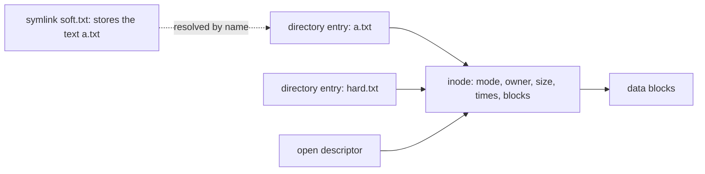

# Файловая система Linux: экспертный уровень

🌐 **Русский** · [English](expert.en.md)

**Уровни:** [обзор](overview.ru.md) · [1. Основы](basics.ru.md) · [2. Продвинутый](advanced.ru.md) · **3. Эксперт** · [4. Квиз](quiz.ru.md)

## Под капотом

Программа работает с путём, а ядро разбирает его по компонентам: в каждом каталоге ищет имя и получает номер inode. На каждом шаге нужны права на поиск (`x`) в каталоге. Символическая ссылка в середине пути всегда раскрывается; последняя — зависит от системного вызова. Открытый файл — это уже не путь: процесс держит дескриптор, связанный с inode.



Блоки освобождаются, когда счётчик имён равен нулю **и** файл никем не открыт.

## Справочник

| Команда | Назначение | Полезные опции |
|---|---|---|
| `ls` | список | `-l`, `-a`, `-A`, `-i`, `-h`, `-R`, `-d` (сам каталог), `-t` (по времени) |
| `stat` | поля inode | `-c` формат: `%i %h %s %Y %Z %d` |
| `cp` | копия | `-r`, `-a` (с атрибутами и ссылками), `-i`, `-u` |
| `mv` | переименовать, переместить | `-i`, `-n` |
| `rm` | удалить имя | `-r`, `-f`, `-i`, `--` |
| `mkdir`, `rmdir` | каталоги | `-p` |
| `ln` | ссылки | `-s`, `-f`, `-n`, `-r` |
| `readlink`, `realpath` | цель ссылки, канонический путь | `readlink -f` |
| `find` | поиск | `-name`, `-type`, `-size`, `-mtime`, `-newer`, `-samefile`, `-exec`, `-print0`, `-delete` |
| `df`, `du` | место | `df -h`, `df -i`, `du -sh` |
| `findmnt` | что куда смонтировано | `findmnt <путь>` |

| Время | Меняется, когда |
|---|---|
| atime | файл читают (при `relatime` — не при каждом чтении) |
| mtime | меняется содержимое |
| ctime | меняется inode: права, владелец, число ссылок, а также содержимое |
| btime | создание; поддерживается не везде |

| Предел | Значение в обычных файловых системах Linux |
|---|---|
| Длина одного имени | 255 байт |
| Запрещены в имени | `/` и нулевой байт |

### Права и время

```bash
echo a > f
before_m=$(stat -c %.9Y f); before_c=$(stat -c %.9Z f)
sleep 0.1; chmod 600 f
[ "$(stat -c %.9Y f)" = "$before_m" ] && echo 'chmod: mtime same'
[ "$(stat -c %.9Z f)" != "$before_c" ] && echo 'chmod: ctime changed'
```

```text
chmod: mtime same
chmod: ctime changed
```

### Перемещение: переименование или копия

Внутри одной файловой системы `mv` только меняет записи каталогов. Между файловыми системами это копирование и удаление: долго, и это уже другой файл.

```bash
echo x > f
a=$(stat -c %i f); mv f g; b=$(stat -c %i g)
[ "$a" = "$b" ] && echo 'same filesystem: same inode'
mv g /dev/shm/g
echo "device before: $(stat -c %d .) after: $(stat -c %d /dev/shm/g)"
rm /dev/shm/g
```

```text
same filesystem: same inode
device before: 120 after: 3145865
```

## Подвохи

### Удалённый файл ещё занимает место

```bash
echo 'important data' > log
exec 3< log          # keep the file open on descriptor 3
rm log
ls log
cat /proc/$$/fd/3
exec 3<&-            # close it: now the space is freed
```

```text
ls: cannot access 'log': No such file or directory
important data
```

Пока процесс держит файл открытым, данные доступны через `/proc/<pid>/fd/N`, а место занято. Типичный случай — удалённый вручную большой журнал работающего сервиса. Найти такие файлы: `sudo lsof +L1`.

### Счётчик ссылок каталога

```bash
mkdir p; stat -c '%h' p
mkdir p/c1 p/c2; stat -c '%h' p
```

```text
2
4
```

На этой файловой системе у каталога имя в родителе, его собственная `.` и по одной `..` от каждого подкаталога. Не все файловые системы считают так.

### Слэш в конце ссылки на каталог

```bash
mkdir d; echo x > d/f; ln -s d l
ls -l l | cut -c1
ls l/
rm -r l/
rm l
ls d
```

```text
l
f
rm: cannot remove 'l/': Not a directory
```

С `l/` команда обращается уже к каталогу, но `rm -r l/` его не удаляет и завершается ошибкой; `rm l` удаляет только ссылку. Файлы в `d` на месте. Другие инструменты и версии ведут себя со слэшем по-разному, поэтому для удаления ссылки пишите её имя без слэша.

### `..` после ссылки

```bash
mkdir -p r/s; echo > r/marker; ln -s r/s l
ls l/..
cd l; cd ..; pwd | sed "s|$HOME|~|"
cd -P l; cd ..; pwd | sed "s|$HOME|~|"
```

```text
marker
s
~/lab
~/lab/r
```

`ls` (ядро) берёт настоящего родителя `r/s`. А `cd` в bash по умолчанию обрабатывает `..` текстуально и возвращает «откуда пришли»; `-P` следует физической структуре.

### Цикл ссылок

```bash
ln -s b a; ln -s a b
cat a
```

```text
cat: a: Too many levels of symbolic links
```

### Перевод строки в имени

```bash
touch $'two\nlines'
ls | wc -l
find . -type f -print0 | tr -cd '\0' | wc -c
```

```text
2
1
```

Один файл, а строк две. Для обработки списков имён используйте `find -print0` с `xargs -0` или `find -exec`.

### Файлы в /proc имеют размер 0

```bash
stat -c '%s %n' /proc/version
wc -c < /proc/version
ls -l /proc/self/cwd | sed 's/.*-> //' | sed "s|$HOME|~|"
cat /proc/sys/fs/protected_symlinks /proc/sys/fs/protected_hardlinks
```

```text
0 /proc/version
166
~/lab
1
1
```

Содержимое создаётся в момент чтения. Две последние строки — настройки `fs.protected_symlinks` и `fs.protected_hardlinks`: при значении `1` ядро ограничивает переход по чужим ссылкам в каталогах вроде `/tmp` и создание жёстких ссылок на чужие файлы.

## Компромиссы и альтернативы

| Задача | Выбор |
|---|---|
| Переключать версию приложения | символическая ссылка и `ln -sfn` |
| Снимки без дублирования неизменившихся файлов | жёсткие ссылки (так работают снимки в духе `rsync --link-dest`) |
| Атомарно заменить файл | записать во временный файл на той же файловой системе и `mv` поверх |
| Показать каталог в другом месте | `mount --bind` (модуль 13 дорожной карты) |

## Вопросы с собеседований

1. Что хранится в inode, а что нет?
<details><summary>Ответ</summary>

Тип, права, владелец, размер, времена, число ссылок, расположение данных. Имени нет — оно в каталоге.
</details>

2. Что нужно, чтобы удалить файл: права на файл или на каталог?
<details><summary>Ответ</summary>

Права на запись и поиск в каталоге: удаляется запись в нём. Sticky bit добавляет ограничение по владельцу.
</details>

3. `df` показывает, что диск полон, а `du` — нет. Почему?
<details><summary>Ответ</summary>

Удалённые, но открытые файлы (`lsof +L1`); файлы, скрытые под точкой монтирования; нет прав читать часть каталогов.
</details>

4. Свободное место есть, а файл не создаётся: `No space left on device`. Что проверить?
<details><summary>Ответ</summary>

`df -i`: могли закончиться inode, обычно из-за множества мелких файлов.
</details>

5. Почему нельзя сделать жёсткую ссылку на каталог?
<details><summary>Ответ</summary>

Появились бы циклы в дереве и неоднозначный родитель; обход каталогов перестал бы завершаться.
</details>

6. Чем отличаются mtime и ctime?
<details><summary>Ответ</summary>

mtime — изменение содержимого, ctime — изменение inode. `chmod` меняет только ctime. ctime — не время создания.
</details>

7. Как атомарно обновить конфигурационный файл?
<details><summary>Ответ</summary>

Записать новую версию рядом (на той же файловой системе) и переименовать поверх: читатель увидит старый или новый файл целиком.
</details>

8. Что произойдёт с жёсткой ссылкой после такого обновления?
<details><summary>Ответ</summary>

Она продолжит указывать на старый inode: переименование заменило имя, а не содержимое.
</details>

9. Какие права у символической ссылки?
<details><summary>Ответ</summary>

В Linux `lrwxrwxrwx`, изменить нельзя; действуют права цели.
</details>

10. Как найти висящие ссылки?
<details><summary>Ответ</summary>

`find <каталог> -xtype l`.
</details>

11. Где посмотреть, что открыл процесс?
<details><summary>Ответ</summary>

`ls -l /proc/<pid>/fd` или `lsof -p <pid>`.
</details>

12. Чем `/tmp` отличается от `/var/tmp` по смыслу?
<details><summary>Ответ</summary>

Оба для временных файлов; `/tmp` может очищаться при загрузке, `/var/tmp` рассчитан на то, что файлы живут дольше. Точная политика зависит от дистрибутива.
</details>

## Шпаргалка

```bash
ls -lai                      # names, inodes, hidden files
stat file                    # all inode fields
ln -sfn target link          # create or repoint a symlink
realpath path                # canonical path
find . -xtype l              # dangling links
df -h; df -i; du -sh *       # space and inodes
sudo lsof +L1                # deleted but still open files
```

## Связанные материалы

- Пререквизиты: [01 · Подготовка окружения](../01-setup/overview.ru.md)
- Дальше: [03 · Основы shell](../03-shell-basics/overview.ru.md)
- Файлы и потоки из программы: [Node.js: файлы, потоки, процессы](../../../javascript/modules/16-nodejs-files-streams-processes/overview.ru.md)
- Хранение в кластере: [Kubernetes 08 · Хранилище](../../../kubernetes/modules/08-storage/overview.ru.md)

## Источники

- [hier(7)](https://man7.org/linux/man-pages/man7/hier.7.html)
- [inode(7)](https://man7.org/linux/man-pages/man7/inode.7.html)
- [symlink(7)](https://man7.org/linux/man-pages/man7/symlink.7.html)
- [path_resolution(7)](https://man7.org/linux/man-pages/man7/path_resolution.7.html)
- [proc_sys_fs(5)](https://man7.org/linux/man-pages/man5/proc_sys_fs.5.html)
- [ln(1)](https://man7.org/linux/man-pages/man1/ln.1.html)
