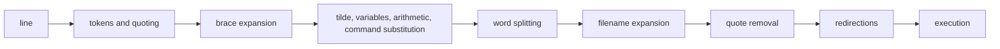

# Shell basics: expert

🌐 [Русский](expert.ru.md) · **English**

**Levels:** [overview](overview.en.md) · [1. Basics](basics.en.md) · [2. Advanced](advanced.en.md) · **3. Expert** · [4. Quiz](quiz.en.md)

## Under the hood

Bash processes a line in steps: tokenises it respecting quotes, performs expansions, sets up redirections and only then runs the command. For an external program the shell forks a child, adjusts its descriptors and calls `exec`. Each part of a pipeline normally runs in its own subshell.



## Reference

| Expansion | Example | Note |
|---|---|---|
| braces | `{a,b}`, `{1..5}` | before variables; no files needed |
| tilde | `~`, `~user` | unquoted only |
| parameter | `$v`, `${v:-def}`, `${v:?msg}`, `${#v}` | |
| arithmetic | `$((2+3))` | integers |
| command | `$(cmd)` | trailing newlines are removed |
| process | `<(cmd)`, `>(cmd)` | bash and some other shells only |
| word splitting | by `IFS` | only unquoted expansion results |
| file names | `*`, `?`, `[abc]`, `[!abc]` | hidden files are skipped |

| `shopt` option | Effect |
|---|---|
| `nullglob` | an unmatched pattern disappears |
| `failglob` | an unmatched pattern is an error |
| `dotglob` | `*` includes hidden files |
| `globstar` | `**` descends into subdirectories |
| `lastpipe` | the last pipeline element runs in the current shell (job control off) |
| `histappend` | append history instead of overwriting |

| Redirection | Effect |
|---|---|
| `n> f`, `n>> f`, `n< f` | open descriptor n |
| `n>&m` | make n a copy of m |
| `n>&-` | close n |
| `<> f` | open for reading and writing |
| `>\| f` | overwrite even with `noclobber` |
| `&> f`, `&>> f` | stdout and stderr (bash) |
| `<<`, `<<-`, `<<<` | here-document, with leading tabs stripped, here-string |

| Status | Meaning |
|---|---|
| 0 | success |
| 1–125 | program-defined failure |
| 126 | could not execute |
| 127 | not found |
| 128+N | terminated by signal N (130 for Ctrl+C, 143 for TERM) |

## Gotchas

### Word splitting

```bash
v='a   b'
printf '[%s]' $v; echo
printf '[%s]' "$v"; echo
touch 'my file'
f='my file'
ls $f
```

```text
[a][b]
[a   b]
ls: cannot access 'my': No such file or directory
ls: cannot access 'file': No such file or directory
```

### Braces don't see variables

```bash
echo {a,b}{1,2}
x=3
echo {1..3} {1..$x}
echo ~ "~"
```

```text
a1 a2 b1 b2
1 2 3 {1..3}
/home/ubuntu ~
```

### An unmatched pattern stays as typed

```bash
touch a1 a2 b1 .h
echo *
echo ?1
echo [!a]*
echo *.zz
shopt -s nullglob; echo x *.zz y
shopt -s dotglob;  echo *
```

```text
a1 a2 b1
a1 b1
b1
*.zz
x y
.h a1 a2 b1
```

### A variable changed in a pipeline is lost

```bash
count=0
printf 'a\nb\n' | while read -r line; do count=$((count+1)); done
echo "after pipe: $count"
while read -r line; do count=$((count+1)); done < <(printf 'a\nb\n')
echo "after process substitution: $count"
```

```text
after pipe: 0
after process substitution: 2
```

### read trims whitespace

```bash
printf '  lead\n' > f
read v < f;        echo "[$v]"
IFS= read -r v < f; echo "[$v]"
```

```text
[lead]
[  lead]
```

### 141 in a pipeline

`yes` received SIGPIPE (13) when `head` closed the pipe: 128 + 13. With `pipefail` such a pipeline counts as failed.

```bash
yes | head -n 1
echo "${PIPESTATUS[@]}"
```

```text
y
141 0
```

### Pipe stderr only

```bash
f() { echo out; echo err >&2; }
f 2>&1 >/dev/null | sed 's/^/got: /'
```

```text
got: err
```

### Your own descriptor

```bash
exec 3> log
echo one >&3
echo two >&3
exec 3>&-
cat log
```

```text
one
two
```

### A failed redirection stops the rest

`< nofile` comes before `> created`, so the file is not created and the command never runs.

```bash
echo x < nofile > created
ls created
```

```text
bash: line 4: nofile: No such file or directory
ls: cannot access 'created': No such file or directory
```

### Statuses wrap modulo 256

```bash
bash -c 'exit 256'; echo $?
bash -c 'exit -1'; echo $?
timeout 0.1 sleep 1; echo $?
bash -c 'kill -TERM $$'; echo $?
```

```text
0
255
124
Terminated                 bash -c 'kill -TERM $$'
143
```

### Command substitution

```bash
x=$(printf 'a\n\n\n')
echo "[$x]"
echo $(printf 'a   b\nc')
echo "$(printf 'a   b\nc')"
```

```text
[a]
a b c
a   b
c
```

### An empty variable in a path

With `dir` empty the path starts at the root. `${dir:?}` aborts instead.

```bash
dir=
echo "$dir/"tmp
( echo "${dir:?is empty}/tmp" )
echo "exit=$?"
```

```text
/tmp
bash: line 6: dir: is empty
exit=1
```

### sh is not bash

On Ubuntu `/bin/sh` is dash. `echo` treats `\t` differently; use `printf` for portability.

```bash
ls -l /bin/sh | sed 's/.* -> //'
sh -c 'echo "a\tb"'
bash -c 'echo "a\tb"'
printf 'a\tb\n'
```

```text
dash
a	b
a\tb
a	b
```

## Trade-offs and alternatives

| Task | Choice |
|---|---|
| Gluing existing utilities | shell |
| Data structures, error handling, tests | a general-purpose language such as [Python](../../../python/overview.en.md) |
| A portable system script | POSIX `sh` without bash features |
| A comfortable interactive shell | zsh, fish; server scripts are still usually bash or sh |

## Interview questions

1. How do `>` and `>>` differ?
<details><summary>Answer</summary>

`>` truncates on open, `>>` appends.
</details>

2. How does `2>&1 >f` differ from `>f 2>&1`?
<details><summary>Answer</summary>

Left to right: in the first, stderr stays on the old stdout; in the second both go to the file.
</details>

3. Why is `cd` a builtin?
<details><summary>Answer</summary>

A child process cannot change its parent's directory.
</details>

4. Who expands `*.log`, the shell or the program?
<details><summary>Answer</summary>

The shell. The program receives the names; quote the pattern to pass it through.
</details>

5. Shell variable versus environment variable?
<details><summary>Answer</summary>

The environment is copied into child processes; only exported variables go there.
</details>

6. What does `false | true` return?
<details><summary>Answer</summary>

0; with `pipefail`, 1. All statuses are in `PIPESTATUS`.
</details>

7. Why do you run a script as `./x`?
<details><summary>Answer</summary>

The current directory is not in `PATH`, otherwise a planted file could shadow a system command.
</details>

8. What is `/dev/null`?
<details><summary>Answer</summary>

A device that discards writes and returns end of file on reads.
</details>

9. Why prefer `$(cmd)` over backticks?
<details><summary>Answer</summary>

It reads better and nests without escaping.
</details>

10. What does status 137 mean?
<details><summary>Answer</summary>

128 + 9: killed by SIGKILL, for example out of memory or a forced stop.
</details>

11. How do you see what will really run?
<details><summary>Answer</summary>

`type name` shows alias, function, builtin or path; `set -x` prints lines after expansion.
</details>

12. Why does `sort f > f` empty the file?
<details><summary>Answer</summary>

The shell opens `f` for writing and truncates it before `sort` starts.
</details>

## Cheat sheet

```bash
type name; help name; man name      # what is it and how to use it
cmd > out 2> err                    # split streams
cmd > all 2>&1                      # merge them
cmd1 | cmd2; echo "${PIPESTATUS[@]}"
echo "$(date)" "${var:-default}"
ls -- "$file"
```

## Related materials

- Prerequisites: [02 · Filesystem](../02-filesystem/overview.en.md)
- Practice environment: [01 · Environment setup](../01-setup/overview.en.md)
- Streams and pipelines from a program: [Node.js: files, streams, processes](../../../javascript/modules/16-nodejs-files-streams-processes/overview.en.md)

## Sources

- [bash(1)](https://man7.org/linux/man-pages/man1/bash.1.html)
- [man(1)](https://man7.org/linux/man-pages/man1/man.1.html)
