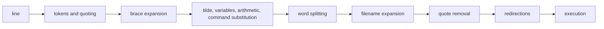

# Основы shell: экспертный уровень

🌐 **Русский** · [English](expert.en.md)

**Уровни:** [обзор](overview.ru.md) · [1. Основы](basics.ru.md) · [2. Продвинутый](advanced.ru.md) · **3. Эксперт** · [4. Квиз](quiz.ru.md)

## Под капотом

Строку bash обрабатывает по шагам: разбивает на токены с учётом кавычек, выполняет раскрытия, настраивает перенаправления и только потом запускает команду. Для внешней программы shell создаёт дочерний процесс (fork), в нём меняет дескрипторы и выполняет `exec`. Каждая часть конвейера обычно работает в своём подпроцессе.



## Справочник

| Раскрытие | Пример | Замечание |
|---|---|---|
| фигурные скобки | `{a,b}`, `{1..5}` | до переменных; файлы не нужны |
| тильда | `~`, `~user` | не в кавычках |
| параметр | `$v`, `${v:-def}`, `${v:?msg}`, `${#v}` | |
| арифметика | `$((2+3))` | целые числа |
| команда | `$(cmd)` | конечные переводы строк удаляются |
| процесс | `<(cmd)`, `>(cmd)` | только bash и некоторые другие |
| деление на слова | по `IFS` | только результаты раскрытий вне кавычек |
| имена файлов | `*`, `?`, `[abc]`, `[!abc]` | скрытые файлы не попадают |

| Опция `shopt` | Действие |
|---|---|
| `nullglob` | шаблон без совпадений исчезает |
| `failglob` | шаблон без совпадений — ошибка |
| `dotglob` | `*` включает скрытые файлы |
| `globstar` | `**` проходит подкаталоги |
| `lastpipe` | последняя часть конвейера в текущем shell (при выключенном управлении заданиями) |
| `histappend` | дописывать историю, а не перезаписывать |

| Перенаправление | Действие |
|---|---|
| `n> f`, `n>> f`, `n< f` | открыть дескриптор n |
| `n>&m` | сделать n копией m |
| `n>&-` | закрыть n |
| `<> f` | открыть на чтение и запись |
| `>\| f` | перезаписать даже при `noclobber` |
| `&> f`, `&>> f` | stdout и stderr (bash) |
| `<<`, `<<-`, `<<<` | here-документ, с удалением начальных табуляций, here-строка |

| Код | Значение |
|---|---|
| 0 | успех |
| 1–125 | ошибка по усмотрению программы |
| 126 | не удалось запустить |
| 127 | не найдено |
| 128+N | завершено сигналом N (130 — Ctrl+C, 143 — TERM) |

## Подвохи

### Деление на слова

```bash
v='a   b'
printf '[%s]' $v; echo
printf '[%s]' "$v"; echo
touch 'my file'
f='my file'
ls $f
```

```text
[a][b]
[a   b]
ls: cannot access 'my': No such file or directory
ls: cannot access 'file': No such file or directory
```

### Фигурные скобки не видят переменных

```bash
echo {a,b}{1,2}
x=3
echo {1..3} {1..$x}
echo ~ "~"
```

```text
a1 a2 b1 b2
1 2 3 {1..3}
/home/ubuntu ~
```

### Шаблон без совпадений остаётся как есть

```bash
touch a1 a2 b1 .h
echo *
echo ?1
echo [!a]*
echo *.zz
shopt -s nullglob; echo x *.zz y
shopt -s dotglob;  echo *
```

```text
a1 a2 b1
a1 b1
b1
*.zz
x y
.h a1 a2 b1
```

### Переменная, изменённая в конвейере, теряется

```bash
count=0
printf 'a\nb\n' | while read -r line; do count=$((count+1)); done
echo "after pipe: $count"
while read -r line; do count=$((count+1)); done < <(printf 'a\nb\n')
echo "after process substitution: $count"
```

```text
after pipe: 0
after process substitution: 2
```

### read обрезает пробелы

```bash
printf '  lead\n' > f
read v < f;        echo "[$v]"
IFS= read -r v < f; echo "[$v]"
```

```text
[lead]
[  lead]
```

### 141 в конвейере

`yes` получил SIGPIPE (13), когда `head` закрыл конвейер: 128 + 13. С `pipefail` такой конвейер считается неуспешным.

```bash
yes | head -n 1
echo "${PIPESTATUS[@]}"
```

```text
y
141 0
```

### Отправить в конвейер только stderr

```bash
f() { echo out; echo err >&2; }
f 2>&1 >/dev/null | sed 's/^/got: /'
```

```text
got: err
```

### Свой дескриптор

```bash
exec 3> log
echo one >&3
echo two >&3
exec 3>&-
cat log
```

```text
one
two
```

### Ошибка перенаправления останавливает следующие

`< nofile` стоит раньше `> created`, поэтому файл не создан и команда не запускалась.

```bash
echo x < nofile > created
ls created
```

```text
bash: line 4: nofile: No such file or directory
ls: cannot access 'created': No such file or directory
```

### Коды берутся по модулю 256

```bash
bash -c 'exit 256'; echo $?
bash -c 'exit -1'; echo $?
timeout 0.1 sleep 1; echo $?
bash -c 'kill -TERM $$'; echo $?
```

```text
0
255
124
Terminated                 bash -c 'kill -TERM $$'
143
```

### Подстановка команды

```bash
x=$(printf 'a\n\n\n')
echo "[$x]"
echo $(printf 'a   b\nc')
echo "$(printf 'a   b\nc')"
```

```text
[a]
a b c
a   b
c
```

### Пустая переменная в пути

При пустой `dir` путь начинается с корня. `${dir:?}` прерывает выполнение.

```bash
dir=
echo "$dir/"tmp
( echo "${dir:?is empty}/tmp" )
echo "exit=$?"
```

```text
/tmp
bash: line 6: dir: is empty
exit=1
```

### sh — не bash

В Ubuntu `/bin/sh` — это dash. `echo` обрабатывает `\t` по-разному; для переносимости используйте `printf`.

```bash
ls -l /bin/sh | sed 's/.* -> //'
sh -c 'echo "a\tb"'
bash -c 'echo "a\tb"'
printf 'a\tb\n'
```

```text
dash
a	b
a\tb
a	b
```

## Компромиссы и альтернативы

| Задача | Выбор |
|---|---|
| Склеить готовые утилиты | shell |
| Структуры данных, обработка ошибок, тесты | язык общего назначения, например [Python](../../../python/overview.ru.md) |
| Переносимый системный скрипт | POSIX `sh` без возможностей bash |
| Удобный интерактивный shell | zsh, fish — но серверные скрипты всё равно обычно на bash или sh |

## Вопросы с собеседований

1. Чем `>` отличается от `>>`?
<details><summary>Ответ</summary>

`>` обрезает файл при открытии, `>>` дописывает в конец.
</details>

2. Чем `2>&1 >f` отличается от `>f 2>&1`?
<details><summary>Ответ</summary>

Порядок слева направо: в первом stderr остаётся на старом stdout, во втором оба идут в файл.
</details>

3. Почему `cd` — встроенная команда?
<details><summary>Ответ</summary>

Дочерний процесс не может сменить каталог родителя.
</details>

4. Кто раскрывает `*.log` — shell или программа?
<details><summary>Ответ</summary>

Shell. Программа получает готовые имена; чтобы передать шаблон ей, берут его в кавычки.
</details>

5. Чем переменная shell отличается от переменной окружения?
<details><summary>Ответ</summary>

Окружение копируется в дочерние процессы; туда попадает только экспортированное.
</details>

6. Что вернёт `false | true`?
<details><summary>Ответ</summary>

0; с `pipefail` — 1. Коды всех частей — в `PIPESTATUS`.
</details>

7. Почему скрипт запускают как `./x`?
<details><summary>Ответ</summary>

Текущего каталога нет в `PATH` — иначе подложенный файл мог бы подменить системную команду.
</details>

8. Что такое `/dev/null`?
<details><summary>Ответ</summary>

Устройство, которое отбрасывает записанное и сразу отдаёт конец файла при чтении.
</details>

9. Чем `$(cmd)` лучше обратных кавычек?
<details><summary>Ответ</summary>

Читается и вкладывается без экранирования.
</details>

10. Что значит код 137?
<details><summary>Ответ</summary>

128 + 9: процесс убит SIGKILL, например при нехватке памяти или принудительной остановке.
</details>

11. Как посмотреть, что выполнится на самом деле?
<details><summary>Ответ</summary>

`type имя` покажет алиас, функцию, встроенную команду или путь; `set -x` печатает строки после раскрытий.
</details>

12. Почему `sort f > f` опустошает файл?
<details><summary>Ответ</summary>

Shell открывает `f` на запись с обрезанием до запуска `sort`.
</details>

## Шпаргалка

```bash
type name; help name; man name      # what is it and how to use it
cmd > out 2> err                    # split streams
cmd > all 2>&1                      # merge them
cmd1 | cmd2; echo "${PIPESTATUS[@]}"
echo "$(date)" "${var:-default}"
ls -- "$file"
```

## Связанные материалы

- Пререквизиты: [02 · Файловая система](../02-filesystem/overview.ru.md)
- Среда для практики: [01 · Подготовка окружения](../01-setup/overview.ru.md)
- Потоки и конвейеры из программы: [Node.js: файлы, потоки, процессы](../../../javascript/modules/16-nodejs-files-streams-processes/overview.ru.md)

## Источники

- [bash(1)](https://man7.org/linux/man-pages/man1/bash.1.html)
- [man(1)](https://man7.org/linux/man-pages/man1/man.1.html)
