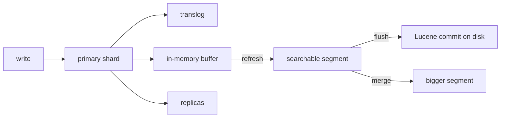

# OpenSearch basics: expert theory

🌐 [Русский](expert.ru.md) · **English**

**Levels:** [overview](overview.en.md) · [1. Basics](basics.en.md) · [2. Advanced](advanced.en.md) · **3. Expert** · [4. Quiz](quiz.en.md)

## The write path



The coordinating node computes the shard from routing and sends the operation to the primary, which applies it and passes it to replicas. Durability before a Lucene commit comes from the **translog**. **Refresh** makes data searchable, **flush** performs a Lucene commit and lets the translog be trimmed: they are different operations.

## Segments

A Lucene segment is immutable. Changing a document means marking the old version deleted and writing a new one. Space is reclaimed when segments merge.

```text
# before: shard segment docs.count docs.deleted
0 _0 3 3
0 _1 0 3
...
# after _forcemerge?max_num_segments=1
0 _3 3  9
1 _4 8 16
2 _5 6 21
```

In the experiment `forcemerge` left one segment per shard, yet `docs.deleted` did not drop to zero: deleted documents were still retained. Do not draw conclusions about disk usage from one measurement. `forcemerge` is for indexes that no longer receive writes.

## The search path

Search has two phases: **query** (each shard returns ids and scores of its best documents) and **fetch** (retrieving the chosen documents). That is why a large `from` is expensive: every shard must prepare `from + size` results.

## Default values reference

| Setting | Value | Verified |
|---|---|---|
| `index.refresh_interval` | `1s` | yes, `include_defaults` |
| `index.translog.durability` | `REQUEST` | yes |
| `index.translog.sync_interval` | `5s` | yes |
| `index.translog.flush_threshold_size` | `512mb` | yes |
| `index.max_result_window` | `10000` | yes; `from=9995, size=10` gives 400 |
| `index.search.idle.after` | `30s` | yes |
| `index.gc_deletes` | `60s` | yes |
| `index.mapping.total_fields.limit` | `1000` | yes |
| shards and replicas of an auto-created index | `1` and `1` | yes |

## Gotchas

1. **Idle shards.** If `refresh_interval` is not set explicitly, a shard without searches for longer than `search.idle.after` stops refreshing until the next search.
2. **A `noop` update** does not increase the version — you cannot count calls by version.
3. **Routing**: the same `_id` with different routing can end up in two shards.
4. **Index names** must be lowercase: `Bad` → `invalid_index_name_exception`.
5. **Creating an existing** index gives `resource_already_exists_exception`.
6. **`yellow` on a single node** with replicas is expected, not an incident.

## Interview questions

1. How does refresh differ from flush?
<details><summary>Answer</summary>

Refresh makes new segments visible to search; flush commits the Lucene index and lets the translog be trimmed.
</details>

2. Why does `get` see a document before `search` does?
<details><summary>Answer</summary>

A read by `_id` is served in real time and does not wait for a refresh, while search works on opened segments.
</details>

3. Why can't the number of primary shards be changed?
<details><summary>Answer</summary>

The routing formula depends on it; you need a new index (reindex) or split/shrink.
</details>

4. What does `yellow` mean?
<details><summary>Answer</summary>

All primaries are assigned, some replicas are not.
</details>

5. Is `_bulk` atomic?
<details><summary>Answer</summary>

No: each operation has its own status.
</details>

6. How do you implement "change only if unchanged"?
<details><summary>Answer</summary>

`if_seq_no` and `if_primary_term`; a conflict gives 409 and you retry.
</details>

7. What is an external version for?
<details><summary>Answer</summary>

So that stale messages do not overwrite newer ones.
</details>

8. What happens inside Lucene when a document changes?
<details><summary>Answer</summary>

The old one is marked deleted and a new one is written; merges reclaim space.
</details>

9. Why is deep pagination expensive?
<details><summary>Answer</summary>

Every shard prepares `from + size` results; there is the `max_result_window` limit. Use `search_after`.
</details>

10. What does `routing` give?
<details><summary>Answer</summary>

A query hits one shard; the risk is uneven load.
</details>

11. `refresh=true` or `wait_for`?
<details><summary>Answer</summary>

`wait_for` waits for the scheduled refresh and does not create extra small segments.
</details>

12. Why is OpenSearch poor as a primary database?
<details><summary>Answer</summary>

No transactions across documents and no foreign keys, and search sees changes with a delay.
</details>

## Related materials

- [Advanced theory](advanced.en.md) · [Quiz](quiz.en.md)
- [03 · Search queries](../03-search-queries/expert.en.md)
- [Topics and storage in Kafka](../../../kafka/modules/04-topics-and-retention/basics.en.md) — immutable segments too

## Sources

- [Refresh API](https://opensearch.org/docs/latest/api-reference/index-apis/refresh/)
- [Index settings](https://opensearch.org/docs/latest/install-and-configure/configuring-opensearch/index-settings/)
- [Force merge](https://opensearch.org/docs/latest/api-reference/index-apis/force-merge/)
