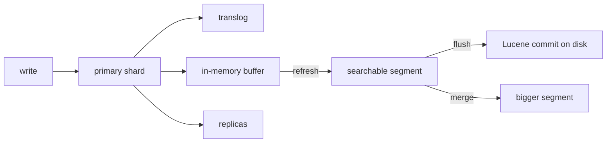

# Основы OpenSearch: экспертная теория

🌐 **Русский** · [English](expert.en.md)

**Уровни:** [overview](overview.ru.md) · [1. Основы](basics.ru.md) · [2. Продвинутый](advanced.ru.md) · **3. Эксперт** · [4. Квиз](quiz.ru.md)

## Путь записи



Координирующий узел вычисляет шард по маршрутизации и направляет операцию на основной шард, тот применяет её и передаёт репликам. Долговечность до фиксации Lucene обеспечивает **translog**. **Refresh** делает данные видимыми поиску, **flush** выполняет фиксацию Lucene и позволяет очистить translog: это разные операции.

## Сегменты

Сегмент Lucene неизменяем. Изменение документа — это пометка старой версии удалённой и запись новой. Место освобождается при слиянии сегментов.

```text
# before: shard segment docs.count docs.deleted
0 _0 3 3
0 _1 0 3
...
# after _forcemerge?max_num_segments=1
0 _3 3  9
1 _4 8 16
2 _5 6 21
```

В эксперименте после `forcemerge` число сегментов стало по одному на шард, а `docs.deleted` не обнулился: удалённые документы ещё удерживались. Не делайте выводов о диске по одному замеру. `forcemerge` применяют к индексам, в которые больше не пишут.

## Путь поиска

Поиск идёт в две фазы: **query** (каждый шард возвращает идентификаторы и оценки лучших документов) и **fetch** (за выбранными документами). Поэтому большой `from` дорог: каждый шард обязан подготовить `from + size` результатов.

## Справочник значений по умолчанию

| Настройка | Значение | Проверено |
|---|---|---|
| `index.refresh_interval` | `1s` | да, `include_defaults` |
| `index.translog.durability` | `REQUEST` | да |
| `index.translog.sync_interval` | `5s` | да |
| `index.translog.flush_threshold_size` | `512mb` | да |
| `index.max_result_window` | `10000` | да; `from=9995, size=10` даёт 400 |
| `index.search.idle.after` | `30s` | да |
| `index.gc_deletes` | `60s` | да |
| `index.mapping.total_fields.limit` | `1000` | да |
| шарды и реплики автосозданного индекса | `1` и `1` | да |

## Подвохи

1. **Простаивающие шарды.** Если `refresh_interval` не задан явно, шард без поисковых запросов дольше `search.idle.after` перестаёт обновляться до следующего поиска.
2. **`noop`-обновление** не увеличивает версию — по версии нельзя считать число вызовов.
3. **Маршрутизация**: тот же `_id` с разной маршрутизацией может оказаться в двух шардах.
4. **Имена индексов** должны быть в нижнем регистре: `Bad` → `invalid_index_name_exception`.
5. **Повторное создание** индекса — `resource_already_exists_exception`.
6. **Статус `yellow` на одном узле** при репликах — ожидаемо, а не авария.

> ⚠️ Проверить: поведение простаивающих шардов (подвох 1) взято из документации и не воспроизводилось.

## Вопросы с собеседований

1. Чем refresh отличается от flush?
<details><summary>Ответ</summary>

Refresh делает новые сегменты видимыми поиску; flush фиксирует индекс Lucene и позволяет обрезать translog.
</details>

2. Почему `get` видит документ раньше, чем `search`?
<details><summary>Ответ</summary>

Чтение по `_id` обслуживается в реальном времени и не ждёт refresh, а поиск работает по открытым сегментам.
</details>

3. Почему нельзя сменить число основных шардов?
<details><summary>Ответ</summary>

От него зависит формула маршрутизации; нужен новый индекс (reindex) либо split/shrink.
</details>

4. Что значит `yellow`?
<details><summary>Ответ</summary>

Все основные шарды назначены, часть реплик — нет.
</details>

5. Атомарен ли `_bulk`?
<details><summary>Ответ</summary>

Нет: у каждой операции свой статус.
</details>

6. Как реализовать «изменить только если не менялось»?
<details><summary>Ответ</summary>

`if_seq_no` и `if_primary_term`; при конфликте — 409 и повтор.
</details>

7. Зачем внешняя версия?
<details><summary>Ответ</summary>

Чтобы устаревшие сообщения не затирали новые.
</details>

8. Что происходит при изменении документа внутри Lucene?
<details><summary>Ответ</summary>

Старый помечается удалённым, пишется новый; место освобождают слияния.
</details>

9. Почему глубокая постраничность дорога?
<details><summary>Ответ</summary>

Каждый шард готовит `from + size` результатов; есть предел `max_result_window`. Используют `search_after`.
</details>

10. Что даёт `routing`?
<details><summary>Ответ</summary>

Запрос попадает в один шард; риск — неравномерная загрузка.
</details>

11. `refresh=true` или `wait_for`?
<details><summary>Ответ</summary>

`wait_for` дожидается планового обновления и не создаёт лишних мелких сегментов.
</details>

12. Чем OpenSearch плох как основная база?
<details><summary>Ответ</summary>

Нет транзакций между документами и внешних ключей, поиск видит изменения с задержкой.
</details>

## Связанные материалы

- [Продвинутая теория](advanced.ru.md) · [Квиз](quiz.ru.md)
- [03 · Поисковые запросы](../03-search-queries/expert.ru.md)
- [Темы и хранение в Kafka](../../../kafka/modules/04-topics-and-retention/basics.ru.md) — тоже неизменяемые сегменты

## Источники

- [Refresh API](https://opensearch.org/docs/latest/api-reference/index-apis/refresh/)
- [Index settings](https://opensearch.org/docs/latest/install-and-configure/configuring-opensearch/index-settings/)
- [Force merge](https://opensearch.org/docs/latest/api-reference/index-apis/force-merge/)
