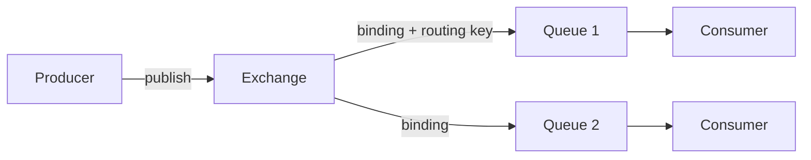

# Messaging and the AMQP model: basics

🌐 [Русский](basics.ru.md) · **English**

**Levels:** [overview](overview.en.md) · **1. Basics** · [2. Advanced](advanced.en.md) · [3. Expert](expert.en.md) · [4. Quiz](quiz.en.md)

**Prerequisites:** [Python](../../../python/overview.en.md) basics · **Time:** ~1.5 h

## How the code was checked

Every example ran against a **real broker**: RabbitMQ 4.4.1 (Erlang 29.1.2) in Docker (`rabbitmq:4-management`) and Python with `pika` 1.5.0. Outputs are copied from those runs. The only code that was not run against the broker is marked.

pika 1.5.0 deprecates `BlockingConnection`; the replacement is `pika.Connection`, which runs its own I/O loop on a background thread and offers a blocking, thread-safe API. The examples use it.

## Why a broker

When service A calls service B directly, both must be alive at the same moment and A must wait for B. A **message broker** sits between them: A hands a message to the broker and goes on; B takes it when ready. You get:

- **Decoupling in time:** B may be down or slow; messages wait in a queue.
- **Smoothing of bursts:** a queue absorbs a spike that B processes at its own pace.
- **Fan-out:** one event may reach many consumers, none known to the producer.
- **Retry and routing logic** in one place instead of in every service.

The price is one more moving part, eventual consistency and the need to think about duplicates and loss (module 05 ([roadmap](../../overview.en.md))).

## The AMQP model



- A **producer** publishes a message to an **exchange**, never straight to a queue.
- The exchange routes it by its **type** and by **bindings** (rules linking an exchange to a queue, usually with a binding key) using the message's **routing key**.
- A **queue** stores messages until a **consumer** takes them.
- The message is a body (bytes) plus properties (content type, headers, delivery mode, …).

The model is the same for every AMQP 0-9-1 client. The **default exchange** (the nameless one, `""`) makes it feel like writing straight into a queue: it routes by queue name.

## Connection and channel

A **connection** is one long-lived TCP connection to the broker. A **channel** is a lightweight virtual connection inside it; almost all operations happen on a channel. Opening a TCP connection is expensive, a channel is cheap, so applications keep one connection and open channels from it.

```python
import pika

conn = pika.Connection(pika.ConnectionParameters("localhost"))
ch = conn.channel()
print("channel", ch.channel_number)
```

```text
channel 1
```

## First message

```python
q = ch.queue_declare(queue="hello", durable=True)
print("declare:", q.method.queue, q.method.message_count, q.method.consumer_count)
ch.basic_publish(exchange="", routing_key="hello", body=b"Hello, RabbitMQ!")
```

```text
declare: hello 0 0
```

`queue_declare` is idempotent: it creates the queue if absent and does nothing if it exists with the same arguments. The reply has the queue name, the number of ready messages and consumers. Publishing to the default exchange with `routing_key="hello"` delivers into the queue `hello`.

## Receiving: get and consume

Two ways to receive:

- **`basic_get`** — polls one message (`(None, None, None)` if the queue is empty). Simple, but inefficient.
- **`basic_consume`** — subscribes; the broker **pushes** messages to a callback.

```python
method, props, body = ch.basic_get("hello", auto_ack=False)
print("get:", body, method.delivery_tag, method.redelivered, repr(method.exchange), repr(method.routing_key))
ch.basic_ack(method.delivery_tag)
print("empty get:", ch.basic_get("hello"))
```

```text
get: b'Hello, RabbitMQ!' 1 False '' 'hello'
empty get: (None, None, None)
```

Push mode with a callback (the callback runs on a worker thread of the connection):

```python
import queue
got = queue.Queue()

def on_message(ch_, method, props, body):
    got.put(body)
    ch_.basic_ack(method.delivery_tag)

tag = ch.basic_consume("hello", on_message)
print("consumed:", [got.get(timeout=5), got.get(timeout=5)])
ch.basic_cancel(tag)
```

```text
consumed: [b'one', b'two']
```

(`one` and `two` were published beforehand.)

## Acknowledgements

After handing a message over, the broker waits for the consumer's **acknowledgement** (`basic_ack`). Until then the message is *unacknowledged*. If the consumer dies or its channel closes without acking, the broker **requeues** the message and marks it `redelivered`. This is what makes at-least-once processing possible. `auto_ack=True` skips the wait: the broker considers the message delivered at once, and a crash loses it. Details are in [module 03](../03-queues-and-delivery/overview.en.md).

## Errors close channels

An illegal operation does not raise a polite exception in the middle of the call: the broker answers with an error and **closes the channel**:

```python
ch3 = conn.channel()
try:
    ch3.queue_declare(queue="nobody", passive=True)   # passive: only check existence
except pika.exceptions.ChannelClosedByBroker as e:
    print("passive declare of missing queue:", e.reply_code, e.reply_text)
print("conn open:", conn.is_open, "channel closed:", ch3.is_closed)
```

```text
passive declare of missing queue: 404 NOT_FOUND - no queue 'nobody' in vhost '/'
conn open: True channel closed: True
```

The connection survives; the channel is dead and must be replaced. So do not share one channel between unrelated tasks, and do not use passive declares as a casual "does it exist" probe on a channel you need.

Publishing to a queue name that does not exist through the default exchange does **not** fail: the message is silently dropped (the "unroutable" case, see [module 02](../02-exchanges-and-routing/overview.en.md)).

## Queues must be durable or exclusive

> RabbitMQ 4.4 refuses to create a queue that is neither durable nor exclusive.

```python
c0 = pika.Connection(pika.ConnectionParameters("localhost"))
try:
    c0.channel().queue_declare("tmp-nd")
except pika.exceptions.ConnectionClosedByBroker as e:
    print("transient queue:", e.reply_code, e.reply_text.splitlines()[0])
```

```text
transient queue: 541 INTERNAL_ERROR - Feature `transient_nonexcl_queues` is deprecated.
```

The broker closed the **whole connection**, not just the channel. Many older tutorials declare `queue_declare("hello")` without `durable=True`; on this version that code fails. Use `durable=True` (survives a restart) or `exclusive=True` (private to one connection, deleted with it).

## Looking inside the broker

- The management UI: `http://localhost:15672` (`guest`/`guest`).
- The CLI inside the container: `docker exec rabbit rabbitmqctl list_queues name messages`.
- The HTTP API, for example `GET /api/overview`; in the run it reported `4.4.1` and Erlang `29.1.2`.

Message counts right after a publish can lag: publishing is asynchronous and the queue process updates the count a moment later. In a test of three consecutive publishes, the counts read immediately were `1 1 2`, and `3` after a second.

## Beginner mistakes

- ❌ Declaring a transient queue on 4.4 → ✅ `durable=True` or `exclusive=True`.
- ❌ Reading `message_count` right after publishing and trusting it → ✅ wait, or use confirms (module 05 ([roadmap](../../overview.en.md))).
- ❌ `auto_ack=True` for work that must not be lost → ✅ ack after processing.
- ❌ One shared channel for everything → ✅ a connection per process, channels per task or thread.
- ❌ Sending to a queue that does not exist and expecting an error → ✅ declare it first, or use `mandatory` ([module 02](../02-exchanges-and-routing/overview.en.md)).
- ❌ Leaving `guest/guest` in production → ✅ own users (module 11 ([roadmap](../../overview.en.md))).

## Related materials

- Next: [advanced theory](advanced.en.md) — properties, connection parameters, errors on publish
- Next module: [02 · Exchanges and routing](../02-exchanges-and-routing/overview.en.md)
- Parallels: [Python asyncio queues](../../../python/overview.en.md), [C# background jobs](../../../csharp/recipes/background-jobs/overview.en.md)

## Sources

- [AMQP 0-9-1 Model Explained](https://www.rabbitmq.com/tutorials/amqp-concepts)
- [Queues](https://www.rabbitmq.com/docs/queues)
- [Consumer Acknowledgements and Publisher Confirms](https://www.rabbitmq.com/docs/confirms)
- [pika: thread-safe connection](https://pika.github.io/pika/latest/modules/adapters/thread_safe/)
